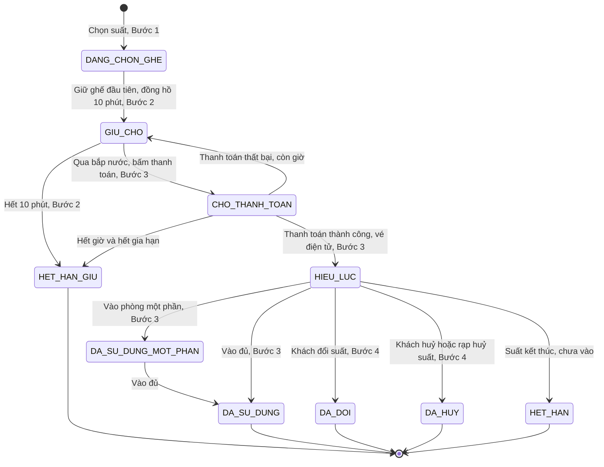
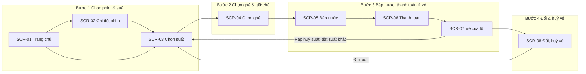

# Đề 8 · Đặt vé xem phim

> **Mã:** DE08 · **Độ khó:** 8/8 · **Vai trò:** 1 (khách xem phim) · **Nền tảng:** App khách iOS / Android

Ứng dụng đặt vé của một rạp chiếu phim, nhìn từ phía khách: chọn phim và suất, chọn ghế theo thời gian thực, thêm bắp nước, thanh toán và nhận vé điện tử dùng được cả khi mất mạng, tự đổi hoặc huỷ vé, được báo và hoàn tiền khi rạp đổi giờ hoặc huỷ suất. Rạp lập lịch, giá và soát vé trên hệ thống riêng, **ngoài phạm vi đề**. Đây là đề có **tranh chấp ghế thời gian thực** (hàng nghìn người cùng chọn một ghế), **đồng hồ giữ chỗ xuyên nhiều bước**, **vé offline** và **ràng buộc về độ tuổi**. Đề gồm **1 tính năng**, là **1 luồng** gồm 4 bước và các màn hình; tài liệu gồm 1 PRD và 1 SRS.

## Tính năng

| **Tính năng** | **Luồng** | **PRD** | **SRS** |
| --- | --- | --- | --- |
| Đặt vé xem phim | Chọn phim & suất → Chọn ghế & giữ chỗ → Bắp nước, thanh toán & vé điện tử → Đổi & huỷ vé | [PRD](docs/PRD.md) | [SRS](docs/SRS.md) |

## Các bước và màn hình của luồng

| **Bước** | **Tên bước** | **Màn hình** | **Phạm vi** |
| --- | --- | --- | --- |
| Bước 1 | Chọn phim & suất | SCR-01, SCR-02, SCR-03 | Đang chiếu, sắp chiếu, theo ngày, chi tiết phim, chọn suất, giờ kết thúc, giá từ, xác nhận độ tuổi, nhắc mở bán |
| Bước 2 | Chọn ghế & giữ chỗ | SCR-04 | Sơ đồ ghế thời gian thực, giữ ghế khi chạm, đồng hồ 10 phút, ghế đôi, chọn nhanh, quy tắc ghế lẻ |
| Bước 3 | Bắp nước, thanh toán & vé điện tử | SCR-05, SCR-06, SCR-07 | Combo, ví / thẻ / QR, gia hạn khi chờ cổng, hoàn tự động, vé QR offline, nhận bắp nước, vào phòng, nhắc giờ chiếu |
| Bước 4 | Đổi & huỷ vé | SCR-08 | Điều kiện, đổi suất, trả chênh lệch, huỷ và hoàn tiền, rạp đổi giờ, rạp huỷ suất, ghế bị khoá |

Luồng: Bước 1 Chọn phim & suất → Bước 2 Chọn ghế & giữ chỗ → Bước 3 Bắp nước, thanh toán & vé điện tử → Bước 4 Đổi & huỷ vé.

## Vòng đời đặt vé (dùng chung cả đề)



Song song: **mỗi ghế** của suất có trạng thái `TRONG`, `DANG_GIU`, `DA_BAN`, `KHONG_BAN` (Bước 2). Suất chiếu, giá vé do rạp lập; khách thấy kết quả (Bước 1) và được báo khi rạp đổi giờ, huỷ suất (Bước 4).

## Bản đồ màn hình



## Bối cảnh chung

Rạp có 6–10 phòng, 40–80 suất mỗi ngày. Ngày khởi chiếu phim hot, hàng nghìn người cùng mở một sơ đồ ghế; giờ cao điểm, 200 người vào một phòng trong 10 phút với mạng trong rạp chập chờn. Khách cần chọn được ghế đẹp, trả tiền nhanh, không bị trừ hai lần, vào phòng không kẹt, đổi hoặc huỷ dễ khi bận. Bài toán thiết kế chính là **cho khách thấy đúng một sự thật về ghế và vé**, cả khi nhiều người cùng chọn và cả khi mất mạng.

| **Nhóm người dùng** | **Nhu cầu chính** |
| --- | --- |
| Nhóm bạn, gia đình | Ghế liền nhau, bắp nước, vé chung một QR, vào phòng lệch giờ được |
| Người hâm mộ phim | Đặt ngay ngày mở bán, chọn ghế đẹp trước người khác |
| Khách bận việc | Đổi suất, huỷ vé trong app, biết rõ tiền |

Ngoài phạm vi cả đề: hệ thống quản lý rạp (phim, phòng, sơ đồ ghế, lịch chiếu, bảng giá, huỷ suất), thiết bị soát vé và quầy bắp nước của nhân viên, chuỗi nhiều rạp, bán vé tại quầy, tiền mặt, mã giảm giá, thẻ thành viên, điểm thưởng, đánh giá phim, ghế dành cho xe lăn, hoá đơn VAT.

## Quy ước dùng chung

- Màn hình mã `SCR-..` (App khách).
- Tiền tệ VND, không có số lẻ; giá làm tròn tới 1.000 ₫.
- Phân loại phim theo quy định phổ biến phim hiện hành: P, K, T13, T16, T18 (mốc tuổi là cấu hình).
- Mọi giờ là giờ Việt Nam; giờ kết thúc suất = giờ bắt đầu + 15 phút quảng cáo + thời lượng phim.
- Khách đăng nhập bằng số điện thoại và OTP theo luồng chuẩn, không mô tả trong bộ tài liệu này.
- Mã BR, MSG, UC đánh số liên tục trong cả đề: Bước 1 dùng BR-01–11, MSG-01–06, UC-01–02; Bước 2 dùng BR-12–23, MSG-07–15, UC-03; Bước 3 dùng BR-24–35, MSG-16–25, UC-04–06; Bước 4 dùng BR-36–41, MSG-26–32, UC-07–09.

## Danh sách màn hình

| **Mã** | **Màn hình** | **Mô tả chi tiết ở** |
| --- | --- | --- |
| SCR-01 | Trang chủ | Bước 1 |
| SCR-02 | Chi tiết phim | Bước 1 |
| SCR-03 | Chọn suất chiếu | Bước 1 |
| SCR-04 | Chọn ghế | Bước 2 |
| SCR-05 | Bắp nước | Bước 3 |
| SCR-06 | Thanh toán | Bước 3 |
| SCR-07 | Vé của tôi & vé điện tử | Bước 3 |
| SCR-08 | Đổi suất / Huỷ vé | Bước 4 |

## Cấu trúc repo

```text
de08-dat-ve-xem-phim/
├── README.md
└── docs/
    ├── PRD.md    Bối cảnh, phạm vi, luồng, use case theo từng bước
    └── SRS.md    Quy tắc, trạng thái, use case, màn hình, API, thông báo theo từng bước
```

## Cách dùng bộ tài liệu

1. Đọc README để nắm vòng đời đặt vé và trạng thái ghế.
2. Đọc PRD để nắm toàn bộ tính năng và luồng, rồi đọc SRS theo từng bước của luồng.
3. Đặc biệt chú ý các tình huống tranh chấp và lỗi: hai người chọn cùng ghế, hết giờ giữ chỗ khi đang thanh toán, mở vé khi mất mạng, rạp đổi giờ hoặc huỷ suất.
4. Thiết kế màn hình theo đúng mã SCR, mã MSG trong SRS để dễ đối chiếu khi review.
5. Sơ đồ viết bằng Mermaid, xem trực tiếp trên GitHub hoặc trình xem Markdown có hỗ trợ Mermaid.
