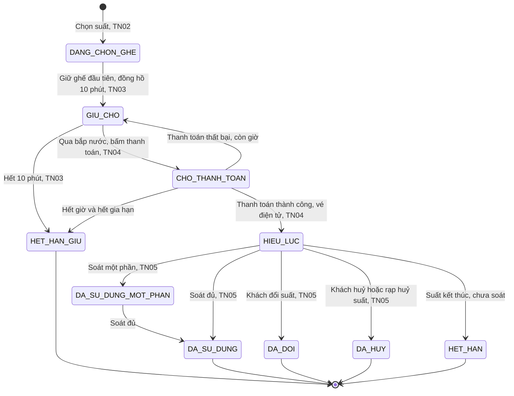
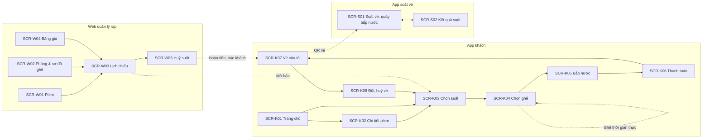

# Đề 8 · Đặt vé xem phim

> **Mã:** DE08 · **Độ khó:** 8/8 · **Vai trò:** 3 (khách, nhân viên rạp, quản lý rạp) · **Nền tảng:** App khách iOS / Android · Web quản lý rạp · App soát vé (thiết bị cầm tay)

Hệ thống đặt vé cho một rạp chiếu phim: quản lý rạp lập lịch chiếu và giá vé; khách chọn phim, suất, ghế theo thời gian thực, thêm bắp nước, thanh toán và nhận vé điện tử; nhân viên soát vé ở cửa phòng chiếu, kể cả khi mất mạng; khách tự đổi, huỷ vé; rạp huỷ suất và hoàn tiền tự động. Đây là đề có **tranh chấp tài nguyên thời gian thực** (hàng nghìn người cùng chọn một ghế), **đồng hồ giữ chỗ xuyên nhiều bước**, **hoạt động offline** và **ràng buộc pháp lý về độ tuổi**. Đề gồm 5 tính năng; mỗi tính năng có 1 PRD và 1 SRS riêng.

## Tính năng

| **Mã** | **Tính năng** | **Phạm vi** | **PRD** | **SRS** |
| --- | --- | --- | --- | --- |
| TN01 | Lịch chiếu, phòng chiếu & giá vé | Phim, sơ đồ ghế, khoá ghế, lưới lịch, kiểm tra chồng lấn, nhân bản, mở bán, bảng giá (Web quản lý) | [PRD](docs/TN01-lich-chieu-gia-ve/PRD.md) | [SRS](docs/TN01-lich-chieu-gia-ve/SRS.md) |
| TN02 | Chọn phim & suất | Đang chiếu, sắp chiếu, theo ngày, chi tiết phim, chọn suất, xác nhận độ tuổi, nhắc mở bán | [PRD](docs/TN02-chon-phim-suat/PRD.md) | [SRS](docs/TN02-chon-phim-suat/SRS.md) |
| TN03 | Chọn ghế & giữ chỗ | Sơ đồ ghế thời gian thực, giữ ghế khi chạm, đồng hồ 10 phút, ghế đôi, chọn nhanh, quy tắc ghế lẻ | [PRD](docs/TN03-chon-ghe-giu-cho/PRD.md) | [SRS](docs/TN03-chon-ghe-giu-cho/SRS.md) |
| TN04 | Bắp nước, thanh toán & vé điện tử | Combo, ví / thẻ / QR, gia hạn khi chờ cổng, hoàn tự động, vé QR offline, nhận bắp nước, nhắc giờ chiếu | [PRD](docs/TN04-bap-nuoc-thanh-toan/PRD.md) | [SRS](docs/TN04-bap-nuoc-thanh-toan/SRS.md) |
| TN05 | Soát vé, đổi & huỷ vé | App soát vé, soát từng phần, kiểm tra tuổi, offline; khách đổi suất, huỷ; rạp huỷ suất | [PRD](docs/TN05-soat-ve-doi-huy/PRD.md) | [SRS](docs/TN05-soat-ve-doi-huy/SRS.md) |

Thứ tự làm gợi ý: TN01 → TN02 → TN03 → TN04 → TN05.

## Vòng đời đặt vé (dùng chung cả đề)



Song song: **suất chiếu** có vòng đời `NHAP` → `MO_BAN` → `DANG_CHIEU` → `DA_CHIEU` hoặc `DA_HUY` (TN01); **mỗi ghế** của suất có trạng thái `TRONG`, `DANG_GIU`, `DA_BAN`, `KHONG_BAN` (TN03).

## Bản đồ màn hình



## Bối cảnh chung

Rạp có 6–10 phòng, 40–80 suất mỗi ngày. Ngày khởi chiếu phim hot, hàng nghìn người cùng mở một sơ đồ ghế; giờ cao điểm, 200 người vào một phòng trong 10 phút với mạng trong rạp chập chờn. Khách cần chọn được ghế đẹp, trả tiền nhanh, không bị trừ hai lần, vào phòng không kẹt. Rạp cần lịch không trùng, giá đúng, không bán trùng ghế, không để ghế lẻ, tuân thủ phân loại phim theo độ tuổi. Bài toán thiết kế chính là **giữ đúng một sự thật về ghế và vé** giữa nhiều người dùng, nhiều thiết bị, cả khi mất mạng.

| **Nhóm người dùng** | **Nhu cầu chính** |
| --- | --- |
| Khách (nhóm bạn, gia đình, người hâm mộ phim) | Chọn suất theo giờ rảnh, ghế liền nhau, bắp nước, vé dùng được offline, đổi khi bận |
| Nhân viên soát vé, quầy bắp nước | Quét nhanh, kết quả rõ, chạy khi mất mạng, kiểm tra tuổi |
| Quản lý rạp | Lập lịch nhanh, không chồng lấn, giá theo quy tắc, xử lý sự cố một lần |

Ngoài phạm vi cả đề: chuỗi nhiều rạp, bán vé tại quầy, tiền mặt, mã giảm giá, thẻ thành viên, điểm thưởng, quản lý kho bắp nước, đánh giá phim, ghế dành cho xe lăn, cổng soát tự động, hoá đơn VAT.

## Quy ước dùng chung

- Màn App khách mã `SCR-K..`, Web quản lý `SCR-W..`, App soát vé `SCR-S..`.
- Tiền tệ VND, không có số lẻ; giá làm tròn tới 1.000 ₫.
- Phân loại phim theo quy định phổ biến phim hiện hành: P, K, T13, T16, T18 (mốc tuổi là cấu hình).
- Mọi giờ là giờ Việt Nam; giờ kết thúc suất = giờ bắt đầu + 15 phút quảng cáo + thời lượng phim.
- Khách đăng nhập bằng số điện thoại và OTP theo luồng chuẩn, không mô tả trong bộ tài liệu này.
- Mã BR, MSG, UC đánh số liên tục trong cả đề: TN01 dùng BR-01–12, MSG-01–08, UC-01–03; TN02 dùng BR-13–21, MSG-09–14, UC-04–05; TN03 dùng BR-22–33, MSG-15–23, UC-06; TN04 dùng BR-34–45, MSG-24–33, UC-07–09; TN05 dùng BR-46–58, MSG-34–44, UC-10–12.

## Danh sách màn hình

| **Mã** | **Màn hình** | **Nền tảng** | **Mô tả chi tiết ở** |
| --- | --- | --- | --- |
| SCR-W01 | Phim | Web quản lý | SRS TN01 |
| SCR-W02 | Phòng chiếu & sơ đồ ghế | Web quản lý | SRS TN01 |
| SCR-W03 | Lịch chiếu | Web quản lý | SRS TN01 |
| SCR-W04 | Bảng giá | Web quản lý | SRS TN01 |
| SCR-K01 | Trang chủ | App khách | SRS TN02 |
| SCR-K02 | Chi tiết phim | App khách | SRS TN02 |
| SCR-K03 | Chọn suất chiếu | App khách | SRS TN02 |
| SCR-K04 | Chọn ghế | App khách | SRS TN03 |
| SCR-K05 | Bắp nước | App khách | SRS TN04 |
| SCR-K06 | Thanh toán | App khách | SRS TN04 |
| SCR-K07 | Vé của tôi & vé điện tử | App khách | SRS TN04 |
| SCR-S01 | Soát vé (và chế độ Quầy bắp nước) | App soát vé | SRS TN05 |
| SCR-S02 | Kết quả soát | App soát vé | SRS TN05 |
| SCR-K08 | Đổi suất / Huỷ vé | App khách | SRS TN05 |
| SCR-W05 | Huỷ suất chiếu | Web quản lý | SRS TN05 |

## Cấu trúc repo

```text
de08-dat-ve-xem-phim/
├── README.md
└── docs/
    ├── TN01-lich-chieu-gia-ve/     PRD.md · SRS.md
    ├── TN02-chon-phim-suat/        PRD.md · SRS.md
    ├── TN03-chon-ghe-giu-cho/      PRD.md · SRS.md
    ├── TN04-bap-nuoc-thanh-toan/   PRD.md · SRS.md
    └── TN05-soat-ve-doi-huy/       PRD.md · SRS.md
```

## Cách dùng bộ tài liệu

1. Đọc README để nắm ba vòng đời: suất chiếu, ghế, đặt vé.
2. Với mỗi tính năng: đọc PRD, rồi SRS. Thiết kế đủ **ba nền tảng**: Web quản lý (màn hình lớn, thao tác nhiều), App khách (điện thoại, đồng hồ giữ chỗ), App soát vé (một tay, môi trường tối, ồn).
3. Đặc biệt chú ý các tình huống tranh chấp và lỗi: hai người chọn cùng ghế, hết giờ giữ chỗ khi đang thanh toán, soát vé khi mất mạng, rạp huỷ suất.
4. Thiết kế màn hình theo đúng mã SCR, mã MSG trong SRS để dễ đối chiếu khi review.
5. Sơ đồ viết bằng Mermaid, xem trực tiếp trên GitHub hoặc trình xem Markdown có hỗ trợ Mermaid.
