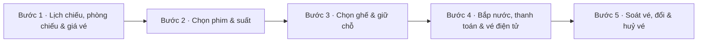
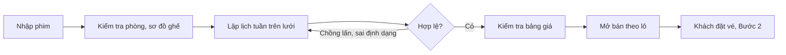
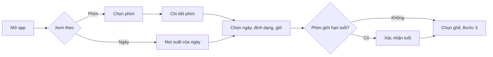
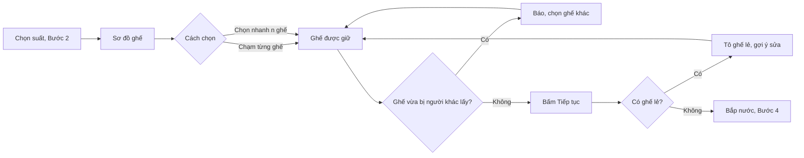
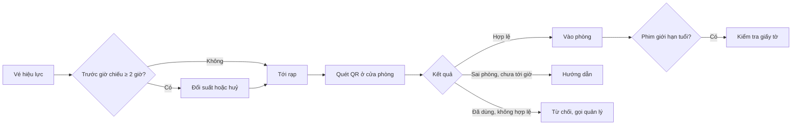

> **Mã:** DE08-PRD · **Trạng thái:** đã chốt · **Người viết:** Design · **SRS:** [SRS.md](SRS.md)

# PRD Đặt vé xem phim

> Đề gồm **1 tính năng**, là **1 luồng** gồm 5 bước và các màn hình: Lịch chiếu, phòng chiếu & giá vé → Chọn phim & suất → Chọn ghế & giữ chỗ → Bắp nước, thanh toán & vé điện tử → Soát vé, đổi & huỷ vé. Sơ đồ chung xem [README](../README.md).

## 1. Bối cảnh và vấn đề

### 1.1 Bối cảnh

Hệ thống đặt vé cho một rạp chiếu phim: quản lý rạp lập lịch chiếu và giá vé; khách chọn phim, suất, ghế theo thời gian thực, thêm bắp nước, thanh toán và nhận vé điện tử; nhân viên soát vé ở cửa phòng chiếu, kể cả khi mất mạng; khách tự đổi, huỷ vé; rạp huỷ suất và hoàn tiền tự động. Đây là đề có **tranh chấp tài nguyên thời gian thực** (hàng nghìn người cùng chọn một ghế), **đồng hồ giữ chỗ xuyên nhiều bước**, **hoạt động offline** và **ràng buộc pháp lý về độ tuổi**.

Rạp có 6–10 phòng, 40–80 suất mỗi ngày. Ngày khởi chiếu phim hot, hàng nghìn người cùng mở một sơ đồ ghế; giờ cao điểm, 200 người vào một phòng trong 10 phút với mạng trong rạp chập chờn. Khách cần chọn được ghế đẹp, trả tiền nhanh, không bị trừ hai lần, vào phòng không kẹt. Rạp cần lịch không trùng, giá đúng, không bán trùng ghế, không để ghế lẻ, tuân thủ phân loại phim theo độ tuổi. Bài toán thiết kế chính là **giữ đúng một sự thật về ghế và vé** giữa nhiều người dùng, nhiều thiết bị, cả khi mất mạng.

### 1.2 Vấn đề

| **Vấn đề** | **Hệ quả** |
| --- | --- |
| Lập lịch bằng bảng tính, xếp chồng hai suất một phòng | Bán trùng, phải huỷ suất, hoàn tiền |
| Quên tính thời gian quảng cáo và dọn phòng | Suất sau bắt đầu trễ, khách phàn nàn |
| Giá vé nhiều tầng (định dạng, khung giờ, ngày, loại ghế) khó kiểm soát | Bán sai giá |
| Ghế hỏng vẫn bán | Khách tới không có chỗ ngồi |
| Không thấy trước lịch của cả tuần theo phòng | Phòng trống giờ vàng, phim hot thiếu suất |
| Muốn xem "tối nay 8 giờ" nhưng phải mở từng phim để xem suất | Mất thời gian, bỏ cuộc |
| Không biết suất nào còn ghế đẹp | Chọn suất rồi mới thấy chỉ còn hàng đầu |
| Không thấy rõ 2D, 3D, IMAX, phụ đề hay lồng tiếng | Mua nhầm định dạng |
| Không biết phim T16, T18 bị kiểm tra tuổi | Bị từ chối ở cửa, mất tiền |
| Phim sắp chiếu chưa mở bán, phải nhớ quay lại | Mất suất đẹp ngày đầu |
| Hai người chọn cùng ghế, cả hai thanh toán | Bán trùng, phải hoàn tiền, khách giận |
| Ghế bị giữ mãi bởi người chọn rồi bỏ đi | Người khác không mua được dù ghế thực ra trống |
| Khách chọn chừa một ghế trống lẻ giữa nhóm | Ghế lẻ khó bán, rạp mất doanh thu |
| Sơ đồ nhỏ trên điện thoại, chạm nhầm ghế | Chọn sai ghế, mất thời gian |
| Không biết còn bao lâu để thanh toán | Hết giờ giữ khi đang nhập thẻ |
| Đồng hồ giữ chỗ hết khi đang nhập thẻ | Mất ghế, khách bực |
| Thanh toán xong màn hình treo, không biết thành công chưa | Thanh toán lại, bị trừ 2 lần |
| Đặt bắp nước online nhưng tới quầy vẫn phải xếp hàng mua | Không thấy lợi ích của đặt trước |
| Vé chỉ có trong email, mất mạng ở rạp không mở được | Kẹt ở cửa phòng chiếu |
| Không nhớ giờ chiếu, tới trễ | Lỡ đầu phim |
| Soát vé chậm, khách xếp hàng, vào trễ | Phim bắt đầu khi phòng còn đang vào |
| Mạng yếu, máy soát không kiểm tra được vé | Cho vào bừa hoặc chặn nhầm |
| Một vé chụp màn hình dùng hai lần | Mất doanh thu, tranh chấp ghế |
| Nhóm 4 người, 1 người tới trễ | Không biết cho vào thế nào |
| Không kiểm tra tuổi với phim T16, T18 | Vi phạm quy định phổ biến phim |
| Khách muốn đổi suất phải ra quầy | Mất thời gian, quầy đông |
| Rạp huỷ suất, phải gọi từng khách | Chậm, sót khách |

### 1.3 Mục tiêu

- 0 suất chiếu trùng phòng được mở bán.
- Thời gian lập lịch một tuần cho một rạp ≤ 2 giờ.
- 0 vé bán sai giá so với bảng giá có hiệu lực.
- ≥ 45% phiên mở app tới bước chọn ghế.
- Thời gian từ mở app tới chọn xong suất ≤ 45 giây (trung vị).
- Vé bị từ chối ở cửa vì độ tuổi ≤ 0,1%.
- 0 ghế bán trùng.
- Thời gian chọn ghế trung vị ≤ 40 giây.
- Tỉ lệ ghế trống lẻ (bị kẹp) khi suất bắt đầu giảm 50%.
- Tỉ lệ thanh toán thành công / phiên tới màn thanh toán ≥ 85%.
- ≥ 30% đơn có bắp nước đặt trước.
- 100% vé mở được khi không có mạng.
- Thời gian soát trung vị ≤ 3 giây mỗi lượt quét.
- 0 vé dùng hai lần khi thiết bị có mạng.
- ≥ 80% đổi, huỷ vé tự làm trong app.
- 100% khách của suất bị huỷ được báo và hoàn tiền tự động trong 15 phút.

## 2. Người dùng

| **Nhóm** | **Nhu cầu với tính năng này** |
| --- | --- |
| Quản lý rạp | Lập lịch nhanh theo dạng lưới phòng × giờ, hệ thống tự kiểm tra trùng; Bảng giá theo quy tắc, xem trước giá của một suất; Huỷ suất một lần, hệ thống tự báo và hoàn tiền |
| Kỹ thuật rạp | Khoá ghế hỏng, mở lại khi sửa xong |
| Nhóm bạn trẻ | Xem nhanh suất tối nay của mọi phim; phim mới, hot |
| Gia đình có trẻ nhỏ | Biết phim nào phù hợp trẻ em, suất ban ngày |
| Người hâm mộ phim | Nhắc khi mở bán phim sắp chiếu, chọn IMAX |
| Nhóm bạn 3–6 người | Ghế liền nhau, chọn nhanh |
| Cặp đôi | Ghế đôi |
| Khách đặt ngày đầu phim hot | Biết ngay ghế nào vừa bị người khác lấy |
| Khách lớn tuổi | Sơ đồ to, dễ chạm, có chọn nhanh |
| Khách đi xem cuối tuần | Combo bắp nước rẻ hơn mua lẻ, nhận nhanh |
| Khách đặt phút chót | Thanh toán nhanh bằng ví, QR |
| Khách ở rạp mạng yếu | Mở vé không cần mạng |
| Nhân viên soát vé | Quét nhanh, kết quả rõ bằng màu và âm thanh, chạy cả khi mất mạng |
| Khách | Vào nhanh; nhóm tới lệch giờ vẫn vào được |
| Khách bận việc | Đổi suất, huỷ vé trong app |

## 3. Phạm vi

### 3.1 Trong phạm vi (MVP)

**Bước 1 · Lịch chiếu, phòng chiếu & giá vé**

- Phim: thông tin, thời lượng, phân loại độ tuổi, định dạng, ngày khởi chiếu, trạng thái.
- Phòng chiếu: định dạng hỗ trợ, sơ đồ ghế (hàng, cột, lối đi, loại ghế: thường, VIP, đôi), khoá ghế.
- Lịch chiếu: tạo suất trên lưới phòng × giờ, tự tính giờ kết thúc, kiểm tra chồng lấn, nhân bản lịch, mở bán theo lô.
- Bảng giá: giá cơ bản theo định dạng, hệ số khung giờ và loại ngày, phụ thu loại ghế; xem trước giá.

**Bước 2 · Chọn phim & suất**

- Trang chủ: Đang chiếu, Sắp chiếu; banner phim nổi bật.
- Xem theo ngày: mọi suất của một ngày, nhóm theo phim.
- Chi tiết phim: trailer, thông tin, phân loại độ tuổi giải thích rõ.
- Chọn suất: ngày, định dạng, ngôn ngữ, giờ; mức ghế còn trống; giá từ.
- Xác nhận độ tuổi với phim T13, T16, T18; lưu ý K.
- Nhắc khi mở bán cho phim sắp chiếu.
- Tìm phim theo tên.

**Bước 3 · Chọn ghế & giữ chỗ**

- Sơ đồ ghế theo thời gian thực: trống, đang giữ, đã bán, không bán, đang chọn.
- Chọn, bỏ chọn ghế; ghế đôi theo cặp; tối đa 8 ghế.
- Giữ ghế 10 phút cho cả quá trình đặt; đếm ngược luôn hiện.
- Quy tắc không để ghế trống lẻ.
- Chọn nhanh n ghế đẹp liền nhau.
- Phóng to, kéo sơ đồ; chú thích loại ghế và giá.

**Bước 4 · Bắp nước, thanh toán & vé điện tử**

- Chọn combo, món lẻ, tuỳ chọn vị; bỏ qua được.
- Tóm tắt đơn: vé, bắp nước, tổng.
- Thanh toán: ví liên kết, thẻ qua cổng thanh toán, QR chuyển khoản.
- Xử lý kết quả, thất bại, tiền về trễ.
- Vé điện tử: QR, thông tin suất, ghế, bắp nước; lưu offline; email; thêm vào lịch.
- Nhận bắp nước tại quầy bằng QR vé.
- Nhắc trước giờ chiếu.

**Bước 5 · Soát vé, đổi & huỷ vé**

- App soát vé: chọn phòng, quét QR hoặc nhập mã, kết quả, soát từng phần, kiểm tra độ tuổi, chế độ offline.
- Khách đổi suất (cùng phim), huỷ vé có phí, trong thời hạn.
- Rạp huỷ suất (Web quản lý): hoàn tiền tự động, thông báo.
- Xử lý vé ảnh hưởng do đổi giờ suất, khoá ghế (Bước 1).

### 3.2 Ngoài phạm vi

- Nhiều rạp trong một chuỗi, phân phối phim, hợp đồng với nhà phát hành.
- Tự động xếp lịch tối ưu bằng thuật toán → phase sau.
- Khuyến mãi, mã giảm giá, thẻ thành viên.
- Nhiều rạp, chọn rạp gần nhất → phase sau.
- Đánh giá, bình luận phim.
- Gợi ý phim cá nhân hoá.
- Đặt vé nhóm, chia tiền.
- Ghế dành cho xe lăn, khu vực đặc biệt → phase sau.
- Chọn ghế cùng bạn bè trên nhiều điện thoại.
- Đổi ghế sau khi đã thanh toán (làm tại quầy).
- Mã giảm giá, điểm thành viên, thẻ quà tặng.
- Thanh toán tiền mặt (chỉ tại quầy, ngoài phạm vi app).
- Giao bắp nước tới ghế.
- Xuất hoá đơn VAT.
- Cổng soát tự động (barrier).
- Đổi sang phim khác, đổi ghế trong app.
- Hoàn tiền bằng điểm, voucher.
- Bán vé tại quầy (dùng hệ thống quầy riêng).

## 4. Nguyên tắc sản phẩm

### 4.1 Hệ thống không cho xếp sai

Chồng lấn phòng, suất ngoài giờ hoạt động, phim chưa khởi chiếu đều bị chặn ngay khi kéo thả, không đợi lưu.

### 4.2 Giá là quy tắc, không phải nhập tay từng suất

Quản lý đặt quy tắc một lần; giá từng suất tự sinh và xem trước được.

### 4.3 Thay đổi sau khi mở bán phải thận trọng

Suất đã bán vé chỉ được đổi giờ ít, hoặc huỷ theo quy trình hoàn tiền (Bước 5).

### 4.4 Thời gian là trục chính

Khách nghĩ theo "khi nào rảnh"; xem theo ngày và giờ phải nhanh như xem theo phim.

### 4.5 Định dạng và độ tuổi không được nhầm

Nhãn 2D / 3D / IMAX, Phụ đề / Lồng tiếng, và phân loại tuổi luôn đi kèm suất, không nằm trong chi tiết ẩn.

### 4.6 Báo trước những gì có thể làm hỏng buổi xem

Phim giới hạn tuổi được xác nhận trước khi chọn ghế.

### 4.7 Chạm là giữ

Ghế được giữ ngay khi khách chạm; người khác thấy ghế chuyển "đang giữ" trong vài giây. Không có bán trùng.

### 4.8 Thời gian luôn hiện

Đồng hồ giữ chỗ đi theo khách qua các bước chọn ghế, bắp nước, thanh toán.

### 4.9 Giúp khách chọn tốt, không chỉ trích

Quy tắc ghế lẻ được giải thích bằng hình (tô ghế bị bỏ lẻ) và gợi ý cách sửa.

### 4.10 Đồng hồ là đồng minh

Đồng hồ giữ chỗ hiện rõ ở mọi bước; khi khách đã sang cổng thanh toán, hệ thống chờ kết quả thay vì nhả ghế.

### 4.11 Thanh toán một lần là một lần

Không bao giờ trừ tiền hai lần cho một đơn; tiền về trễ thì tự hoàn.

### 4.12 Vé dùng được ở mọi nơi

Vé lưu trên máy, mở offline, tăng độ sáng khi hiện QR.

### 4.13 Một cái nhìn là đủ

Kết quả soát: màn hình đổi màu toàn bộ (xanh, vàng, đỏ), âm thanh khác nhau, chữ lớn; nhân viên không cần đọc kỹ.

### 4.14 Không mạng vẫn soát được

Vé được ký số và tải trước; mất mạng vẫn kiểm tra được, đồng bộ khi có mạng.

### 4.15 Chính sách rõ trước khi khách quyết định

Màn đổi, huỷ hiện phí, số tiền hoàn, thời gian nhận tiền trước khi xác nhận.

### 4.16 Lỗi của rạp, rạp chịu

Rạp huỷ suất hoặc đổi giờ → hoàn 100% hoặc đổi miễn phí, không cần khách yêu cầu.

## 5. Quy tắc nghiệp vụ

| **Quy tắc** | **Giá trị** |
| --- | --- |
| Phân loại độ tuổi | P, K, T13, T16, T18 (phim C không được nhập) |
| Định dạng | 2D, 3D, IMAX; phòng chỉ chiếu định dạng mình hỗ trợ |
| Thời gian một suất | Thời lượng phim + 15 phút quảng cáo; sau suất cần 15 phút dọn phòng |
| Giờ hoạt động | Suất đầu bắt đầu từ 08:00; suất cuối bắt đầu trước 23:30 |
| Mở bán | Theo lô, sớm nhất 14 ngày trước ngày chiếu |
| Loại ghế | Thường, VIP, Đôi (bán theo cặp) |
| Sửa suất đã có vé | Đổi giờ tối đa ±30 phút, báo khách; không đổi phòng, phim |
| Đang chiếu | Phim có suất mở bán trong 7 ngày tới |
| Sắp chiếu | Phim có ngày khởi chiếu trong tương lai |
| Dải ngày | 7 ngày từ hôm nay; ngày không có suất làm mờ |
| Mức ghế trống | Còn nhiều (> 50%), Còn ít (20–50%), Sắp hết (< 20%), Hết vé |
| Bán online | Tới giờ bắt đầu suất |
| Phân loại tuổi | P mọi lứa tuổi · K dưới 13 tuổi cần đi cùng cha mẹ, người giám hộ · T13, T16, T18 từ đủ 13, 16, 18 tuổi |
| Số ghế tối đa | 8 mỗi lần đặt (ghế đôi tính là 2) |
| Thời gian giữ | 10 phút từ ghế đầu tiên; + tối đa 5 phút khi đang chờ kết quả thanh toán |
| Phiên giữ chỗ | 1 phiên đang mở mỗi khách |
| Ghế đôi | Chọn, bỏ theo cặp |
| Ghế lẻ | Không được tạo ra một ghế trống lẻ liền kề ghế mình chọn |
| Cập nhật sơ đồ | ≤ 2 giây |
| Bắp nước | Mỗi món 0–10; combo có tuỳ chọn vị bắp và nước |
| Phương thức | Ví liên kết, thẻ nội địa và quốc tế qua cổng thanh toán, QR chuyển khoản |
| Thời gian thanh toán | Trong đồng hồ giữ chỗ; gia hạn tối đa 5 phút khi đang chờ kết quả cổng (Bước 3) |
| Tiền về sau khi mất ghế | Hoàn tự động ≤ 1 ngày làm việc |
| Nhận bắp nước | Từ 60 phút trước giờ chiếu tới khi suất kết thúc |
| Nhắc trước | 2 giờ và 30 phút trước giờ chiếu |
| Khung giờ soát | Từ 30 phút trước giờ bắt đầu tới giờ kết thúc suất |
| Soát từng phần | Đơn nhiều ghế cho vào từng nhóm người |
| Đổi suất | Cùng phim, trong 7 ngày, cùng số ghế; ≥ 2 giờ trước giờ chiếu; miễn phí 1 lần mỗi đơn |
| Huỷ vé | ≥ 2 giờ trước giờ chiếu; hoàn 90% tổng (phí huỷ 10%) |
| Rạp huỷ suất | Hoàn 100% tự động |
| Rạp đổi giờ suất | Khách đổi, huỷ miễn phí 100%, không giới hạn thời điểm |
| Không đủ tuổi | Không được vào, không hoàn tiền |

## 6. Luồng trải nghiệm

### 6.1 Toàn bộ luồng

### 6.2 Bước 1 · Lịch chiếu, phòng chiếu & giá vé

| **Bước** | **Giai đoạn** | **Trải nghiệm** | **Đầu ra** |
| --- | --- | --- | --- |
| 1 | Phim | Nhập thông tin, phân loại, định dạng | Phim sẵn sàng xếp lịch |
| 2 | Phòng | Sơ đồ ghế, khoá ghế hỏng | Phòng sẵn sàng |
| 3 | Lịch | Kéo phim vào lưới phòng × giờ; nhân bản từ tuần trước | Suất nháp |
| 4 | Giá | Quy tắc giá; xem trước giá theo suất | Giá từng suất |
| 5 | Mở bán | Chọn các suất, bấm Mở bán | Suất khách thấy được |

### 6.3 Bước 2 · Chọn phim & suất

| **Bước** | **Giai đoạn** | **Trải nghiệm** | **Đầu ra** |
| --- | --- | --- | --- |
| 1 | Khám phá | Đang chiếu, Sắp chiếu, Theo ngày | Phim hoặc ngày |
| 2 | Tìm hiểu | Trailer, tóm tắt, phân loại tuổi | Quyết định xem |
| 3 | Chọn suất | Ngày, định dạng, giờ; mức ghế trống | Suất chiếu |
| 4 | Độ tuổi | Xác nhận (nếu cần) | Sang chọn ghế |

### 6.4 Bước 3 · Chọn ghế & giữ chỗ

| **Bước** | **Giai đoạn** | **Trải nghiệm** | **Đầu ra** |
| --- | --- | --- | --- |
| 1 | Xem sơ đồ | Màn hình chiếu ở trên, loại ghế, giá | Hiểu phòng |
| 2 | Chọn | Chạm ghế, ghế đổi màu ngay; đồng hồ 10 phút bắt đầu | Ghế đang giữ |
| 3 | Kiểm tra | Quy tắc ghế lẻ, số ghế, tạm tính | Ghế hợp lệ |
| 4 | Tiếp tục | Sang bắp nước, thanh toán với đồng hồ chạy tiếp | Đơn đặt vé |

### 6.5 Bước 4 · Bắp nước, thanh toán & vé điện tử

| **Bước** | **Giai đoạn** | **Trải nghiệm** | **Đầu ra** |
| --- | --- | --- | --- |
| 1 | Bắp nước | Combo có ảnh, giá, tiết kiệm bao nhiêu | Món đặt trước |
| 2 | Thanh toán | Tóm tắt, phương thức, đồng hồ | Đơn trả tiền |
| 3 | Kết quả | Thành công to rõ | Vé |
| 4 | Ở rạp | Mở vé offline, nhận bắp nước bằng QR | Vào phòng chiếu (Bước 5) |

### 6.6 Bước 5 · Soát vé, đổi & huỷ vé

| **Bước** | **Giai đoạn** | **Khách thấy** | **Nhân viên thấy** |
| --- | --- | --- | --- |
| 1 | Trước giờ chiếu | Đổi suất, huỷ trong app | – |
| 2 | Ở cửa phòng | Mở vé, QR sáng | Camera quét |
| 3 | Kết quả | – | Màu, phim, ghế, số người, cảnh báo tuổi |
| 4 | Sự cố | Push hoàn tiền nếu rạp huỷ | Danh sách vé ảnh hưởng |

## 7. Use Cases, User Stories và Acceptance Criteria

### Bước 1 · Lịch chiếu, phòng chiếu & giá vé

#### UC1. Phim và phòng chiếu

##### US1.1 Nhập phim

AC01: Tên, tên gốc, poster, trailer, thời lượng, thể loại, đạo diễn, diễn viên, tóm tắt, phân loại độ tuổi, định dạng, ngày khởi chiếu.

AC02: Phim chưa đủ thông tin bắt buộc → không xếp lịch được.

##### US1.2 Sơ đồ ghế

User Story: Là quản lý rạp, tôi muốn vẽ sơ đồ ghế giống thực tế để khách chọn đúng chỗ.

AC01: Lưới hàng (A–Z) × cột; đánh dấu lối đi, loại ghế; ghế đôi chiếm 2 ô liền nhau.

AC02: Xem trước như khách thấy.

AC03: Phòng đã có suất mở bán → không sửa cấu trúc sơ đồ, chỉ khoá, mở khoá ghế.

##### US1.3 Khoá ghế hỏng

AC01: Khoá một ghế cho một khoảng thời gian hoặc tới khi mở lại; ghế đã bán trong khoảng đó được liệt kê để xử lý.

#### UC2. Lập lịch

##### US2.1 Xếp suất

User Story: Là quản lý rạp, tôi muốn kéo phim vào lưới và hệ thống báo ngay nếu chồng lấn.

AC01: Lưới theo ngày: hàng là phòng, cột là giờ; thẻ suất dài theo thời lượng + quảng cáo, có vùng dọn phòng.

AC02: Chồng lấn, định dạng không hỗ trợ, ngoài giờ hoạt động, trước ngày khởi chiếu (trừ suất đánh dấu Chiếu sớm) → chặn, nêu lý do.

AC03: Nhân bản lịch một ngày hoặc một tuần sang ngày khác.

##### US2.2 Mở bán

AC01: Chọn nhiều suất nháp, bấm Mở bán; chỉ suất hợp lệ và có giá mới được mở.

AC02: Suất đã mở bán hiện trên app khách trong ≤ 1 phút.

##### US2.3 Sửa suất

AC01: Suất chưa có vé: sửa tự do.

AC02: Suất đã có vé: chỉ đổi giờ ±30 phút, hệ thống báo khách đã mua; muốn đổi nhiều hơn phải huỷ suất (Bước 5).

#### UC3. Bảng giá

AC01: Giá cơ bản theo định dạng; hệ số theo khung giờ và loại ngày; phụ thu theo loại ghế.

AC02: Khai báo ngày lễ.

AC03: Xem trước giá từng loại ghế của một suất bất kỳ.

AC04: Thay đổi bảng giá có ngày hiệu lực; vé đã bán giữ giá cũ.

### Bước 2 · Chọn phim & suất

#### UC4. Khám phá phim

##### US4.1 Xem phim đang chiếu

AC01: Lưới poster: tên, phân loại tuổi, thời lượng, định dạng có sẵn.

AC02: Tab Sắp chiếu: ngày khởi chiếu, nút "Nhắc tôi khi mở bán".

AC03: Tìm phim theo tên, không dấu.

##### US4.2 Xem theo ngày

User Story: Là người rảnh tối nay, tôi muốn thấy mọi suất sau 19 giờ của mọi phim.

AC01: Chọn ngày; danh sách phim, mỗi phim có các suất của ngày đó.

AC02: Lọc khung giờ: Sáng, Chiều, Tối; lọc định dạng.

#### UC5. Chọn suất

##### US5.1 Chọn đúng suất

AC01: Dải 7 ngày; ngày không có suất làm mờ.

AC02: Suất nhóm theo định dạng và ngôn ngữ, ví dụ "2D Phụ đề", "IMAX Lồng tiếng".

AC03: Mỗi suất: giờ bắt đầu, giờ kết thúc dự kiến, mức ghế trống, giá từ.

AC04: Suất hết vé không chọn được; suất đã bắt đầu không hiện.

#### UC6. Độ tuổi

##### US6.1 Không bị từ chối ở cửa

User Story: Là khách 15 tuổi, tôi muốn biết trước phim T16 không xem được.

AC01: Nhãn phân loại có giải thích khi chạm.

AC02: Chọn suất phim T13, T16, T18 → popup xác nhận đủ tuổi và mang giấy tờ tuỳ thân; với K → lưu ý đi cùng cha mẹ.

AC03: Hồ sơ có ngày sinh chưa đủ tuổi → không cho đặt, nói rõ lý do.

#### UC7. Nhắc mở bán

AC01: Bật nhắc cho phim sắp chiếu; push khi suất đầu tiên được mở bán.

### Bước 3 · Chọn ghế & giữ chỗ

#### UC8. Chọn ghế

##### US8.1 Chọn ghế liền nhau cho nhóm

User Story: Là người đặt cho nhóm 4 bạn, tôi muốn chọn 4 ghế liền nhau ở giữa phòng thật nhanh.

AC01: Sơ đồ có màn hình chiếu, chú thích loại ghế và giá.

AC02: Chạm ghế trống → ghế chuyển "đang chọn" ngay; chạm lại để bỏ.

AC03: "Chọn nhanh": nhập số ghế → hệ thống chọn n ghế liền nhau tốt nhất còn trống.

AC04: Ghế đôi chọn theo cặp.

AC05: Quá 8 ghế → báo, không chọn thêm.

##### US8.2 Biết ghế người khác vừa lấy

AC01: Ghế người khác giữ, mua hiện đổi trạng thái trong ≤ 2 giây.

AC02: Chạm đúng ghế vừa bị lấy → báo và giữ nguyên các ghế khác của mình.

#### UC9. Giữ chỗ

##### US9.1 Biết còn bao lâu

AC01: Đồng hồ 10 phút bắt đầu khi giữ ghế đầu tiên; hiện ở mọi bước tới thanh toán.

AC02: Còn 2 phút → nhắc.

AC03: Hết giờ → nhả ghế, báo, quay về sơ đồ (ghế có thể đã bị người khác chọn).

AC04: Đang chờ kết quả thanh toán khi hết 10 phút → giữ thêm tối đa 5 phút.

##### US9.2 Một phiên mỗi khách

AC01: Mở suất khác khi đang giữ ghế → hỏi có bỏ ghế đang giữ không.

#### UC10. Ghế lẻ

##### US10.1 Không để ghế trống lẻ

User Story: Là rạp, tôi muốn khách không để lại một ghế trống lẻ cạnh nhóm mình để ghế đó còn bán được.

AC01: Bấm Tiếp tục mà tạo ra ghế trống lẻ cạnh ghế mình chọn → không cho tiếp tục, tô ghế lẻ, giải thích.

AC02: Ghế lẻ đã có từ trước (không do khách tạo ra) → không chặn.

AC03: Gợi ý: chọn thêm ghế lẻ đó hoặc dịch nhóm sang một ghế.

### Bước 4 · Bắp nước, thanh toán & vé điện tử

#### UC11. Bắp nước

AC01: Danh sách combo, món lẻ; ảnh, mô tả, giá; combo ghi "Tiết kiệm {x} ₫" so với mua lẻ.

AC02: Chọn vị bắp, loại nước trong combo.

AC03: Nút "Bỏ qua"; đồng hồ giữ chỗ vẫn chạy.

#### UC12. Thanh toán

##### US12.1 Thanh toán nhanh

User Story: Là khách đặt phút chót, tôi muốn trả bằng ví trong vài chạm.

AC01: Tóm tắt: phim, suất, ghế, bắp nước, tổng.

AC02: Chọn phương thức; nhớ phương thức lần trước.

AC03: Xác nhận đã đọc điều khoản đổi, huỷ vé.

AC04: Bấm "Thanh toán {tổng}" chỉ tạo một giao dịch.

##### US12.2 Khi có sự cố

AC01: Thất bại khi còn giờ → báo lý do, ghế vẫn giữ, thử lại hoặc đổi phương thức.

AC02: Đang chờ kết quả cổng khi hết 10 phút → chờ thêm tối đa 5 phút; khách thấy "Đang xác nhận thanh toán".

AC03: Tiền về sau khi ghế đã nhả → hoàn tự động, báo khách.

#### UC13. Vé điện tử

##### US13.1 Có vé ngay và mọi lúc

AC01: Thành công → màn vé: QR, mã đặt vé, phim, phân loại, phòng, ngày giờ, ghế, bắp nước.

AC02: Vé lưu trên máy, mở được khi không có mạng.

AC03: Email vé; nút thêm vào lịch.

AC04: Hiện QR → tăng độ sáng màn hình.

##### US13.2 Nhận bắp nước

AC01: Quầy quét QR vé → thấy món chưa nhận → giao → đánh dấu đã nhận.

AC02: Vé hiện trạng thái từng món: Chưa nhận, Đã nhận lúc {giờ}.

#### UC14. Nhắc giờ chiếu

AC01: Push 2 giờ và 30 phút trước giờ chiếu; chạm mở vé.

### Bước 5 · Soát vé, đổi & huỷ vé

#### UC15. Soát vé

##### US15.1 Soát nhanh

User Story: Là nhân viên soát vé giờ cao điểm, tôi muốn quét và biết ngay cho vào hay không.

AC01: Chọn phòng đang soát; camera luôn mở; quét liên tục không cần bấm.

AC02: Kết quả trong ≤ 1 giây: toàn màn đổi màu, âm thanh, rung; hiện phim, phòng, giờ, ghế, số người.

AC03: Vé đã dùng → hiện thời điểm và thiết bị đã soát.

AC04: QR không đọc được → nhập tay mã đặt vé.

##### US15.2 Nhóm tới lệch giờ

AC01: Đơn 4 ghế, 2 người tới → chọn "Cho vào 2 người"; lần quét sau còn 2.

##### US15.3 Kiểm tra tuổi

AC01: Phim T13, T16, T18 → kết quả kèm "Kiểm tra giấy tờ: sinh trước ngày {dd/mm/yyyy}"; nhân viên chọn Đủ tuổi / Không đủ tuổi cho từng người.

AC02: Không đủ tuổi → không cho vào, ghi nhận lý do.

##### US15.4 Không có mạng

AC01: Soát được bằng chữ ký QR và danh sách vé đã tải; biểu tượng "Offline" rõ ràng.

AC02: Có mạng lại → đồng bộ; soát trùng giữa các máy được gắn cờ.

#### UC16. Khách đổi, huỷ vé

##### US16.1 Đổi suất

User Story: Là khách bận việc đột xuất, tôi muốn đổi sang suất tối mai của cùng phim.

AC01: Chỉ khi vé chưa soát và còn ≥ 2 giờ trước giờ chiếu.

AC02: Chọn suất mới (cùng phim, trong 7 ngày), chọn đủ số ghế; bắp nước chuyển theo.

AC03: Suất mới đắt hơn → trả thêm chênh lệch; rẻ hơn → không hoàn chênh lệch (ghi rõ).

AC04: Miễn phí 1 lần mỗi đơn; vé cũ chuyển "Đã đổi", vé mới có QR mới.

##### US16.2 Huỷ vé

AC01: Hiện phí huỷ 10%, số tiền hoàn, nơi nhận, thời gian.

AC02: Xác nhận → ghế nhả ngay, hoàn tiền.

#### UC17. Rạp huỷ suất

##### US17.1 Huỷ suất một lần

User Story: Là quản lý rạp, khi máy chiếu hỏng tôi muốn huỷ suất và hệ thống tự lo phần khách.

AC01: Chọn suất, lý do; thấy số vé, tổng tiền sẽ hoàn trước khi xác nhận.

AC02: Xác nhận → mọi vé huỷ, hoàn 100% tự động (vé và bắp nước chưa nhận), push, email.

AC03: Suất đang chiếu bị dừng → bắp nước đã nhận không hoàn.

## 8. Chỉ số theo dõi

| **Chỉ số** | **Định nghĩa** | **Mục tiêu MVP** |
| --- | --- | --- |
| Suất trùng phòng | Suất mở bán chồng lấn | 0 |
| Thời gian lập lịch tuần | Từ mở lưới tới mở bán cả tuần | ≤ 2 giờ |
| Tỉ lệ dùng nhân bản | Suất tạo bằng nhân bản / tổng suất | Theo dõi |
| Suất đổi giờ sau mở bán | Số suất / tổng suất | ≤ 2% |
| Vé sai giá | Vé có giá khác bảng giá hiệu lực | 0 |
| Tỉ lệ tới chọn ghế | Phiên tới **SCR-K04** / phiên mở app | ≥ 45% |
| Thời gian chọn suất | Mở app → chọn suất (trung vị) | ≤ 45 giây |
| Tỉ lệ dùng xem theo ngày | Phiên dùng tab Theo ngày / phiên chọn suất | Theo dõi |
| Từ chối vì độ tuổi | Vé bị từ chối ở cửa vì tuổi / vé phim giới hạn tuổi | ≤ 0,1% |
| Chuyển đổi từ nhắc mở bán | Đặt vé trong 24 giờ sau push / push đã gửi | Theo dõi |
| Bán trùng | Số ghế bán cho 2 đơn | 0 |
| Thời gian chọn ghế | Mở **SCR-K04** → Tiếp tục (trung vị) | ≤ 40 giây |
| Hết giờ giữ | Phiên hết giờ / phiên có giữ ghế | ≤ 15% |
| Va chạm ghế | Lần chạm ghế vừa bị lấy / lần chạm ghế | Theo dõi (phim hot) |
| Ghế lẻ khi bắt đầu chiếu | Ghế trống bị kẹp / ghế trống khi bắt đầu | Giảm 50% |
| Dùng chọn nhanh | Phiên dùng chọn nhanh / phiên chọn ghế | Theo dõi |
| Thanh toán thành công | Đơn thành công / phiên tới **SCR-K06** | ≥ 85% |
| Đơn có bắp nước | Đơn có ≥ 1 món / tổng đơn | ≥ 30% |
| Giá trị bắp nước trung bình | Doanh thu bắp nước / đơn có bắp nước | Theo dõi |
| Trừ tiền hai lần | Số đơn bị trừ 2 lần | 0 |
| Hoàn tiền do mất ghế | Đơn hoàn do tiền về trễ / tổng đơn | ≤ 0,5% |
| Vé mở offline | Lần mở vé không có mạng thành công / lần mở offline | 100% |
| Thời gian soát | Quét → kết quả hiện (trung vị) | ≤ 1 giây; ≤ 3 giây mỗi lượt gồm thao tác |
| Vé dùng hai lần | Khi có mạng | 0 |
| Soát trùng offline | Lần gắn cờ / lần soát offline | Theo dõi |
| Tự đổi, huỷ | Đổi, huỷ trong app / tổng đổi, huỷ | ≥ 80% |
| Báo và hoàn khi rạp huỷ | Khách được hoàn ≤ 15 phút / khách của suất huỷ | 100% |
| Từ chối vì tuổi | Lượt không đủ tuổi / lượt kiểm tra | Theo dõi |

## 9. Phụ thuộc và rủi ro

| **Mục** | **Mô tả** | **Hướng xử lý** |
| --- | --- | --- |
| Thông tin phim từ nhà phát hành | Thời lượng, phân loại thay đổi sát ngày | Cho sửa trước khi mở bán; sửa sau mở bán phải kiểm tra lại các suất |
| Ngày lễ | Quên khai báo | Nhắc khai báo lễ của năm sau từ tháng 11 |
| Sơ đồ ghế phức tạp | Phòng có ghế lệch, ban công | MVP chỉ hỗ trợ lưới; ô trống làm lối đi |
| Lịch chiếu đổi giờ | Khách đã xem giờ cũ | Cập nhật ≤ 1 phút (Bước 1); vé đã mua được báo |
| Mức ghế trống thay đổi nhanh | Hiển thị lệch | Làm mới khi mở **SCR-K03**; con số chính xác ở **SCR-K04** |
| Trailer nặng | Tốn dữ liệu di động | Chỉ phát khi khách chạm |
| Tải đột biến ngày mở bán | Hàng nghìn phiên cùng một phòng | Giữ ghế nguyên tử trên máy chủ; hàng chờ vào sơ đồ khi quá tải |
| Kết nối thời gian thực | Mất kết nối, sơ đồ cũ | Tự kết nối lại; dự phòng làm mới mỗi 5 giây; máy chủ luôn là nguồn đúng |
| Quy tắc ghế lẻ gây khó chịu | Khách thấy bị ép | Giải thích bằng hình, gợi ý sửa, không áp dụng khi ghế lẻ có sẵn |
| Cổng thanh toán, ví | Chậm, kết quả về trễ | Gia hạn giữ chỗ 5 phút; đối soát máy chủ–máy chủ; hoàn tự động |
| QR chuyển khoản | Khách chuyển sai số tiền, sai nội dung | QR có sẵn số tiền, nội dung; không khớp → hoàn, không xuất vé |
| Quầy bắp nước giờ cao điểm | Xếp hàng dài | Làn riêng cho đơn đặt trước |
| Mạng trong rạp | Yếu, chập chờn | Chế độ offline; tải trước vé 3 giờ tới |
| Nhiều cửa, nhiều máy | Soát trùng khi offline | Gắn cờ khi đồng bộ; quản lý xử lý |
| Cổng thanh toán | Hoàn tiền thẻ chậm | Hiện thời gian dự kiến theo phương thức |
| Quy định độ tuổi | Thay đổi | Mốc tuổi là cấu hình |

## 10. Câu hỏi mở

> Mọi câu hỏi dưới đây đã được PO chốt ngày 20/11/2026; quyết định ghi sau mỗi câu và đã cập nhật vào SRS.

- Giá vé đã bán có đổi khi bảng giá đổi? → **Đã chốt:** Không; giá chốt tại thời điểm đặt (SRS BR-11).
- Suất đã mở bán có tự đóng bán? → **Đã chốt:** Bán online tới giờ bắt đầu chiếu; tại quầy tới 15 phút sau giờ bắt đầu (SRS BR-08).
- Ai được mở bán? → **Đã chốt:** Quản lý rạp; nhân viên chỉ xem (SRS BR-12).
- Ghế khoá khi đã có người mua thì sao? → **Đã chốt:** Hệ thống liệt kê vé bị ảnh hưởng; quản lý đổi ghế cho khách tại quầy hoặc hoàn tiền theo Bước 5 (SRS BR-04).
- Có hiện số ghế còn chính xác? → **Đã chốt:** Không; hiện mức (Còn nhiều, Còn ít, Sắp hết) để tránh lệch (SRS BR-15).
- Khách chưa có ngày sinh trong hồ sơ thì sao? → **Đã chốt:** Hỏi xác nhận đủ tuổi mỗi lần đặt phim giới hạn; không bắt nhập ngày sinh (SRS BR-17).
- Suất sắp bắt đầu (≤ 15 phút) có bán? → **Đã chốt:** Có tới giờ bắt đầu, kèm nhãn "Sắp bắt đầu" (SRS BR-16).
- Phim chiếu sớm trước khởi chiếu có hiện ở Đang chiếu? → **Đã chốt:** Hiện ở Sắp chiếu với nhãn "Chiếu sớm" và có nút Đặt vé (SRS BR-13).
- Giữ ghế khi chạm hay khi bấm Tiếp tục? → **Đã chốt:** Khi chạm, mỗi ghế giữ ngay trên máy chủ (SRS BR-24).
- Đồng hồ có reset khi chọn thêm ghế? → **Đã chốt:** Không; một đồng hồ 10 phút cho cả phiên (SRS BR-25).
- Ghế lẻ ở mép hàng có tính? → **Đã chốt:** Có; mép hàng và lối đi được coi như ghế không trống (SRS BR-27).
- Khách đặt 1 ghế có bị chặn vì ghế lẻ? → **Đã chốt:** Có, cùng quy tắc; trừ khi không còn cách chọn nào khác trong hàng đó (SRS BR-27).
- Một QR cho cả đơn hay mỗi ghế một QR? → **Đã chốt:** Một QR cho cả đơn; soát vé được từng phần (SRS BR-42, Bước 5).
- Bắp nước có huỷ riêng được? → **Đã chốt:** Không; huỷ theo cả đơn (Bước 5).
- Vé lưu offline bao lâu? → **Đã chốt:** Tới 24 giờ sau khi suất kết thúc; sau đó vẫn xem được trong lịch sử khi có mạng (SRS BR-42).
- Có thêm vé vào ví điện thoại (Wallet)? → **Đã chốt:** Không ở MVP; có thêm vào lịch (SRS BR-41).
- Cho vào trễ tới khi nào? → **Đã chốt:** Tới giờ kết thúc suất (SRS BR-48).
- Đổi suất có đổi được bắp nước? → **Đã chốt:** Bắp nước chuyển nguyên sang suất mới; không sửa (SRS BR-52).
- Rạp huỷ suất có cho khách chọn đổi suất thay vì hoàn? → **Đã chốt:** Hoàn 100% tự động; khách đặt lại nếu muốn (SRS BR-53).
- Vé chưa soát khi suất kết thúc có hoàn? → **Đã chốt:** Không (SRS BR-57).
