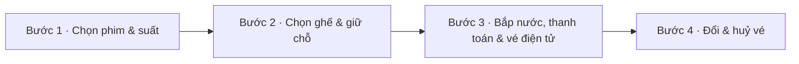
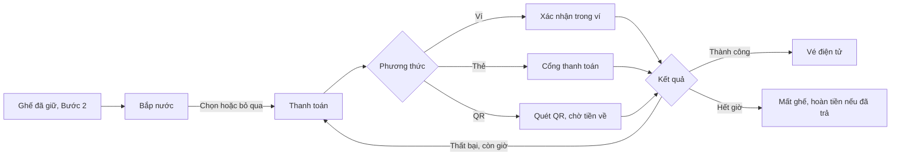
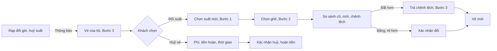

> **Mã:** DE08-PRD · **Trạng thái:** đã chốt · **Người viết:** Design · **SRS:** [SRS.md](SRS.md)

# PRD Đặt vé xem phim

> Đề gồm **1 tính năng**, là **1 luồng** gồm 4 bước và các màn hình: Chọn phim & suất → Chọn ghế & giữ chỗ → Bắp nước, thanh toán & vé điện tử → Đổi & huỷ vé. Sơ đồ chung xem [README](../README.md).

## 1. Bối cảnh và vấn đề

### 1.1 Bối cảnh

Ứng dụng đặt vé của một rạp chiếu phim, nhìn từ phía khách: chọn phim và suất, chọn ghế theo thời gian thực, thêm bắp nước, thanh toán và nhận vé điện tử dùng được cả khi mất mạng, tự đổi hoặc huỷ vé, được báo và hoàn tiền khi rạp đổi giờ hoặc huỷ suất. Rạp lập lịch, giá và soát vé trên hệ thống riêng, **ngoài phạm vi đề**. Đây là đề có **tranh chấp ghế thời gian thực** (hàng nghìn người cùng chọn một ghế), **đồng hồ giữ chỗ xuyên nhiều bước**, **vé offline** và **ràng buộc về độ tuổi**.

Rạp có 6–10 phòng, 40–80 suất mỗi ngày. Ngày khởi chiếu phim hot, hàng nghìn người cùng mở một sơ đồ ghế; giờ cao điểm, 200 người vào một phòng trong 10 phút với mạng trong rạp chập chờn. Khách cần chọn được ghế đẹp, trả tiền nhanh, không bị trừ hai lần, vào phòng không kẹt, đổi hoặc huỷ dễ khi bận. Bài toán thiết kế chính là **cho khách thấy đúng một sự thật về ghế và vé**, cả khi nhiều người cùng chọn và cả khi mất mạng.

### 1.2 Vấn đề

| **Vấn đề** | **Hệ quả** |
| --- | --- |
| Muốn xem "tối nay 8 giờ" nhưng phải mở từng phim để xem suất | Mất thời gian, bỏ cuộc |
| Không biết suất nào còn ghế đẹp | Chọn suất rồi mới thấy chỉ còn hàng đầu |
| Không thấy rõ 2D, 3D, IMAX, phụ đề hay lồng tiếng | Mua nhầm định dạng |
| Không biết phim T16, T18 bị kiểm tra tuổi | Bị từ chối ở cửa, mất tiền |
| Phim sắp chiếu chưa mở bán, phải nhớ quay lại | Mất suất đẹp ngày đầu |
| Hai người chọn cùng ghế, cả hai thanh toán | Bán trùng, phải hoàn tiền, khách giận |
| Ghế bị giữ mãi bởi người chọn rồi bỏ đi | Người khác không mua được dù ghế thực ra trống |
| Khách chọn chừa một ghế trống lẻ giữa nhóm | Ghế lẻ khó bán, rạp mất doanh thu |
| Sơ đồ nhỏ trên điện thoại, chạm nhầm ghế | Chọn sai ghế, mất thời gian |
| Không biết còn bao lâu để thanh toán | Hết giờ giữ khi đang nhập thẻ |
| Đồng hồ giữ chỗ hết khi đang nhập thẻ | Mất ghế, khách bực |
| Thanh toán xong màn hình treo, không biết thành công chưa | Thanh toán lại, bị trừ 2 lần |
| Đặt bắp nước online nhưng tới quầy vẫn phải xếp hàng mua | Không thấy lợi ích của đặt trước |
| Vé chỉ có trong email, mất mạng ở rạp không mở được | Kẹt ở cửa phòng chiếu |
| Không nhớ giờ chiếu, tới trễ | Lỡ đầu phim |
| Khách muốn đổi suất phải ra quầy | Mất thời gian, quầy đông |
| Không biết huỷ thì mất bao nhiêu, bao giờ có tiền | Ngại huỷ, bỏ vé, gọi tổng đài |
| Suất mới đắt hơn hoặc rẻ hơn mà không nói rõ | Tranh cãi về tiền chênh lệch |
| Rạp đổi giờ suất, khách không biết | Tới trễ, mất suất |
| Rạp huỷ suất, phải gọi từng khách | Chậm, sót khách, hoàn tiền lâu |

### 1.3 Mục tiêu

- ≥ 45% phiên mở app tới bước chọn ghế.
- Thời gian từ mở app tới chọn xong suất ≤ 45 giây (trung vị).
- Vé bị từ chối ở cửa vì độ tuổi ≤ 0,1%.
- 0 ghế bán trùng.
- Thời gian chọn ghế trung vị ≤ 40 giây.
- Tỉ lệ ghế trống lẻ (bị kẹp) khi suất bắt đầu giảm 50%.
- Tỉ lệ thanh toán thành công / phiên tới màn thanh toán ≥ 85%.
- ≥ 30% đơn có bắp nước đặt trước.
- 100% vé mở được khi không có mạng.
- ≥ 80% đổi, huỷ vé tự làm trong app.
- 100% khách của suất bị huỷ được báo và có lệnh hoàn tiền trong 15 phút.
- 0 khiếu nại về số tiền hoàn khác với số đã hiển thị trước khi xác nhận.

## 2. Người dùng

| **Nhóm** | **Nhu cầu với tính năng này** |
| --- | --- |
| Nhóm bạn trẻ | Xem nhanh suất tối nay của mọi phim; phim mới, hot |
| Gia đình có trẻ nhỏ | Biết phim nào phù hợp trẻ em, suất ban ngày |
| Người hâm mộ phim | Nhắc khi mở bán phim sắp chiếu, chọn IMAX |
| Nhóm bạn 3–6 người | Ghế liền nhau, chọn nhanh |
| Cặp đôi | Ghế đôi |
| Khách đặt ngày đầu phim hot | Biết ngay ghế nào vừa bị người khác lấy |
| Khách lớn tuổi | Sơ đồ to, dễ chạm, có chọn nhanh |
| Khách đi xem cuối tuần | Combo bắp nước rẻ hơn mua lẻ, nhận nhanh |
| Khách đặt phút chót | Thanh toán nhanh bằng ví, QR |
| Khách ở rạp mạng yếu | Mở vé không cần mạng |
| Khách bận việc | Đổi sang suất khác của cùng phim, vài chạm |
| Khách không đi được nữa | Huỷ, biết trước tiền hoàn và thời gian nhận |
| Khách có suất bị rạp đổi giờ | Được báo ngay, đổi hoặc huỷ miễn phí |
| Khách có suất bị rạp huỷ | Được hoàn tiền tự động, gợi ý suất khác |

## 3. Phạm vi

### 3.1 Trong phạm vi (MVP)

**Bước 1 · Chọn phim & suất**

- Trang chủ: Đang chiếu, Sắp chiếu; banner phim nổi bật.
- Xem theo ngày: mọi suất của một ngày, nhóm theo phim.
- Chi tiết phim: trailer, thông tin, phân loại độ tuổi giải thích rõ.
- Chọn suất: ngày, định dạng, ngôn ngữ, giờ; mức ghế còn trống; giá từ.
- Xác nhận độ tuổi với phim T13, T16, T18; lưu ý K.
- Nhắc khi mở bán cho phim sắp chiếu.
- Tìm phim theo tên.

**Bước 2 · Chọn ghế & giữ chỗ**

- Sơ đồ ghế theo thời gian thực: trống, đang giữ, đã bán, không bán, đang chọn.
- Chọn, bỏ chọn ghế; ghế đôi theo cặp; tối đa 8 ghế.
- Giữ ghế 10 phút cho cả quá trình đặt; đếm ngược luôn hiện.
- Quy tắc không để ghế trống lẻ.
- Chọn nhanh n ghế đẹp liền nhau.
- Phóng to, kéo sơ đồ; chú thích loại ghế và giá.

**Bước 3 · Bắp nước, thanh toán & vé điện tử**

- Chọn combo, món lẻ, tuỳ chọn vị; bỏ qua được.
- Tóm tắt đơn: vé, bắp nước, tổng.
- Thanh toán: ví liên kết, thẻ qua cổng thanh toán, QR chuyển khoản.
- Xử lý kết quả, thất bại, tiền về trễ.
- Vé điện tử: QR, thông tin suất, ghế, bắp nước; lưu offline; email; thêm vào lịch.
- Dùng vé tại rạp: đưa QR nhận bắp nước, vào phòng; vé cập nhật món đã nhận, số người đã vào.
- Nhắc trước giờ chiếu.

**Bước 4 · Đổi & huỷ vé**

- Điều kiện đổi, huỷ hiện trên vé và ở bước thanh toán.
- Đổi suất: cùng phim, chọn suất và ghế mới, so sánh cũ – mới, trả thêm chênh lệch.
- Huỷ vé: phí huỷ, tiền hoàn, nơi nhận, thời gian nhận.
- Rạp đổi giờ suất: thông báo, nhãn trên vé, đổi hoặc huỷ miễn phí.
- Rạp huỷ suất: thông báo, vé huỷ, hoàn tiền tự động, gợi ý suất khác.
- Ghế bị rạp khoá sau khi bán: nhãn trên vé, hướng dẫn tại quầy.

### 3.2 Ngoài phạm vi

- Nhiều rạp, chọn rạp gần nhất → phase sau.
- Đánh giá, bình luận phim.
- Gợi ý phim cá nhân hoá.
- Đặt vé nhóm, chia tiền.
- Lập lịch chiếu, phòng chiếu, giá vé (hệ thống quản lý của rạp).
- Ghế dành cho xe lăn, khu vực đặc biệt → phase sau.
- Chọn ghế cùng bạn bè trên nhiều điện thoại.
- Đổi ghế sau khi đã thanh toán (làm tại quầy).
- Mã giảm giá, điểm thành viên, thẻ quà tặng.
- Thanh toán tiền mặt (chỉ tại quầy, ngoài phạm vi app).
- Màn quét vé của nhân viên quầy và cửa phòng chiếu (thiết bị của rạp).
- Giao bắp nước tới ghế.
- Xuất hoá đơn VAT.
- Thao tác của rạp: đổi giờ, huỷ suất, khoá ghế trên hệ thống quản lý.
- Đổi phim khác, đổi ghế trong cùng suất trong app.
- Hoàn bằng voucher, điểm thưởng.
- Huỷ riêng bắp nước.

## 4. Nguyên tắc sản phẩm

### 4.1 Thời gian là trục chính

Khách nghĩ theo "khi nào rảnh"; xem theo ngày và giờ phải nhanh như xem theo phim.

### 4.2 Định dạng và độ tuổi không được nhầm

Nhãn 2D / 3D / IMAX, Phụ đề / Lồng tiếng, và phân loại tuổi luôn đi kèm suất, không nằm trong chi tiết ẩn.

### 4.3 Báo trước những gì có thể làm hỏng buổi xem

Phim giới hạn tuổi được xác nhận trước khi chọn ghế.

### 4.4 Chạm là giữ

Ghế được giữ ngay khi khách chạm; người khác thấy ghế chuyển "đang giữ" trong vài giây. Không có bán trùng.

### 4.5 Thời gian luôn hiện

Đồng hồ giữ chỗ đi theo khách qua các bước chọn ghế, bắp nước, thanh toán.

### 4.6 Giúp khách chọn tốt, không chỉ trích

Quy tắc ghế lẻ được giải thích bằng hình (tô ghế bị bỏ lẻ) và gợi ý cách sửa.

### 4.7 Đồng hồ là đồng minh

Đồng hồ giữ chỗ hiện rõ ở mọi bước; khi khách đã sang cổng thanh toán, hệ thống chờ kết quả thay vì nhả ghế.

### 4.8 Thanh toán một lần là một lần

Không bao giờ trừ tiền hai lần cho một đơn; tiền về trễ thì tự hoàn.

### 4.9 Vé dùng được ở mọi nơi

Vé lưu trên máy, mở offline, tăng độ sáng khi hiện QR.

### 4.10 Nói rõ tiền trước khi xác nhận

Màn xác nhận luôn có số tiền cụ thể: trả thêm, không hoàn chênh lệch, phí huỷ, tiền hoàn, nơi nhận, thời gian.

### 4.11 Lỗi của rạp thì khách không chịu

Rạp đổi giờ hoặc huỷ suất: đổi, huỷ miễn phí, hoàn 100%, không áp giới hạn thời gian thông thường.

### 4.12 Điều kiện thấy được trước

Khách biết điều kiện đổi, huỷ trước khi trả tiền (Bước 3) và thấy lại trên vé; nút đổi, huỷ ẩn hoặc giải thích khi không còn dùng được.

## 5. Quy tắc nghiệp vụ

| **Quy tắc** | **Giá trị** |
| --- | --- |
| Đang chiếu | Phim có suất mở bán trong 7 ngày tới |
| Sắp chiếu | Phim có ngày khởi chiếu trong tương lai |
| Dải ngày | 7 ngày từ hôm nay; ngày không có suất làm mờ |
| Mức ghế trống | Còn nhiều (> 50%), Còn ít (20–50%), Sắp hết (< 20%), Hết vé |
| Bán online | Tới giờ bắt đầu suất; mở bán tối đa 14 ngày trước |
| Giờ kết thúc | Giờ bắt đầu + 15 phút quảng cáo + thời lượng phim |
| Giá vé | Theo định dạng, khung giờ, loại ngày, loại ghế; app hiện "Từ {giá}" |
| Phân loại tuổi | P mọi lứa tuổi · K dưới 13 tuổi cần đi cùng cha mẹ, người giám hộ · T13, T16, T18 từ đủ 13, 16, 18 tuổi |
| Số ghế tối đa | 8 mỗi lần đặt (ghế đôi tính là 2) |
| Thời gian giữ | 10 phút từ ghế đầu tiên; + tối đa 5 phút khi đang chờ kết quả thanh toán |
| Phiên giữ chỗ | 1 phiên đang mở mỗi khách |
| Ghế đôi | Chọn, bỏ theo cặp |
| Ghế lẻ | Không được tạo ra một ghế trống lẻ liền kề ghế mình chọn |
| Cập nhật sơ đồ | ≤ 2 giây |
| Bắp nước | Mỗi món 0–10; combo có tuỳ chọn vị bắp và nước |
| Phương thức | Ví liên kết, thẻ nội địa và quốc tế qua cổng thanh toán, QR chuyển khoản |
| Thời gian thanh toán | Trong đồng hồ giữ chỗ; gia hạn tối đa 5 phút khi đang chờ kết quả cổng (Bước 2) |
| Tiền về sau khi mất ghế | Hoàn tự động ≤ 1 ngày làm việc |
| Nhận bắp nước | Từ 60 phút trước giờ chiếu tới khi suất kết thúc |
| Nhắc trước | 2 giờ và 30 phút trước giờ chiếu |
| Hạn đổi, huỷ | Trước giờ bắt đầu ít nhất 2 giờ; vé chưa ai vào phòng |
| Đổi suất | Cùng phim, suất trong 7 ngày tới, cùng số ghế; miễn phí 1 lần mỗi đơn |
| Chênh lệch | Đắt hơn → trả thêm; rẻ hơn → không hoàn |
| Phí huỷ | 10% tổng đơn, làm tròn 1.000 ₫ |
| Thời gian hoàn | Ví ngay; thẻ 5–7 ngày làm việc; QR chuyển khoản 1 ngày làm việc |
| Rạp đổi giờ, huỷ suất | Đổi, huỷ miễn phí; hoàn 100% vé và bắp nước chưa nhận |

## 6. Luồng trải nghiệm

### 6.1 Toàn bộ luồng

### 6.2 Bước 1 · Chọn phim & suất

| **Bước** | **Giai đoạn** | **Trải nghiệm** | **Đầu ra** |
| --- | --- | --- | --- |
| 1 | Khám phá | Đang chiếu, Sắp chiếu, Theo ngày | Phim hoặc ngày |
| 2 | Tìm hiểu | Trailer, tóm tắt, phân loại tuổi | Quyết định xem |
| 3 | Chọn suất | Ngày, định dạng, giờ; mức ghế trống | Suất chiếu |
| 4 | Độ tuổi | Xác nhận (nếu cần) | Sang chọn ghế |

### 6.3 Bước 2 · Chọn ghế & giữ chỗ

| **Bước** | **Giai đoạn** | **Trải nghiệm** | **Đầu ra** |
| --- | --- | --- | --- |
| 1 | Xem sơ đồ | Màn hình chiếu ở trên, loại ghế, giá | Hiểu phòng |
| 2 | Chọn | Chạm ghế, ghế đổi màu ngay; đồng hồ 10 phút bắt đầu | Ghế đang giữ |
| 3 | Kiểm tra | Quy tắc ghế lẻ, số ghế, tạm tính | Ghế hợp lệ |
| 4 | Tiếp tục | Sang bắp nước, thanh toán với đồng hồ chạy tiếp | Đơn đặt vé |

### 6.4 Bước 3 · Bắp nước, thanh toán & vé điện tử

| **Bước** | **Giai đoạn** | **Trải nghiệm** | **Đầu ra** |
| --- | --- | --- | --- |
| 1 | Bắp nước | Combo có ảnh, giá, tiết kiệm bao nhiêu | Món đặt trước |
| 2 | Thanh toán | Tóm tắt, phương thức, đồng hồ | Đơn trả tiền |
| 3 | Kết quả | Thành công to rõ | Vé |
| 4 | Ở rạp | Mở vé offline, nhận bắp nước bằng QR | Vào phòng chiếu |

### 6.5 Bước 4 · Đổi & huỷ vé

| **Bước** | **Giai đoạn** | **Trải nghiệm** | **Đầu ra** |
| --- | --- | --- | --- |
| 1 | Xem vé | Nút Đổi suất, Huỷ vé kèm điều kiện | Lựa chọn |
| 2 | Đổi suất | Chọn suất, ghế như lúc đặt; so sánh cũ – mới | Vé mới |
| 3 | Huỷ vé | Phí, tiền hoàn, nơi nhận, thời gian | Vé huỷ, lệnh hoàn |
| 4 | Thay đổi từ rạp | Thông báo, nhãn trên vé, lựa chọn miễn phí | Vé giữ, đổi, huỷ hoặc được hoàn |

## 7. Use Cases, User Stories và Acceptance Criteria

### Bước 1 · Chọn phim & suất

#### UC1. Khám phá phim

##### US1.1 Xem phim đang chiếu

AC01: Lưới poster: tên, phân loại tuổi, thời lượng, định dạng có sẵn.

AC02: Tab Sắp chiếu: ngày khởi chiếu, nút "Nhắc tôi khi mở bán".

AC03: Tìm phim theo tên, không dấu.

##### US1.2 Xem theo ngày

User Story: Là người rảnh tối nay, tôi muốn thấy mọi suất sau 19 giờ của mọi phim.

AC01: Chọn ngày; danh sách phim, mỗi phim có các suất của ngày đó.

AC02: Lọc khung giờ: Sáng, Chiều, Tối; lọc định dạng.

#### UC2. Chọn suất

##### US2.1 Chọn đúng suất

AC01: Dải 7 ngày; ngày không có suất làm mờ.

AC02: Suất nhóm theo định dạng và ngôn ngữ, ví dụ "2D Phụ đề", "IMAX Lồng tiếng".

AC03: Mỗi suất: giờ bắt đầu, giờ kết thúc dự kiến, mức ghế trống, giá từ.

AC04: Suất hết vé không chọn được; suất đã bắt đầu không hiện.

#### UC3. Độ tuổi

##### US3.1 Không bị từ chối ở cửa

User Story: Là khách 15 tuổi, tôi muốn biết trước phim T16 không xem được.

AC01: Nhãn phân loại có giải thích khi chạm.

AC02: Chọn suất phim T13, T16, T18 → popup xác nhận đủ tuổi và mang giấy tờ tuỳ thân; với K → lưu ý đi cùng cha mẹ.

AC03: Hồ sơ có ngày sinh chưa đủ tuổi → không cho đặt, nói rõ lý do.

#### UC4. Nhắc mở bán

AC01: Bật nhắc cho phim sắp chiếu; push khi suất đầu tiên được mở bán.

### Bước 2 · Chọn ghế & giữ chỗ

#### UC5. Chọn ghế

##### US5.1 Chọn ghế liền nhau cho nhóm

User Story: Là người đặt cho nhóm 4 bạn, tôi muốn chọn 4 ghế liền nhau ở giữa phòng thật nhanh.

AC01: Sơ đồ có màn hình chiếu, chú thích loại ghế và giá.

AC02: Chạm ghế trống → ghế chuyển "đang chọn" ngay; chạm lại để bỏ.

AC03: "Chọn nhanh": nhập số ghế → hệ thống chọn n ghế liền nhau tốt nhất còn trống.

AC04: Ghế đôi chọn theo cặp.

AC05: Quá 8 ghế → báo, không chọn thêm.

##### US5.2 Biết ghế người khác vừa lấy

AC01: Ghế người khác giữ, mua hiện đổi trạng thái trong ≤ 2 giây.

AC02: Chạm đúng ghế vừa bị lấy → báo và giữ nguyên các ghế khác của mình.

#### UC6. Giữ chỗ

##### US6.1 Biết còn bao lâu

AC01: Đồng hồ 10 phút bắt đầu khi giữ ghế đầu tiên; hiện ở mọi bước tới thanh toán.

AC02: Còn 2 phút → nhắc.

AC03: Hết giờ → nhả ghế, báo, quay về sơ đồ (ghế có thể đã bị người khác chọn).

AC04: Đang chờ kết quả thanh toán khi hết 10 phút → giữ thêm tối đa 5 phút.

##### US6.2 Một phiên mỗi khách

AC01: Mở suất khác khi đang giữ ghế → hỏi có bỏ ghế đang giữ không.

#### UC7. Ghế lẻ

##### US7.1 Không để ghế trống lẻ

User Story: Là rạp, tôi muốn khách không để lại một ghế trống lẻ cạnh nhóm mình để ghế đó còn bán được.

AC01: Bấm Tiếp tục mà tạo ra ghế trống lẻ cạnh ghế mình chọn → không cho tiếp tục, tô ghế lẻ, giải thích.

AC02: Ghế lẻ đã có từ trước (không do khách tạo ra) → không chặn.

AC03: Gợi ý: chọn thêm ghế lẻ đó hoặc dịch nhóm sang một ghế.

### Bước 3 · Bắp nước, thanh toán & vé điện tử

#### UC8. Bắp nước

AC01: Danh sách combo, món lẻ; ảnh, mô tả, giá; combo ghi "Tiết kiệm {x} ₫" so với mua lẻ.

AC02: Chọn vị bắp, loại nước trong combo.

AC03: Nút "Bỏ qua"; đồng hồ giữ chỗ vẫn chạy.

#### UC9. Thanh toán

##### US9.1 Thanh toán nhanh

User Story: Là khách đặt phút chót, tôi muốn trả bằng ví trong vài chạm.

AC01: Tóm tắt: phim, suất, ghế, bắp nước, tổng.

AC02: Chọn phương thức; nhớ phương thức lần trước.

AC03: Xác nhận đã đọc điều khoản đổi, huỷ vé.

AC04: Bấm "Thanh toán {tổng}" chỉ tạo một giao dịch.

##### US9.2 Khi có sự cố

AC01: Thất bại khi còn giờ → báo lý do, ghế vẫn giữ, thử lại hoặc đổi phương thức.

AC02: Đang chờ kết quả cổng khi hết 10 phút → chờ thêm tối đa 5 phút; khách thấy "Đang xác nhận thanh toán".

AC03: Tiền về sau khi ghế đã nhả → hoàn tự động, báo khách.

#### UC10. Vé điện tử

##### US10.1 Có vé ngay và mọi lúc

AC01: Thành công → màn vé: QR, mã đặt vé, phim, phân loại, phòng, ngày giờ, ghế, bắp nước.

AC02: Vé lưu trên máy, mở được khi không có mạng.

AC03: Email vé; nút thêm vào lịch.

AC04: Hiện QR → tăng độ sáng màn hình.

##### US10.2 Nhận bắp nước và vào phòng

AC01: Khách đưa QR vé ở quầy; vé hiện khung giờ nhận bắp nước.

AC02: Vé hiện trạng thái từng món: Chưa nhận, Đã nhận lúc {giờ}.

AC03: Ở cửa phòng, đưa cùng QR; vé hiện "{k}/{n} người đã vào", nhóm tới lệch vẫn vào từng phần.

AC04: Phim T13, T16, T18: vé nhắc mang giấy tờ tuỳ thân có ảnh.

#### UC11. Nhắc giờ chiếu

AC01: Push 2 giờ và 30 phút trước giờ chiếu; chạm mở vé.

### Bước 4 · Đổi & huỷ vé

#### UC12. Đổi suất

##### US12.1 Đổi sang suất khác

User Story: Là khách bận việc, tôi muốn đổi sang suất khác của cùng phim trong app.

AC01: Vé đủ điều kiện → nút "Đổi suất"; chỉ hiện suất của cùng phim trong 7 ngày tới.

AC02: Chọn đủ số ghế như vé cũ; đồng hồ giữ chỗ áp dụng như lúc đặt.

AC03: Màn so sánh cũ → mới; ghi rõ "+{x} ₫ cần trả thêm" hoặc "Không hoàn chênh lệch {x} ₫".

AC04: Thành công → vé cũ "Đã đổi", vé mới có QR mới; bắp nước chuyển theo.

#### UC13. Huỷ vé

##### US13.1 Huỷ và biết tiền hoàn

User Story: Là khách không đi được, tôi muốn biết huỷ được bao nhiêu tiền, khi nào nhận.

AC01: Màn huỷ: tổng đã trả, phí huỷ 10%, tiền hoàn, nơi nhận, thời gian.

AC02: Xác nhận → vé "Đã huỷ", ghế nhả, toast số tiền hoàn.

AC03: Không đủ điều kiện → nêu lý do, hướng dẫn liên hệ quầy.

#### UC14. Thay đổi từ phía rạp

##### US14.1 Rạp đổi giờ

AC01: Push, email giờ cũ → giờ mới; vé có nhãn "Rạp đã đổi giờ".

AC02: Đổi, huỷ miễn phí 100% tới giờ bắt đầu mới, không áp hạn 2 giờ.

##### US14.2 Rạp huỷ suất

AC01: Push, email trong 15 phút: lý do, số tiền hoàn, nơi nhận, thời gian; nút "Đặt suất khác".

AC02: Vé "Đã huỷ"; hoàn 100% vé và bắp nước chưa nhận.

##### US14.3 Ghế bị khoá

AC01: Vé có nhãn "Cần đổi ghế tại quầy" và hướng dẫn; tại quầy được đổi ghế hoặc huỷ hoàn 100%.

## 8. Chỉ số theo dõi

| **Chỉ số** | **Định nghĩa** | **Mục tiêu MVP** |
| --- | --- | --- |
| Tỉ lệ tới chọn ghế | Phiên tới **SCR-04** / phiên mở app | ≥ 45% |
| Thời gian chọn suất | Mở app → chọn suất (trung vị) | ≤ 45 giây |
| Tỉ lệ dùng xem theo ngày | Phiên dùng tab Theo ngày / phiên chọn suất | Theo dõi |
| Từ chối vì độ tuổi | Vé bị từ chối ở cửa vì tuổi / vé phim giới hạn tuổi | ≤ 0,1% |
| Chuyển đổi từ nhắc mở bán | Đặt vé trong 24 giờ sau push / push đã gửi | Theo dõi |
| Bán trùng | Số ghế bán cho 2 đơn | 0 |
| Thời gian chọn ghế | Mở **SCR-04** → Tiếp tục (trung vị) | ≤ 40 giây |
| Hết giờ giữ | Phiên hết giờ / phiên có giữ ghế | ≤ 15% |
| Va chạm ghế | Lần chạm ghế vừa bị lấy / lần chạm ghế | Theo dõi (phim hot) |
| Ghế lẻ khi bắt đầu chiếu | Ghế trống bị kẹp / ghế trống khi bắt đầu | Giảm 50% |
| Dùng chọn nhanh | Phiên dùng chọn nhanh / phiên chọn ghế | Theo dõi |
| Thanh toán thành công | Đơn thành công / phiên tới **SCR-06** | ≥ 85% |
| Đơn có bắp nước | Đơn có ≥ 1 món / tổng đơn | ≥ 30% |
| Giá trị bắp nước trung bình | Doanh thu bắp nước / đơn có bắp nước | Theo dõi |
| Trừ tiền hai lần | Số đơn bị trừ 2 lần | 0 |
| Hoàn tiền do mất ghế | Đơn hoàn do tiền về trễ / tổng đơn | ≤ 0,5% |
| Vé mở offline | Lần mở vé không có mạng thành công / lần mở offline | 100% |
| Tự phục vụ | Đổi, huỷ làm trong app / tổng đổi, huỷ | ≥ 80% |
| Đổi thành công | Đổi hoàn tất / lần bấm Đổi suất | ≥ 70% |
| Báo khi rạp huỷ | Khách được báo và có lệnh hoàn trong 15 phút / khách của suất | 100% |
| Đặt lại sau khi rạp huỷ | Khách đặt suất khác trong 24 giờ / khách bị huỷ | Theo dõi |
| Khiếu nại số tiền | Khiếu nại hoàn khác số đã hiển thị | 0 |

## 9. Phụ thuộc và rủi ro

| **Mục** | **Mô tả** | **Hướng xử lý** |
| --- | --- | --- |
| Lịch chiếu đổi giờ | Khách đã xem giờ cũ | Cập nhật ≤ 1 phút (SRS BR-10); vé đã mua được báo |
| Mức ghế trống thay đổi nhanh | Hiển thị lệch | Làm mới khi mở **SCR-03**; con số chính xác ở **SCR-04** |
| Trailer nặng | Tốn dữ liệu di động | Chỉ phát khi khách chạm |
| Tải đột biến ngày mở bán | Hàng nghìn phiên cùng một phòng | Giữ ghế nguyên tử trên máy chủ; hàng chờ vào sơ đồ khi quá tải |
| Kết nối thời gian thực | Mất kết nối, sơ đồ cũ | Tự kết nối lại; dự phòng làm mới mỗi 5 giây; máy chủ luôn là nguồn đúng |
| Quy tắc ghế lẻ gây khó chịu | Khách thấy bị ép | Giải thích bằng hình, gợi ý sửa, không áp dụng khi ghế lẻ có sẵn |
| Cổng thanh toán, ví | Chậm, kết quả về trễ | Gia hạn giữ chỗ 5 phút; đối soát máy chủ–máy chủ; hoàn tự động |
| QR chuyển khoản | Khách chuyển sai số tiền, sai nội dung | QR có sẵn số tiền, nội dung; không khớp → hoàn, không xuất vé |
| Quầy bắp nước giờ cao điểm | Xếp hàng dài | Làn riêng cho đơn đặt trước |
| Hệ thống quản lý rạp | Đổi giờ, huỷ suất cập nhật chậm | Đồng bộ sự kiện; app cập nhật ≤ 1 phút |
| Cổng thanh toán | Hoàn về thẻ chậm | Hiện rõ thời gian theo nguồn; trạng thái hoàn trên vé |
| Đổi suất cạnh tranh ghế | Suất mới hết ghế khi đang đổi | Vé cũ giữ nguyên tới khi đổi thành công |

## 10. Câu hỏi mở

> Mọi câu hỏi dưới đây đã được PO chốt ngày 20/11/2026; quyết định ghi sau mỗi câu và đã cập nhật vào SRS.

- Có hiện số ghế còn chính xác? → **Đã chốt:** Không; hiện mức (Còn nhiều, Còn ít, Sắp hết) để tránh lệch (SRS BR-03).
- Khách chưa có ngày sinh trong hồ sơ thì sao? → **Đã chốt:** Hỏi xác nhận đủ tuổi mỗi lần đặt phim giới hạn; không bắt nhập ngày sinh (SRS BR-05).
- Suất sắp bắt đầu (≤ 15 phút) có bán? → **Đã chốt:** Có tới giờ bắt đầu, kèm nhãn "Sắp bắt đầu" (SRS BR-04).
- Phim chiếu sớm trước khởi chiếu có hiện ở Đang chiếu? → **Đã chốt:** Hiện ở Sắp chiếu với nhãn "Chiếu sớm" và có nút Đặt vé (SRS BR-01).
- Giữ ghế khi chạm hay khi bấm Tiếp tục? → **Đã chốt:** Khi chạm, mỗi ghế giữ ngay trên máy chủ (SRS BR-14).
- Đồng hồ có reset khi chọn thêm ghế? → **Đã chốt:** Không; một đồng hồ 10 phút cho cả phiên (SRS BR-15).
- Ghế lẻ ở mép hàng có tính? → **Đã chốt:** Có; mép hàng và lối đi được coi như ghế không trống (SRS BR-17).
- Khách đặt 1 ghế có bị chặn vì ghế lẻ? → **Đã chốt:** Có, cùng quy tắc; trừ khi không còn cách chọn nào khác trong hàng đó (SRS BR-17).
- Một QR cho cả đơn hay mỗi ghế một QR? → **Đã chốt:** Một QR cho cả đơn; vào phòng được từng phần (SRS BR-32, BR-33).
- Bắp nước có huỷ riêng được? → **Đã chốt:** Không; huỷ theo cả đơn (Bước 4).
- Vé lưu offline bao lâu? → **Đã chốt:** Tới 24 giờ sau khi suất kết thúc; sau đó vẫn xem được trong lịch sử khi có mạng (SRS BR-32).
- Có thêm vé vào ví điện thoại (Wallet)? → **Đã chốt:** Không ở MVP; có thêm vào lịch (SRS BR-31).
- Đổi suất có mất phí? → **Đã chốt:** Miễn phí 1 lần mỗi đơn; vé đã đổi không đổi tiếp, chỉ huỷ được (SRS BR-37).
- Suất mới rẻ hơn có hoàn chênh lệch? → **Đã chốt:** Không; ghi rõ trước khi xác nhận (SRS BR-37).
- Phí huỷ bao nhiêu? → **Đã chốt:** 10% tổng đơn, gồm bắp nước (SRS BR-38).
- Rạp đổi giờ thì khách được gì? → **Đã chốt:** Đổi hoặc huỷ miễn phí 100%, tới giờ bắt đầu mới (SRS BR-39).
