> **Mã:** DE08-SRS · **Trạng thái:** đã chốt · **Người viết:** Design · **PRD:** [PRD.md](PRD.md)

# UC-DE08 - Đặt vé xem phim

> SRS này mô tả **1 tính năng**, là **1 luồng** gồm 4 bước: Chọn phim & suất → Chọn ghế & giữ chỗ → Bắp nước, thanh toán & vé điện tử → Đổi & huỷ vé. Mã BR, MSG, UC, SCR đánh số liên tục trong toàn tài liệu. Sơ đồ chung xem [README](../README.md).

## 1. Tổng quan

| **Mục** | **Nội dung** |
| --- | --- |
| Mục tiêu | Ứng dụng đặt vé của một rạp chiếu phim, nhìn từ phía khách: chọn phim và suất, chọn ghế theo thời gian thực, thêm bắp nước, thanh toán và nhận vé điện tử dùng được cả khi mất mạng, tự đổi hoặc huỷ vé, được báo và hoàn tiền khi rạp đổi giờ hoặc huỷ suất |
| Actor | Khách · App khách · Máy chủ · Máy chủ (dịch vụ giữ ghế) · Cổng thanh toán · Ví liên kết · Ngân hàng nhận tiền · Nhân viên rạp (quét vé trên thiết bị của rạp, ngoài phạm vi) · Hệ thống quản lý rạp (gửi sự kiện) |
| Luồng | Bước 1 Chọn phim & suất → Bước 2 Chọn ghế & giữ chỗ → Bước 3 Bắp nước, thanh toán & vé điện tử → Bước 4 Đổi & huỷ vé |
| Ngoài phạm vi | Hệ thống quản lý rạp (phim, phòng, sơ đồ ghế, lịch chiếu, bảng giá, huỷ suất), thiết bị soát vé và quầy bắp nước của nhân viên, chuỗi nhiều rạp, bán vé tại quầy, tiền mặt, mã giảm giá, thẻ thành viên, điểm thưởng, đánh giá phim, ghế dành cho xe lăn, hoá đơn VAT |
| Nền tảng | App khách iOS / Android |

### Các bước của luồng

| **Bước** | **Mục tiêu** | **Phạm vi** |
| --- | --- | --- |
| Bước 1 · Chọn phim & suất | Khách tìm phim, chọn suất đúng định dạng, đúng giờ, biết trước ràng buộc độ tuổi | Trang chủ, Đang chiếu, Sắp chiếu, Theo ngày, tìm phim, chi tiết phim, chọn suất, xác nhận độ tuổi, nhắc mở bán |
| Bước 2 · Chọn ghế & giữ chỗ | Khách chọn ghế nhanh, đúng; không bao giờ bán trùng; ghế không bị giữ vô hạn; hạn chế ghế trống lẻ | Sơ đồ ghế, trạng thái ghế thời gian thực, chọn, bỏ chọn, ghế đôi, chọn nhanh, giữ ghế, đồng hồ giữ chỗ, phiên đặt vé, quy tắc ghế lẻ |
| Bước 3 · Bắp nước, thanh toán & vé điện tử | Khách thêm bắp nước, thanh toán trong thời gian giữ chỗ, nhận vé điện tử dùng được offline | Danh mục bắp nước, chọn món, tóm tắt, thanh toán ví / thẻ / QR, kết quả, hoàn tiền tự động, vé điện tử, email, lịch, nhận bắp nước, nhắc giờ chiếu |
| Bước 4 · Đổi & huỷ vé | Khách tự đổi suất, huỷ vé, biết rõ tiền; được báo và hoàn tiền tự động khi rạp thay đổi suất | Điều kiện đổi, huỷ; đổi suất; trả chênh lệch; huỷ vé và hoàn tiền; rạp đổi giờ; rạp huỷ suất; ghế bị khoá sau khi bán |

## 2. User Story

| **ID** | **As a** | **I want** | **So that** |
| --- | --- | --- | --- |
| US-01 | Khách | Xem mọi suất của một ngày | Chọn theo thời gian rảnh |
| US-02 | Khách | Thấy rõ định dạng, ngôn ngữ của suất | Không mua nhầm |
| US-03 | Khách | Biết suất nào còn nhiều ghế | Chọn được chỗ đẹp |
| US-04 | Khách | Biết trước giới hạn tuổi | Không bị từ chối ở cửa |
| US-05 | Khách | Được nhắc khi phim mở bán | Không lỡ suất ngày đầu |
| US-06 | Khách | Chọn nhanh n ghế liền nhau | Cả nhóm ngồi cạnh nhau |
| US-07 | Khách | Thấy ngay ghế người khác vừa lấy | Không chọn nhầm |
| US-08 | Khách | Biết còn bao lâu để hoàn tất | Không mất ghế khi đang thanh toán |
| US-09 | Rạp | Không bán trùng ghế | Không phải xử lý sự cố |
| US-10 | Rạp | Hạn chế ghế trống lẻ | Bán được nhiều ghế hơn |
| US-11 | Khách | Đặt combo bắp nước trước | Nhận nhanh, rẻ hơn |
| US-12 | Khách | Thanh toán nhanh, biết rõ kết quả | Không trả hai lần |
| US-13 | Khách | Không mất ghế khi đang chờ cổng thanh toán | Không phải chọn lại |
| US-14 | Khách | Mở vé khi không có mạng | Vào phòng chiếu không bị kẹt |
| US-15 | Khách | Thấy bắp nước đã nhận, bao nhiêu người đã vào | Không bị nhầm khi đi nhóm |
| US-16 | Khách | Đổi suất trong app | Không phải ra quầy |
| US-17 | Khách | Biết tiền hoàn và thời gian trước khi huỷ | Yên tâm quyết định |
| US-18 | Khách | Được đổi, huỷ miễn phí khi rạp đổi giờ | Không chịu thiệt vì rạp |
| US-19 | Khách | Được báo và hoàn tiền tự động khi rạp huỷ suất | Không phải gọi hỏi |

## 3. Business Rules

| **Mã** | **Quy tắc** |
| --- | --- |
| BR-01 | **Danh mục phim**: Đang chiếu = phim `DANG_CHIEU` có ≥ 1 suất `MO_BAN` trong 7 ngày tới, sắp theo số vé bán 7 ngày gần nhất. Sắp chiếu = phim `SAP_CHIEU`, sắp theo ngày khởi chiếu; phim có suất **Chiếu sớm** mở bán → nhãn "Chiếu sớm" và nút Đặt vé |
| BR-02 | **Thẻ phim**: poster, tên, nhãn phân loại (màu theo mức), thời lượng, định dạng có suất; Sắp chiếu thêm ngày khởi chiếu |
| BR-03 | **Mức ghế trống** theo tỉ lệ ghế `TRONG` / ghế bán được: > 50% "Còn nhiều"; 20–50% "Còn ít"; < 20% "Sắp hết"; 0 "Hết vé" (không chọn được). Tính lại khi mở **SCR-03** và mỗi 60 giây khi đang mở |
| BR-04 | **Suất hiển thị**: `MO_BAN`, giờ bắt đầu > hiện tại. Bắt đầu trong ≤ 15 phút → nhãn "Sắp bắt đầu". Suất rạp đổi giờ (Bước 4 BR-39) hiện giờ mới |
| BR-05 | **Xác nhận độ tuổi**: chọn suất phim T13, T16, T18 → popup MSG-02 với \[Tôi đủ tuổi\] \[Chọn phim khác\]; phim K → popup MSG-03. Hồ sơ có ngày sinh: tính tuổi tại ngày chiếu; chưa đủ T13/T16/T18 → MSG-04, không cho đặt. Xác nhận lưu cùng đơn đặt vé (Bước 2, Bước 3) |
| BR-06 | **Nhóm suất** trên **SCR-03**: theo "định dạng + ngôn ngữ" (2D Phụ đề, 2D Lồng tiếng, 3D Phụ đề, IMAX Phụ đề…); trong nhóm sắp theo giờ |
| BR-07 | **Giá từ** = giá thấp nhất (ghế thường) của suất theo BR-11 |
| BR-08 | **Nhắc mở bán**: bật trên phim `SAP_CHIEU`; khi suất đầu tiên của phim `MO_BAN` → push MSG-05 một lần; tắt được |
| BR-09 | **Tìm phim** theo tên, tên gốc; không dấu, không phân biệt hoa thường; gợi ý sau 2 ký tự |
| BR-10 | **Thông tin suất** (do rạp lập, ngoài phạm vi): giờ bắt đầu; giờ kết thúc dự kiến = bắt đầu + 15 phút quảng cáo + thời lượng phim, hiện dạng "19:45 → 22:10". Suất mở bán tối đa 14 ngày trước ngày chiếu; app hiện 7 ngày tới. Bán online tới giờ bắt đầu. Suất **Chiếu sớm** (trước ngày khởi chiếu) có nhãn riêng. Suất mới, đổi giờ, huỷ hiện trên app ≤ 1 phút |
| BR-11 | **Giá vé** (rạp cấu hình, app chỉ hiển thị) = làm tròn tới 1.000 ₫ của (giá cơ bản theo định dạng × hệ số khung giờ × hệ số loại ngày) + phụ thu loại ghế. Khung giờ: Sáng (bắt đầu trước 12:00), Chiều (12:00–16:59), Tối (từ 17:00). Loại ngày: Thường (T2–T5), Cuối tuần (T6–CN), Lễ. Ghế đôi = 2 × giá ghế thường + phụ thu đôi. Giá chốt lúc giữ ghế (Bước 2); bảng giá đổi sau đó không ảnh hưởng vé đã đặt |
| BR-12 | **Trạng thái ghế** (theo suất): `TRONG`, `DANG_GIU` (phiên khác giữ), `DA_BAN`, `KHONG_BAN` (rạp khoá ghế hỏng, bảo trì, dành riêng; Bước 4 BR-41); phía khách thêm `DANG_CHON` (phiên của mình giữ). Màu và biểu tượng khác nhau cho từng trạng thái, kèm chú thích |
| BR-13 | **Số ghế** tối đa 8 mỗi phiên (ghế đôi tính 2). Chạm ghế thứ 9 → MSG-08 |
| BR-14 | **Giữ ghế khi chạm**: \[SeatHold\] nguyên tử trên máy chủ; ghế `TRONG` → `DANG_CHON` cho phiên này; ghế không còn `TRONG` → MSG-07, ghế hiện trạng thái thật. Bỏ chọn → \[SeatRelease\], ghế về `TRONG` ngay |
| BR-15 | **Đồng hồ giữ chỗ**: 10 phút tính từ lần giữ ghế đầu tiên của phiên, không đặt lại khi chọn thêm, áp dụng cho **SCR-04**, **SCR-05**, **SCR-06**. Còn 2 phút → MSG-09. Hết giờ → nhả mọi ghế, phiên `HET_HAN_GIU`, MSG-10. Khi đã chuyển sang cổng thanh toán (Bước 3) mà hết 10 phút → gia hạn tới khi có kết quả, tối đa thêm 5 phút |
| BR-16 | **Phiên đặt vé**: mỗi khách tối đa 1 phiên đang giữ ghế. Mở suất khác khi đang giữ → MSG-11 \[Bỏ ghế đang giữ\] \[Quay lại\]. Thoát app không nhả ghế ngay; ghế nhả khi hết đồng hồ hoặc khách bấm "Huỷ chọn" |
| BR-17 | **Ghế lẻ**: khi bấm Tiếp tục, với mỗi hàng có ghế `DANG_CHON`: không được tồn tại ghế `TRONG` đứng một mình (hai bên là ghế không trống: `DANG_CHON`, `DANG_GIU`, `DA_BAN`, `KHONG_BAN`, lối đi hoặc mép hàng) **và** liền kề một ghế `DANG_CHON`. Ngoại lệ: ghế lẻ đó đã đứng một mình trước khi khách chọn; hoặc hàng không còn cách chọn cùng số ghế nào mà không tạo ghế lẻ. Vi phạm → MSG-12, tô ghế lẻ, gợi ý (BR-23) |
| BR-18 | **Ghế đôi**: chạm một nửa → giữ cả cặp; bỏ → nhả cả cặp. Giá theo Bước 1 BR-11 |
| BR-19 | **Thời gian thực**: sơ đồ nhận thay đổi trạng thái ghế qua \[SeatStream\] ≤ 2 giây; mất kết nối → banner MSG-13, làm mới \[SeatMap\] mỗi 5 giây; máy chủ luôn kiểm tra lại khi giữ ghế |
| BR-20 | **Tạm tính**: liệt kê ghế đã chọn theo mã (F7, F8…), loại, giá; tổng tạm tính; phí tiện ích 0 ₫ (cấu hình) |
| BR-21 | **Độ tuổi nhóm**: phim T13, T16, T18 và chọn > 1 ghế → dòng nhắc "Mọi người trong nhóm đều cần đủ {n} tuổi và mang giấy tờ" dưới tạm tính |
| BR-22 | **Suất bắt đầu** trong lúc đang chọn → nhả ghế, MSG-14. Suất bị huỷ (Bước 4) → nhả ghế, MSG-15 |
| BR-23 | **Chọn nhanh n ghế** (1–8): chọn n ghế `TRONG` liền nhau cùng loại ghế đang lọc (mặc định Thường), trong cùng hàng, không tạo ghế lẻ; ưu tiên hàng ở khoảng 2/3 chiều sâu phòng, gần cột giữa nhất. Không tìm được → MSG-12 dạng gợi ý "Không còn {n} ghế liền nhau, thử ít ghế hơn". Gợi ý sửa ghế lẻ: chọn thêm ghế lẻ, hoặc dịch cả nhóm 1 ghế |
| BR-24 | **Danh mục bắp nước** do rạp cấu hình: combo và món lẻ; mỗi mục có ảnh, tên, mô tả, giá, trạng thái còn bán; combo có nhóm tuỳ chọn (vị bắp: Ngọt, Phô mai, Caramel; nước: chọn trong danh sách) và nhãn "Tiết kiệm {x} ₫" = tổng giá lẻ − giá combo. Số lượng mỗi mục 0–10 |
| BR-25 | **Bỏ qua** bắp nước được; quay lại sửa trước khi thanh toán |
| BR-26 | **Tổng** = Σ giá ghế (Bước 1 BR-11, chốt lúc giữ ghế) + Σ bắp nước + phí tiện ích (cấu hình, hiện 0 ₫) |
| BR-27 | **Phương thức**: Ví liên kết; Thẻ (nội địa, quốc tế) qua cổng thanh toán; QR chuyển khoản (VietQR có sẵn số tiền, nội dung = mã đơn). Nhớ phương thức lần trước. Bấm thanh toán cần tích "Tôi đã đọc điều kiện đổi, huỷ vé" (tóm tắt Bước 4 BR-36) |
| BR-28 | **Tạo thanh toán**: \[PaymentCreate\] với idempotency key; phiên `CHO_THANH_TOAN`. Ví → xác nhận trong ví. Thẻ → chuyển sang trang cổng thanh toán. QR → hiện QR trên **SCR-06**, đếm theo đồng hồ giữ chỗ |
| BR-29 | **Kết quả** chỉ tin thông báo máy chủ–máy chủ có chữ ký từ cổng, ví, ngân hàng. App gọi \[PaymentStatus\] mỗi 3 giây khi đang chờ. Đã chuyển sang cổng / ví mà hết 10 phút → gia hạn giữ chỗ tối đa 5 phút (Bước 2 BR-15), **SCR-06** hiện "Đang xác nhận thanh toán" |
| BR-30 | **Thất bại** khi còn thời gian giữ chỗ → MSG-17, phiên về `GIU_CHO`, ghế giữ nguyên, khách thử lại hoặc đổi phương thức. **Tiền về sau khi ghế đã nhả** (hết giờ và hết gia hạn) → không xuất vé, hoàn tự động về nguồn ≤ 1 ngày làm việc, MSG-19. **QR sai số tiền, sai nội dung** → không xuất vé, hoàn, MSG-19 |
| BR-31 | **Thành công**: ghế `DA_BAN`; tạo đơn vé với mã đặt vé 8 ký tự chữ số; QR chứa mã đặt vé và chữ ký số của máy chủ; trạng thái vé `HIEU_LUC`; gửi push MSG-20 và email vé; nút "Thêm vào lịch" (sự kiện lịch của máy với giờ chiếu, địa chỉ rạp) |
| BR-32 | **Vé điện tử** (**SCR-07**): QR, mã đặt vé, phim, nhãn phân loại, rạp, phòng, ngày giờ bắt đầu và kết thúc dự kiến, ghế, bắp nước (trạng thái từng món), tổng, phương thức. Lưu trên máy (mã hoá) tới 24 giờ sau khi suất kết thúc; mở được khi không có mạng. Hiện QR → độ sáng tối đa. Một QR cho cả đơn; vào phòng từng phần theo BR-33 |
| BR-33 | **Dùng vé tại rạp**: khách mở vé (offline được) và đưa QR cho nhân viên; việc quét do rạp làm trên thiết bị riêng (ngoài phạm vi). **Nhận bắp nước** tại quầy từ 60 phút trước giờ bắt đầu tới giờ kết thúc suất; vé hiện khung giờ này, ngoài khung → MSG-23. **Vào phòng** từ 30 phút trước giờ bắt đầu tới giờ kết thúc; nhóm tới lệch được vào từng phần. Khi có mạng, vé cập nhật: từng món "Đã nhận lúc {giờ}" (MSG-24), "{k}/{n} người đã vào" (MSG-25), trạng thái `DA_SU_DUNG_MOT_PHAN`, `DA_SU_DUNG`. Phim T13, T16, T18: vé nhắc mang giấy tờ tuỳ thân có ảnh; người không đủ tuổi không được vào, không hoàn tiền (Bước 1 BR-05). Suất kết thúc mà chưa vào đủ → phần còn lại `HET_HAN`, không hoàn |
| BR-34 | **Nhắc giờ chiếu**: push MSG-21 lúc 2 giờ và 30 phút trước giờ bắt đầu; tắt được trong cài đặt |
| BR-35 | **Không trừ hai lần**: một phiên đặt vé chỉ có một thanh toán thành công; thanh toán thành công thứ hai (nếu có do khách trả bằng hai phương thức) → hoàn tự động ngay, MSG-19 |
| BR-36 | **Điều kiện đổi, huỷ**: vé `HIEU_LUC`, chưa ai vào phòng, còn ≥ 2 giờ tới giờ bắt đầu (trừ BR-39). Hành động theo trạng thái ở mục 4.2. Tóm tắt điều kiện ("Đổi miễn phí 1 lần, huỷ mất phí 10%, trước giờ chiếu ít nhất 2 giờ") hiện ở thanh toán (Bước 3 BR-27) và trên vé |
| BR-37 | **Đổi suất**: cùng phim, suất `MO_BAN` trong 7 ngày tới, cùng số ghế (chọn ghế theo Bước 2, đồng hồ giữ chỗ áp dụng); miễn phí 1 lần mỗi đơn (vé đã đổi không đổi tiếp). Giá suất mới tính theo Bước 1 BR-11. Mới đắt hơn → trả chênh lệch theo Bước 3; rẻ hơn → không hoàn chênh lệch. Bắp nước chưa nhận chuyển nguyên. Thành công → vé cũ `DA_DOI`, ghế cũ nhả; vé mới mã đặt vé, QR mới. Thất bại ở bất kỳ bước nào → vé cũ giữ nguyên |
| BR-38 | **Huỷ vé**: hoàn 90% tổng đơn (phí huỷ 10%, làm tròn 1.000 ₫, gồm bắp nước) về nguồn: ví ngay, thẻ 5–7 ngày làm việc, QR chuyển khoản 1 ngày làm việc (về tài khoản đã chuyển). Ghế nhả ngay; vé `DA_HUY`; trạng thái hoàn hiện trên vé (Đang hoàn, Đã hoàn) |
| BR-39 | **Rạp đổi giờ suất** (tối đa ±30 phút, chỉ giờ bắt đầu): push, email MSG-30; vé hiện nhãn "Rạp đã đổi giờ" và giờ mới. Vé được đổi suất, huỷ hoàn 100% miễn phí, không áp hạn 2 giờ, tới giờ bắt đầu mới; đổi theo cách này không tính vào lần đổi miễn phí |
| BR-40 | **Rạp huỷ suất**: mọi vé `HIEU_LUC`, `DA_SU_DUNG_MOT_PHAN` của suất → `DA_HUY`; hoàn 100% giá vé và bắp nước chưa nhận về nguồn (thời gian như BR-38); bắp nước đã nhận không hoàn. Push, email MSG-28 trong ≤ 15 phút kèm \[Đặt suất khác\] mở **SCR-03** của phim. Khách đang giữ ghế của suất → nhả, Bước 2 MSG-15 |
| BR-41 | **Ghế bị rạp khoá sau khi bán** (hỏng, bảo trì): vé hiện nhãn "Cần đổi ghế tại quầy" và MSG-31; tại quầy rạp đổi ghế tương đương hoặc huỷ hoàn 100%. Vé vẫn dùng được để vào phòng |

## 4. Trạng thái

### 4.1 Bước 1 · Chọn phim & suất

#### Trạng thái nút suất chiếu trên SCR-03

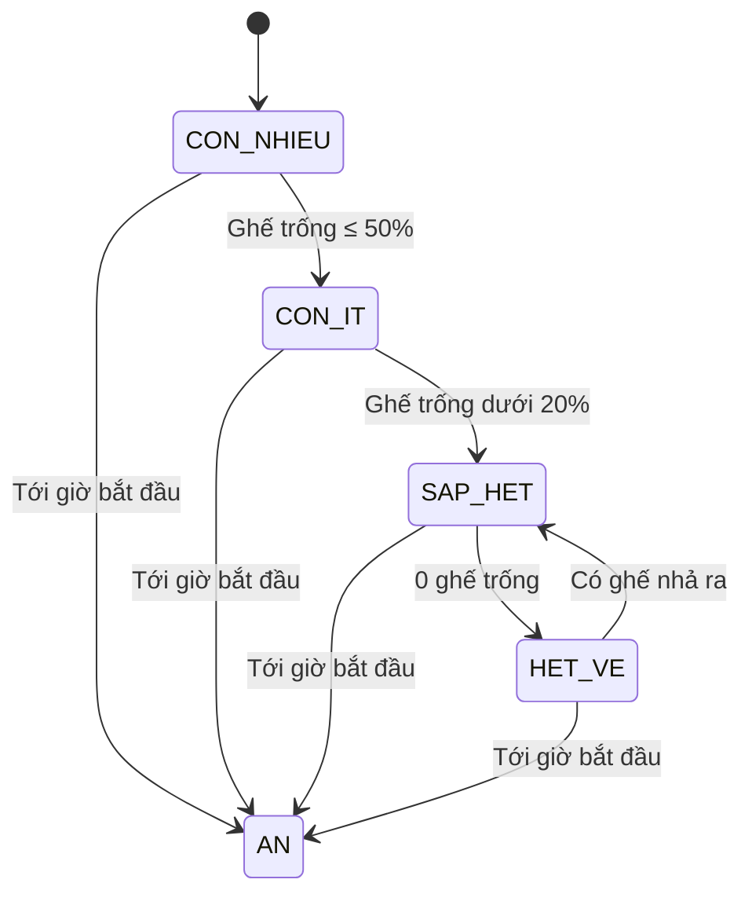

| **Trạng thái** | **Hiển thị** |
| --- | --- |
| `CON_NHIEU` | Ô giờ thường, chấm xanh |
| `CON_IT` | Chấm vàng, "Còn ít" |
| `SAP_HET` | Chấm đỏ, "Sắp hết" |
| `HET_VE` | Mờ, "Hết vé", không chạm được |
| Nhãn phụ | "Sắp bắt đầu" khi ≤ 15 phút |

### 4.2 Bước 2 · Chọn ghế & giữ chỗ

#### Trạng thái một ghế

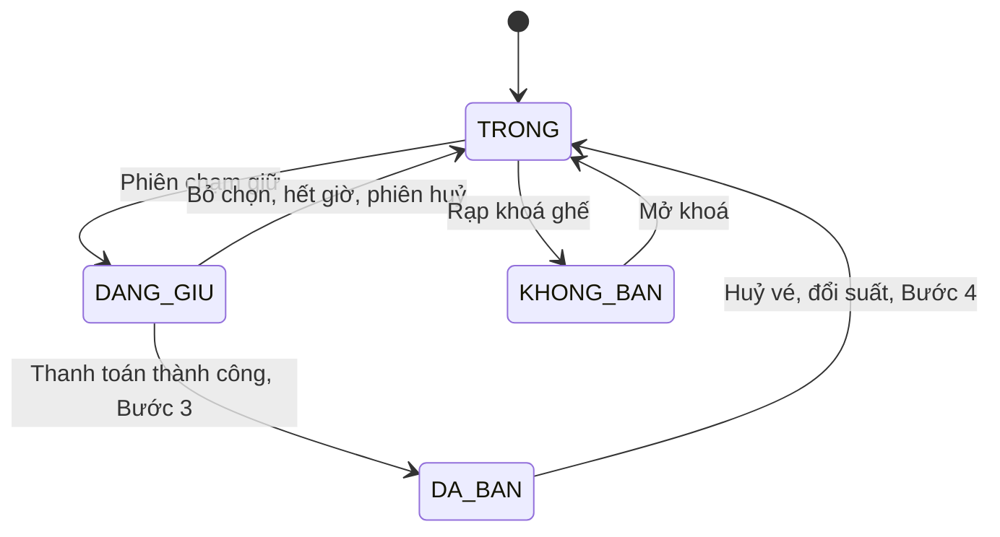

#### Trạng thái phiên đặt vé

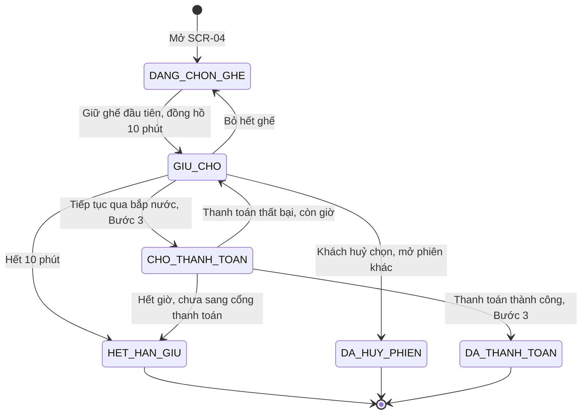

### 4.3 Bước 3 · Bắp nước, thanh toán & vé điện tử

#### Trạng thái thanh toán của phiên

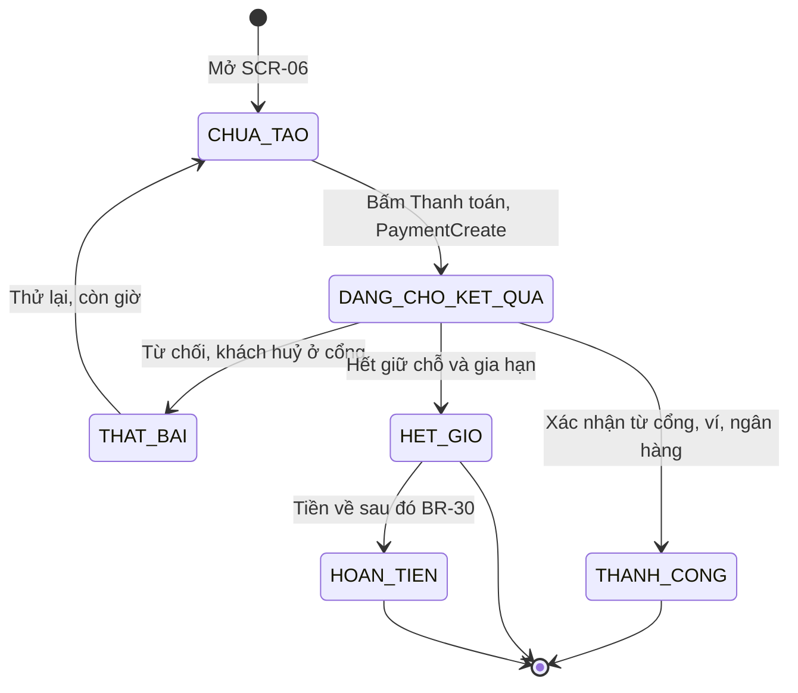

#### Trạng thái vé (đơn vé)

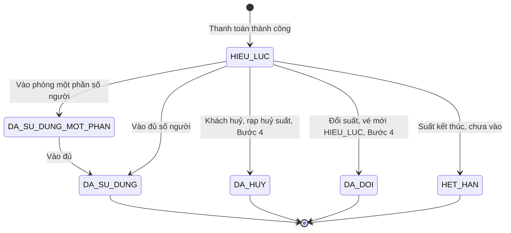

#### Hiển thị trên SCR-06

| **Trạng thái** | **Hiển thị** |
| --- | --- |
| `CHUA_TAO` | Tóm tắt, phương thức, nút "Thanh toán {tổng} ₫", đồng hồ |
| `DANG_CHO_KET_QUA` (QR) | QR, thông tin chuyển khoản sao chép được, đồng hồ |
| `DANG_CHO_KET_QUA` (đã qua cổng, gia hạn) | Vòng chờ, MSG-18 |
| `THAT_BAI` | MSG-17, nút thử lại, đổi phương thức |
| `HET_GIO` | MSG-10 (Bước 2) kèm MSG-19 nếu đã trả |

### 4.4 Bước 4 · Đổi & huỷ vé

#### Vé khi đổi, huỷ

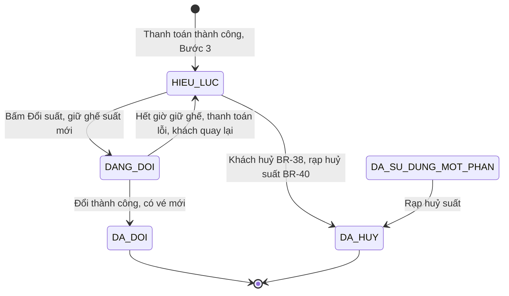

`DANG_DOI` chỉ tồn tại trong phiên đổi trên app; với rạp và các màn khác, vé cũ vẫn `HIEU_LUC` tới khi đổi xong.

#### Hành động khách theo trạng thái vé

| **Trạng thái vé** | **Đổi suất** | **Huỷ** | **Ghi chú** |
| --- | --- | --- | --- |
| `HIEU_LUC`, ≥ 2 giờ, chưa đổi | Có (miễn phí 1 lần) | Có (phí 10%) | |
| `HIEU_LUC`, < 2 giờ | Không | Không | Trừ BR-39 |
| `HIEU_LUC`, suất rạp đổi giờ | Có, miễn phí | Có, hoàn 100% | BR-39 |
| Vé đã đổi một lần | Không | Có (phí 10%) | |
| `HIEU_LUC`, ghế bị khoá | Có | Có | Tại quầy hoàn 100% (BR-41) |
| `DA_SU_DUNG_MOT_PHAN`, `DA_SU_DUNG`, `HET_HAN`, `DA_HUY`, `DA_DOI` | Không | Không | |

## 5. Use Case

### Bước 1 · Chọn phim & suất

#### UC-01 Khám phá và chọn phim

**Luồng chính**

| **Bước** | **Actor** | **Mô tả** |
| --- | --- | --- |
| 1 | Khách | Mở app |
| 2 | App | Gọi \[MovieList\]; hiện **SCR-01** tab Đang chiếu |
| 3 | Khách | Chạm poster một phim |
| 4 | App | Gọi \[MovieDetail\]; hiện **SCR-02** |
| 5 | Khách | Bấm "Đặt vé" → **SCR-03** |

**Luồng thay thế**

| **Mã** | **Điều kiện** | **Xử lý** |
| --- | --- | --- |
| A1 | Tab Theo ngày | Chọn ngày, lọc khung giờ, định dạng → danh sách phim kèm suất; chạm suất → UC-02 bước 4 |
| A2 | Tab Sắp chiếu, bật nhắc | \[ReleaseReminder\]; MSG-06 |
| A3 | Tìm phim | Ô tìm trên **SCR-01** (BR-09) |
| A4 | Xem trailer | Phát trong **SCR-02** khi chạm, không tự phát |

**Luồng lỗi**

| **Mã** | **Điều kiện** | **Xử lý** |
| --- | --- | --- |
| E1 | Không có phim đang chiếu | Empty state "Rạp đang cập nhật lịch chiếu" |
| E2 | Lỗi mạng | MSG-01 |

#### UC-02 Chọn suất và xác nhận độ tuổi

| **Mục** | **Nội dung** |
| --- | --- |
| Tiền điều kiện | Phim có suất mở bán |
| Hậu điều kiện thành công | Có suất đã chọn và xác nhận độ tuổi (nếu cần); mở **SCR-04** |
| Hậu điều kiện thất bại | Ở lại **SCR-03** |

**Luồng chính**

| **Bước** | **Actor** | **Mô tả** |
| --- | --- | --- |
| 1 | App | Gọi \[ShowtimeList\] cho phim; hiện dải ngày, mặc định ngày gần nhất có suất |
| 2 | Khách | Chọn thứ Sáu |
| 3 | App | Hiện các nhóm "2D Phụ đề", "IMAX Phụ đề" với giờ, mức ghế trống, giá từ |
| 4 | Khách | Chạm 19:45 IMAX |
| 5 | App | Phim T16, hồ sơ không có ngày sinh → MSG-02 |
| 6 | Khách | "Tôi đủ tuổi" |
| 7 | App | Mở **SCR-04** (Bước 2) với suất và cờ đã xác nhận tuổi |

**Luồng lỗi**

| **Mã** | **Điều kiện** | **Xử lý** |
| --- | --- | --- |
| E1 | Suất vừa hết vé hoặc vừa bắt đầu | Toast "Suất này không còn bán", tải lại danh sách |
| E2 | Chưa đủ tuổi theo hồ sơ | MSG-04 |
| E3 | Lỗi mạng | MSG-01 |

### Bước 2 · Chọn ghế & giữ chỗ

#### UC-03 Chọn và giữ ghế

| **Mục** | **Nội dung** |
| --- | --- |
| Tiền điều kiện | Đã chọn suất `MO_BAN` (Bước 1); khách đã đăng nhập |
| Hậu điều kiện thành công | Phiên `GIU_CHO` với ghế hợp lệ BR-17; mở **SCR-05** (Bước 3) |
| Hậu điều kiện thất bại | Ghế được nhả; khách ở lại **SCR-04** hoặc về **SCR-03** |

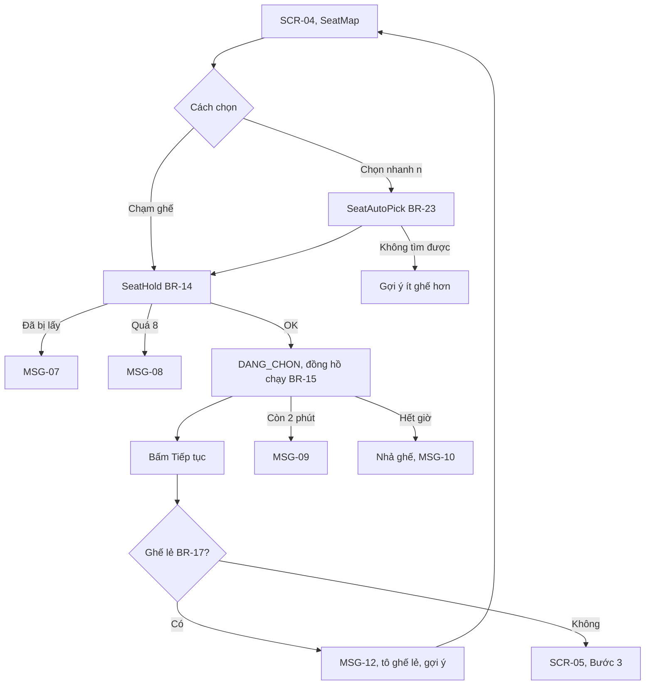

**Luồng chính**

| **Bước** | **Actor** | **Mô tả** |
| --- | --- | --- |
| 1 | App | Gọi \[SeatMap\], mở \[SeatStream\]; hiện **SCR-04** |
| 2 | Khách | Chạm F7 |
| 3 | App | Gọi \[SeatHold\]; F7 `DANG_CHON`; đồng hồ 10:00 bắt đầu |
| 4 | Khách | Chạm F8, F9, F10 |
| 5 | App | Giữ từng ghế; tạm tính cập nhật |
| 6 | Khách | Bấm "Tiếp tục" |
| 7 | App | Gọi \[SeatValidate\] (BR-17); hợp lệ → **SCR-05** |

**Luồng thay thế**

| **Mã** | **Điều kiện** | **Xử lý** |
| --- | --- | --- |
| A1 | Chọn nhanh | Nhập 4 → \[SeatAutoPick\] → 4 ghế được giữ, sơ đồ cuộn tới hàng đó |
| A2 | Ghế đôi | BR-18 |
| A3 | Bỏ chọn | Chạm lại ghế → \[SeatRelease\] |
| A4 | Đang giữ ở phiên khác | MSG-11 trước bước 1 |
| A5 | Phóng to | Kéo hai ngón; ghế tối thiểu 32 pt khi phóng to tối đa |

**Luồng lỗi**

| **Mã** | **Điều kiện** | **Xử lý** |
| --- | --- | --- |
| E1 | Ghế vừa bị lấy | MSG-07 |
| E2 | Quá 8 ghế | MSG-08 |
| E3 | Ghế lẻ | MSG-12 |
| E4 | Hết giờ | MSG-10 |
| E5 | Mất kết nối | MSG-13 (BR-19) |
| E6 | Suất bắt đầu, bị huỷ | MSG-14, MSG-15 |

### Bước 3 · Bắp nước, thanh toán & vé điện tử

#### UC-04 Chọn bắp nước

**Luồng chính**

| **Bước** | **Actor** | **Mô tả** |
| --- | --- | --- |
| 1 | App | Gọi \[ConcessionMenu\]; hiện **SCR-05** với đồng hồ giữ chỗ |
| 2 | Khách | Chọn "Combo đôi": vị Phô mai, 2 nước |
| 3 | App | Cập nhật tổng (BR-26) |
| 4 | Khách | Bấm "Tiếp tục" → **SCR-06** |

**Luồng thay thế**

| **Mã** | **Điều kiện** | **Xử lý** |
| --- | --- | --- |
| A1 | Bỏ qua | "Bỏ qua" → **SCR-06** |
| A2 | Món hết | Mờ, "Tạm hết" |

#### UC-05 Thanh toán

| **Mục** | **Nội dung** |
| --- | --- |
| Tiền điều kiện | Phiên `GIU_CHO`, còn thời gian giữ chỗ |
| Hậu điều kiện thành công | Phiên `DA_THANH_TOAN`; vé `HIEU_LUC`; mở **SCR-07** |
| Hậu điều kiện thất bại | Phiên `GIU_CHO` (còn giờ) hoặc `HET_HAN_GIU`; tiền không bị giữ |

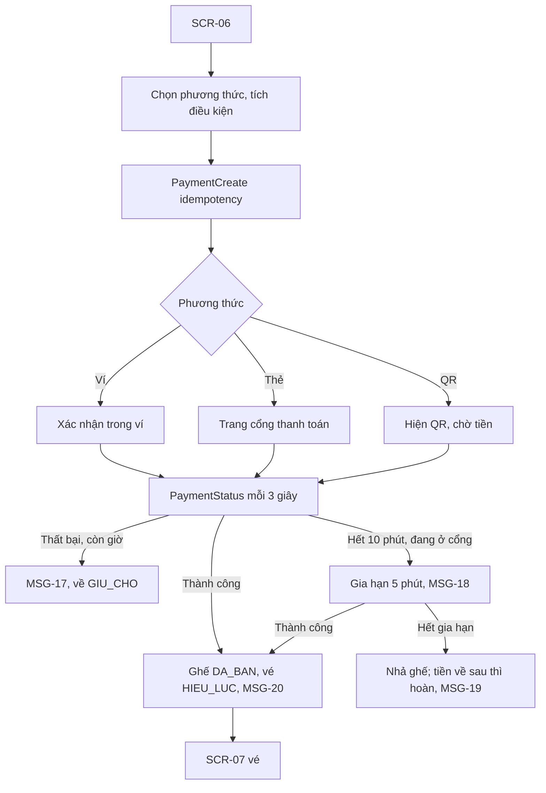

**Luồng chính**

| **Bước** | **Actor** | **Mô tả** |
| --- | --- | --- |
| 1 | App | **SCR-06**: tóm tắt phim, suất, ghế, bắp nước, tổng; phương thức lần trước (Ví) |
| 2 | Khách | Tích điều kiện, bấm "Thanh toán 295.000 ₫" |
| 3 | App | Gọi \[PaymentCreate\]; mở xác nhận của ví |
| 4 | Khách | Xác nhận trong ví |
| 5 | Máy chủ | Nhận xác nhận từ ví; ghế `DA_BAN`; tạo vé; gửi email |
| 6 | App | \[PaymentStatus\] trả `THANH_CONG`; mở **SCR-07**; lưu vé offline |

**Luồng thay thế**

| **Mã** | **Điều kiện** | **Xử lý** |
| --- | --- | --- |
| A1 | Thẻ | Trang cổng; quay về app → chờ kết quả |
| A2 | QR | QR trên **SCR-06**; khách chuyển bằng app ngân hàng; tiền về → thành công |
| A3 | Gia hạn khi chờ cổng | MSG-18 (BR-29) |
| A4 | Thêm vào lịch | Nút trên **SCR-07** → hộp thoại lịch của hệ điều hành |

**Luồng lỗi**

| **Mã** | **Điều kiện** | **Xử lý** |
| --- | --- | --- |
| E1 | Thất bại khi còn giờ | MSG-17 |
| E2 | Tiền về sau khi mất ghế, QR sai số tiền | MSG-19 (BR-30) |
| E3 | Thanh toán thành công hai lần | Hoàn lần thứ hai (BR-35) |
| E4 | Mất mạng trên app sau khi trả | Khi có mạng, \[PaymentStatus\] cập nhật; vé cũng có trong email |

#### UC-06 Dùng vé và nhận bắp nước

**Luồng chính**

| **Bước** | **Actor** | **Mô tả** |
| --- | --- | --- |
| 1 | App | 30 phút trước giờ chiếu gửi MSG-21 |
| 2 | Khách | Mở vé (offline được) tại quầy bắp nước; vé hiện "Combo đôi × 1 – Phô mai, 2 nước – Chưa nhận" và khung giờ nhận |
| 3 | Khách | Đưa QR cho nhân viên quầy; nhận bắp nước |
| 4 | App | Nhận sự kiện \[TicketEvents\]: món "Đã nhận lúc {giờ}", MSG-24 |
| 5 | Khách | Tới cửa phòng chiếu, đưa QR cho nhân viên soát vé |
| 6 | App | "4/4 người đã vào", vé `DA_SU_DUNG`, MSG-25 |

**Luồng lỗi**

| **Mã** | **Điều kiện** | **Xử lý** |
| --- | --- | --- |
| E1 | Mở vé ngoài khung giờ nhận bắp nước | MSG-23 trên vé |
| E2 | Nhóm tới lệch | Vào 2 người trước → "2/4 người đã vào", vé `DA_SU_DUNG_MOT_PHAN`; 2 người sau dùng lại QR |
| E3 | Không có mạng | Vé vẫn mở được; trạng thái món, số người cập nhật khi có mạng |
| E4 | Vé đã huỷ, đã đổi | Vé cũ hiện nhãn "Đã huỷ" / "Đã đổi", QR mờ; mở vé mới (Bước 4) |

### Bước 4 · Đổi & huỷ vé

#### UC-07 Đổi suất

| **Mục** | **Nội dung** |
| --- | --- |
| Tiền điều kiện | Vé thoả mục 4.2 |
| Hậu điều kiện thành công | Vé cũ `DA_DOI`; vé mới `HIEU_LUC` |
| Hậu điều kiện thất bại | Vé cũ giữ nguyên |

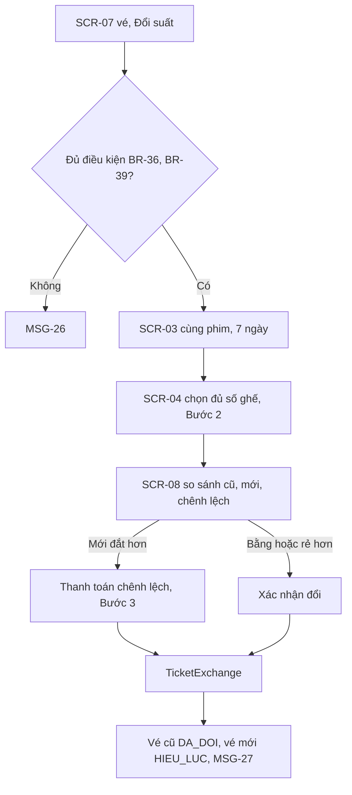

**Luồng chính**

| **Bước** | **Actor** | **Mô tả** |
| --- | --- | --- |
| 1 | Khách | Ở **SCR-07** bấm "Đổi suất" |
| 2 | App | Gọi \[TicketExchangeOptions\]; đủ điều kiện → mở **SCR-03** chế độ đổi suất (chỉ phim này, 7 ngày) |
| 3 | Khách | Chọn suất mới, chọn 2 ghế trên **SCR-04** (Bước 2, đồng hồ giữ chỗ áp dụng) |
| 4 | App | **SCR-08** chế độ đổi: suất cũ → suất mới, giá cũ, giá mới, "+20.000 ₫ cần trả thêm" |
| 5 | Khách | Bấm "Xác nhận đổi", thanh toán chênh lệch (Bước 3) |
| 6 | Máy chủ | \[TicketExchange\]: vé cũ `DA_DOI`, ghế cũ nhả; vé mới `HIEU_LUC`; bắp nước chuyển theo |
| 7 | App | Mở vé mới trên **SCR-07**; MSG-27 |

**Luồng thay thế**

| **Mã** | **Điều kiện** | **Xử lý** |
| --- | --- | --- |
| A1 | Suất mới rẻ hơn | **SCR-08** ghi "Không hoàn chênh lệch {x} ₫" trước khi xác nhận; không qua thanh toán |
| A2 | Suất rạp đổi giờ (BR-39) | **SCR-08** ghi "Miễn phí do rạp đổi giờ"; không tính lần đổi |
| A3 | Khách quay lại giữa chừng | Nhả ghế suất mới; vé cũ giữ nguyên |

**Luồng lỗi**

| **Mã** | **Điều kiện** | **Xử lý** |
| --- | --- | --- |
| E1 | Không đủ điều kiện (< 2 giờ, đã đổi, đã vào phòng) | MSG-26 |
| E2 | Hết giờ giữ ghế suất mới | Bước 2 MSG-10; vé cũ giữ nguyên |
| E3 | Thanh toán chênh lệch thất bại | Bước 3 MSG-17; vé cũ giữ nguyên |
| E4 | Mất mạng khi xác nhận | MSG-32; gửi lại cùng idempotency key |

#### UC-08 Huỷ vé

| **Mục** | **Nội dung** |
| --- | --- |
| Tiền điều kiện | Vé thoả mục 4.2 |
| Hậu điều kiện thành công | Vé `DA_HUY`; ghế nhả; lệnh hoàn tiền được tạo |
| Hậu điều kiện thất bại | Vé giữ nguyên |

**Luồng chính**

| **Bước** | **Actor** | **Mô tả** |
| --- | --- | --- |
| 1 | Khách | Ở **SCR-07** bấm "Huỷ vé" |
| 2 | App | Gọi \[TicketCancelQuote\]; **SCR-08** chế độ huỷ: tổng đã trả 295.000 ₫, phí huỷ 30.000 ₫, hoàn 265.000 ₫ về Ví, nhận ngay |
| 3 | Khách | Bấm "Xác nhận huỷ" |
| 4 | Máy chủ | \[TicketCancel\]: vé `DA_HUY`, ghế nhả, tạo lệnh hoàn (BR-38) |
| 5 | App | MSG-29; vé hiện "Đã huỷ", trạng thái hoàn |

**Luồng thay thế**

| **Mã** | **Điều kiện** | **Xử lý** |
| --- | --- | --- |
| A1 | Suất rạp đổi giờ | Hoàn 100%, **SCR-08** ghi "Miễn phí do rạp đổi giờ" (BR-39) |
| A2 | Trả bằng thẻ | "Hoàn về thẻ •••• 1234 trong 5–7 ngày làm việc" |

**Luồng lỗi**

| **Mã** | **Điều kiện** | **Xử lý** |
| --- | --- | --- |
| E1 | Không đủ điều kiện | MSG-26 |
| E2 | Mất mạng khi xác nhận | MSG-32; gửi lại cùng idempotency key, không huỷ hai lần |

#### UC-09 Nhận thay đổi từ rạp

| **Mục** | **Nội dung** |
| --- | --- |
| Tiền điều kiện | Khách có vé `HIEU_LUC` của suất bị rạp đổi giờ, huỷ, hoặc có ghế bị khoá |
| Hậu điều kiện thành công | Khách được báo; vé cập nhật nhãn, trạng thái; tiền hoàn (nếu huỷ suất) |
| Hậu điều kiện thất bại | – |

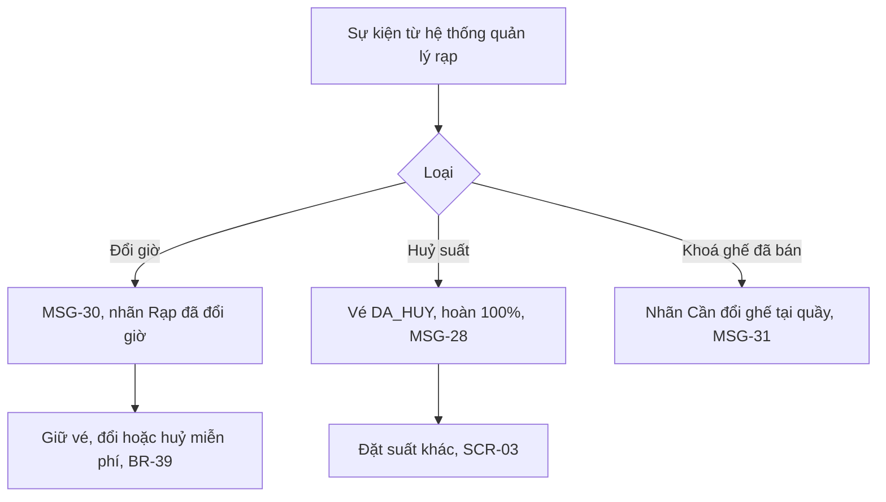

**Luồng chính (rạp huỷ suất)**

| **Bước** | **Actor** | **Mô tả** |
| --- | --- | --- |
| 1 | Máy chủ | Nhận sự kiện huỷ suất; vé `DA_HUY`; tạo lệnh hoàn (BR-40) |
| 2 | App | Push, email MSG-28 trong ≤ 15 phút |
| 3 | Khách | Chạm push → **SCR-07** vé "Đã huỷ bởi rạp", số tiền hoàn, nơi nhận |
| 4 | Khách | Bấm "Đặt suất khác" → **SCR-03** của phim (Bước 1) |

**Luồng thay thế**

| **Mã** | **Điều kiện** | **Xử lý** |
| --- | --- | --- |
| A1 | Rạp đổi giờ | MSG-30; vé hiện giờ mới, nhãn; khách giữ vé hoặc đổi, huỷ miễn phí (BR-39) |
| A2 | Ghế bị khoá | MSG-31; nhãn trên vé (BR-41) |
| A3 | Khách đang giữ ghế của suất bị huỷ | Bước 2 MSG-15 |

## 6. Điểm vào

| **Điểm vào** | **Dẫn tới** | **Ghi chú** |
| --- | --- | --- |
| Mở app | **SCR-01** | |
| Push nhắc mở bán | **SCR-03** của phim | BR-08 |
| Link chia sẻ phim | **SCR-02** | |
| "Đổi suất" ở vé (Bước 4) | **SCR-03** chế độ đổi suất | Cùng phim |
| Chọn suất (Bước 1) | **SCR-04** | |
| Quay lại từ **SCR-05**, **SCR-06** | **SCR-04** | Giữ nguyên ghế, đồng hồ chạy tiếp |
| Thanh toán thất bại, còn giờ (Bước 3) | **SCR-06** | Ghế vẫn giữ |
| "Đổi suất" (Bước 4) | **SCR-04** của suất mới | Số ghế = số ghế vé cũ |
| "Tiếp tục" ở **SCR-04** | **SCR-05** | |
| Tab Vé của tôi | Danh sách vé sắp tới, đã xem | |
| Push nhắc giờ chiếu, email | **SCR-07** | |
| Banner "Vé sắp tới" ở **SCR-01** | **SCR-07** | Bước 1 |
| Vé ở **SCR-07** → Đổi suất / Huỷ vé | UC-07, UC-08 | |
| Push, email "Rạp đã đổi giờ" (MSG-30) | **SCR-07** với lựa chọn đổi, huỷ miễn phí | BR-39 |
| Push, email "Suất đã bị huỷ" (MSG-28) | **SCR-07** vé đã huỷ | BR-40 |

## 7. Mô tả màn hình

<!-- Bước 1 · Chọn phim & suất -->
### SCR-01 Trang chủ

| **#** | **Thành phần** | **Loại** | **Hành vi** |
| --- | --- | --- | --- |
| 1 | Banner | Carousel | Phim nổi bật; chạm mở **SCR-02** |
| 2 | Tab | Tabs | Đang chiếu, Sắp chiếu, Theo ngày |
| 3 | Ô tìm | Search | BR-09 |
| 4 | Lưới phim | Grid 2 cột | Thẻ phim BR-02 |
| 5 | Theo ngày | Dải ngày + chips lọc + list | A1 UC-01 |
| 6 | Vé sắp tới | Banner | Khi có vé trong 24 giờ tới → mở vé (Bước 3) |

### SCR-02 Chi tiết phim

| **#** | **Thành phần** | **Loại** | **Hành vi** |
| --- | --- | --- | --- |
| 1 | Trailer / poster | Media | Chạm để phát |
| 2 | Tên, tên gốc | Text | |
| 3 | Nhãn phân loại | Tag | Chạm → giải thích mức tuổi |
| 4 | Thông tin | List | Thời lượng, khởi chiếu, thể loại, đạo diễn, diễn viên, ngôn ngữ |
| 5 | Tóm tắt | Text mở rộng | 4 dòng, "Xem thêm" |
| 6 | "Đặt vé" / "Nhắc tôi khi mở bán" | Button dính đáy | Theo trạng thái phim |

### SCR-03 Chọn suất chiếu

| **#** | **Thành phần** | **Loại** | **Hành vi** |
| --- | --- | --- | --- |
| 1 | Phim | Header thu gọn | Poster nhỏ, tên, phân loại, thời lượng |
| 2 | Dải ngày | Chips cuộn ngang | 7 ngày; "Hôm nay", "Mai", "T6 22/11"; ngày không có suất mờ |
| 3 | Nhóm suất | Section | BR-06 |
| 4 | Ô giờ | Button | "19:45 → 22:10", mức ghế trống (mục 4.1), "Từ {giá}" |
| 5 | Popup độ tuổi | Modal | MSG-02, MSG-03, MSG-04 |

<!-- Bước 2 · Chọn ghế & giữ chỗ -->
### SCR-04 Chọn ghế

| **#** | **Thành phần** | **Loại** | **Hành vi** |
| --- | --- | --- | --- |
| 1 | Header suất | Header | Phim, phòng, ngày giờ, định dạng; nút đổi suất |
| 2 | Đồng hồ giữ chỗ | Timer | "Giữ ghế 09:42"; đổi màu khi < 2 phút; ẩn trước khi giữ ghế đầu |
| 3 | Màn hình chiếu | Hình | Cong, ở trên cùng |
| 4 | Sơ đồ ghế | Canvas | Trạng thái BR-12; phóng to, kéo; mã hàng ở hai bên |
| 5 | Chú thích | Legend | Trống, Đang chọn, Đã bán/Đang giữ, Không bán; Thường, VIP, Đôi kèm giá |
| 6 | Chọn nhanh | Stepper + Button | "Chọn nhanh {n} ghế" (BR-23) |
| 7 | Ghế đã chọn | Chips | Mã ghế, chạm × để bỏ |
| 8 | Tạm tính | Text | BR-20; nhắc độ tuổi BR-21 |
| 9 | "Tiếp tục" | Button dính đáy | Disabled khi chưa có ghế |
| 10 | Banner kết nối | Banner | MSG-13 |
| 11 | Tô ghế lẻ | Overlay | Viền nhấp nháy ghế lẻ khi vi phạm BR-17 |

<!-- Bước 3 · Bắp nước, thanh toán & vé điện tử -->
### SCR-05 Bắp nước

| **#** | **Thành phần** | **Loại** | **Hành vi** |
| --- | --- | --- | --- |
| 1 | Đồng hồ giữ chỗ | Timer | Bước 2 BR-15 |
| 2 | Combo | List | Ảnh, tên, mô tả, giá, "Tiết kiệm {x} ₫", stepper |
| 3 | Tuỳ chọn combo | Bottom sheet | Vị bắp, nước |
| 4 | Món lẻ | List | Ảnh, tên, giá, stepper |
| 5 | Tổng | Text | Vé + bắp nước |
| 6 | "Bỏ qua", "Tiếp tục" | Button | |

### SCR-06 Thanh toán

| **#** | **Thành phần** | **Loại** | **Bắt buộc** | **Validate / hành vi** |
| --- | --- | --- | --- | --- |
| 1 | Đồng hồ giữ chỗ | Timer | – | |
| 2 | Tóm tắt | Card | – | Poster, phim, phân loại, phòng, ngày giờ, ghế, bắp nước, giá từng phần |
| 3 | Email nhận vé | Email | Có | Điền sẵn từ hồ sơ |
| 4 | Phương thức | Radio list | Có | BR-27 |
| 5 | Điều kiện đổi, huỷ | Checkbox + link | Có | Mở tóm tắt Bước 4 BR-36 |
| 6 | "Thanh toán {tổng} ₫" | Button | – | Disabled khi chưa tích |
| 7 | Khu QR | Panel | – | QR, ngân hàng, số tài khoản, số tiền, nội dung (sao chép); "Tải ảnh QR" |
| 8 | Trạng thái chờ | Overlay | – | Mục 4.3 |

### SCR-07 Vé của tôi & vé điện tử

| **#** | **Thành phần** | **Loại** | **Hành vi** |
| --- | --- | --- | --- |
| 1 | Tab | Tabs | Sắp tới, Đã xem |
| 2 | Thẻ vé | Card | Poster, phim, ngày giờ, phòng, ghế, trạng thái vé (mục 4.2) |
| 3 | Vé điện tử | Màn chi tiết | QR lớn, mã đặt vé, thông tin BR-32; độ sáng tối đa |
| 4 | Bắp nước | List | Món, trạng thái nhận |
| 5 | Thêm vào lịch | Button | BR-31 |
| 6 | Đổi suất, Huỷ vé | Button | Bước 4 |
| 7 | Ghi chú offline | Text | "Vé đã lưu trên máy, dùng được khi không có mạng" |

<!-- Bước 4 · Đổi & huỷ vé -->
### SCR-08 Đổi suất / Huỷ vé

| **#** | **Thành phần** | **Loại** | **Bắt buộc** | **Validate / hành vi** |
| --- | --- | --- | --- | --- |
| 1 | Vé hiện tại | Card | – | Phim, suất, ghế, bắp nước, đã trả |
| 2 | Đổi: suất mới | Card | – | Suất, ghế mới, giá mới; mũi tên từ cũ sang mới |
| 3 | Chênh lệch | Text | – | "+{x} ₫ cần trả thêm" hoặc "Không hoàn chênh lệch {x} ₫" hoặc "Miễn phí do rạp đổi giờ" |
| 4 | Huỷ: tiền hoàn | Card | – | Tổng đã trả, phí huỷ 10%, tiền hoàn, nơi nhận, thời gian (BR-38) |
| 5 | Điều kiện | Text | – | "Mỗi vé được đổi miễn phí 1 lần, trước giờ chiếu ít nhất 2 giờ" |
| 6 | "Xác nhận đổi" / "Xác nhận huỷ" | Button | – | Huỷ: nút đỏ |

Trên **SCR-07** (Bước 3), vé thêm: nhãn "Rạp đã đổi giờ", "Đã huỷ bởi rạp", "Cần đổi ghế tại quầy", "Đã đổi"; trạng thái hoàn tiền; nút Đổi suất, Huỷ vé ẩn hoặc disabled kèm lý do theo mục 4.2.

## 8. API

### 8.1 Bước 1 · Chọn phim & suất

| **API** | **Request chính** | **Response chính** | **Timeout / retry** |
| --- | --- | --- | --- |
| \[MovieList\] | tab, keyword | Thẻ phim | 5s / 1 lần |
| \[MovieDetail\] | movie_id | Thông tin, trailer_url | 5s / 1 lần |
| \[ShowtimeList\] | movie_id hoặc date, filters | Suất: giờ, kết thúc, định dạng, ngôn ngữ, mức ghế, giá từ | 5s / 1 lần |
| \[ReleaseReminder\] | movie_id, on | – | 5s / 1 lần |
| \[ProfileAge\] | – | birth_date hoặc null | Cache phiên |

**Map lỗi → thông báo**

| **Nhóm** | **Message** |
| --- | --- |
| Mất mạng, lỗi máy chủ | MSG-01 |
| Xác nhận tuổi T13, T16, T18 | MSG-02 |
| Lưu ý phim K | MSG-03 |
| Chưa đủ tuổi | MSG-04 |
| Phim đã mở bán (push) | MSG-05 |
| Đã bật nhắc | MSG-06 |

### 8.2 Bước 2 · Chọn ghế & giữ chỗ

| **API** | **Request chính** | **Response chính** | **Timeout / retry** |
| --- | --- | --- | --- |
| \[SeatMap\] | showtime_id | Lưới, loại, giá, trạng thái từng ghế, phiên đang mở của khách | 3s / 1 lần |
| \[SeatStream\] | showtime_id | Sự kiện đổi trạng thái ghế | Kết nối lâu dài; dự phòng làm mới 5 giây |
| \[SeatHold\] | session_id, seat_code | OK, hold_expires_at hoặc SEAT_TAKEN, LIMIT | 2s / không retry tự động |
| \[SeatRelease\] | session_id, seat_code | OK | 2s / 2 lần |
| \[SeatAutoPick\] | session_id, count, seat_type | Ghế đã giữ hoặc NOT_FOUND | 3s / 1 lần |
| \[SeatValidate\] | session_id | OK hoặc danh sách ghế lẻ, gợi ý | 2s / 1 lần |
| \[SessionCancel\] | session_id | OK | 3s / 2 lần |

**Map lỗi → thông báo**

| **Nhóm** | **Message** |
| --- | --- |
| Ghế vừa bị lấy | MSG-07 |
| Quá 8 ghế | MSG-08 |
| Còn 2 phút | MSG-09 |
| Hết giờ giữ | MSG-10 |
| Đang có phiên khác | MSG-11 |
| Ghế lẻ, chọn nhanh không được | MSG-12 |
| Mất kết nối | MSG-13 |
| Suất đã bắt đầu | MSG-14 |
| Suất bị huỷ | MSG-15 |

### 8.3 Bước 3 · Bắp nước, thanh toán & vé điện tử

| **API** | **Request chính** | **Response chính** | **Timeout / retry** |
| --- | --- | --- | --- |
| \[ConcessionMenu\] | showtime_id | Combo, món, tuỳ chọn, trạng thái | 3s / 1 lần |
| \[SessionUpdate\] | session_id, concessions | Tổng mới | 3s / 1 lần |
| \[PaymentCreate\] | session_id, method, email, idempotency_key | payment_id, redirect_url hoặc qr | 10s / gửi lại cùng key |
| \[PaymentStatus\] | payment_id | status, ticket_id | 3s / mỗi 3 giây |
| \[PaymentWebhook\] | Cổng, ví, ngân hàng → máy chủ | – | Có chữ ký; BR-29 |
| \[TicketList\], \[TicketDetail\] | tab; ticket_id | Vé, QR ký số | 5s / 1 lần; lưu offline |
| \[TicketEvents\] | ticket_id | Món đã nhận, số người đã vào, trạng thái vé | Push + đồng bộ khi mở vé |

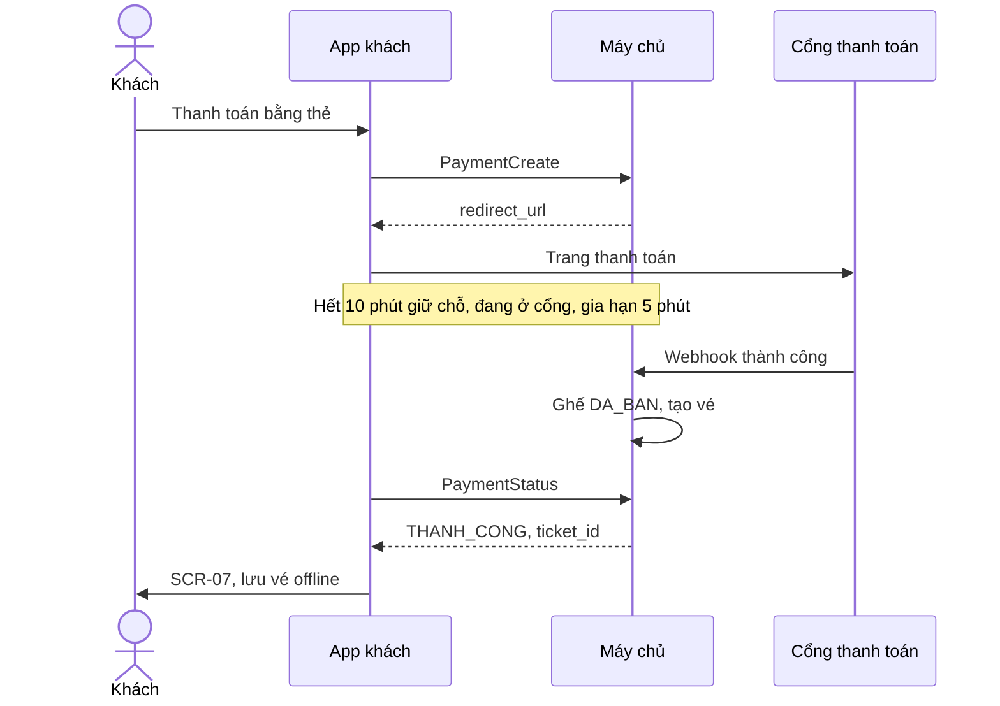

**Map lỗi → thông báo**

| **Nhóm** | **Message** |
| --- | --- |
| Món bắp nước tạm hết | MSG-16 |
| Thanh toán thất bại | MSG-17 |
| Đang xác nhận (gia hạn) | MSG-18 |
| Hoàn tiền tự động | MSG-19 |
| Đặt vé thành công | MSG-20 |
| Nhắc giờ chiếu | MSG-21 |
| Mất mạng | MSG-22 |
| Khung giờ nhận bắp nước | MSG-23 |
| Bắp nước đã nhận | MSG-24 |
| Đã vào phòng | MSG-25 |

### 8.4 Bước 4 · Đổi & huỷ vé

| **API** | **Request chính** | **Response chính** | **Timeout / retry** |
| --- | --- | --- | --- |
| \[TicketExchangeOptions\] | ticket_id | Đủ điều kiện, lý do, miễn phí hay không | 3s / 1 lần |
| \[TicketExchange\] | ticket_id, new_session_id, payment_id (nếu có), idempotency_key | Vé mới | 10s / gửi lại cùng key |
| \[TicketCancelQuote\] | ticket_id | Phí, tiền hoàn, nơi nhận, thời gian | 3s / 1 lần |
| \[TicketCancel\] | ticket_id, idempotency_key | Trạng thái, refund_id | 10s / gửi lại cùng key |
| \[TicketEvents\] | ticket_id | Đổi giờ, huỷ suất, khoá ghế, trạng thái hoàn | Push + đồng bộ khi mở vé |

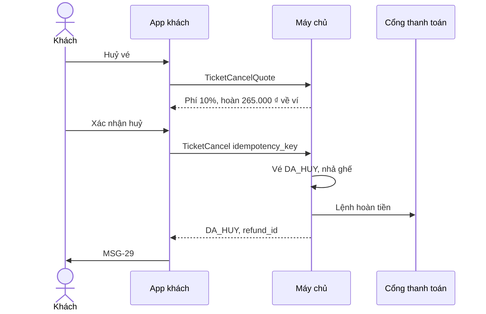

**Map lỗi → thông báo**

| **Nhóm** | **Message** |
| --- | --- |
| Không đủ điều kiện đổi, huỷ | MSG-26 |
| Đổi suất thành công | MSG-27 |
| Rạp huỷ suất | MSG-28 |
| Huỷ vé thành công | MSG-29 |
| Rạp đổi giờ | MSG-30 |
| Ghế bị khoá | MSG-31 |
| Mất mạng | MSG-32 |

## 9. Danh sách thông báo

| **ID** | **Nơi hiện** | **Nội dung (VI)** |
| --- | --- | --- |
| MSG-01 | Toast | Kết nối không ổn định, vui lòng thử lại |
| MSG-02 | Popup | Phim {tên} được phân loại {T13/T16/T18}: chỉ dành cho khán giả từ đủ {13/16/18} tuổi. Rạp sẽ kiểm tra giấy tờ tuỳ thân có ảnh khi vào phòng chiếu; không đủ tuổi sẽ không được vào và không hoàn tiền. \[Tôi đủ tuổi\] \[Chọn phim khác\] |
| MSG-03 | Popup | Phim {tên} được phân loại K: khán giả dưới 13 tuổi cần xem cùng cha mẹ hoặc người giám hộ. \[Đã hiểu\] |
| MSG-04 | Popup | Theo ngày sinh trong hồ sơ, bạn chưa đủ {n} tuổi để xem phim này |
| MSG-05 | Push | {Tên phim} đã mở bán vé! Chọn suất ngay |
| MSG-06 | Toast | Chúng tôi sẽ báo bạn khi {tên phim} mở bán |
| MSG-07 | Toast | Ghế {mã} vừa có người chọn. Vui lòng chọn ghế khác |
| MSG-08 | Toast | Mỗi lần đặt tối đa 8 ghế |
| MSG-09 | Banner | Còn 2 phút để hoàn tất đặt vé |
| MSG-10 | Popup | Đã hết thời gian giữ ghế. Các ghế bạn chọn đã được nhả cho người khác. \[Chọn lại\] |
| MSG-11 | Popup | Bạn đang giữ {n} ghế suất {phim} {giờ}. Bỏ các ghế đó để chọn suất mới? \[Bỏ ghế đang giữ\] \[Quay lại\] |
| MSG-12 | Inline | Cách chọn này để lại ghế {mã} trống một mình nên khó bán. Hãy chọn thêm ghế {mã} hoặc dịch nhóm sang một ghế. {Hoặc: Không còn {n} ghế liền nhau, thử ít ghế hơn} |
| MSG-13 | Banner | Đang cập nhật sơ đồ ghế… |
| MSG-14 | Popup | Suất chiếu đã bắt đầu nên không thể đặt vé online. Bạn có thể mua tại quầy trong 15 phút đầu |
| MSG-15 | Popup | Suất chiếu này vừa bị huỷ. Vui lòng chọn suất khác |
| MSG-16 | Inline | Món này đang tạm hết |
| MSG-17 | Banner **SCR-06** | Thanh toán chưa thành công: {lý do}. Ghế của bạn vẫn được giữ tới {giờ}. \[Thử lại\] \[Đổi phương thức\] |
| MSG-18 | Overlay | Đang xác nhận thanh toán với {ngân hàng / ví}. Ghế vẫn được giữ cho bạn, vui lòng không thanh toán lại |
| MSG-19 | Push, email | Đơn {mã} chưa xuất vé {lý do: hết thời gian giữ ghế / số tiền chuyển khoản không khớp / thanh toán trùng}. Số tiền {x} ₫ sẽ được hoàn về {nguồn} trong 1 ngày làm việc |
| MSG-20 | Push | Đặt vé thành công! {Phim} · {ngày giờ} · Ghế {ghế}. Vé đã lưu trong ứng dụng |
| MSG-21 | Push | {Phim} bắt đầu lúc {giờ} tại {phòng}. Mở vé để vào phòng chiếu {và nhận bắp nước tại quầy} |
| MSG-22 | Toast | Kết nối không ổn định, vui lòng thử lại |
| MSG-23 | Inline vé | Nhận bắp nước tại quầy từ {giờ} tới {giờ} |
| MSG-24 | Toast, inline vé | Đã nhận {món} lúc {giờ} |
| MSG-25 | Inline vé | {k}/{n} người đã vào phòng chiếu lúc {giờ} |
| MSG-26 | Popup | Vé này không thể {đổi / huỷ}: {còn dưới 2 giờ tới giờ chiếu / đã đổi một lần / đã vào phòng}. Vui lòng liên hệ quầy vé |
| MSG-27 | Toast | Đã đổi sang suất {ngày giờ}, ghế {ghế}. Vé mới đã thay vé cũ |
| MSG-28 | Push, email | Rất tiếc, suất {phim} {ngày giờ} đã bị huỷ ({lý do}). Bạn được hoàn {x} ₫ về {nguồn} trong {thời gian}. \[Đặt suất khác\] |
| MSG-29 | Toast | Đã huỷ vé. {x} ₫ sẽ được hoàn về {nguồn} trong {thời gian} |
| MSG-30 | Push, email | Suất {phim} ngày {ngày} đổi giờ bắt đầu từ {giờ cũ} thành {giờ mới}. Bạn có thể đổi hoặc huỷ vé miễn phí trong ứng dụng |
| MSG-31 | Push, inline vé | Ghế {mã} của bạn tạm không sử dụng được. Vui lòng tới quầy vé để đổi ghế hoặc được hoàn 100% |
| MSG-32 | Toast | Kết nối không ổn định, vui lòng thử lại |

## 10. Yêu cầu phi chức năng

| **Mục** | **Yêu cầu** |
| --- | --- |
| Hiệu năng | **SCR-01** hiện poster đầu tiên ≤ 1,5 giây; \[ShowtimeList\] ≤ 500 ms (p95); \[SeatHold\] ≤ 300 ms (p95); sự kiện tới sơ đồ ≤ 2 giây; chịu 5.000 phiên đồng thời trên một suất; \[PaymentCreate\] ≤ 1 giây; vé hiện ≤ 3 giây sau khi máy chủ nhận xác nhận; QR vé mở offline ≤ 500 ms; \[TicketCancelQuote\], \[TicketExchangeOptions\] ≤ 500 ms (p95); báo khách và tạo lệnh hoàn cho suất bị huỷ ≤ 15 phút; đổi giờ hiện trên app ≤ 1 phút |
| Độ tươi dữ liệu | Suất mới, đổi giờ, huỷ hiện trên app ≤ 1 phút |
| Dữ liệu di động | Trailer không tự phát; poster nhiều kích thước |
| Log / audit | Xác nhận độ tuổi: thời điểm, phim, suất; Mọi lần giữ, nhả ghế: phiên, thời điểm, lý do (bỏ chọn, hết giờ, thanh toán); Mọi sự kiện thanh toán, gia hạn, hoàn tiền; sự kiện nhận bắp nước, vào phòng hiện trên vé; Mọi lần đổi, huỷ (lý do, số tiền), sự kiện rạp đổi giờ, huỷ suất, khoá ghế, lệnh hoàn và kết quả |
| Tracking | Tab dùng, tìm phim, mở chi tiết, xem trailer, chọn ngày, chọn suất (định dạng, mức ghế), gặp popup tuổi và lựa chọn, bật nhắc; Thời gian chọn ghế, số va chạm, dùng chọn nhanh, vi phạm ghế lẻ và cách sửa, hết giờ ở bước nào; Tỉ lệ có bắp nước, món phổ biến, phương thức, thời gian thanh toán, thất bại theo lý do, gia hạn, hoàn tiền, mở vé offline, thêm vào lịch; Bấm Đổi suất, Huỷ vé, bỏ giữa chừng, chênh lệch, nguồn hoàn, chạm Đặt suất khác sau khi rạp huỷ |
| Accessibility | Nhãn phân loại đọc được thành chữ ("Phân loại T16, từ 16 tuổi"); ô giờ đọc kèm mức ghế; mức ghế không chỉ phân biệt bằng màu; Sơ đồ có chế độ danh sách: chọn hàng → danh sách ghế với trạng thái bằng chữ; ghế đọc "F7, ghế thường, 85.000 đồng, còn trống"; trạng thái không chỉ bằng màu (có biểu tượng); Tổng tiền đọc rõ; đồng hồ giữ chỗ thông báo bằng giọng đọc khi còn 2 phút; QR có mã đặt vé dạng chữ để nhân viên nhập tay; Số tiền hoàn, phí, thời gian đọc rõ; nhãn trạng thái vé phân biệt bằng chữ, không chỉ bằng màu |
| Tính đúng | Giữ ghế nguyên tử, một ghế một phiên; nhả ghế hết hạn chạy trên máy chủ, không phụ thuộc app; Một phiên tối đa một thanh toán thành công được giữ; ghế chỉ `DA_BAN` khi có xác nhận máy chủ–máy chủ; Idempotency cho đổi, huỷ; số tiền hoàn thực tế bằng số đã hiển thị trên **SCR-08** |
| Tải đột biến | Khi quá tải, khách vào hàng chờ có thứ tự trước khi vào **SCR-04** |
| Bảo mật | App không lưu số thẻ; QR vé ký số, không đoán được; vé lưu offline mã hoá; Vé cũ `DA_DOI`, `DA_HUY` có QR vô hiệu; vé lưu offline được cập nhật khi có mạng |
