> **Mã:** DE08-SRS · **Trạng thái:** đã chốt · **Người viết:** Design · **PRD:** [PRD.md](PRD.md)

# UC-DE08 - Đặt vé xem phim

> SRS này mô tả **1 tính năng**, là **1 luồng** gồm 5 bước: Lịch chiếu, phòng chiếu & giá vé → Chọn phim & suất → Chọn ghế & giữ chỗ → Bắp nước, thanh toán & vé điện tử → Soát vé, đổi & huỷ vé. Mã BR, MSG, UC, SCR đánh số liên tục trong toàn tài liệu. Sơ đồ chung xem [README](../README.md).

## 1. Tổng quan

| **Mục** | **Nội dung** |
| --- | --- |
| Mục tiêu | Hệ thống đặt vé cho một rạp chiếu phim: quản lý rạp lập lịch chiếu và giá vé; khách chọn phim, suất, ghế theo thời gian thực, thêm bắp nước, thanh toán và nhận vé điện tử; nhân viên soát vé ở cửa phòng chiếu, kể cả khi mất mạng; khách tự đổi, huỷ vé; rạp huỷ suất và hoàn tiền tự động |
| Actor | Quản lý rạp · Nhân viên rạp (xem) · Web quản lý · Máy chủ · Khách · App khách · Máy chủ (dịch vụ giữ ghế) · Cổng thanh toán · Ví liên kết · Ngân hàng nhận tiền · Nhân viên quầy bắp nước · Nhân viên soát vé · App soát vé |
| Luồng | Bước 1 Lịch chiếu, phòng chiếu & giá vé → Bước 2 Chọn phim & suất → Bước 3 Chọn ghế & giữ chỗ → Bước 4 Bắp nước, thanh toán & vé điện tử → Bước 5 Soát vé, đổi & huỷ vé |
| Ngoài phạm vi | Chuỗi nhiều rạp, bán vé tại quầy, tiền mặt, mã giảm giá, thẻ thành viên, điểm thưởng, quản lý kho bắp nước, đánh giá phim, ghế dành cho xe lăn, cổng soát tự động, hoá đơn VAT |
| Nền tảng | App khách iOS / Android · Web quản lý rạp · App soát vé (thiết bị cầm tay) |

### Các bước của luồng

| **Bước** | **Mục tiêu** | **Phạm vi** |
| --- | --- | --- |
| Bước 1 · Lịch chiếu, phòng chiếu & giá vé | Quản lý rạp lập lịch chiếu đúng, không chồng lấn, giá đúng quy tắc, rồi mở bán | Phim, phòng, sơ đồ ghế, khoá ghế, lưới lịch, kiểm tra hợp lệ, nhân bản, mở bán, sửa suất, bảng giá, ngày lễ, xem trước giá |
| Bước 2 · Chọn phim & suất | Khách tìm phim, chọn suất đúng định dạng, đúng giờ, biết trước ràng buộc độ tuổi | Trang chủ, Đang chiếu, Sắp chiếu, Theo ngày, tìm phim, chi tiết phim, chọn suất, xác nhận độ tuổi, nhắc mở bán |
| Bước 3 · Chọn ghế & giữ chỗ | Khách chọn ghế nhanh, đúng; không bao giờ bán trùng; ghế không bị giữ vô hạn; hạn chế ghế trống lẻ | Sơ đồ ghế, trạng thái ghế thời gian thực, chọn, bỏ chọn, ghế đôi, chọn nhanh, giữ ghế, đồng hồ giữ chỗ, phiên đặt vé, quy tắc ghế lẻ |
| Bước 4 · Bắp nước, thanh toán & vé điện tử | Khách thêm bắp nước, thanh toán trong thời gian giữ chỗ, nhận vé điện tử dùng được offline | Danh mục bắp nước, chọn món, tóm tắt, thanh toán ví / thẻ / QR, kết quả, hoàn tiền tự động, vé điện tử, email, lịch, nhận bắp nước, nhắc giờ chiếu |
| Bước 5 · Soát vé, đổi & huỷ vé | Soát vé nhanh, đúng, cả khi mất mạng; khách tự đổi, huỷ; rạp huỷ suất và hoàn tiền tự động | Chọn phòng, quét QR, nhập mã, kết quả, soát từng phần, kiểm tra tuổi, offline và đồng bộ, đổi suất, huỷ vé, huỷ suất, vé bị ảnh hưởng bởi đổi giờ và khoá ghế, hết hạn |

## 2. User Story

| **ID** | **As a** | **I want** | **So that** |
| --- | --- | --- | --- |
| US-01 | Quản lý rạp | Vẽ sơ đồ ghế theo thực tế | Khách chọn đúng chỗ |
| US-02 | Quản lý rạp | Kéo phim vào lưới và được chặn khi chồng lấn | Không bán trùng |
| US-03 | Quản lý rạp | Nhân bản lịch tuần trước | Lập lịch nhanh |
| US-04 | Quản lý rạp | Đặt giá theo quy tắc, xem trước | Không bán sai giá |
| US-05 | Kỹ thuật rạp | Khoá ghế hỏng | Không bán ghế không dùng được |
| US-06 | Khách | Xem mọi suất của một ngày | Chọn theo thời gian rảnh |
| US-07 | Khách | Thấy rõ định dạng, ngôn ngữ của suất | Không mua nhầm |
| US-08 | Khách | Biết suất nào còn nhiều ghế | Chọn được chỗ đẹp |
| US-09 | Khách | Biết trước giới hạn tuổi | Không bị từ chối ở cửa |
| US-10 | Khách | Được nhắc khi phim mở bán | Không lỡ suất ngày đầu |
| US-11 | Khách | Chọn nhanh n ghế liền nhau | Cả nhóm ngồi cạnh nhau |
| US-12 | Khách | Thấy ngay ghế người khác vừa lấy | Không chọn nhầm |
| US-13 | Khách | Biết còn bao lâu để hoàn tất | Không mất ghế khi đang thanh toán |
| US-14 | Rạp | Không bán trùng ghế | Không phải xử lý sự cố |
| US-15 | Rạp | Hạn chế ghế trống lẻ | Bán được nhiều ghế hơn |
| US-16 | Khách | Đặt combo bắp nước trước | Nhận nhanh, rẻ hơn |
| US-17 | Khách | Thanh toán nhanh, biết rõ kết quả | Không trả hai lần |
| US-18 | Khách | Không mất ghế khi đang chờ cổng thanh toán | Không phải chọn lại |
| US-19 | Khách | Mở vé khi không có mạng | Vào phòng chiếu không bị kẹt |
| US-20 | Nhân viên quầy | Quét QR vé để giao bắp nước | Không giao trùng |
| US-21 | Nhân viên soát vé | Biết ngay cho vào hay không | Khách vào nhanh |
| US-22 | Nhân viên soát vé | Soát được khi mất mạng | Không kẹt hàng |
| US-23 | Nhân viên soát vé | Biết khi nào phải kiểm tra tuổi | Tuân thủ phân loại phim |
| US-24 | Khách | Đổi suất, huỷ vé trong app | Không phải ra quầy |
| US-25 | Quản lý rạp | Huỷ suất một lần, hệ thống lo hoàn tiền | Xử lý sự cố nhanh |

## 3. Business Rules

| **Mã** | **Quy tắc** |
| --- | --- |
| BR-01 | **Phim**: bắt buộc tên, poster, thời lượng (phút, 30–300), phân loại (P, K, T13, T16, T18), định dạng (1+ trong 2D, 3D, IMAX), ngày khởi chiếu; tuỳ chọn tên gốc, trailer, thể loại, đạo diễn, diễn viên, tóm tắt, ngôn ngữ (Phụ đề / Lồng tiếng). Trạng thái `SAP_CHIEU` (trước ngày khởi chiếu), `DANG_CHIEU`, `NGUNG_CHIEU` (quản lý đặt) |
| BR-02 | **Sơ đồ ghế**: lưới tối đa 26 hàng (A–Z) × 30 cột; mỗi ô: Ghế thường, VIP, Đôi (2 ô liền, cùng hàng), Lối đi, Trống. Mã ghế = hàng + số thứ tự trong hàng (bỏ qua lối đi), ví dụ F7; ghế đôi mã "J1-2". Phòng có định dạng hỗ trợ (1+ trong 2D, 3D, IMAX) |
| BR-03 | **Sửa sơ đồ**: chỉ khi phòng không có suất `MO_BAN` trong tương lai; ngược lại chỉ khoá, mở khoá ghế |
| BR-04 | **Khoá ghế**: chọn ghế, lý do (Hỏng, Bảo trì, Dành riêng), thời gian (khoảng ngày hoặc tới khi mở lại). Ghế khoá không bán (trạng thái `KHONG_BAN`, Bước 3). Nếu đã có vé bán ghế đó trong khoảng khoá → danh sách vé bị ảnh hưởng (MSG-06) để xử lý tại quầy hoặc hoàn tiền (Bước 5) |
| BR-05 | **Suất chiếu**: phim, phòng, định dạng (phòng và phim cùng hỗ trợ), giờ bắt đầu (bội số 5 phút). Giờ kết thúc = bắt đầu + 15 phút quảng cáo + thời lượng. Vùng dọn phòng 15 phút sau giờ kết thúc |
| BR-06 | **Hợp lệ khi xếp**: không chồng lấn [bắt đầu, kết thúc + 15 phút] với suất khác cùng phòng; bắt đầu từ 08:00 và trước 23:30; ngày chiếu ≥ ngày khởi chiếu, trừ suất được quản lý đánh dấu **Chiếu sớm**; phim không `NGUNG_CHIEU`. Vi phạm → thẻ suất viền đỏ, MSG-01 hoặc MSG-02 với lý do; không lưu được |
| BR-07 | **Nhân bản**: sao chép mọi suất của 1 ngày hoặc 7 ngày sang khoảng đích; suất vi phạm BR-06 ở đích bị bỏ qua và liệt kê (MSG-03); suất tạo ra ở `NHAP` |
| BR-08 | **Mở bán**: chọn suất `NHAP` → `MO_BAN`; chỉ khi hợp lệ và có giá; ngày chiếu ≤ hôm nay + 14 ngày. Bán online tới giờ bắt đầu; tại quầy tới 15 phút sau giờ bắt đầu. Sau giờ kết thúc → `DA_CHIEU` |
| BR-09 | **Sửa suất `MO_BAN`**: chưa có vé → sửa như `NHAP` (vẫn kiểm tra BR-06). Có vé → chỉ đổi giờ bắt đầu trong ±30 phút, vẫn kiểm tra BR-06; gửi MSG-07 tới khách đã mua; không đổi phòng, phim, định dạng. Thay đổi lớn hơn → huỷ suất (Bước 5) |
| BR-10 | **Giá vé** = làm tròn tới 1.000 ₫ của (giá cơ bản theo định dạng × hệ số khung giờ × hệ số loại ngày) + phụ thu loại ghế. Khung giờ: Sáng (bắt đầu trước 12:00), Chiều (12:00–16:59), Tối (từ 17:00). Loại ngày: Thường (T2–T5), Cuối tuần (T6–CN), Lễ (theo danh sách). Ghế đôi: giá = 2 × giá ghế thường + phụ thu đôi. Các giá trị cấu hình trên **SCR-W04**; giá trị hiện hành xem ví dụ ở UC-03 |
| BR-11 | **Hiệu lực giá**: mỗi phiên bản bảng giá có ngày hiệu lực; suất dùng bảng giá hiệu lực tại **ngày chiếu**; thay đổi không ảnh hưởng vé đã bán (giá chốt khi đặt). Bảng giá mới có hiệu lực ≥ ngày mai |
| BR-12 | **Quyền**: Quản lý rạp: mọi thao tác. Nhân viên rạp: xem lịch, xem sơ đồ, khoá ghế (không mở bán, không sửa giá). Mọi thay đổi ghi lịch sử |
| BR-13 | **Danh mục phim**: Đang chiếu = phim `DANG_CHIEU` có ≥ 1 suất `MO_BAN` trong 7 ngày tới, sắp theo số vé bán 7 ngày gần nhất. Sắp chiếu = phim `SAP_CHIEU`, sắp theo ngày khởi chiếu; phim có suất **Chiếu sớm** mở bán → nhãn "Chiếu sớm" và nút Đặt vé |
| BR-14 | **Thẻ phim**: poster, tên, nhãn phân loại (màu theo mức), thời lượng, định dạng có suất; Sắp chiếu thêm ngày khởi chiếu |
| BR-15 | **Mức ghế trống** theo tỉ lệ ghế `TRONG` / ghế bán được: > 50% "Còn nhiều"; 20–50% "Còn ít"; < 20% "Sắp hết"; 0 "Hết vé" (không chọn được). Tính lại khi mở **SCR-K03** và mỗi 60 giây khi đang mở |
| BR-16 | **Suất hiển thị**: `MO_BAN`, giờ bắt đầu > hiện tại. Bắt đầu trong ≤ 15 phút → nhãn "Sắp bắt đầu". Suất đổi giờ (Bước 1 BR-09) hiện giờ mới |
| BR-17 | **Xác nhận độ tuổi**: chọn suất phim T13, T16, T18 → popup MSG-10 với \[Tôi đủ tuổi\] \[Chọn phim khác\]; phim K → popup MSG-11. Hồ sơ có ngày sinh: tính tuổi tại ngày chiếu; chưa đủ T13/T16/T18 → MSG-12, không cho đặt. Xác nhận lưu cùng đơn đặt vé (Bước 3, Bước 4) |
| BR-18 | **Nhóm suất** trên **SCR-K03**: theo "định dạng + ngôn ngữ" (2D Phụ đề, 2D Lồng tiếng, 3D Phụ đề, IMAX Phụ đề…); trong nhóm sắp theo giờ |
| BR-19 | **Giá từ** = giá thấp nhất (ghế thường) của suất theo Bước 1 BR-10 |
| BR-20 | **Nhắc mở bán**: bật trên phim `SAP_CHIEU`; khi suất đầu tiên của phim `MO_BAN` → push MSG-13 một lần; tắt được |
| BR-21 | **Tìm phim** theo tên, tên gốc; không dấu, không phân biệt hoa thường; gợi ý sau 2 ký tự |
| BR-22 | **Trạng thái ghế** (theo suất): `TRONG`, `DANG_GIU` (phiên khác giữ), `DA_BAN`, `KHONG_BAN` (khoá, Bước 1 BR-04); phía khách thêm `DANG_CHON` (phiên của mình giữ). Màu và biểu tượng khác nhau cho từng trạng thái, kèm chú thích |
| BR-23 | **Số ghế** tối đa 8 mỗi phiên (ghế đôi tính 2). Chạm ghế thứ 9 → MSG-16 |
| BR-24 | **Giữ ghế khi chạm**: \[SeatHold\] nguyên tử trên máy chủ; ghế `TRONG` → `DANG_CHON` cho phiên này; ghế không còn `TRONG` → MSG-15, ghế hiện trạng thái thật. Bỏ chọn → \[SeatRelease\], ghế về `TRONG` ngay |
| BR-25 | **Đồng hồ giữ chỗ**: 10 phút tính từ lần giữ ghế đầu tiên của phiên, không đặt lại khi chọn thêm, áp dụng cho **SCR-K04**, **SCR-K05**, **SCR-K06**. Còn 2 phút → MSG-17. Hết giờ → nhả mọi ghế, phiên `HET_HAN_GIU`, MSG-18. Khi đã chuyển sang cổng thanh toán (Bước 4) mà hết 10 phút → gia hạn tới khi có kết quả, tối đa thêm 5 phút |
| BR-26 | **Phiên đặt vé**: mỗi khách tối đa 1 phiên đang giữ ghế. Mở suất khác khi đang giữ → MSG-19 \[Bỏ ghế đang giữ\] \[Quay lại\]. Thoát app không nhả ghế ngay; ghế nhả khi hết đồng hồ hoặc khách bấm "Huỷ chọn" |
| BR-27 | **Ghế lẻ**: khi bấm Tiếp tục, với mỗi hàng có ghế `DANG_CHON`: không được tồn tại ghế `TRONG` đứng một mình (hai bên là ghế không trống: `DANG_CHON`, `DANG_GIU`, `DA_BAN`, `KHONG_BAN`, lối đi hoặc mép hàng) **và** liền kề một ghế `DANG_CHON`. Ngoại lệ: ghế lẻ đó đã đứng một mình trước khi khách chọn; hoặc hàng không còn cách chọn cùng số ghế nào mà không tạo ghế lẻ. Vi phạm → MSG-20, tô ghế lẻ, gợi ý (BR-33) |
| BR-28 | **Ghế đôi**: chạm một nửa → giữ cả cặp; bỏ → nhả cả cặp. Giá theo Bước 1 BR-10 |
| BR-29 | **Thời gian thực**: sơ đồ nhận thay đổi trạng thái ghế qua \[SeatStream\] ≤ 2 giây; mất kết nối → banner MSG-21, làm mới \[SeatMap\] mỗi 5 giây; máy chủ luôn kiểm tra lại khi giữ ghế |
| BR-30 | **Tạm tính**: liệt kê ghế đã chọn theo mã (F7, F8…), loại, giá; tổng tạm tính; phí tiện ích 0 ₫ (cấu hình) |
| BR-31 | **Độ tuổi nhóm**: phim T13, T16, T18 và chọn > 1 ghế → dòng nhắc "Mọi người trong nhóm đều cần đủ {n} tuổi và mang giấy tờ" dưới tạm tính |
| BR-32 | **Suất bắt đầu** trong lúc đang chọn → nhả ghế, MSG-22. Suất bị huỷ (Bước 5) → nhả ghế, MSG-23 |
| BR-33 | **Chọn nhanh n ghế** (1–8): chọn n ghế `TRONG` liền nhau cùng loại ghế đang lọc (mặc định Thường), trong cùng hàng, không tạo ghế lẻ; ưu tiên hàng ở khoảng 2/3 chiều sâu phòng, gần cột giữa nhất. Không tìm được → MSG-20 dạng gợi ý "Không còn {n} ghế liền nhau, thử ít ghế hơn". Gợi ý sửa ghế lẻ: chọn thêm ghế lẻ, hoặc dịch cả nhóm 1 ghế |
| BR-34 | **Danh mục bắp nước** do rạp cấu hình: combo và món lẻ; mỗi mục có ảnh, tên, mô tả, giá, trạng thái còn bán; combo có nhóm tuỳ chọn (vị bắp: Ngọt, Phô mai, Caramel; nước: chọn trong danh sách) và nhãn "Tiết kiệm {x} ₫" = tổng giá lẻ − giá combo. Số lượng mỗi mục 0–10 |
| BR-35 | **Bỏ qua** bắp nước được; quay lại sửa trước khi thanh toán |
| BR-36 | **Tổng** = Σ giá ghế (Bước 1 BR-10, chốt lúc giữ ghế) + Σ bắp nước + phí tiện ích (cấu hình, hiện 0 ₫) |
| BR-37 | **Phương thức**: Ví liên kết; Thẻ (nội địa, quốc tế) qua cổng thanh toán; QR chuyển khoản (VietQR có sẵn số tiền, nội dung = mã đơn). Nhớ phương thức lần trước. Bấm thanh toán cần tích "Tôi đã đọc điều kiện đổi, huỷ vé" (tóm tắt Bước 5 BR-52) |
| BR-38 | **Tạo thanh toán**: \[PaymentCreate\] với idempotency key; phiên `CHO_THANH_TOAN`. Ví → xác nhận trong ví. Thẻ → chuyển sang trang cổng thanh toán. QR → hiện QR trên **SCR-K06**, đếm theo đồng hồ giữ chỗ |
| BR-39 | **Kết quả** chỉ tin thông báo máy chủ–máy chủ có chữ ký từ cổng, ví, ngân hàng. App gọi \[PaymentStatus\] mỗi 3 giây khi đang chờ. Đã chuyển sang cổng / ví mà hết 10 phút → gia hạn giữ chỗ tối đa 5 phút (Bước 3 BR-25), **SCR-K06** hiện "Đang xác nhận thanh toán" |
| BR-40 | **Thất bại** khi còn thời gian giữ chỗ → MSG-25, phiên về `GIU_CHO`, ghế giữ nguyên, khách thử lại hoặc đổi phương thức. **Tiền về sau khi ghế đã nhả** (hết giờ và hết gia hạn) → không xuất vé, hoàn tự động về nguồn ≤ 1 ngày làm việc, MSG-27. **QR sai số tiền, sai nội dung** → không xuất vé, hoàn, MSG-27 |
| BR-41 | **Thành công**: ghế `DA_BAN`; tạo đơn vé với mã đặt vé 8 ký tự chữ số; QR chứa mã đặt vé và chữ ký số của máy chủ; trạng thái vé `HIEU_LUC`; gửi push MSG-28 và email vé; nút "Thêm vào lịch" (sự kiện lịch của máy với giờ chiếu, địa chỉ rạp) |
| BR-42 | **Vé điện tử** (**SCR-K07**): QR, mã đặt vé, phim, nhãn phân loại, rạp, phòng, ngày giờ bắt đầu và kết thúc dự kiến, ghế, bắp nước (trạng thái từng món), tổng, phương thức. Lưu trên máy (mã hoá) tới 24 giờ sau khi suất kết thúc; mở được khi không có mạng. Hiện QR → độ sáng tối đa. Một QR cho cả đơn; soát từng phần ở Bước 5 |
| BR-43 | **Nhận bắp nước**: nhân viên quầy quét QR vé bằng App soát vé (chế độ Quầy bắp nước) → danh sách món, số lượng chưa nhận → chọn món giao → \[ConcessionRedeem\]. Nhận được từ 60 phút trước giờ chiếu tới giờ kết thúc suất; ngoài khoảng → MSG-31. Món đã nhận → MSG-32 kèm thời điểm |
| BR-44 | **Nhắc giờ chiếu**: push MSG-29 lúc 2 giờ và 30 phút trước giờ bắt đầu; tắt được trong cài đặt |
| BR-45 | **Không trừ hai lần**: một phiên đặt vé chỉ có một thanh toán thành công; thanh toán thành công thứ hai (nếu có do khách trả bằng hai phương thức) → hoàn tự động ngay, MSG-27 |
| BR-46 | **App soát vé**: nhân viên đăng nhập bằng tài khoản rạp; chọn chế độ **Soát vé** (chọn 1 phòng hoặc Tất cả phòng) hoặc **Quầy bắp nước** (Bước 4 BR-43). Camera quét liên tục; nút nhập tay mã đặt vé |
| BR-47 | **Dữ liệu offline**: tải trước danh sách vé (mã, suất, ghế, số người, trạng thái, phân loại phim) của mọi suất bắt đầu trong 3 giờ tới, cập nhật theo sự kiện khi có mạng. Offline: kiểm tra chữ ký QR + danh sách đã tải; lượt soát lưu chờ, đồng bộ khi có mạng |
| BR-48 | **Khung giờ soát**: từ 30 phút trước giờ bắt đầu tới giờ kết thúc suất. Trước khung → `CHUA_TOI_GIO`; sau khung → `HET_HAN` |
| BR-49 | **Kết quả soát** (toàn màn, màu, âm thanh): `HOP_LE` xanh – phim, phòng, giờ, ghế, số người còn được vào; `SAI_PHONG` vàng – "Phòng {x}", cho chuyển hướng; `CHUA_TOI_GIO` vàng – "Mở cửa lúc {giờ}"; `DA_SU_DUNG` đỏ – thời điểm, thiết bị, nhân viên đã soát; `KHONG_HOP_LE` đỏ – vé đã huỷ, đã đổi, không tồn tại, chữ ký sai; `HET_HAN` đỏ |
| BR-50 | **Soát từng phần**: đơn n ghế; mặc định cho vào tất cả số người còn lại; nhân viên giảm số người trước khi bấm "Cho vào". Vé `DA_SU_DUNG_MOT_PHAN` cho tới khi đủ n người → `DA_SU_DUNG` |
| BR-51 | **Kiểm tra tuổi**: phim T13, T16, T18 → kết quả `HOP_LE` có thêm khối vàng "Kiểm tra giấy tờ: sinh trước hoặc đúng ngày {ngày chiếu − n năm}"; nhân viên chọn số người đủ tuổi; người không đủ không được vào, ghi nhận lý do "Không đủ tuổi", không hoàn tiền. Phim K → nhắc "Trẻ dưới 13 tuổi cần đi cùng cha mẹ, người giám hộ" |
| BR-52 | **Khách đổi, huỷ**: chỉ vé `HIEU_LUC` chưa soát, còn ≥ 2 giờ tới giờ bắt đầu. **Đổi suất**: cùng phim, suất `MO_BAN` trong 7 ngày tới, cùng số ghế (chọn ghế theo Bước 3); miễn phí 1 lần mỗi đơn (vé đổi không đổi tiếp được); suất mới đắt hơn → trả thêm chênh lệch theo Bước 4; rẻ hơn → không hoàn chênh lệch; bắp nước chuyển nguyên. Vé cũ `DA_DOI`, ghế cũ nhả; vé mới mã, QR mới. **Huỷ**: hoàn 90% tổng (phí huỷ 10%, làm tròn 1.000 ₫) về nguồn: ví ngay, thẻ 5–7 ngày làm việc, QR 1 ngày làm việc (về tài khoản đã chuyển); ghế nhả ngay |
| BR-53 | **Rạp huỷ suất** (**SCR-W05**): quản lý chọn lý do (Sự cố kỹ thuật, Mất điện, Phim bị rút, Khác); xem số vé, tổng hoàn trước khi xác nhận; xác nhận lại bằng mật khẩu. Kết quả: suất `DA_HUY`; mọi vé `HIEU_LUC`, `DA_SU_DUNG_MOT_PHAN` → `DA_HUY`; hoàn 100% giá vé và bắp nước chưa nhận; bắp nước đã nhận không hoàn; push, email MSG-40 trong ≤ 15 phút; phiên đang giữ ghế của suất bị nhả (Bước 3 MSG-23) |
| BR-54 | **Suất đổi giờ** (Bước 1 BR-09): vé của suất được đổi suất, huỷ miễn phí 100%, không giới hạn 2 giờ, tới giờ bắt đầu mới; nhãn "Rạp đã đổi giờ" trên vé |
| BR-55 | **Ghế bị khoá** sau khi bán (Bước 1 BR-04): vé hiện nhãn "Cần đổi ghế tại quầy"; tại quầy quản lý đổi ghế hoặc huỷ vé hoàn 100% |
| BR-56 | **Soát trùng offline**: khi đồng bộ, nếu cùng vé được soát vượt số người trên nhiều thiết bị → lượt sau gắn cờ `SOAT_TRUNG`, thông báo quản lý ca (MSG-43) |
| BR-57 | **Hết hạn**: suất kết thúc mà vé chưa soát đủ → phần chưa soát `HET_HAN`, không hoàn |
| BR-58 | **Nhập tay**: mã đặt vé 8 ký tự; sai 5 lần liên tiếp trên một thiết bị trong 1 phút → khoá nhập tay 1 phút |

## 4. Trạng thái

### 4.1 Bước 1 · Lịch chiếu, phòng chiếu & giá vé

#### Vòng đời suất chiếu

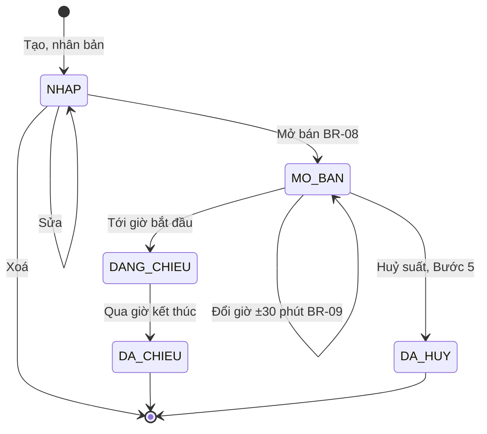

#### Hiển thị thẻ suất trên lưới

| **Trạng thái** | **Hiển thị** |
| --- | --- |
| `NHAP` | Nền nhạt, viền nét đứt |
| `NHAP` vi phạm | Viền đỏ, biểu tượng cảnh báo, tooltip lý do |
| `MO_BAN` | Nền đậm màu theo phim, số ghế đã bán / tổng |
| `DANG_CHIEU`, `DA_CHIEU` | Xám, chỉ xem |
| `DA_HUY` | Gạch ngang, chỉ xem |

### 4.2 Bước 2 · Chọn phim & suất

#### Trạng thái nút suất chiếu trên SCR-K03

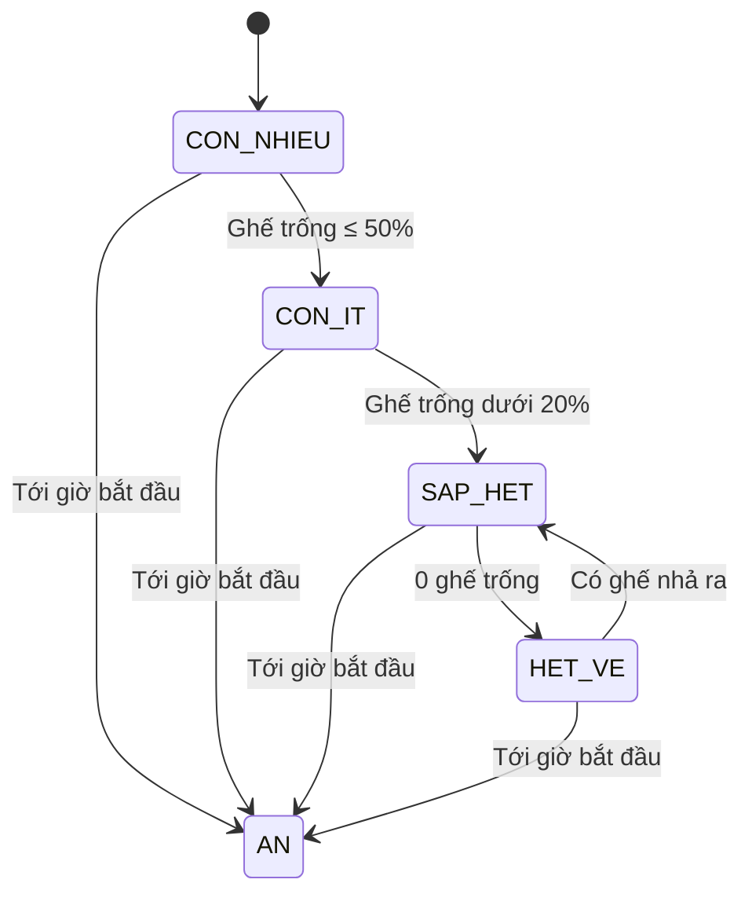

| **Trạng thái** | **Hiển thị** |
| --- | --- |
| `CON_NHIEU` | Ô giờ thường, chấm xanh |
| `CON_IT` | Chấm vàng, "Còn ít" |
| `SAP_HET` | Chấm đỏ, "Sắp hết" |
| `HET_VE` | Mờ, "Hết vé", không chạm được |
| Nhãn phụ | "Sắp bắt đầu" khi ≤ 15 phút |

### 4.3 Bước 3 · Chọn ghế & giữ chỗ

#### Trạng thái một ghế

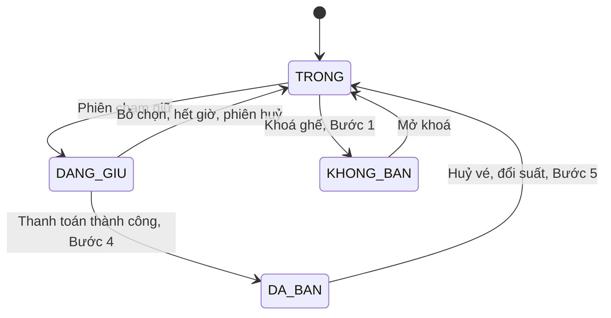

#### Trạng thái phiên đặt vé

### 4.4 Bước 4 · Bắp nước, thanh toán & vé điện tử

#### Trạng thái thanh toán của phiên

#### Trạng thái vé (đơn vé)

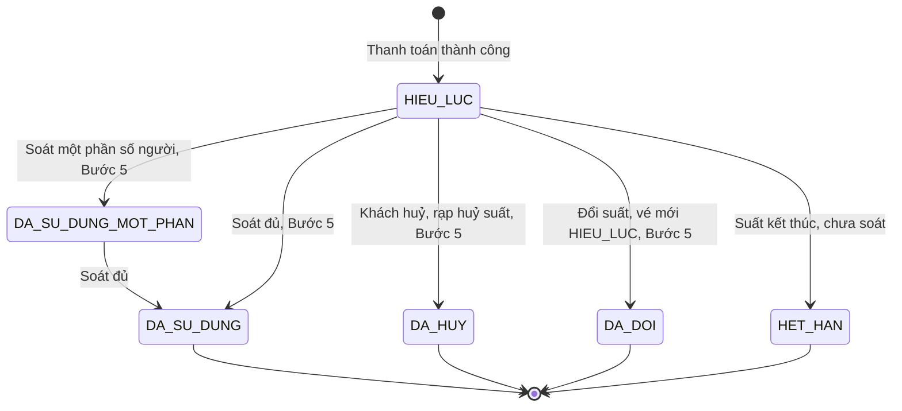

#### Hiển thị trên SCR-K06

| **Trạng thái** | **Hiển thị** |
| --- | --- |
| `CHUA_TAO` | Tóm tắt, phương thức, nút "Thanh toán {tổng} ₫", đồng hồ |
| `DANG_CHO_KET_QUA` (QR) | QR, thông tin chuyển khoản sao chép được, đồng hồ |
| `DANG_CHO_KET_QUA` (đã qua cổng, gia hạn) | Vòng chờ, MSG-26 |
| `THAT_BAI` | MSG-25, nút thử lại, đổi phương thức |
| `HET_GIO` | MSG-18 (Bước 3) kèm MSG-27 nếu đã trả |

### 4.5 Bước 5 · Soát vé, đổi & huỷ vé

#### Trạng thái vé (đầy đủ)

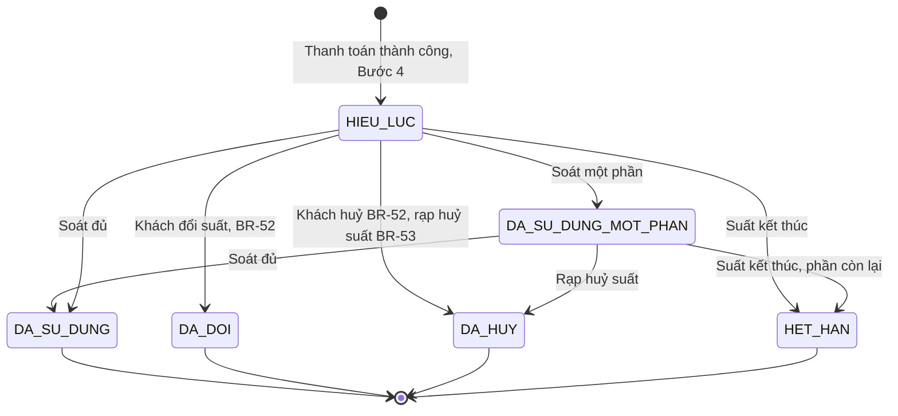

#### Hành động khách theo trạng thái vé

| **Trạng thái vé** | **Đổi suất** | **Huỷ** | **Ghi chú** |
| --- | --- | --- | --- |
| `HIEU_LUC`, ≥ 2 giờ, chưa đổi | Có (miễn phí 1 lần) | Có (phí 10%) | |
| `HIEU_LUC`, < 2 giờ | Không | Không | Trừ BR-54 |
| `HIEU_LUC`, suất đổi giờ | Có, miễn phí | Có, hoàn 100% | BR-54 |
| Vé đã đổi một lần | Không | Có (phí 10%) | |
| `DA_SU_DUNG_MOT_PHAN`, `DA_SU_DUNG`, `HET_HAN`, `DA_HUY`, `DA_DOI` | Không | Không | |

## 5. Use Case

### Bước 1 · Lịch chiếu, phòng chiếu & giá vé

#### UC-01 Thiết lập phòng và sơ đồ ghế

**Luồng chính**

| **Bước** | **Actor** | **Mô tả** |
| --- | --- | --- |
| 1 | Quản lý rạp | Mở **SCR-W02**, chọn "Phòng 3" |
| 2 | Quản lý rạp | Đặt 12 hàng × 18 cột; tô cột 5 và 14 làm lối đi; hàng H–J là VIP; hàng L là ghế đôi |
| 3 | Web | Đánh mã ghế theo BR-02, hiện tổng số ghế theo loại |
| 4 | Quản lý rạp | Bấm "Xem như khách" rồi "Lưu" |
| 5 | Web | Gọi \[RoomSave\] |

**Luồng thay thế**

| **Mã** | **Điều kiện** | **Xử lý** |
| --- | --- | --- |
| A1 | Khoá ghế | Chọn ghế → "Khoá ghế" → lý do, thời gian → \[SeatBlock\] (BR-04) |
| A2 | Phòng có suất mở bán | Công cụ sửa cấu trúc bị khoá, MSG-05 |

**Luồng lỗi**

| **Mã** | **Điều kiện** | **Xử lý** |
| --- | --- | --- |
| E1 | Ghế đôi đặt qua lối đi hoặc ở cột cuối lẻ | Lỗi inline "Ghế đôi cần 2 ô liền nhau trong cùng hàng" |
| E2 | Khoá ghế đã bán | MSG-06 |

#### UC-02 Lập lịch và mở bán

| **Mục** | **Nội dung** |
| --- | --- |
| Tiền điều kiện | Có phim đủ thông tin, phòng có sơ đồ, bảng giá có hiệu lực |
| Hậu điều kiện thành công | Suất `MO_BAN`, hiện trên app khách |
| Hậu điều kiện thất bại | Suất ở `NHAP` với lý do lỗi |

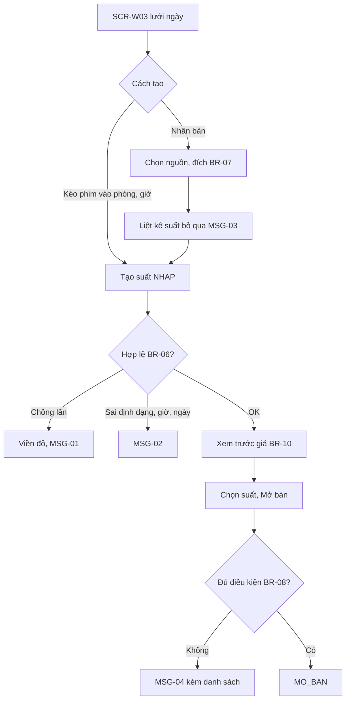

**Luồng chính**

| **Bước** | **Actor** | **Mô tả** |
| --- | --- | --- |
| 1 | Quản lý rạp | Mở **SCR-W03**, chọn tuần 24–30/11 |
| 2 | Quản lý rạp | "Nhân bản tuần trước" |
| 3 | Web | Gọi \[ScheduleClone\]; tạo suất `NHAP`, liệt kê 2 suất bị bỏ qua vì phim đã ngừng chiếu |
| 4 | Quản lý rạp | Kéo phim mới vào Phòng 1 lúc 19:30 |
| 5 | Web | Hiện thẻ suất 19:30–21:55 (+ dọn tới 22:10); hợp lệ |
| 6 | Quản lý rạp | Chọn cả tuần, bấm "Mở bán" |
| 7 | Web | Gọi \[ShowtimePublish\]; suất chuyển `MO_BAN`; MSG-08 |

**Luồng thay thế**

| **Mã** | **Điều kiện** | **Xử lý** |
| --- | --- | --- |
| A1 | Kéo thẻ suất sang giờ khác, phòng khác | Kiểm tra BR-06 ngay khi thả |
| A2 | Đổi giờ suất đã có vé | Giới hạn ±30 phút (BR-09), popup xác nhận số khách sẽ được báo |
| A3 | Xoá suất `NHAP` | Xoá ngay |
| A4 | Xem trước giá | Chạm thẻ suất → panel giá từng loại ghế |

**Luồng lỗi**

| **Mã** | **Điều kiện** | **Xử lý** |
| --- | --- | --- |
| E1 | Chồng lấn | MSG-01 |
| E2 | Định dạng, giờ hoạt động, trước khởi chiếu | MSG-02 |
| E3 | Mở bán quá 14 ngày, thiếu giá | MSG-04 |

#### UC-03 Cấu hình bảng giá

**Luồng chính**

| **Bước** | **Actor** | **Mô tả** |
| --- | --- | --- |
| 1 | Quản lý rạp | Mở **SCR-W04**, "Tạo phiên bản mới", hiệu lực từ 01/12/2026 |
| 2 | Quản lý rạp | Nhập giá cơ bản 2D 75.000 ₫, 3D 95.000 ₫, IMAX 140.000 ₫; hệ số Sáng 0,8 · Chiều 1,0 · Tối 1,15; Thường 1,0 · Cuối tuần 1,2 · Lễ 1,3; phụ thu VIP 20.000 ₫, Đôi 30.000 ₫ |
| 3 | Web | Ma trận xem trước: mỗi định dạng × khung giờ × loại ngày × loại ghế |
| 4 | Quản lý rạp | Bấm "Lưu" → \[PriceTableSave\] |

**Luồng thay thế**

| **Mã** | **Điều kiện** | **Xử lý** |
| --- | --- | --- |
| A1 | Khai báo ngày lễ | Lịch chọn ngày, tên lễ |

### Bước 2 · Chọn phim & suất

#### UC-04 Khám phá và chọn phim

**Luồng chính**

| **Bước** | **Actor** | **Mô tả** |
| --- | --- | --- |
| 1 | Khách | Mở app |
| 2 | App | Gọi \[MovieList\]; hiện **SCR-K01** tab Đang chiếu |
| 3 | Khách | Chạm poster một phim |
| 4 | App | Gọi \[MovieDetail\]; hiện **SCR-K02** |
| 5 | Khách | Bấm "Đặt vé" → **SCR-K03** |

**Luồng thay thế**

| **Mã** | **Điều kiện** | **Xử lý** |
| --- | --- | --- |
| A1 | Tab Theo ngày | Chọn ngày, lọc khung giờ, định dạng → danh sách phim kèm suất; chạm suất → UC-05 bước 4 |
| A2 | Tab Sắp chiếu, bật nhắc | \[ReleaseReminder\]; MSG-14 |
| A3 | Tìm phim | Ô tìm trên **SCR-K01** (BR-21) |
| A4 | Xem trailer | Phát trong **SCR-K02** khi chạm, không tự phát |

**Luồng lỗi**

| **Mã** | **Điều kiện** | **Xử lý** |
| --- | --- | --- |
| E1 | Không có phim đang chiếu | Empty state "Rạp đang cập nhật lịch chiếu" |
| E2 | Lỗi mạng | MSG-09 |

#### UC-05 Chọn suất và xác nhận độ tuổi

| **Mục** | **Nội dung** |
| --- | --- |
| Tiền điều kiện | Phim có suất mở bán |
| Hậu điều kiện thành công | Có suất đã chọn và xác nhận độ tuổi (nếu cần); mở **SCR-K04** |
| Hậu điều kiện thất bại | Ở lại **SCR-K03** |

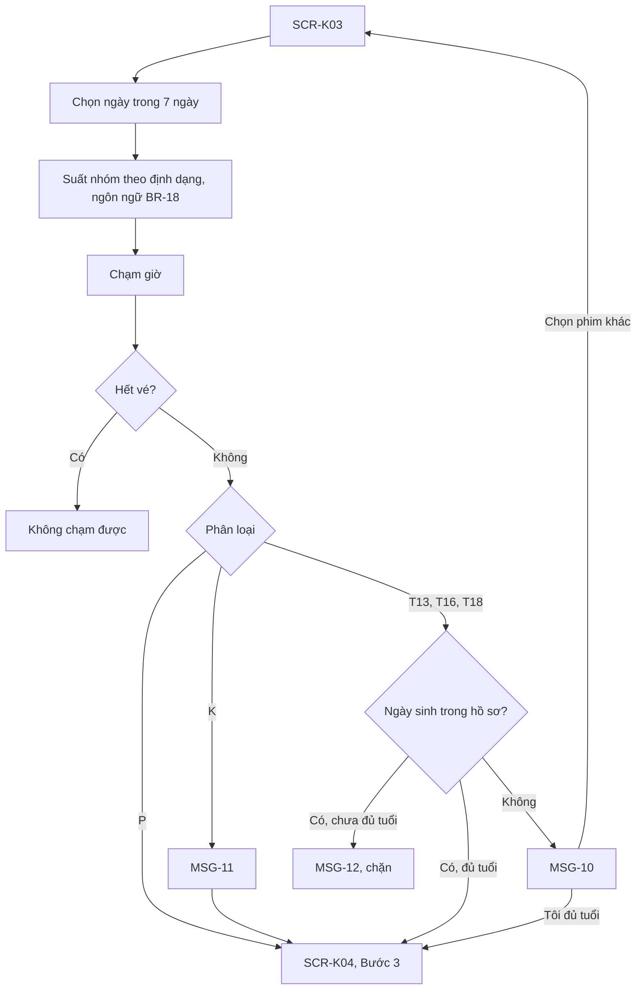

**Luồng chính**

| **Bước** | **Actor** | **Mô tả** |
| --- | --- | --- |
| 1 | App | Gọi \[ShowtimeList\] cho phim; hiện dải ngày, mặc định ngày gần nhất có suất |
| 2 | Khách | Chọn thứ Sáu |
| 3 | App | Hiện các nhóm "2D Phụ đề", "IMAX Phụ đề" với giờ, mức ghế trống, giá từ |
| 4 | Khách | Chạm 19:45 IMAX |
| 5 | App | Phim T16, hồ sơ không có ngày sinh → MSG-10 |
| 6 | Khách | "Tôi đủ tuổi" |
| 7 | App | Mở **SCR-K04** (Bước 3) với suất và cờ đã xác nhận tuổi |

**Luồng lỗi**

| **Mã** | **Điều kiện** | **Xử lý** |
| --- | --- | --- |
| E1 | Suất vừa hết vé hoặc vừa bắt đầu | Toast "Suất này không còn bán", tải lại danh sách |
| E2 | Chưa đủ tuổi theo hồ sơ | MSG-12 |
| E3 | Lỗi mạng | MSG-09 |

### Bước 3 · Chọn ghế & giữ chỗ

#### UC-06 Chọn và giữ ghế

| **Mục** | **Nội dung** |
| --- | --- |
| Tiền điều kiện | Đã chọn suất `MO_BAN` (Bước 2); khách đã đăng nhập |
| Hậu điều kiện thành công | Phiên `GIU_CHO` với ghế hợp lệ BR-27; mở **SCR-K05** (Bước 4) |
| Hậu điều kiện thất bại | Ghế được nhả; khách ở lại **SCR-K04** hoặc về **SCR-K03** |

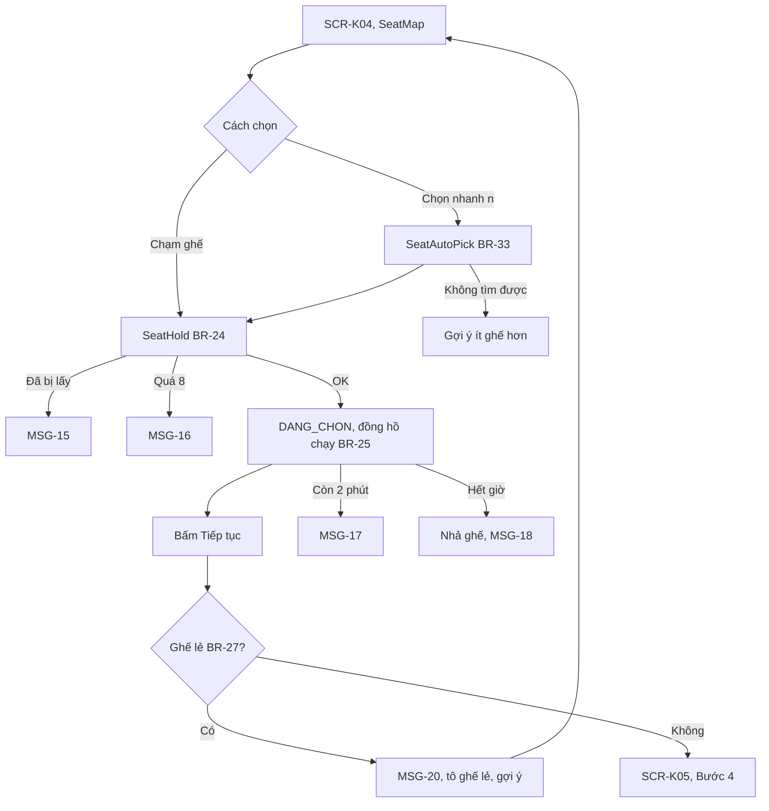

**Luồng chính**

| **Bước** | **Actor** | **Mô tả** |
| --- | --- | --- |
| 1 | App | Gọi \[SeatMap\], mở \[SeatStream\]; hiện **SCR-K04** |
| 2 | Khách | Chạm F7 |
| 3 | App | Gọi \[SeatHold\]; F7 `DANG_CHON`; đồng hồ 10:00 bắt đầu |
| 4 | Khách | Chạm F8, F9, F10 |
| 5 | App | Giữ từng ghế; tạm tính cập nhật |
| 6 | Khách | Bấm "Tiếp tục" |
| 7 | App | Gọi \[SeatValidate\] (BR-27); hợp lệ → **SCR-K05** |

**Luồng thay thế**

| **Mã** | **Điều kiện** | **Xử lý** |
| --- | --- | --- |
| A1 | Chọn nhanh | Nhập 4 → \[SeatAutoPick\] → 4 ghế được giữ, sơ đồ cuộn tới hàng đó |
| A2 | Ghế đôi | BR-28 |
| A3 | Bỏ chọn | Chạm lại ghế → \[SeatRelease\] |
| A4 | Đang giữ ở phiên khác | MSG-19 trước bước 1 |
| A5 | Phóng to | Kéo hai ngón; ghế tối thiểu 32 pt khi phóng to tối đa |

**Luồng lỗi**

| **Mã** | **Điều kiện** | **Xử lý** |
| --- | --- | --- |
| E1 | Ghế vừa bị lấy | MSG-15 |
| E2 | Quá 8 ghế | MSG-16 |
| E3 | Ghế lẻ | MSG-20 |
| E4 | Hết giờ | MSG-18 |
| E5 | Mất kết nối | MSG-21 (BR-29) |
| E6 | Suất bắt đầu, bị huỷ | MSG-22, MSG-23 |

### Bước 4 · Bắp nước, thanh toán & vé điện tử

#### UC-07 Chọn bắp nước

**Luồng chính**

| **Bước** | **Actor** | **Mô tả** |
| --- | --- | --- |
| 1 | App | Gọi \[ConcessionMenu\]; hiện **SCR-K05** với đồng hồ giữ chỗ |
| 2 | Khách | Chọn "Combo đôi": vị Phô mai, 2 nước |
| 3 | App | Cập nhật tổng (BR-36) |
| 4 | Khách | Bấm "Tiếp tục" → **SCR-K06** |

**Luồng thay thế**

| **Mã** | **Điều kiện** | **Xử lý** |
| --- | --- | --- |
| A1 | Bỏ qua | "Bỏ qua" → **SCR-K06** |
| A2 | Món hết | Mờ, "Tạm hết" |

#### UC-08 Thanh toán

| **Mục** | **Nội dung** |
| --- | --- |
| Tiền điều kiện | Phiên `GIU_CHO`, còn thời gian giữ chỗ |
| Hậu điều kiện thành công | Phiên `DA_THANH_TOAN`; vé `HIEU_LUC`; mở **SCR-K07** |
| Hậu điều kiện thất bại | Phiên `GIU_CHO` (còn giờ) hoặc `HET_HAN_GIU`; tiền không bị giữ |

**Luồng chính**

| **Bước** | **Actor** | **Mô tả** |
| --- | --- | --- |
| 1 | App | **SCR-K06**: tóm tắt phim, suất, ghế, bắp nước, tổng; phương thức lần trước (Ví) |
| 2 | Khách | Tích điều kiện, bấm "Thanh toán 295.000 ₫" |
| 3 | App | Gọi \[PaymentCreate\]; mở xác nhận của ví |
| 4 | Khách | Xác nhận trong ví |
| 5 | Máy chủ | Nhận xác nhận từ ví; ghế `DA_BAN`; tạo vé; gửi email |
| 6 | App | \[PaymentStatus\] trả `THANH_CONG`; mở **SCR-K07**; lưu vé offline |

**Luồng thay thế**

| **Mã** | **Điều kiện** | **Xử lý** |
| --- | --- | --- |
| A1 | Thẻ | Trang cổng; quay về app → chờ kết quả |
| A2 | QR | QR trên **SCR-K06**; khách chuyển bằng app ngân hàng; tiền về → thành công |
| A3 | Gia hạn khi chờ cổng | MSG-26 (BR-39) |
| A4 | Thêm vào lịch | Nút trên **SCR-K07** → hộp thoại lịch của hệ điều hành |

**Luồng lỗi**

| **Mã** | **Điều kiện** | **Xử lý** |
| --- | --- | --- |
| E1 | Thất bại khi còn giờ | MSG-25 |
| E2 | Tiền về sau khi mất ghế, QR sai số tiền | MSG-27 (BR-40) |
| E3 | Thanh toán thành công hai lần | Hoàn lần thứ hai (BR-45) |
| E4 | Mất mạng trên app sau khi trả | Khi có mạng, \[PaymentStatus\] cập nhật; vé cũng có trong email |

#### UC-09 Dùng vé và nhận bắp nước

**Luồng chính**

| **Bước** | **Actor** | **Mô tả** |
| --- | --- | --- |
| 1 | App | 30 phút trước giờ chiếu gửi MSG-29 |
| 2 | Khách | Mở vé (offline) tại quầy bắp nước |
| 3 | Nhân viên quầy | Quét QR bằng App soát vé chế độ Quầy |
| 4 | App soát vé | Gọi \[ConcessionLookup\]; hiện "Combo đôi × 1 – Phô mai, 2 nước – chưa nhận" |
| 5 | Nhân viên quầy | Giao, bấm "Đã giao" → \[ConcessionRedeem\] |
| 6 | App khách | Khi có mạng, vé hiện "Đã nhận lúc {giờ}" |

**Luồng lỗi**

| **Mã** | **Điều kiện** | **Xử lý** |
| --- | --- | --- |
| E1 | Ngoài khung giờ nhận | MSG-31 |
| E2 | Đã nhận | MSG-32 |
| E3 | Vé đã huỷ, đổi | MSG-33 |

### Bước 5 · Soát vé, đổi & huỷ vé

#### UC-10 Soát vé

| **Mục** | **Nội dung** |
| --- | --- |
| Tiền điều kiện | Nhân viên đăng nhập App soát vé, chọn phòng |
| Hậu điều kiện thành công | Lượt soát được ghi; vé cập nhật trạng thái |
| Hậu điều kiện thất bại | Khách không được vào; lượt từ chối được ghi lý do |

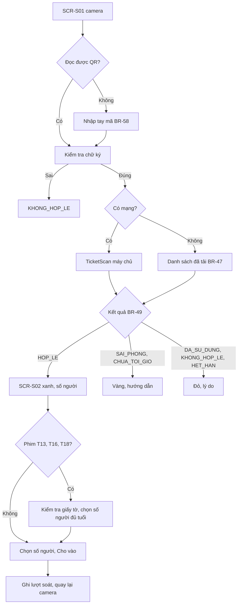

**Luồng chính**

| **Bước** | **Actor** | **Mô tả** |
| --- | --- | --- |
| 1 | Nhân viên | Chọn "Phòng 3"; **SCR-S01** mở camera |
| 2 | Khách | Đưa QR vé |
| 3 | App soát vé | Kiểm tra chữ ký; gọi \[TicketScan\] |
| 4 | Máy chủ | Vé `HIEU_LUC`, đúng phòng, trong khung giờ, 4 ghế chưa soát |
| 5 | App soát vé | **SCR-S02** xanh, âm "ting": "{Phim} · Phòng 3 · 19:45 · G5–G8 · 4 người" |
| 6 | Nhân viên | Bấm "Cho vào 4" |
| 7 | App soát vé | Gọi \[TicketAdmit\]; vé `DA_SU_DUNG`; tự quay về camera sau 1 giây |

**Luồng thay thế**

| **Mã** | **Điều kiện** | **Xử lý** |
| --- | --- | --- |
| A1 | Nhóm tới lệch | Giảm số người còn 2 → `DA_SU_DUNG_MOT_PHAN` (BR-50) |
| A2 | Phim T16 | Khối kiểm tra giấy tờ; nhân viên chọn 3/4 đủ tuổi → cho vào 3, ghi 1 "Không đủ tuổi" (BR-51) |
| A3 | Offline | Biểu tượng "Offline"; kết quả từ danh sách đã tải; lượt lưu chờ (BR-47) |
| A4 | Chế độ Tất cả phòng | Không có `SAI_PHONG`; kết quả hiện phòng to rõ |

**Luồng lỗi**

| **Mã** | **Điều kiện** | **Xử lý** |
| --- | --- | --- |
| E1 | Vé đã dùng | MSG-34 |
| E2 | Vé huỷ, đổi, không tồn tại, chữ ký sai | MSG-35 |
| E3 | Sai phòng, chưa tới giờ, hết hạn | MSG-36 |
| E4 | Nhập tay sai nhiều lần | MSG-37 |
| E5 | Soát trùng phát hiện khi đồng bộ | MSG-43 |

#### UC-11 Khách đổi suất hoặc huỷ vé

| **Mục** | **Nội dung** |
| --- | --- |
| Tiền điều kiện | Vé thoả mục 4.2 |
| Hậu điều kiện thành công | Vé mới `HIEU_LUC` (đổi) hoặc vé `DA_HUY` và lệnh hoàn tiền (huỷ) |
| Hậu điều kiện thất bại | Vé giữ nguyên |

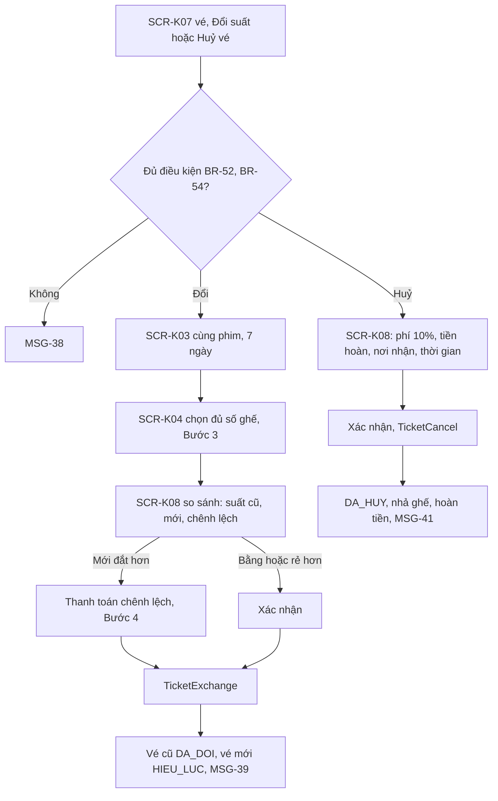

**Luồng chính (đổi suất)**

| **Bước** | **Actor** | **Mô tả** |
| --- | --- | --- |
| 1 | Khách | Ở vé bấm "Đổi suất" |
| 2 | App | Kiểm tra BR-52; mở **SCR-K03** chế độ đổi suất (chỉ phim này, 7 ngày) |
| 3 | Khách | Chọn suất mới, chọn 2 ghế (Bước 3, đồng hồ giữ chỗ áp dụng) |
| 4 | App | **SCR-K08**: suất cũ → suất mới, giá cũ, giá mới, chênh lệch +20.000 ₫ |
| 5 | Khách | Thanh toán chênh lệch (Bước 4) |
| 6 | Máy chủ | \[TicketExchange\]: vé cũ `DA_DOI`, ghế cũ nhả; vé mới `HIEU_LUC`; bắp nước chuyển theo |
| 7 | App | Mở vé mới; MSG-39 |

**Luồng thay thế**

| **Mã** | **Điều kiện** | **Xử lý** |
| --- | --- | --- |
| A1 | Huỷ vé | **SCR-K08** chế độ huỷ → \[TicketCancel\] → MSG-41 |
| A2 | Suất đổi giờ (BR-54) | Đổi, huỷ miễn phí 100%; **SCR-K08** ghi "Miễn phí do rạp đổi giờ" |
| A3 | Suất mới rẻ hơn | Ghi rõ "Không hoàn chênh lệch {x} ₫" trước khi xác nhận |

**Luồng lỗi**

| **Mã** | **Điều kiện** | **Xử lý** |
| --- | --- | --- |
| E1 | Không đủ điều kiện (< 2 giờ, đã đổi, đã soát) | MSG-38 |
| E2 | Hết giờ giữ ghế suất mới | Theo Bước 3 MSG-18; vé cũ giữ nguyên |
| E3 | Thanh toán chênh lệch thất bại | Theo Bước 4 MSG-25; vé cũ giữ nguyên |

#### UC-12 Rạp huỷ suất

| **Mục** | **Nội dung** |
| --- | --- |
| Tiền điều kiện | Quản lý rạp đăng nhập Web; suất `MO_BAN` hoặc `DANG_CHIEU` |
| Hậu điều kiện thành công | Suất `DA_HUY`; mọi khách được hoàn và báo ≤ 15 phút |
| Hậu điều kiện thất bại | Suất giữ trạng thái |

**Luồng chính**

| **Bước** | **Actor** | **Mô tả** |
| --- | --- | --- |
| 1 | Quản lý rạp | Ở **SCR-W03** (Bước 1) mở suất → "Huỷ suất" → **SCR-W05** |
| 2 | Web | Hiện số đơn, số vé, bắp nước đã nhận, tổng tiền sẽ hoàn (BR-53) |
| 3 | Quản lý rạp | Chọn lý do "Sự cố kỹ thuật", nhập mật khẩu xác nhận |
| 4 | Web | Gọi \[ShowtimeCancel\] |
| 5 | Máy chủ | Suất `DA_HUY`; vé `DA_HUY`; tạo lệnh hoàn; nhả phiên giữ ghế; gửi MSG-40 |
| 6 | Web | Tiến độ "Đã báo {n}/{N} khách, đã tạo {n} lệnh hoàn"; MSG-44 khi xong |

**Luồng lỗi**

| **Mã** | **Điều kiện** | **Xử lý** |
| --- | --- | --- |
| E1 | Sai mật khẩu | Lỗi inline |
| E2 | Lệnh hoàn thất bại một số đơn | Danh sách đơn lỗi, nút "Thử lại"; hệ thống tự thử lại mỗi 15 phút |

## 6. Điểm vào

| **Điểm vào** | **Dẫn tới** | **Ghi chú** |
| --- | --- | --- |
| Menu Phim | **SCR-W01** | |
| Menu Phòng chiếu | **SCR-W02** | |
| Menu Lịch chiếu | **SCR-W03** ngày hôm nay | |
| Menu Giá vé | **SCR-W04** | |
| Thông báo "Ghế khoá có vé" | Danh sách vé bị ảnh hưởng | BR-04 |
| Mở app | **SCR-K01** | |
| Push nhắc mở bán | **SCR-K03** của phim | BR-20 |
| Link chia sẻ phim | **SCR-K02** | |
| "Đổi suất" ở vé (Bước 5) | **SCR-K03** chế độ đổi suất | Cùng phim |
| Chọn suất (Bước 2) | **SCR-K04** | |
| Quay lại từ **SCR-K05**, **SCR-K06** | **SCR-K04** | Giữ nguyên ghế, đồng hồ chạy tiếp |
| Thanh toán thất bại, còn giờ (Bước 4) | **SCR-K06** | Ghế vẫn giữ |
| "Đổi suất" (Bước 5) | **SCR-K04** của suất mới | Số ghế = số ghế vé cũ |
| "Tiếp tục" ở **SCR-K04** | **SCR-K05** | |
| Tab Vé của tôi | Danh sách vé sắp tới, đã xem | |
| Push nhắc giờ chiếu, email | **SCR-K07** | |
| Banner "Vé sắp tới" ở **SCR-K01** | **SCR-K07** | Bước 2 |
| Mở App soát vé | Chọn chế độ, phòng → **SCR-S01** | |
| Vé ở **SCR-K07** → Đổi suất / Huỷ vé | UC-11 | |
| Push "Rạp đã đổi giờ" (Bước 1 MSG-07) | Vé với lựa chọn đổi, huỷ miễn phí | BR-54 |
| Panel suất ở **SCR-W03** → Huỷ suất | **SCR-W05** | |

## 7. Mô tả màn hình

<!-- Bước 1 · Lịch chiếu, phòng chiếu & giá vé -->
### SCR-W01 Phim

| **#** | **Thành phần** | **Loại** | **Bắt buộc** | **Validate / hành vi** |
| --- | --- | --- | --- | --- |
| 1 | Danh sách phim | Table | – | Poster nhỏ, tên, phân loại, định dạng, khởi chiếu, trạng thái, số suất tuần này |
| 2 | Form phim | Form | Theo BR-01 | Thời lượng 30–300; poster ≤ 5 MB, tỉ lệ 2:3 |
| 3 | Ngừng chiếu | Button | – | Cảnh báo nếu còn suất `MO_BAN` |

### SCR-W02 Phòng chiếu & sơ đồ ghế

| **#** | **Thành phần** | **Loại** | **Hành vi** |
| --- | --- | --- | --- |
| 1 | Danh sách phòng | List | Tên, định dạng, số ghế |
| 2 | Kích thước lưới | Number × Number | Hàng, cột |
| 3 | Công cụ tô | Toolbar | Thường, VIP, Đôi, Lối đi, Trống |
| 4 | Lưới ghế | Canvas | Kéo để tô nhiều ô; màn hình chiếu ở trên |
| 5 | Khoá ghế | Panel | Lý do, thời gian (BR-04); ghế khoá hiện dấu × |
| 6 | Tổng ghế | Text | Theo loại |
| 7 | Xem như khách | Button | Hiện sơ đồ như **SCR-K04** |

### SCR-W03 Lịch chiếu

| **#** | **Thành phần** | **Loại** | **Hành vi** |
| --- | --- | --- | --- |
| 1 | Chọn ngày, tuần | Date picker | |
| 2 | Danh sách phim | Side panel | Kéo vào lưới; lọc đang chiếu, sắp chiếu |
| 3 | Lưới | Timeline | Hàng = phòng; cột = 08:00–02:00; bước 5 phút; thẻ suất theo mục 4.2; vùng dọn phòng sọc |
| 4 | Nhân bản | Button | BR-07 |
| 5 | Mở bán | Button | Cho suất đã chọn |
| 6 | Panel suất | Drawer | Phim, phòng, giờ, định dạng, giá xem trước, số vé đã bán, Huỷ suất (Bước 5) |
| 7 | Tổng hợp | Text | Số suất theo phim trong ngày |

### SCR-W04 Bảng giá

| **#** | **Thành phần** | **Loại** | **Bắt buộc** | **Validate / hành vi** |
| --- | --- | --- | --- | --- |
| 1 | Phiên bản | List | – | Ngày hiệu lực, người tạo |
| 2 | Giá cơ bản | Amount × 3 | Có | Theo định dạng |
| 3 | Hệ số khung giờ | Number × 3 | Có | 0,5–2,0 |
| 4 | Hệ số loại ngày | Number × 3 | Có | 0,5–2,0 |
| 5 | Phụ thu ghế | Amount × 2 | Có | VIP, Đôi |
| 6 | Ngày lễ | Calendar | – | |
| 7 | Ma trận xem trước | Table | – | Giá cuối theo BR-10 |

<!-- Bước 2 · Chọn phim & suất -->
### SCR-K01 Trang chủ

| **#** | **Thành phần** | **Loại** | **Hành vi** |
| --- | --- | --- | --- |
| 1 | Banner | Carousel | Phim nổi bật; chạm mở **SCR-K02** |
| 2 | Tab | Tabs | Đang chiếu, Sắp chiếu, Theo ngày |
| 3 | Ô tìm | Search | BR-21 |
| 4 | Lưới phim | Grid 2 cột | Thẻ phim BR-14 |
| 5 | Theo ngày | Dải ngày + chips lọc + list | A1 UC-04 |
| 6 | Vé sắp tới | Banner | Khi có vé trong 24 giờ tới → mở vé (Bước 4) |

### SCR-K02 Chi tiết phim

| **#** | **Thành phần** | **Loại** | **Hành vi** |
| --- | --- | --- | --- |
| 1 | Trailer / poster | Media | Chạm để phát |
| 2 | Tên, tên gốc | Text | |
| 3 | Nhãn phân loại | Tag | Chạm → giải thích mức tuổi |
| 4 | Thông tin | List | Thời lượng, khởi chiếu, thể loại, đạo diễn, diễn viên, ngôn ngữ |
| 5 | Tóm tắt | Text mở rộng | 4 dòng, "Xem thêm" |
| 6 | "Đặt vé" / "Nhắc tôi khi mở bán" | Button dính đáy | Theo trạng thái phim |

### SCR-K03 Chọn suất chiếu

| **#** | **Thành phần** | **Loại** | **Hành vi** |
| --- | --- | --- | --- |
| 1 | Phim | Header thu gọn | Poster nhỏ, tên, phân loại, thời lượng |
| 2 | Dải ngày | Chips cuộn ngang | 7 ngày; "Hôm nay", "Mai", "T6 22/11"; ngày không có suất mờ |
| 3 | Nhóm suất | Section | BR-18 |
| 4 | Ô giờ | Button | "19:45 → 22:10", mức ghế trống (mục 4.1), "Từ {giá}" |
| 5 | Popup độ tuổi | Modal | MSG-10, MSG-11, MSG-12 |

<!-- Bước 3 · Chọn ghế & giữ chỗ -->
### SCR-K04 Chọn ghế

| **#** | **Thành phần** | **Loại** | **Hành vi** |
| --- | --- | --- | --- |
| 1 | Header suất | Header | Phim, phòng, ngày giờ, định dạng; nút đổi suất |
| 2 | Đồng hồ giữ chỗ | Timer | "Giữ ghế 09:42"; đổi màu khi < 2 phút; ẩn trước khi giữ ghế đầu |
| 3 | Màn hình chiếu | Hình | Cong, ở trên cùng |
| 4 | Sơ đồ ghế | Canvas | Trạng thái BR-22; phóng to, kéo; mã hàng ở hai bên |
| 5 | Chú thích | Legend | Trống, Đang chọn, Đã bán/Đang giữ, Không bán; Thường, VIP, Đôi kèm giá |
| 6 | Chọn nhanh | Stepper + Button | "Chọn nhanh {n} ghế" (BR-33) |
| 7 | Ghế đã chọn | Chips | Mã ghế, chạm × để bỏ |
| 8 | Tạm tính | Text | BR-30; nhắc độ tuổi BR-31 |
| 9 | "Tiếp tục" | Button dính đáy | Disabled khi chưa có ghế |
| 10 | Banner kết nối | Banner | MSG-21 |
| 11 | Tô ghế lẻ | Overlay | Viền nhấp nháy ghế lẻ khi vi phạm BR-27 |

<!-- Bước 4 · Bắp nước, thanh toán & vé điện tử -->
### SCR-K05 Bắp nước

| **#** | **Thành phần** | **Loại** | **Hành vi** |
| --- | --- | --- | --- |
| 1 | Đồng hồ giữ chỗ | Timer | Bước 3 BR-25 |
| 2 | Combo | List | Ảnh, tên, mô tả, giá, "Tiết kiệm {x} ₫", stepper |
| 3 | Tuỳ chọn combo | Bottom sheet | Vị bắp, nước |
| 4 | Món lẻ | List | Ảnh, tên, giá, stepper |
| 5 | Tổng | Text | Vé + bắp nước |
| 6 | "Bỏ qua", "Tiếp tục" | Button | |

### SCR-K06 Thanh toán

| **#** | **Thành phần** | **Loại** | **Bắt buộc** | **Validate / hành vi** |
| --- | --- | --- | --- | --- |
| 1 | Đồng hồ giữ chỗ | Timer | – | |
| 2 | Tóm tắt | Card | – | Poster, phim, phân loại, phòng, ngày giờ, ghế, bắp nước, giá từng phần |
| 3 | Email nhận vé | Email | Có | Điền sẵn từ hồ sơ |
| 4 | Phương thức | Radio list | Có | BR-37 |
| 5 | Điều kiện đổi, huỷ | Checkbox + link | Có | Mở tóm tắt Bước 5 BR-52 |
| 6 | "Thanh toán {tổng} ₫" | Button | – | Disabled khi chưa tích |
| 7 | Khu QR | Panel | – | QR, ngân hàng, số tài khoản, số tiền, nội dung (sao chép); "Tải ảnh QR" |
| 8 | Trạng thái chờ | Overlay | – | Mục 4.3 |

### SCR-K07 Vé của tôi & vé điện tử

| **#** | **Thành phần** | **Loại** | **Hành vi** |
| --- | --- | --- | --- |
| 1 | Tab | Tabs | Sắp tới, Đã xem |
| 2 | Thẻ vé | Card | Poster, phim, ngày giờ, phòng, ghế, trạng thái vé (mục 4.2) |
| 3 | Vé điện tử | Màn chi tiết | QR lớn, mã đặt vé, thông tin BR-42; độ sáng tối đa |
| 4 | Bắp nước | List | Món, trạng thái nhận |
| 5 | Thêm vào lịch | Button | BR-41 |
| 6 | Đổi suất, Huỷ vé | Button | Bước 5 |
| 7 | Ghi chú offline | Text | "Vé đã lưu trên máy, dùng được khi không có mạng" |

<!-- Bước 5 · Soát vé, đổi & huỷ vé -->
### SCR-S01 Soát vé (App soát vé)

| **#** | **Thành phần** | **Loại** | **Hành vi** |
| --- | --- | --- | --- |
| 1 | Chế độ, phòng | Header | "Soát vé · Phòng 3"; chạm để đổi |
| 2 | Trạng thái mạng | Badge | Online / Offline; số lượt chờ đồng bộ |
| 3 | Camera | Camera view | Quét liên tục |
| 4 | Suất đang soát | List nhỏ | Suất trong khung giờ của phòng: giờ, phim, đã vào / tổng |
| 5 | Nhập mã | Button | Bàn phím 8 ký tự (BR-58) |
| 6 | Đèn | Icon | Bật đèn khi tối |

### SCR-S02 Kết quả soát

| **#** | **Thành phần** | **Loại** | **Hành vi** |
| --- | --- | --- | --- |
| 1 | Nền màu toàn màn | Background | Xanh, vàng, đỏ theo BR-49; âm, rung khác nhau |
| 2 | Tiêu đề | Text cực lớn | "HỢP LỆ", "SAI PHÒNG – Phòng 5", "ĐÃ SỬ DỤNG"… |
| 3 | Thông tin vé | Text | Phim, phòng, giờ, ghế |
| 4 | Số người | Stepper | Còn được vào; mặc định tối đa (BR-50) |
| 5 | Kiểm tra giấy tờ | Khối vàng | BR-51; stepper số người đủ tuổi |
| 6 | Lần soát trước | Text | Với `DA_SU_DUNG`: giờ, thiết bị, nhân viên |
| 7 | "Cho vào {n}" / "Đóng" | Button lớn | Tự quay về camera sau 1 giây với `HOP_LE` |

### SCR-K08 Đổi suất / Huỷ vé (App khách)

| **#** | **Thành phần** | **Loại** | **Hành vi** |
| --- | --- | --- | --- |
| 1 | Vé hiện tại | Card | Phim, suất, ghế, bắp nước, đã trả |
| 2 | Đổi: suất mới | Card | Suất, ghế mới, giá mới; mũi tên từ cũ sang mới |
| 3 | Chênh lệch | Text | "+{x} ₫ cần trả thêm" hoặc "Không hoàn chênh lệch {x} ₫" hoặc "Miễn phí do rạp đổi giờ" |
| 4 | Huỷ: tiền hoàn | Card | Tổng đã trả, phí huỷ 10%, tiền hoàn, nơi nhận, thời gian (BR-52) |
| 5 | Điều kiện | Text | "Mỗi vé được đổi miễn phí 1 lần, trước giờ chiếu ít nhất 2 giờ" |
| 6 | "Xác nhận đổi" / "Xác nhận huỷ" | Button | |

### SCR-W05 Huỷ suất chiếu (Web quản lý)

| **#** | **Thành phần** | **Loại** | **Bắt buộc** | **Validate / hành vi** |
| --- | --- | --- | --- | --- |
| 1 | Suất | Card | – | Phim, phòng, giờ, trạng thái |
| 2 | Ảnh hưởng | Table | – | Số đơn, vé, bắp nước đã nhận, tổng hoàn |
| 3 | Lý do | Select + Text | Có | BR-53 |
| 4 | Mật khẩu xác nhận | Password | Có | |
| 5 | "Huỷ suất" | Button đỏ | – | |
| 6 | Tiến độ | Progress | – | Báo khách, tạo lệnh hoàn; danh sách lỗi |

## 8. API

### 8.1 Bước 1 · Lịch chiếu, phòng chiếu & giá vé

| **API** | **Request chính** | **Response chính** | **Timeout / retry** |
| --- | --- | --- | --- |
| \[MovieSave\] | thông tin BR-01 | movie_id | 10s / 1 lần |
| \[RoomSave\] | room_id, grid, formats | room, seat_codes | 10s / 1 lần |
| \[SeatBlock\] | room_id, seats, reason, from, to | affected_tickets | 5s / 1 lần |
| \[ScheduleGet\] | date_range | Suất theo phòng | 5s / 1 lần |
| \[ShowtimeSave\] | movie, room, format, start | showtime, violations | 3s / 1 lần |
| \[ScheduleClone\] | source_range, target_start | created, skipped (lý do) | 15s / 1 lần |
| \[ShowtimePublish\] | showtime_ids | published, rejected (lý do) | 10s / 1 lần |
| \[PriceTableSave\] | effective_from, base, factors, surcharges, holidays | version_id | 5s / 1 lần |
| \[PricePreview\] | showtime_id | Giá từng loại ghế | 2s / 1 lần |

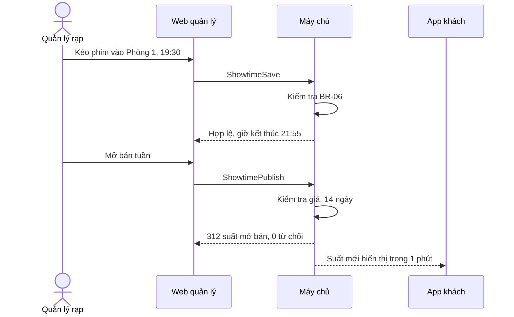

**Map lỗi → thông báo**

| **Nhóm lỗi** | **Message** |
| --- | --- |
| Chồng lấn phòng | MSG-01 |
| Sai định dạng, giờ hoạt động, khởi chiếu | MSG-02 |
| Suất bị bỏ qua khi nhân bản | MSG-03 |
| Không mở bán được | MSG-04 |
| Không sửa sơ đồ khi có suất mở bán | MSG-05 |
| Khoá ghế đã bán | MSG-06 |
| Đổi giờ suất (gửi khách) | MSG-07 |
| Mở bán thành công | MSG-08 |

### 8.2 Bước 2 · Chọn phim & suất

| **API** | **Request chính** | **Response chính** | **Timeout / retry** |
| --- | --- | --- | --- |
| \[MovieList\] | tab, keyword | Thẻ phim | 5s / 1 lần |
| \[MovieDetail\] | movie_id | Thông tin, trailer_url | 5s / 1 lần |
| \[ShowtimeList\] | movie_id hoặc date, filters | Suất: giờ, kết thúc, định dạng, ngôn ngữ, mức ghế, giá từ | 5s / 1 lần |
| \[ReleaseReminder\] | movie_id, on | – | 5s / 1 lần |
| \[ProfileAge\] | – | birth_date hoặc null | Cache phiên |

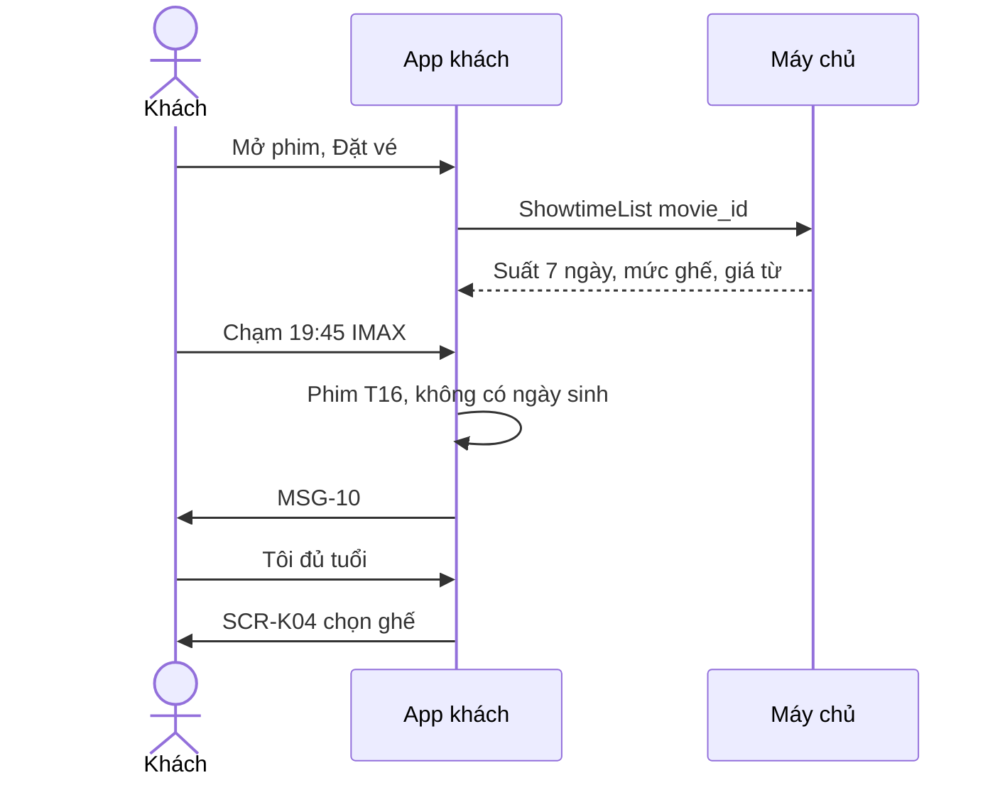

**Map lỗi → thông báo**

| **Nhóm** | **Message** |
| --- | --- |
| Mất mạng, lỗi máy chủ | MSG-09 |
| Xác nhận tuổi T13, T16, T18 | MSG-10 |
| Lưu ý phim K | MSG-11 |
| Chưa đủ tuổi | MSG-12 |
| Phim đã mở bán (push) | MSG-13 |
| Đã bật nhắc | MSG-14 |

### 8.3 Bước 3 · Chọn ghế & giữ chỗ

| **API** | **Request chính** | **Response chính** | **Timeout / retry** |
| --- | --- | --- | --- |
| \[SeatMap\] | showtime_id | Lưới, loại, giá, trạng thái từng ghế, phiên đang mở của khách | 3s / 1 lần |
| \[SeatStream\] | showtime_id | Sự kiện đổi trạng thái ghế | Kết nối lâu dài; dự phòng làm mới 5 giây |
| \[SeatHold\] | session_id, seat_code | OK, hold_expires_at hoặc SEAT_TAKEN, LIMIT | 2s / không retry tự động |
| \[SeatRelease\] | session_id, seat_code | OK | 2s / 2 lần |
| \[SeatAutoPick\] | session_id, count, seat_type | Ghế đã giữ hoặc NOT_FOUND | 3s / 1 lần |
| \[SeatValidate\] | session_id | OK hoặc danh sách ghế lẻ, gợi ý | 2s / 1 lần |
| \[SessionCancel\] | session_id | OK | 3s / 2 lần |

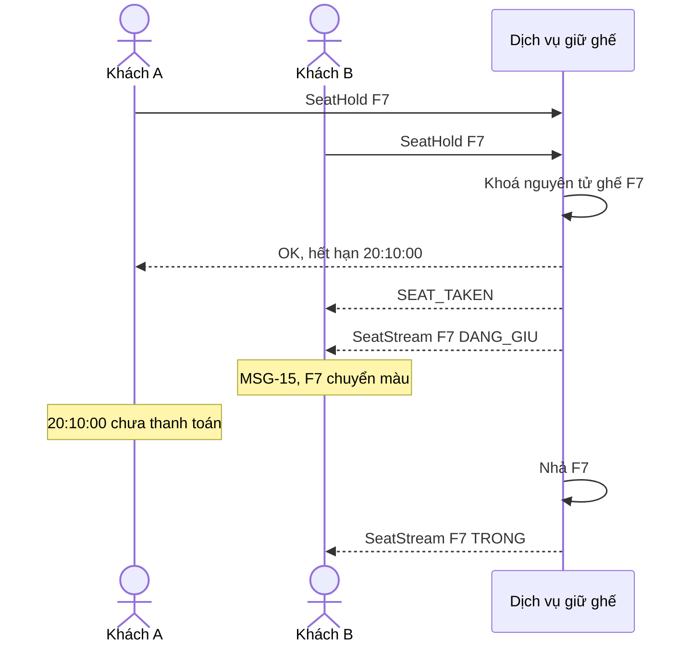

**Map lỗi → thông báo**

| **Nhóm** | **Message** |
| --- | --- |
| Ghế vừa bị lấy | MSG-15 |
| Quá 8 ghế | MSG-16 |
| Còn 2 phút | MSG-17 |
| Hết giờ giữ | MSG-18 |
| Đang có phiên khác | MSG-19 |
| Ghế lẻ, chọn nhanh không được | MSG-20 |
| Mất kết nối | MSG-21 |
| Suất đã bắt đầu | MSG-22 |
| Suất bị huỷ | MSG-23 |

### 8.4 Bước 4 · Bắp nước, thanh toán & vé điện tử

| **API** | **Request chính** | **Response chính** | **Timeout / retry** |
| --- | --- | --- | --- |
| \[ConcessionMenu\] | showtime_id | Combo, món, tuỳ chọn, trạng thái | 3s / 1 lần |
| \[SessionUpdate\] | session_id, concessions | Tổng mới | 3s / 1 lần |
| \[PaymentCreate\] | session_id, method, email, idempotency_key | payment_id, redirect_url hoặc qr | 10s / gửi lại cùng key |
| \[PaymentStatus\] | payment_id | status, ticket_id | 3s / mỗi 3 giây |
| \[PaymentWebhook\] | Cổng, ví, ngân hàng → máy chủ | – | Có chữ ký; BR-39 |
| \[TicketList\], \[TicketDetail\] | tab; ticket_id | Vé, QR ký số | 5s / 1 lần; lưu offline |
| \[ConcessionLookup\] (App soát vé) | qr_payload | Món, số lượng chưa nhận, khung giờ nhận | 3s / 1 lần |
| \[ConcessionRedeem\] (App soát vé) | ticket_id, items | Trạng thái mới | 3s / 2 lần, idempotent |

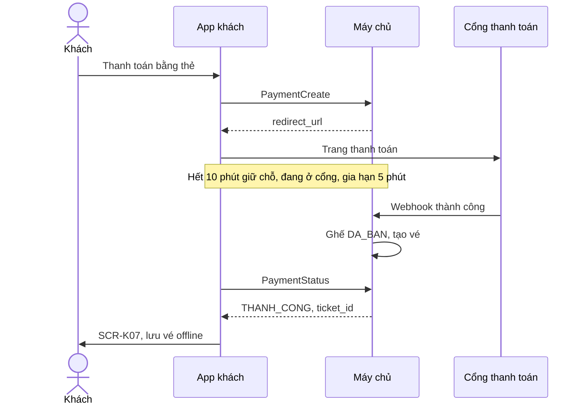

**Map lỗi → thông báo**

| **Nhóm** | **Message** |
| --- | --- |
| Món bắp nước tạm hết | MSG-24 |
| Thanh toán thất bại | MSG-25 |
| Đang xác nhận (gia hạn) | MSG-26 |
| Hoàn tiền tự động | MSG-27 |
| Đặt vé thành công | MSG-28 |
| Nhắc giờ chiếu | MSG-29 |
| Mất mạng | MSG-30 |
| Ngoài giờ nhận bắp nước | MSG-31 |
| Bắp nước đã nhận | MSG-32 |
| Vé không còn hiệu lực | MSG-33 |

### 8.5 Bước 5 · Soát vé, đổi & huỷ vé

| **API** | **Request chính** | **Response chính** | **Timeout / retry** |
| --- | --- | --- | --- |
| \[ScanPreload\] | room_id hoặc all, window 3h | Danh sách vé, khoá công khai kiểm chữ ký | 15s / 3 lần; làm mới theo sự kiện |
| \[TicketScan\] | qr_payload hoặc code, room_id, device_id | Kết quả BR-49, vé, số người còn lại, rating | 2s / không retry (dùng offline) |
| \[TicketAdmit\] | ticket_id, count, age_rejected, device_id, offline_at | Trạng thái vé, cờ trùng | 3s / lưu chờ khi offline |
| \[ScanSync\] | lượt soát offline | Kết quả, cờ `SOAT_TRUNG` | 15s / thử lại tới khi thành công |
| \[TicketExchangeOptions\] | ticket_id | Đủ điều kiện, lý do, miễn phí hay không | 3s / 1 lần |
| \[TicketExchange\] | ticket_id, new_session_id, payment_id (nếu có) | Vé mới | 10s / idempotent |
| \[TicketCancelQuote\] | ticket_id | Phí, tiền hoàn, nơi nhận, thời gian | 3s / 1 lần |
| \[TicketCancel\] | ticket_id, idempotency_key | Trạng thái, refund_id | 10s / gửi lại cùng key |
| \[ShowtimeCancel\] (Web) | showtime_id, reason, password | job_id | 10s / 1 lần |
| \[ShowtimeCancelProgress\] (Web) | job_id | Đã báo, đã hoàn, lỗi | 3s / mỗi 3 giây |

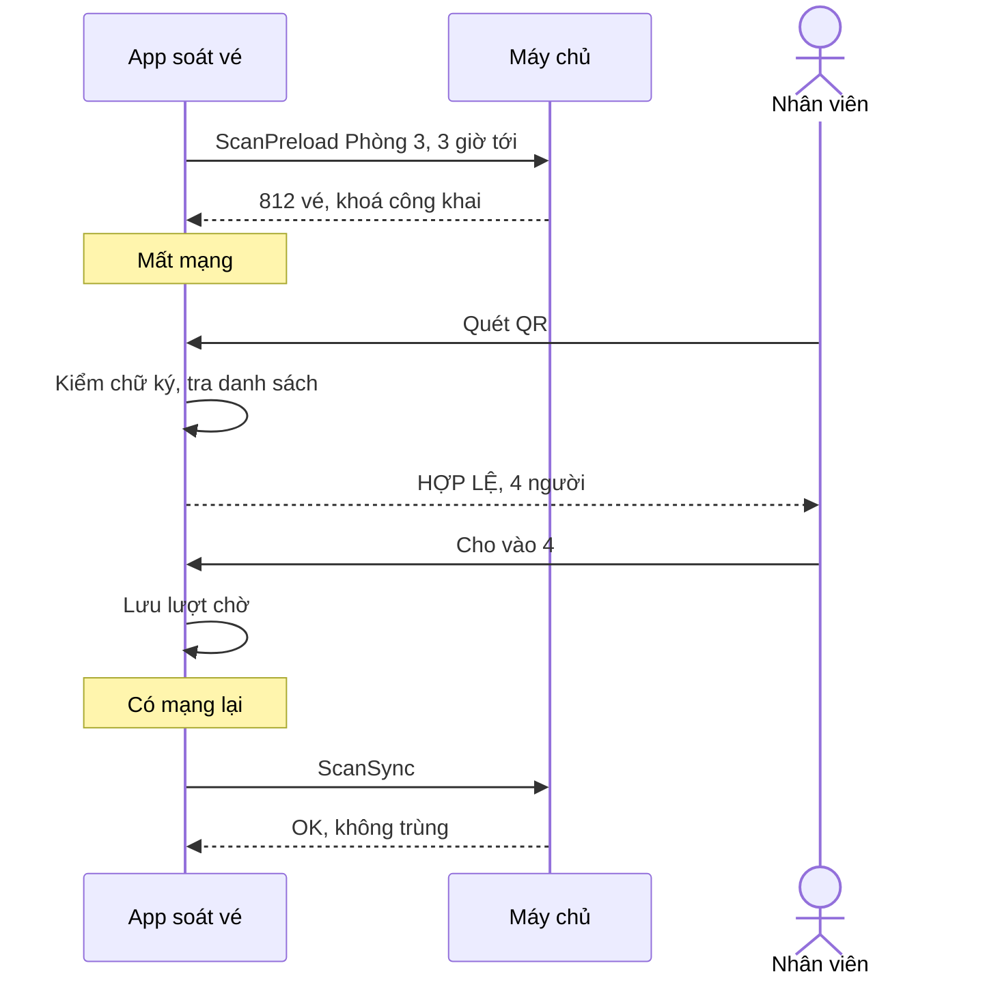

**Map lỗi → thông báo**

| **Nhóm** | **Message** |
| --- | --- |
| Vé đã sử dụng | MSG-34 |
| Vé không hợp lệ | MSG-35 |
| Sai phòng, chưa tới giờ, hết hạn | MSG-36 |
| Nhập tay bị khoá | MSG-37 |
| Không đủ điều kiện đổi, huỷ | MSG-38 |
| Đổi suất thành công | MSG-39 |
| Rạp huỷ suất (gửi khách) | MSG-40 |
| Huỷ vé thành công | MSG-41 |
| Không đủ tuổi (ghi nhận) | MSG-42 |
| Soát trùng | MSG-43 |
| Huỷ suất xong (Web) | MSG-44 |

## 9. Danh sách thông báo

| **ID** | **Nơi hiện** | **Nội dung (VI)** |
| --- | --- | --- |
| MSG-01 | Tooltip, inline | Trùng với suất {phim} {giờ bắt đầu}–{giờ kết thúc} tại {phòng} (cần 15 phút dọn phòng) |
| MSG-02 | Tooltip, inline | Theo lý do: {Phòng} không hỗ trợ {định dạng} · Suất phải bắt đầu từ 08:00 và trước 23:30 · Phim khởi chiếu ngày {ngày} |
| MSG-03 | Popup | Đã tạo {n} suất. Bỏ qua {m} suất: {danh sách và lý do} |
| MSG-04 | Popup | Không mở bán được {m} suất: {danh sách và lý do: quá 14 ngày / chưa có giá / không hợp lệ} |
| MSG-05 | Banner | Phòng đang có suất mở bán nên không sửa được sơ đồ. Bạn vẫn có thể khoá, mở khoá ghế |
| MSG-06 | Popup | {n} vé đã bán có ghế bị khoá trong khoảng này. \[Xem danh sách\] |
| MSG-07 | Push, email khách | Suất {phim} ngày {ngày} tại {rạp} đổi giờ bắt đầu từ {giờ cũ} thành {giờ mới}. Bạn có thể đổi hoặc huỷ vé miễn phí trong ứng dụng |
| MSG-08 | Toast | Đã mở bán {n} suất |
| MSG-09 | Toast | Kết nối không ổn định, vui lòng thử lại |
| MSG-10 | Popup | Phim {tên} được phân loại {T13/T16/T18}: chỉ dành cho khán giả từ đủ {13/16/18} tuổi. Rạp sẽ kiểm tra giấy tờ tuỳ thân có ảnh khi vào phòng chiếu; không đủ tuổi sẽ không được vào và không hoàn tiền. \[Tôi đủ tuổi\] \[Chọn phim khác\] |
| MSG-11 | Popup | Phim {tên} được phân loại K: khán giả dưới 13 tuổi cần xem cùng cha mẹ hoặc người giám hộ. \[Đã hiểu\] |
| MSG-12 | Popup | Theo ngày sinh trong hồ sơ, bạn chưa đủ {n} tuổi để xem phim này |
| MSG-13 | Push | {Tên phim} đã mở bán vé! Chọn suất ngay |
| MSG-14 | Toast | Chúng tôi sẽ báo bạn khi {tên phim} mở bán |
| MSG-15 | Toast | Ghế {mã} vừa có người chọn. Vui lòng chọn ghế khác |
| MSG-16 | Toast | Mỗi lần đặt tối đa 8 ghế |
| MSG-17 | Banner | Còn 2 phút để hoàn tất đặt vé |
| MSG-18 | Popup | Đã hết thời gian giữ ghế. Các ghế bạn chọn đã được nhả cho người khác. \[Chọn lại\] |
| MSG-19 | Popup | Bạn đang giữ {n} ghế suất {phim} {giờ}. Bỏ các ghế đó để chọn suất mới? \[Bỏ ghế đang giữ\] \[Quay lại\] |
| MSG-20 | Inline | Cách chọn này để lại ghế {mã} trống một mình nên khó bán. Hãy chọn thêm ghế {mã} hoặc dịch nhóm sang một ghế. {Hoặc: Không còn {n} ghế liền nhau, thử ít ghế hơn} |
| MSG-21 | Banner | Đang cập nhật sơ đồ ghế… |
| MSG-22 | Popup | Suất chiếu đã bắt đầu nên không thể đặt vé online. Bạn có thể mua tại quầy trong 15 phút đầu |
| MSG-23 | Popup | Suất chiếu này vừa bị huỷ. Vui lòng chọn suất khác |
| MSG-24 | Inline | Món này đang tạm hết |
| MSG-25 | Banner **SCR-K06** | Thanh toán chưa thành công: {lý do}. Ghế của bạn vẫn được giữ tới {giờ}. \[Thử lại\] \[Đổi phương thức\] |
| MSG-26 | Overlay | Đang xác nhận thanh toán với {ngân hàng / ví}. Ghế vẫn được giữ cho bạn, vui lòng không thanh toán lại |
| MSG-27 | Push, email | Đơn {mã} chưa xuất vé {lý do: hết thời gian giữ ghế / số tiền chuyển khoản không khớp / thanh toán trùng}. Số tiền {x} ₫ sẽ được hoàn về {nguồn} trong 1 ngày làm việc |
| MSG-28 | Push | Đặt vé thành công! {Phim} · {ngày giờ} · Ghế {ghế}. Vé đã lưu trong ứng dụng |
| MSG-29 | Push | {Phim} bắt đầu lúc {giờ} tại {phòng}. Mở vé để vào phòng chiếu {và nhận bắp nước tại quầy} |
| MSG-30 | Toast | Kết nối không ổn định, vui lòng thử lại |
| MSG-31 | App soát vé | Chỉ nhận bắp nước từ {giờ} tới {giờ} |
| MSG-32 | App soát vé | Đã nhận lúc {giờ} tại {quầy} |
| MSG-33 | App soát vé | Vé {đã huỷ / đã đổi sang suất khác}. Không giao bắp nước |
| MSG-34 | **SCR-S02** đỏ | ĐÃ SỬ DỤNG lúc {giờ} tại {thiết bị} bởi {nhân viên}. {Đã vào {k}/{n} người} |
| MSG-35 | **SCR-S02** đỏ | VÉ KHÔNG HỢP LỆ: {đã huỷ / đã đổi sang suất khác / không tồn tại / mã không đúng}. Mời khách tới quầy |
| MSG-36 | **SCR-S02** vàng, đỏ | {SAI PHÒNG – Vé của Phòng {x} / CHƯA TỚI GIỜ – Mở cửa lúc {giờ} / HẾT HẠN – Suất đã kết thúc} |
| MSG-37 | Toast | Nhập sai nhiều lần. Thử lại sau 1 phút |
| MSG-38 | Popup | Vé này không thể {đổi / huỷ}: {còn dưới 2 giờ tới giờ chiếu / đã đổi một lần / đã soát}. Vui lòng liên hệ quầy vé |
| MSG-39 | Toast | Đã đổi sang suất {ngày giờ}, ghế {ghế}. Vé mới đã thay vé cũ |
| MSG-40 | Push, email | Rất tiếc, suất {phim} {ngày giờ} đã bị huỷ ({lý do}). Bạn được hoàn {x} ₫ về {nguồn} trong {thời gian}. \[Đặt suất khác\] |
| MSG-41 | Toast | Đã huỷ vé. {x} ₫ sẽ được hoàn về {nguồn} trong {thời gian} |
| MSG-42 | **SCR-S02** | Đã ghi nhận {k} người không đủ tuổi, không vào phòng |
| MSG-43 | Thông báo quản lý ca | Vé {mã} được soát vượt số người trên {thiết bị A} và {thiết bị B} lúc {giờ}. Kiểm tra phòng {x} |
| MSG-44 | Toast Web | Đã huỷ suất; báo {N} khách, tạo {N} lệnh hoàn tiền {(m lỗi, đang thử lại)} |

## 10. Yêu cầu phi chức năng

| **Mục** | **Yêu cầu** |
| --- | --- |
| Hiệu năng | Kiểm tra hợp lệ khi thả thẻ ≤ 300 ms; lưới tuần 10 phòng tải ≤ 2 giây; suất mở bán lên app ≤ 1 phút; **SCR-K01** hiện poster đầu tiên ≤ 1,5 giây; \[ShowtimeList\] ≤ 500 ms (p95); \[SeatHold\] ≤ 300 ms (p95); sự kiện tới sơ đồ ≤ 2 giây; chịu 5.000 phiên đồng thời trên một suất; \[PaymentCreate\] ≤ 1 giây; vé hiện ≤ 3 giây sau khi máy chủ nhận xác nhận; QR vé mở offline ≤ 500 ms; Kết quả soát ≤ 1 giây (online, p95), ≤ 300 ms (offline); đồng bộ lượt chờ ≤ 30 giây sau khi có mạng; báo và tạo lệnh hoàn cho suất huỷ ≤ 15 phút |
| Tính đúng | Kiểm tra chồng lấn trên máy chủ trong giao dịch (không chỉ trên trình duyệt); giá vé tính tại máy chủ; Giữ ghế nguyên tử, một ghế một phiên; nhả ghế hết hạn chạy trên máy chủ, không phụ thuộc app; Một phiên tối đa một thanh toán thành công được giữ; ghế chỉ `DA_BAN` khi có xác nhận máy chủ–máy chủ |
| Bảo mật | Đăng nhập Web quản lý 2 lớp; phân quyền theo BR-12; App không lưu số thẻ; QR vé ký số, không đoán được; vé lưu offline mã hoá; QR ký số bằng khoá riêng của máy chủ; App soát vé chỉ có khoá công khai; thiết bị soát đăng ký với rạp; huỷ suất cần mật khẩu |
| Log / audit | Mọi tạo, sửa, mở bán, đổi giờ, khoá ghế, đổi bảng giá: ai, khi nào, trước và sau; Xác nhận độ tuổi: thời điểm, phim, suất; Mọi lần giữ, nhả ghế: phiên, thời điểm, lý do (bỏ chọn, hết giờ, thanh toán); Mọi sự kiện thanh toán, gia hạn, hoàn tiền; mọi lần giao bắp nước (thiết bị, nhân viên, thời điểm); Mọi lượt soát (thiết bị, nhân viên, thời điểm, kết quả, số người, từ chối tuổi), mọi đổi, huỷ, huỷ suất, lệnh hoàn |
| Tracking | Thời gian lập lịch, dùng nhân bản, số lần vi phạm khi kéo thả, số suất đổi giờ sau mở bán; Tab dùng, tìm phim, mở chi tiết, xem trailer, chọn ngày, chọn suất (định dạng, mức ghế), gặp popup tuổi và lựa chọn, bật nhắc; Thời gian chọn ghế, số va chạm, dùng chọn nhanh, vi phạm ghế lẻ và cách sửa, hết giờ ở bước nào; Tỉ lệ có bắp nước, món phổ biến, phương thức, thời gian thanh toán, thất bại theo lý do, gia hạn, hoàn tiền, mở vé offline, thêm vào lịch; Thời gian soát, tỉ lệ kết quả theo loại, tỉ lệ offline, soát trùng, đổi, huỷ (lý do), hoàn tiền theo nguồn |
| Accessibility | Lưới dùng được bằng bàn phím (di chuyển thẻ bằng phím mũi tên); màu phim kèm tên phim trên thẻ; Nhãn phân loại đọc được thành chữ ("Phân loại T16, từ 16 tuổi"); ô giờ đọc kèm mức ghế; mức ghế không chỉ phân biệt bằng màu; Sơ đồ có chế độ danh sách: chọn hàng → danh sách ghế với trạng thái bằng chữ; ghế đọc "F7, ghế thường, 85.000 đồng, còn trống"; trạng thái không chỉ bằng màu (có biểu tượng); Tổng tiền đọc rõ; đồng hồ giữ chỗ thông báo bằng giọng đọc khi còn 2 phút; QR có mã đặt vé dạng chữ để nhân viên nhập tay; Kết quả soát phân biệt bằng màu **và** chữ, âm, rung; App khách đọc rõ số tiền hoàn và điều kiện |
| Độ tươi dữ liệu | Suất mới, đổi giờ, huỷ hiện trên app ≤ 1 phút |
| Dữ liệu di động | Trailer không tự phát; poster nhiều kích thước |
| Tải đột biến | Khi quá tải, khách vào hàng chờ có thứ tự trước khi vào **SCR-K04** |
| Độ tin cậy | Soát online khoá theo vé (không vượt số người); offline gắn cờ trùng khi đồng bộ; dữ liệu soát không mất khi tắt máy |
| Thiết bị | App soát vé chạy trên máy Android cầm tay; pin đủ ca 8 giờ ở chế độ quét liên tục; dùng được bằng một tay |
