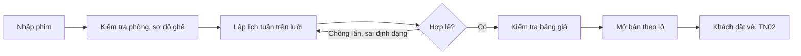

> **Mã:** DE08-TN01-PRD · **Trạng thái:** đã chốt · **Người viết:** Design · **SRS:** [SRS.md](SRS.md)

# PRD Lịch chiếu, phòng chiếu và giá vé (Đặt vé xem phim)

## 1. Bối cảnh và vấn đề

### 1.1 Bối cảnh

Trước khi khách đặt được vé, rạp phải có **phim**, **phòng chiếu với sơ đồ ghế**, **suất chiếu** và **bảng giá** (xem [README](../../README.md)). Người làm việc này là quản lý rạp, mỗi tuần lập lịch cho 6–10 phòng, 40–80 suất mỗi ngày, trên Web quản lý. Mọi sai sót ở đây (trùng phòng, sai giá, sơ đồ ghế sai) đều lan ra app của hàng nghìn khách.

### 1.2 Vấn đề

| **Vấn đề** | **Hệ quả** |
| --- | --- |
| Lập lịch bằng bảng tính, xếp chồng hai suất một phòng | Bán trùng, phải huỷ suất, hoàn tiền |
| Quên tính thời gian quảng cáo và dọn phòng | Suất sau bắt đầu trễ, khách phàn nàn |
| Giá vé nhiều tầng (định dạng, khung giờ, ngày, loại ghế) khó kiểm soát | Bán sai giá |
| Ghế hỏng vẫn bán | Khách tới không có chỗ ngồi |
| Không thấy trước lịch của cả tuần theo phòng | Phòng trống giờ vàng, phim hot thiếu suất |

### 1.3 Mục tiêu

- 0 suất chiếu trùng phòng được mở bán.
- Thời gian lập lịch một tuần cho một rạp ≤ 2 giờ.
- 0 vé bán sai giá so với bảng giá có hiệu lực.

## 2. Người dùng

| **Nhóm** | **Nhu cầu với tính năng này** |
| --- | --- |
| Quản lý rạp | Lập lịch nhanh theo dạng lưới phòng × giờ, hệ thống tự kiểm tra trùng |
| Quản lý rạp | Bảng giá theo quy tắc, xem trước giá của một suất |
| Kỹ thuật rạp | Khoá ghế hỏng, mở lại khi sửa xong |

## 3. Phạm vi

### 3.1 Trong phạm vi (MVP)

- Phim: thông tin, thời lượng, phân loại độ tuổi, định dạng, ngày khởi chiếu, trạng thái.
- Phòng chiếu: định dạng hỗ trợ, sơ đồ ghế (hàng, cột, lối đi, loại ghế: thường, VIP, đôi), khoá ghế.
- Lịch chiếu: tạo suất trên lưới phòng × giờ, tự tính giờ kết thúc, kiểm tra chồng lấn, nhân bản lịch, mở bán theo lô.
- Bảng giá: giá cơ bản theo định dạng, hệ số khung giờ và loại ngày, phụ thu loại ghế; xem trước giá.

### 3.2 Ngoài phạm vi

- Nhiều rạp trong một chuỗi, phân phối phim, hợp đồng với nhà phát hành.
- Tự động xếp lịch tối ưu bằng thuật toán → phase sau.
- Khuyến mãi, mã giảm giá, thẻ thành viên.
- Quản lý bắp nước, kho (chỉ dùng danh mục combo có sẵn ở TN04).

## 4. Nguyên tắc sản phẩm

### 4.1 Hệ thống không cho xếp sai

Chồng lấn phòng, suất ngoài giờ hoạt động, phim chưa khởi chiếu đều bị chặn ngay khi kéo thả, không đợi lưu.

### 4.2 Giá là quy tắc, không phải nhập tay từng suất

Quản lý đặt quy tắc một lần; giá từng suất tự sinh và xem trước được.

### 4.3 Thay đổi sau khi mở bán phải thận trọng

Suất đã bán vé chỉ được đổi giờ ít, hoặc huỷ theo quy trình hoàn tiền (TN05).

## 5. Quy tắc nghiệp vụ

| **Quy tắc** | **Giá trị** |
| --- | --- |
| Phân loại độ tuổi | P, K, T13, T16, T18 (phim C không được nhập) |
| Định dạng | 2D, 3D, IMAX; phòng chỉ chiếu định dạng mình hỗ trợ |
| Thời gian một suất | Thời lượng phim + 15 phút quảng cáo; sau suất cần 15 phút dọn phòng |
| Giờ hoạt động | Suất đầu bắt đầu từ 08:00; suất cuối bắt đầu trước 23:30 |
| Mở bán | Theo lô, sớm nhất 14 ngày trước ngày chiếu |
| Loại ghế | Thường, VIP, Đôi (bán theo cặp) |
| Sửa suất đã có vé | Đổi giờ tối đa ±30 phút, báo khách; không đổi phòng, phim |

## 6. Luồng trải nghiệm

| **Bước** | **Giai đoạn** | **Trải nghiệm** | **Đầu ra** |
| --- | --- | --- | --- |
| 1 | Phim | Nhập thông tin, phân loại, định dạng | Phim sẵn sàng xếp lịch |
| 2 | Phòng | Sơ đồ ghế, khoá ghế hỏng | Phòng sẵn sàng |
| 3 | Lịch | Kéo phim vào lưới phòng × giờ; nhân bản từ tuần trước | Suất nháp |
| 4 | Giá | Quy tắc giá; xem trước giá theo suất | Giá từng suất |
| 5 | Mở bán | Chọn các suất, bấm Mở bán | Suất khách thấy được |

## 7. Use Cases, User Stories và Acceptance Criteria

### UC1. Phim và phòng chiếu

#### US1.1 Nhập phim

AC01: Tên, tên gốc, poster, trailer, thời lượng, thể loại, đạo diễn, diễn viên, tóm tắt, phân loại độ tuổi, định dạng, ngày khởi chiếu.

AC02: Phim chưa đủ thông tin bắt buộc → không xếp lịch được.

#### US1.2 Sơ đồ ghế

User Story: Là quản lý rạp, tôi muốn vẽ sơ đồ ghế giống thực tế để khách chọn đúng chỗ.

AC01: Lưới hàng (A–Z) × cột; đánh dấu lối đi, loại ghế; ghế đôi chiếm 2 ô liền nhau.

AC02: Xem trước như khách thấy.

AC03: Phòng đã có suất mở bán → không sửa cấu trúc sơ đồ, chỉ khoá, mở khoá ghế.

#### US1.3 Khoá ghế hỏng

AC01: Khoá một ghế cho một khoảng thời gian hoặc tới khi mở lại; ghế đã bán trong khoảng đó được liệt kê để xử lý.

### UC2. Lập lịch

#### US2.1 Xếp suất

User Story: Là quản lý rạp, tôi muốn kéo phim vào lưới và hệ thống báo ngay nếu chồng lấn.

AC01: Lưới theo ngày: hàng là phòng, cột là giờ; thẻ suất dài theo thời lượng + quảng cáo, có vùng dọn phòng.

AC02: Chồng lấn, định dạng không hỗ trợ, ngoài giờ hoạt động, trước ngày khởi chiếu (trừ suất đánh dấu Chiếu sớm) → chặn, nêu lý do.

AC03: Nhân bản lịch một ngày hoặc một tuần sang ngày khác.

#### US2.2 Mở bán

AC01: Chọn nhiều suất nháp, bấm Mở bán; chỉ suất hợp lệ và có giá mới được mở.

AC02: Suất đã mở bán hiện trên app khách trong ≤ 1 phút.

#### US2.3 Sửa suất

AC01: Suất chưa có vé: sửa tự do.

AC02: Suất đã có vé: chỉ đổi giờ ±30 phút, hệ thống báo khách đã mua; muốn đổi nhiều hơn phải huỷ suất (TN05).

### UC3. Bảng giá

AC01: Giá cơ bản theo định dạng; hệ số theo khung giờ và loại ngày; phụ thu theo loại ghế.

AC02: Khai báo ngày lễ.

AC03: Xem trước giá từng loại ghế của một suất bất kỳ.

AC04: Thay đổi bảng giá có ngày hiệu lực; vé đã bán giữ giá cũ.

## 8. Chỉ số theo dõi

| **Chỉ số** | **Định nghĩa** | **Mục tiêu MVP** |
| --- | --- | --- |
| Suất trùng phòng | Suất mở bán chồng lấn | 0 |
| Thời gian lập lịch tuần | Từ mở lưới tới mở bán cả tuần | ≤ 2 giờ |
| Tỉ lệ dùng nhân bản | Suất tạo bằng nhân bản / tổng suất | Theo dõi |
| Suất đổi giờ sau mở bán | Số suất / tổng suất | ≤ 2% |
| Vé sai giá | Vé có giá khác bảng giá hiệu lực | 0 |

## 9. Phụ thuộc và rủi ro

| **Mục** | **Mô tả** | **Hướng xử lý** |
| --- | --- | --- |
| Thông tin phim từ nhà phát hành | Thời lượng, phân loại thay đổi sát ngày | Cho sửa trước khi mở bán; sửa sau mở bán phải kiểm tra lại các suất |
| Ngày lễ | Quên khai báo | Nhắc khai báo lễ của năm sau từ tháng 11 |
| Sơ đồ ghế phức tạp | Phòng có ghế lệch, ban công | MVP chỉ hỗ trợ lưới; ô trống làm lối đi |

## 10. Câu hỏi mở

> Mọi câu hỏi dưới đây đã được PO chốt ngày 20/11/2026; quyết định ghi sau mỗi câu và đã cập nhật vào SRS.

- Giá vé đã bán có đổi khi bảng giá đổi? → **Đã chốt:** Không; giá chốt tại thời điểm đặt (SRS BR-11).
- Suất đã mở bán có tự đóng bán? → **Đã chốt:** Bán online tới giờ bắt đầu chiếu; tại quầy tới 15 phút sau giờ bắt đầu (SRS BR-08).
- Ai được mở bán? → **Đã chốt:** Quản lý rạp; nhân viên chỉ xem (SRS BR-12).
- Ghế khoá khi đã có người mua thì sao? → **Đã chốt:** Hệ thống liệt kê vé bị ảnh hưởng; quản lý đổi ghế cho khách tại quầy hoặc hoàn tiền theo TN05 (SRS BR-04).
