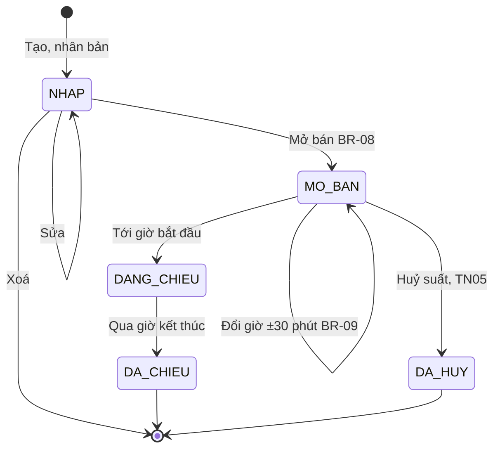
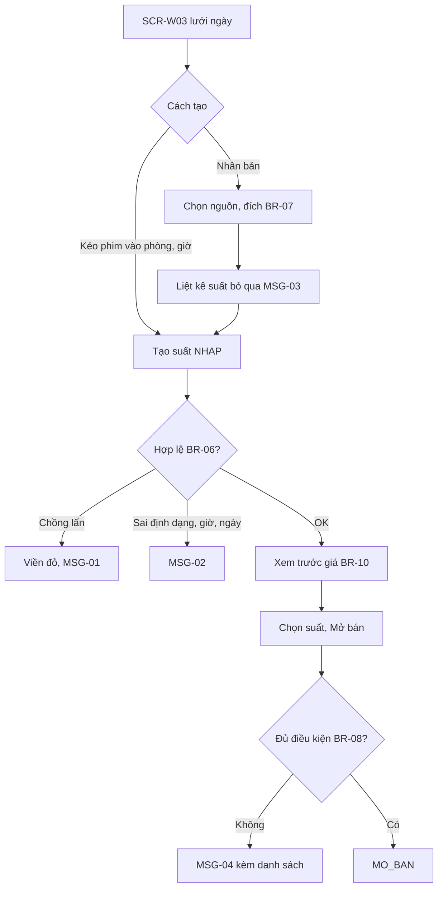
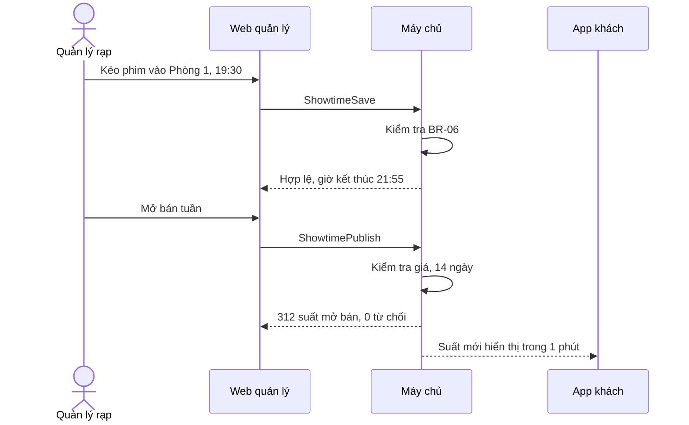

> **Mã:** DE08-TN01-SRS · **Trạng thái:** đã chốt · **Người viết:** Design · **PRD:** [PRD.md](PRD.md)

# UC-DE08-01 - Lịch chiếu, phòng chiếu và giá vé

> SRS này mô tả phía Web quản lý rạp: phim, phòng chiếu, sơ đồ ghế, suất chiếu, bảng giá và mở bán. Khách xem suất chiếu ở [SRS TN02](../TN02-chon-phim-suat/SRS.md); huỷ suất ở [SRS TN05](../TN05-soat-ve-doi-huy/SRS.md).

## 1. Tổng quan

| **Mục** | **Nội dung** |
| --- | --- |
| Mục tiêu | Quản lý rạp lập lịch chiếu đúng, không chồng lấn, giá đúng quy tắc, rồi mở bán |
| Actor | Quản lý rạp · Nhân viên rạp (xem) · Web quản lý · Máy chủ |
| Phạm vi | Phim, phòng, sơ đồ ghế, khoá ghế, lưới lịch, kiểm tra hợp lệ, nhân bản, mở bán, sửa suất, bảng giá, ngày lễ, xem trước giá |
| Ngoài phạm vi | Chuỗi nhiều rạp, xếp lịch tự động, khuyến mãi, kho bắp nước |
| Nền tảng | Web quản lý (desktop ≥ 1280 px) |

## 2. User Story

| **ID** | **As a** | **I want** | **So that** |
| --- | --- | --- | --- |
| US-01 | Quản lý rạp | Vẽ sơ đồ ghế theo thực tế | Khách chọn đúng chỗ |
| US-02 | Quản lý rạp | Kéo phim vào lưới và được chặn khi chồng lấn | Không bán trùng |
| US-03 | Quản lý rạp | Nhân bản lịch tuần trước | Lập lịch nhanh |
| US-04 | Quản lý rạp | Đặt giá theo quy tắc, xem trước | Không bán sai giá |
| US-05 | Kỹ thuật rạp | Khoá ghế hỏng | Không bán ghế không dùng được |

## 3. Business Rules

| **Mã** | **Quy tắc** |
| --- | --- |
| BR-01 | **Phim**: bắt buộc tên, poster, thời lượng (phút, 30–300), phân loại (P, K, T13, T16, T18), định dạng (1+ trong 2D, 3D, IMAX), ngày khởi chiếu; tuỳ chọn tên gốc, trailer, thể loại, đạo diễn, diễn viên, tóm tắt, ngôn ngữ (Phụ đề / Lồng tiếng). Trạng thái `SAP_CHIEU` (trước ngày khởi chiếu), `DANG_CHIEU`, `NGUNG_CHIEU` (quản lý đặt) |
| BR-02 | **Sơ đồ ghế**: lưới tối đa 26 hàng (A–Z) × 30 cột; mỗi ô: Ghế thường, VIP, Đôi (2 ô liền, cùng hàng), Lối đi, Trống. Mã ghế = hàng + số thứ tự trong hàng (bỏ qua lối đi), ví dụ F7; ghế đôi mã "J1-2". Phòng có định dạng hỗ trợ (1+ trong 2D, 3D, IMAX) |
| BR-03 | **Sửa sơ đồ**: chỉ khi phòng không có suất `MO_BAN` trong tương lai; ngược lại chỉ khoá, mở khoá ghế |
| BR-04 | **Khoá ghế**: chọn ghế, lý do (Hỏng, Bảo trì, Dành riêng), thời gian (khoảng ngày hoặc tới khi mở lại). Ghế khoá không bán (trạng thái `KHONG_BAN`, TN03). Nếu đã có vé bán ghế đó trong khoảng khoá → danh sách vé bị ảnh hưởng (MSG-06) để xử lý tại quầy hoặc hoàn tiền (TN05) |
| BR-05 | **Suất chiếu**: phim, phòng, định dạng (phòng và phim cùng hỗ trợ), giờ bắt đầu (bội số 5 phút). Giờ kết thúc = bắt đầu + 15 phút quảng cáo + thời lượng. Vùng dọn phòng 15 phút sau giờ kết thúc |
| BR-06 | **Hợp lệ khi xếp**: không chồng lấn [bắt đầu, kết thúc + 15 phút] với suất khác cùng phòng; bắt đầu từ 08:00 và trước 23:30; ngày chiếu ≥ ngày khởi chiếu, trừ suất được quản lý đánh dấu **Chiếu sớm**; phim không `NGUNG_CHIEU`. Vi phạm → thẻ suất viền đỏ, MSG-01 hoặc MSG-02 với lý do; không lưu được |
| BR-07 | **Nhân bản**: sao chép mọi suất của 1 ngày hoặc 7 ngày sang khoảng đích; suất vi phạm BR-06 ở đích bị bỏ qua và liệt kê (MSG-03); suất tạo ra ở `NHAP` |
| BR-08 | **Mở bán**: chọn suất `NHAP` → `MO_BAN`; chỉ khi hợp lệ và có giá; ngày chiếu ≤ hôm nay + 14 ngày. Bán online tới giờ bắt đầu; tại quầy tới 15 phút sau giờ bắt đầu. Sau giờ kết thúc → `DA_CHIEU` |
| BR-09 | **Sửa suất `MO_BAN`**: chưa có vé → sửa như `NHAP` (vẫn kiểm tra BR-06). Có vé → chỉ đổi giờ bắt đầu trong ±30 phút, vẫn kiểm tra BR-06; gửi MSG-07 tới khách đã mua; không đổi phòng, phim, định dạng. Thay đổi lớn hơn → huỷ suất (TN05) |
| BR-10 | **Giá vé** = làm tròn tới 1.000 ₫ của (giá cơ bản theo định dạng × hệ số khung giờ × hệ số loại ngày) + phụ thu loại ghế. Khung giờ: Sáng (bắt đầu trước 12:00), Chiều (12:00–16:59), Tối (từ 17:00). Loại ngày: Thường (T2–T5), Cuối tuần (T6–CN), Lễ (theo danh sách). Ghế đôi: giá = 2 × giá ghế thường + phụ thu đôi. Các giá trị cấu hình trên **SCR-W04**; giá trị hiện hành xem ví dụ ở UC-03 |
| BR-11 | **Hiệu lực giá**: mỗi phiên bản bảng giá có ngày hiệu lực; suất dùng bảng giá hiệu lực tại **ngày chiếu**; thay đổi không ảnh hưởng vé đã bán (giá chốt khi đặt). Bảng giá mới có hiệu lực ≥ ngày mai |
| BR-12 | **Quyền**: Quản lý rạp: mọi thao tác. Nhân viên rạp: xem lịch, xem sơ đồ, khoá ghế (không mở bán, không sửa giá). Mọi thay đổi ghi lịch sử |

## 4. Trạng thái

### 4.1 Vòng đời suất chiếu

### 4.2 Hiển thị thẻ suất trên lưới

| **Trạng thái** | **Hiển thị** |
| --- | --- |
| `NHAP` | Nền nhạt, viền nét đứt |
| `NHAP` vi phạm | Viền đỏ, biểu tượng cảnh báo, tooltip lý do |
| `MO_BAN` | Nền đậm màu theo phim, số ghế đã bán / tổng |
| `DANG_CHIEU`, `DA_CHIEU` | Xám, chỉ xem |
| `DA_HUY` | Gạch ngang, chỉ xem |

## 5. Use Case

### UC-01 Thiết lập phòng và sơ đồ ghế

**Luồng chính**

| **Bước** | **Actor** | **Mô tả** |
| --- | --- | --- |
| 1 | Quản lý rạp | Mở **SCR-W02**, chọn "Phòng 3" |
| 2 | Quản lý rạp | Đặt 12 hàng × 18 cột; tô cột 5 và 14 làm lối đi; hàng H–J là VIP; hàng L là ghế đôi |
| 3 | Web | Đánh mã ghế theo BR-02, hiện tổng số ghế theo loại |
| 4 | Quản lý rạp | Bấm "Xem như khách" rồi "Lưu" |
| 5 | Web | Gọi \[RoomSave\] |

**Luồng thay thế**

| **Mã** | **Điều kiện** | **Xử lý** |
| --- | --- | --- |
| A1 | Khoá ghế | Chọn ghế → "Khoá ghế" → lý do, thời gian → \[SeatBlock\] (BR-04) |
| A2 | Phòng có suất mở bán | Công cụ sửa cấu trúc bị khoá, MSG-05 |

**Luồng lỗi**

| **Mã** | **Điều kiện** | **Xử lý** |
| --- | --- | --- |
| E1 | Ghế đôi đặt qua lối đi hoặc ở cột cuối lẻ | Lỗi inline "Ghế đôi cần 2 ô liền nhau trong cùng hàng" |
| E2 | Khoá ghế đã bán | MSG-06 |

### UC-02 Lập lịch và mở bán

| **Mục** | **Nội dung** |
| --- | --- |
| Tiền điều kiện | Có phim đủ thông tin, phòng có sơ đồ, bảng giá có hiệu lực |
| Hậu điều kiện thành công | Suất `MO_BAN`, hiện trên app khách |
| Hậu điều kiện thất bại | Suất ở `NHAP` với lý do lỗi |

**Luồng chính**

| **Bước** | **Actor** | **Mô tả** |
| --- | --- | --- |
| 1 | Quản lý rạp | Mở **SCR-W03**, chọn tuần 24–30/11 |
| 2 | Quản lý rạp | "Nhân bản tuần trước" |
| 3 | Web | Gọi \[ScheduleClone\]; tạo suất `NHAP`, liệt kê 2 suất bị bỏ qua vì phim đã ngừng chiếu |
| 4 | Quản lý rạp | Kéo phim mới vào Phòng 1 lúc 19:30 |
| 5 | Web | Hiện thẻ suất 19:30–21:55 (+ dọn tới 22:10); hợp lệ |
| 6 | Quản lý rạp | Chọn cả tuần, bấm "Mở bán" |
| 7 | Web | Gọi \[ShowtimePublish\]; suất chuyển `MO_BAN`; MSG-08 |

**Luồng thay thế**

| **Mã** | **Điều kiện** | **Xử lý** |
| --- | --- | --- |
| A1 | Kéo thẻ suất sang giờ khác, phòng khác | Kiểm tra BR-06 ngay khi thả |
| A2 | Đổi giờ suất đã có vé | Giới hạn ±30 phút (BR-09), popup xác nhận số khách sẽ được báo |
| A3 | Xoá suất `NHAP` | Xoá ngay |
| A4 | Xem trước giá | Chạm thẻ suất → panel giá từng loại ghế |

**Luồng lỗi**

| **Mã** | **Điều kiện** | **Xử lý** |
| --- | --- | --- |
| E1 | Chồng lấn | MSG-01 |
| E2 | Định dạng, giờ hoạt động, trước khởi chiếu | MSG-02 |
| E3 | Mở bán quá 14 ngày, thiếu giá | MSG-04 |

### UC-03 Cấu hình bảng giá

**Luồng chính**

| **Bước** | **Actor** | **Mô tả** |
| --- | --- | --- |
| 1 | Quản lý rạp | Mở **SCR-W04**, "Tạo phiên bản mới", hiệu lực từ 01/12/2026 |
| 2 | Quản lý rạp | Nhập giá cơ bản 2D 75.000 ₫, 3D 95.000 ₫, IMAX 140.000 ₫; hệ số Sáng 0,8 · Chiều 1,0 · Tối 1,15; Thường 1,0 · Cuối tuần 1,2 · Lễ 1,3; phụ thu VIP 20.000 ₫, Đôi 30.000 ₫ |
| 3 | Web | Ma trận xem trước: mỗi định dạng × khung giờ × loại ngày × loại ghế |
| 4 | Quản lý rạp | Bấm "Lưu" → \[PriceTableSave\] |

**Luồng thay thế**

| **Mã** | **Điều kiện** | **Xử lý** |
| --- | --- | --- |
| A1 | Khai báo ngày lễ | Lịch chọn ngày, tên lễ |

## 6. Điểm vào

| **Điểm vào** | **Dẫn tới** | **Ghi chú** |
| --- | --- | --- |
| Menu Phim | **SCR-W01** | |
| Menu Phòng chiếu | **SCR-W02** | |
| Menu Lịch chiếu | **SCR-W03** ngày hôm nay | |
| Menu Giá vé | **SCR-W04** | |
| Thông báo "Ghế khoá có vé" | Danh sách vé bị ảnh hưởng | BR-04 |

## 7. Mô tả màn hình

### SCR-W01 Phim

| **#** | **Thành phần** | **Loại** | **Bắt buộc** | **Validate / hành vi** |
| --- | --- | --- | --- | --- |
| 1 | Danh sách phim | Table | – | Poster nhỏ, tên, phân loại, định dạng, khởi chiếu, trạng thái, số suất tuần này |
| 2 | Form phim | Form | Theo BR-01 | Thời lượng 30–300; poster ≤ 5 MB, tỉ lệ 2:3 |
| 3 | Ngừng chiếu | Button | – | Cảnh báo nếu còn suất `MO_BAN` |

### SCR-W02 Phòng chiếu & sơ đồ ghế

| **#** | **Thành phần** | **Loại** | **Hành vi** |
| --- | --- | --- | --- |
| 1 | Danh sách phòng | List | Tên, định dạng, số ghế |
| 2 | Kích thước lưới | Number × Number | Hàng, cột |
| 3 | Công cụ tô | Toolbar | Thường, VIP, Đôi, Lối đi, Trống |
| 4 | Lưới ghế | Canvas | Kéo để tô nhiều ô; màn hình chiếu ở trên |
| 5 | Khoá ghế | Panel | Lý do, thời gian (BR-04); ghế khoá hiện dấu × |
| 6 | Tổng ghế | Text | Theo loại |
| 7 | Xem như khách | Button | Hiện sơ đồ như **SCR-K04** |

### SCR-W03 Lịch chiếu

| **#** | **Thành phần** | **Loại** | **Hành vi** |
| --- | --- | --- | --- |
| 1 | Chọn ngày, tuần | Date picker | |
| 2 | Danh sách phim | Side panel | Kéo vào lưới; lọc đang chiếu, sắp chiếu |
| 3 | Lưới | Timeline | Hàng = phòng; cột = 08:00–02:00; bước 5 phút; thẻ suất theo mục 4.2; vùng dọn phòng sọc |
| 4 | Nhân bản | Button | BR-07 |
| 5 | Mở bán | Button | Cho suất đã chọn |
| 6 | Panel suất | Drawer | Phim, phòng, giờ, định dạng, giá xem trước, số vé đã bán, Huỷ suất (TN05) |
| 7 | Tổng hợp | Text | Số suất theo phim trong ngày |

### SCR-W04 Bảng giá

| **#** | **Thành phần** | **Loại** | **Bắt buộc** | **Validate / hành vi** |
| --- | --- | --- | --- | --- |
| 1 | Phiên bản | List | – | Ngày hiệu lực, người tạo |
| 2 | Giá cơ bản | Amount × 3 | Có | Theo định dạng |
| 3 | Hệ số khung giờ | Number × 3 | Có | 0,5–2,0 |
| 4 | Hệ số loại ngày | Number × 3 | Có | 0,5–2,0 |
| 5 | Phụ thu ghế | Amount × 2 | Có | VIP, Đôi |
| 6 | Ngày lễ | Calendar | – | |
| 7 | Ma trận xem trước | Table | – | Giá cuối theo BR-10 |

## 8. API

| **API** | **Request chính** | **Response chính** | **Timeout / retry** |
| --- | --- | --- | --- |
| \[MovieSave\] | thông tin BR-01 | movie_id | 10s / 1 lần |
| \[RoomSave\] | room_id, grid, formats | room, seat_codes | 10s / 1 lần |
| \[SeatBlock\] | room_id, seats, reason, from, to | affected_tickets | 5s / 1 lần |
| \[ScheduleGet\] | date_range | Suất theo phòng | 5s / 1 lần |
| \[ShowtimeSave\] | movie, room, format, start | showtime, violations | 3s / 1 lần |
| \[ScheduleClone\] | source_range, target_start | created, skipped (lý do) | 15s / 1 lần |
| \[ShowtimePublish\] | showtime_ids | published, rejected (lý do) | 10s / 1 lần |
| \[PriceTableSave\] | effective_from, base, factors, surcharges, holidays | version_id | 5s / 1 lần |
| \[PricePreview\] | showtime_id | Giá từng loại ghế | 2s / 1 lần |

**Map lỗi → thông báo**

| **Nhóm lỗi** | **Message** |
| --- | --- |
| Chồng lấn phòng | MSG-01 |
| Sai định dạng, giờ hoạt động, khởi chiếu | MSG-02 |
| Suất bị bỏ qua khi nhân bản | MSG-03 |
| Không mở bán được | MSG-04 |
| Không sửa sơ đồ khi có suất mở bán | MSG-05 |
| Khoá ghế đã bán | MSG-06 |
| Đổi giờ suất (gửi khách) | MSG-07 |
| Mở bán thành công | MSG-08 |

## 9. Danh sách thông báo

| **ID** | **Nơi hiện** | **Nội dung (VI)** |
| --- | --- | --- |
| MSG-01 | Tooltip, inline | Trùng với suất {phim} {giờ bắt đầu}–{giờ kết thúc} tại {phòng} (cần 15 phút dọn phòng) |
| MSG-02 | Tooltip, inline | Theo lý do: {Phòng} không hỗ trợ {định dạng} · Suất phải bắt đầu từ 08:00 và trước 23:30 · Phim khởi chiếu ngày {ngày} |
| MSG-03 | Popup | Đã tạo {n} suất. Bỏ qua {m} suất: {danh sách và lý do} |
| MSG-04 | Popup | Không mở bán được {m} suất: {danh sách và lý do: quá 14 ngày / chưa có giá / không hợp lệ} |
| MSG-05 | Banner | Phòng đang có suất mở bán nên không sửa được sơ đồ. Bạn vẫn có thể khoá, mở khoá ghế |
| MSG-06 | Popup | {n} vé đã bán có ghế bị khoá trong khoảng này. \[Xem danh sách\] |
| MSG-07 | Push, email khách | Suất {phim} ngày {ngày} tại {rạp} đổi giờ bắt đầu từ {giờ cũ} thành {giờ mới}. Bạn có thể đổi hoặc huỷ vé miễn phí trong ứng dụng |
| MSG-08 | Toast | Đã mở bán {n} suất |

## 10. Yêu cầu phi chức năng

| **Mục** | **Yêu cầu** |
| --- | --- |
| Hiệu năng | Kiểm tra hợp lệ khi thả thẻ ≤ 300 ms; lưới tuần 10 phòng tải ≤ 2 giây; suất mở bán lên app ≤ 1 phút |
| Tính đúng | Kiểm tra chồng lấn trên máy chủ trong giao dịch (không chỉ trên trình duyệt); giá vé tính tại máy chủ |
| Bảo mật | Đăng nhập Web quản lý 2 lớp; phân quyền theo BR-12 |
| Log / audit | Mọi tạo, sửa, mở bán, đổi giờ, khoá ghế, đổi bảng giá: ai, khi nào, trước và sau |
| Tracking | Thời gian lập lịch, dùng nhân bản, số lần vi phạm khi kéo thả, số suất đổi giờ sau mở bán |
| Accessibility | Lưới dùng được bằng bàn phím (di chuyển thẻ bằng phím mũi tên); màu phim kèm tên phim trên thẻ |
