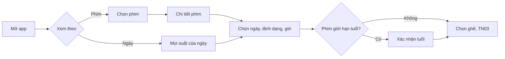

> **Mã:** DE08-TN02-PRD · **Trạng thái:** đã chốt · **Người viết:** Design · **SRS:** [SRS.md](SRS.md)

# PRD Chọn phim và suất chiếu (Đặt vé xem phim)

## 1. Bối cảnh và vấn đề

### 1.1 Bối cảnh

Khách mở app để xem rạp đang chiếu gì, chọn phim và suất phù hợp với lịch của mình (xem [README](../../README.md)). Quyết định thường diễn ra nhanh, trong nhóm bạn hoặc gia đình: "tối nay 8 giờ xem gì?". Với phim có giới hạn độ tuổi, khách cần biết trước để không bị từ chối ở cửa phòng chiếu.

### 1.2 Vấn đề

| **Vấn đề** | **Hệ quả** |
| --- | --- |
| Muốn xem "tối nay 8 giờ" nhưng phải mở từng phim để xem suất | Mất thời gian, bỏ cuộc |
| Không biết suất nào còn ghế đẹp | Chọn suất rồi mới thấy chỉ còn hàng đầu |
| Không thấy rõ 2D, 3D, IMAX, phụ đề hay lồng tiếng | Mua nhầm định dạng |
| Không biết phim T16, T18 bị kiểm tra tuổi | Bị từ chối ở cửa, mất tiền |
| Phim sắp chiếu chưa mở bán, phải nhớ quay lại | Mất suất đẹp ngày đầu |

### 1.3 Mục tiêu

- ≥ 45% phiên mở app tới bước chọn ghế.
- Thời gian từ mở app tới chọn xong suất ≤ 45 giây (trung vị).
- Vé bị từ chối ở cửa vì độ tuổi ≤ 0,1%.

## 2. Người dùng

| **Nhóm** | **Nhu cầu với tính năng này** |
| --- | --- |
| Nhóm bạn trẻ | Xem nhanh suất tối nay của mọi phim; phim mới, hot |
| Gia đình có trẻ nhỏ | Biết phim nào phù hợp trẻ em, suất ban ngày |
| Người hâm mộ phim | Nhắc khi mở bán phim sắp chiếu, chọn IMAX |

## 3. Phạm vi

### 3.1 Trong phạm vi (MVP)

- Trang chủ: Đang chiếu, Sắp chiếu; banner phim nổi bật.
- Xem theo ngày: mọi suất của một ngày, nhóm theo phim.
- Chi tiết phim: trailer, thông tin, phân loại độ tuổi giải thích rõ.
- Chọn suất: ngày, định dạng, ngôn ngữ, giờ; mức ghế còn trống; giá từ.
- Xác nhận độ tuổi với phim T13, T16, T18; lưu ý K.
- Nhắc khi mở bán cho phim sắp chiếu.
- Tìm phim theo tên.

### 3.2 Ngoài phạm vi

- Nhiều rạp, chọn rạp gần nhất → phase sau.
- Đánh giá, bình luận phim.
- Gợi ý phim cá nhân hoá.
- Đặt vé nhóm, chia tiền.

## 4. Nguyên tắc sản phẩm

### 4.1 Thời gian là trục chính

Khách nghĩ theo "khi nào rảnh"; xem theo ngày và giờ phải nhanh như xem theo phim.

### 4.2 Định dạng và độ tuổi không được nhầm

Nhãn 2D / 3D / IMAX, Phụ đề / Lồng tiếng, và phân loại tuổi luôn đi kèm suất, không nằm trong chi tiết ẩn.

### 4.3 Báo trước những gì có thể làm hỏng buổi xem

Phim giới hạn tuổi được xác nhận trước khi chọn ghế.

## 5. Quy tắc nghiệp vụ

| **Quy tắc** | **Giá trị** |
| --- | --- |
| Đang chiếu | Phim có suất mở bán trong 7 ngày tới |
| Sắp chiếu | Phim có ngày khởi chiếu trong tương lai |
| Dải ngày | 7 ngày từ hôm nay; ngày không có suất làm mờ |
| Mức ghế trống | Còn nhiều (> 50%), Còn ít (20–50%), Sắp hết (< 20%), Hết vé |
| Bán online | Tới giờ bắt đầu suất |
| Phân loại tuổi | P mọi lứa tuổi · K dưới 13 tuổi cần đi cùng cha mẹ, người giám hộ · T13, T16, T18 từ đủ 13, 16, 18 tuổi |

## 6. Luồng trải nghiệm

| **Bước** | **Giai đoạn** | **Trải nghiệm** | **Đầu ra** |
| --- | --- | --- | --- |
| 1 | Khám phá | Đang chiếu, Sắp chiếu, Theo ngày | Phim hoặc ngày |
| 2 | Tìm hiểu | Trailer, tóm tắt, phân loại tuổi | Quyết định xem |
| 3 | Chọn suất | Ngày, định dạng, giờ; mức ghế trống | Suất chiếu |
| 4 | Độ tuổi | Xác nhận (nếu cần) | Sang chọn ghế |

## 7. Use Cases, User Stories và Acceptance Criteria

### UC1. Khám phá phim

#### US1.1 Xem phim đang chiếu

AC01: Lưới poster: tên, phân loại tuổi, thời lượng, định dạng có sẵn.

AC02: Tab Sắp chiếu: ngày khởi chiếu, nút "Nhắc tôi khi mở bán".

AC03: Tìm phim theo tên, không dấu.

#### US1.2 Xem theo ngày

User Story: Là người rảnh tối nay, tôi muốn thấy mọi suất sau 19 giờ của mọi phim.

AC01: Chọn ngày; danh sách phim, mỗi phim có các suất của ngày đó.

AC02: Lọc khung giờ: Sáng, Chiều, Tối; lọc định dạng.

### UC2. Chọn suất

#### US2.1 Chọn đúng suất

AC01: Dải 7 ngày; ngày không có suất làm mờ.

AC02: Suất nhóm theo định dạng và ngôn ngữ, ví dụ "2D Phụ đề", "IMAX Lồng tiếng".

AC03: Mỗi suất: giờ bắt đầu, giờ kết thúc dự kiến, mức ghế trống, giá từ.

AC04: Suất hết vé không chọn được; suất đã bắt đầu không hiện.

### UC3. Độ tuổi

#### US3.1 Không bị từ chối ở cửa

User Story: Là khách 15 tuổi, tôi muốn biết trước phim T16 không xem được.

AC01: Nhãn phân loại có giải thích khi chạm.

AC02: Chọn suất phim T13, T16, T18 → popup xác nhận đủ tuổi và mang giấy tờ tuỳ thân; với K → lưu ý đi cùng cha mẹ.

AC03: Hồ sơ có ngày sinh chưa đủ tuổi → không cho đặt, nói rõ lý do.

### UC4. Nhắc mở bán

AC01: Bật nhắc cho phim sắp chiếu; push khi suất đầu tiên được mở bán.

## 8. Chỉ số theo dõi

| **Chỉ số** | **Định nghĩa** | **Mục tiêu MVP** |
| --- | --- | --- |
| Tỉ lệ tới chọn ghế | Phiên tới **SCR-K04** / phiên mở app | ≥ 45% |
| Thời gian chọn suất | Mở app → chọn suất (trung vị) | ≤ 45 giây |
| Tỉ lệ dùng xem theo ngày | Phiên dùng tab Theo ngày / phiên chọn suất | Theo dõi |
| Từ chối vì độ tuổi | Vé bị từ chối ở cửa vì tuổi / vé phim giới hạn tuổi | ≤ 0,1% |
| Chuyển đổi từ nhắc mở bán | Đặt vé trong 24 giờ sau push / push đã gửi | Theo dõi |

## 9. Phụ thuộc và rủi ro

| **Mục** | **Mô tả** | **Hướng xử lý** |
| --- | --- | --- |
| Lịch chiếu đổi giờ | Khách đã xem giờ cũ | Cập nhật ≤ 1 phút (TN01); vé đã mua được báo |
| Mức ghế trống thay đổi nhanh | Hiển thị lệch | Làm mới khi mở **SCR-K03**; con số chính xác ở **SCR-K04** |
| Trailer nặng | Tốn dữ liệu di động | Chỉ phát khi khách chạm |

## 10. Câu hỏi mở

> Mọi câu hỏi dưới đây đã được PO chốt ngày 20/11/2026; quyết định ghi sau mỗi câu và đã cập nhật vào SRS.

- Có hiện số ghế còn chính xác? → **Đã chốt:** Không; hiện mức (Còn nhiều, Còn ít, Sắp hết) để tránh lệch (SRS BR-15).
- Khách chưa có ngày sinh trong hồ sơ thì sao? → **Đã chốt:** Hỏi xác nhận đủ tuổi mỗi lần đặt phim giới hạn; không bắt nhập ngày sinh (SRS BR-17).
- Suất sắp bắt đầu (≤ 15 phút) có bán? → **Đã chốt:** Có tới giờ bắt đầu, kèm nhãn "Sắp bắt đầu" (SRS BR-16).
- Phim chiếu sớm trước khởi chiếu có hiện ở Đang chiếu? → **Đã chốt:** Hiện ở Sắp chiếu với nhãn "Chiếu sớm" và có nút Đặt vé (SRS BR-13).
