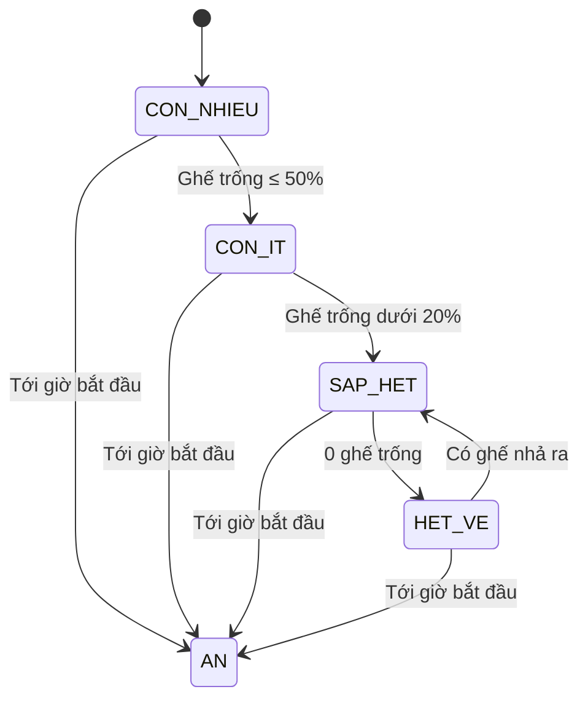
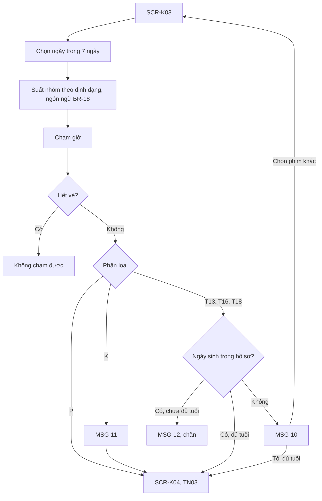
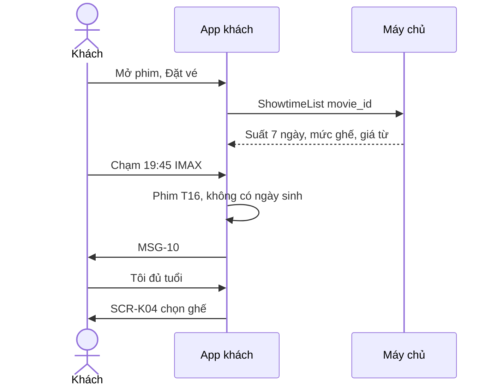

> **Mã:** DE08-TN02-SRS · **Trạng thái:** đã chốt · **Người viết:** Design · **PRD:** [PRD.md](PRD.md)

# UC-DE08-02 - Chọn phim và suất chiếu

> SRS này mô tả App khách từ lúc mở app tới khi chọn được suất chiếu; chọn ghế và giữ chỗ xem [SRS TN03](../TN03-chon-ghe-giu-cho/SRS.md). Dữ liệu phim, suất do [SRS TN01](../TN01-lich-chieu-gia-ve/SRS.md) tạo.

## 1. Tổng quan

| **Mục** | **Nội dung** |
| --- | --- |
| Mục tiêu | Khách tìm phim, chọn suất đúng định dạng, đúng giờ, biết trước ràng buộc độ tuổi |
| Actor | Khách · App khách · Máy chủ |
| Phạm vi | Trang chủ, Đang chiếu, Sắp chiếu, Theo ngày, tìm phim, chi tiết phim, chọn suất, xác nhận độ tuổi, nhắc mở bán |
| Ngoài phạm vi | Nhiều rạp, đánh giá phim, gợi ý cá nhân hoá, đặt nhóm |
| Nền tảng | App khách iOS / Android |

## 2. User Story

| **ID** | **As a** | **I want** | **So that** |
| --- | --- | --- | --- |
| US-06 | Khách | Xem mọi suất của một ngày | Chọn theo thời gian rảnh |
| US-07 | Khách | Thấy rõ định dạng, ngôn ngữ của suất | Không mua nhầm |
| US-08 | Khách | Biết suất nào còn nhiều ghế | Chọn được chỗ đẹp |
| US-09 | Khách | Biết trước giới hạn tuổi | Không bị từ chối ở cửa |
| US-10 | Khách | Được nhắc khi phim mở bán | Không lỡ suất ngày đầu |

## 3. Business Rules

| **Mã** | **Quy tắc** |
| --- | --- |
| BR-13 | **Danh mục phim**: Đang chiếu = phim `DANG_CHIEU` có ≥ 1 suất `MO_BAN` trong 7 ngày tới, sắp theo số vé bán 7 ngày gần nhất. Sắp chiếu = phim `SAP_CHIEU`, sắp theo ngày khởi chiếu; phim có suất **Chiếu sớm** mở bán → nhãn "Chiếu sớm" và nút Đặt vé |
| BR-14 | **Thẻ phim**: poster, tên, nhãn phân loại (màu theo mức), thời lượng, định dạng có suất; Sắp chiếu thêm ngày khởi chiếu |
| BR-15 | **Mức ghế trống** theo tỉ lệ ghế `TRONG` / ghế bán được: > 50% "Còn nhiều"; 20–50% "Còn ít"; < 20% "Sắp hết"; 0 "Hết vé" (không chọn được). Tính lại khi mở **SCR-K03** và mỗi 60 giây khi đang mở |
| BR-16 | **Suất hiển thị**: `MO_BAN`, giờ bắt đầu > hiện tại. Bắt đầu trong ≤ 15 phút → nhãn "Sắp bắt đầu". Suất đổi giờ (TN01 BR-09) hiện giờ mới |
| BR-17 | **Xác nhận độ tuổi**: chọn suất phim T13, T16, T18 → popup MSG-10 với \[Tôi đủ tuổi\] \[Chọn phim khác\]; phim K → popup MSG-11. Hồ sơ có ngày sinh: tính tuổi tại ngày chiếu; chưa đủ T13/T16/T18 → MSG-12, không cho đặt. Xác nhận lưu cùng đơn đặt vé (TN03, TN04) |
| BR-18 | **Nhóm suất** trên **SCR-K03**: theo "định dạng + ngôn ngữ" (2D Phụ đề, 2D Lồng tiếng, 3D Phụ đề, IMAX Phụ đề…); trong nhóm sắp theo giờ |
| BR-19 | **Giá từ** = giá thấp nhất (ghế thường) của suất theo TN01 BR-10 |
| BR-20 | **Nhắc mở bán**: bật trên phim `SAP_CHIEU`; khi suất đầu tiên của phim `MO_BAN` → push MSG-13 một lần; tắt được |
| BR-21 | **Tìm phim** theo tên, tên gốc; không dấu, không phân biệt hoa thường; gợi ý sau 2 ký tự |

## 4. Trạng thái

### 4.1 Trạng thái nút suất chiếu trên SCR-K03

| **Trạng thái** | **Hiển thị** |
| --- | --- |
| `CON_NHIEU` | Ô giờ thường, chấm xanh |
| `CON_IT` | Chấm vàng, "Còn ít" |
| `SAP_HET` | Chấm đỏ, "Sắp hết" |
| `HET_VE` | Mờ, "Hết vé", không chạm được |
| Nhãn phụ | "Sắp bắt đầu" khi ≤ 15 phút |

## 5. Use Case

### UC-04 Khám phá và chọn phim

**Luồng chính**

| **Bước** | **Actor** | **Mô tả** |
| --- | --- | --- |
| 1 | Khách | Mở app |
| 2 | App | Gọi \[MovieList\]; hiện **SCR-K01** tab Đang chiếu |
| 3 | Khách | Chạm poster một phim |
| 4 | App | Gọi \[MovieDetail\]; hiện **SCR-K02** |
| 5 | Khách | Bấm "Đặt vé" → **SCR-K03** |

**Luồng thay thế**

| **Mã** | **Điều kiện** | **Xử lý** |
| --- | --- | --- |
| A1 | Tab Theo ngày | Chọn ngày, lọc khung giờ, định dạng → danh sách phim kèm suất; chạm suất → UC-05 bước 4 |
| A2 | Tab Sắp chiếu, bật nhắc | \[ReleaseReminder\]; MSG-14 |
| A3 | Tìm phim | Ô tìm trên **SCR-K01** (BR-21) |
| A4 | Xem trailer | Phát trong **SCR-K02** khi chạm, không tự phát |

**Luồng lỗi**

| **Mã** | **Điều kiện** | **Xử lý** |
| --- | --- | --- |
| E1 | Không có phim đang chiếu | Empty state "Rạp đang cập nhật lịch chiếu" |
| E2 | Lỗi mạng | MSG-09 |

### UC-05 Chọn suất và xác nhận độ tuổi

| **Mục** | **Nội dung** |
| --- | --- |
| Tiền điều kiện | Phim có suất mở bán |
| Hậu điều kiện thành công | Có suất đã chọn và xác nhận độ tuổi (nếu cần); mở **SCR-K04** |
| Hậu điều kiện thất bại | Ở lại **SCR-K03** |

**Luồng chính**

| **Bước** | **Actor** | **Mô tả** |
| --- | --- | --- |
| 1 | App | Gọi \[ShowtimeList\] cho phim; hiện dải ngày, mặc định ngày gần nhất có suất |
| 2 | Khách | Chọn thứ Sáu |
| 3 | App | Hiện các nhóm "2D Phụ đề", "IMAX Phụ đề" với giờ, mức ghế trống, giá từ |
| 4 | Khách | Chạm 19:45 IMAX |
| 5 | App | Phim T16, hồ sơ không có ngày sinh → MSG-10 |
| 6 | Khách | "Tôi đủ tuổi" |
| 7 | App | Mở **SCR-K04** (TN03) với suất và cờ đã xác nhận tuổi |

**Luồng lỗi**

| **Mã** | **Điều kiện** | **Xử lý** |
| --- | --- | --- |
| E1 | Suất vừa hết vé hoặc vừa bắt đầu | Toast "Suất này không còn bán", tải lại danh sách |
| E2 | Chưa đủ tuổi theo hồ sơ | MSG-12 |
| E3 | Lỗi mạng | MSG-09 |

## 6. Điểm vào

| **Điểm vào** | **Dẫn tới** | **Ghi chú** |
| --- | --- | --- |
| Mở app | **SCR-K01** | |
| Push nhắc mở bán | **SCR-K03** của phim | BR-20 |
| Link chia sẻ phim | **SCR-K02** | |
| "Đổi suất" ở vé (TN05) | **SCR-K03** chế độ đổi suất | Cùng phim |

## 7. Mô tả màn hình

### SCR-K01 Trang chủ

| **#** | **Thành phần** | **Loại** | **Hành vi** |
| --- | --- | --- | --- |
| 1 | Banner | Carousel | Phim nổi bật; chạm mở **SCR-K02** |
| 2 | Tab | Tabs | Đang chiếu, Sắp chiếu, Theo ngày |
| 3 | Ô tìm | Search | BR-21 |
| 4 | Lưới phim | Grid 2 cột | Thẻ phim BR-14 |
| 5 | Theo ngày | Dải ngày + chips lọc + list | A1 UC-04 |
| 6 | Vé sắp tới | Banner | Khi có vé trong 24 giờ tới → mở vé (TN04) |

### SCR-K02 Chi tiết phim

| **#** | **Thành phần** | **Loại** | **Hành vi** |
| --- | --- | --- | --- |
| 1 | Trailer / poster | Media | Chạm để phát |
| 2 | Tên, tên gốc | Text | |
| 3 | Nhãn phân loại | Tag | Chạm → giải thích mức tuổi |
| 4 | Thông tin | List | Thời lượng, khởi chiếu, thể loại, đạo diễn, diễn viên, ngôn ngữ |
| 5 | Tóm tắt | Text mở rộng | 4 dòng, "Xem thêm" |
| 6 | "Đặt vé" / "Nhắc tôi khi mở bán" | Button dính đáy | Theo trạng thái phim |

### SCR-K03 Chọn suất chiếu

| **#** | **Thành phần** | **Loại** | **Hành vi** |
| --- | --- | --- | --- |
| 1 | Phim | Header thu gọn | Poster nhỏ, tên, phân loại, thời lượng |
| 2 | Dải ngày | Chips cuộn ngang | 7 ngày; "Hôm nay", "Mai", "T6 22/11"; ngày không có suất mờ |
| 3 | Nhóm suất | Section | BR-18 |
| 4 | Ô giờ | Button | "19:45 → 22:10", mức ghế trống (mục 4.1), "Từ {giá}" |
| 5 | Popup độ tuổi | Modal | MSG-10, MSG-11, MSG-12 |

## 8. API

| **API** | **Request chính** | **Response chính** | **Timeout / retry** |
| --- | --- | --- | --- |
| \[MovieList\] | tab, keyword | Thẻ phim | 5s / 1 lần |
| \[MovieDetail\] | movie_id | Thông tin, trailer_url | 5s / 1 lần |
| \[ShowtimeList\] | movie_id hoặc date, filters | Suất: giờ, kết thúc, định dạng, ngôn ngữ, mức ghế, giá từ | 5s / 1 lần |
| \[ReleaseReminder\] | movie_id, on | – | 5s / 1 lần |
| \[ProfileAge\] | – | birth_date hoặc null | Cache phiên |

**Map lỗi → thông báo**

| **Nhóm** | **Message** |
| --- | --- |
| Mất mạng, lỗi máy chủ | MSG-09 |
| Xác nhận tuổi T13, T16, T18 | MSG-10 |
| Lưu ý phim K | MSG-11 |
| Chưa đủ tuổi | MSG-12 |
| Phim đã mở bán (push) | MSG-13 |
| Đã bật nhắc | MSG-14 |

## 9. Danh sách thông báo

| **ID** | **Nơi hiện** | **Nội dung (VI)** |
| --- | --- | --- |
| MSG-09 | Toast | Kết nối không ổn định, vui lòng thử lại |
| MSG-10 | Popup | Phim {tên} được phân loại {T13/T16/T18}: chỉ dành cho khán giả từ đủ {13/16/18} tuổi. Rạp sẽ kiểm tra giấy tờ tuỳ thân có ảnh khi vào phòng chiếu; không đủ tuổi sẽ không được vào và không hoàn tiền. \[Tôi đủ tuổi\] \[Chọn phim khác\] |
| MSG-11 | Popup | Phim {tên} được phân loại K: khán giả dưới 13 tuổi cần xem cùng cha mẹ hoặc người giám hộ. \[Đã hiểu\] |
| MSG-12 | Popup | Theo ngày sinh trong hồ sơ, bạn chưa đủ {n} tuổi để xem phim này |
| MSG-13 | Push | {Tên phim} đã mở bán vé! Chọn suất ngay |
| MSG-14 | Toast | Chúng tôi sẽ báo bạn khi {tên phim} mở bán |

## 10. Yêu cầu phi chức năng

| **Mục** | **Yêu cầu** |
| --- | --- |
| Hiệu năng | **SCR-K01** hiện poster đầu tiên ≤ 1,5 giây; \[ShowtimeList\] ≤ 500 ms (p95) |
| Độ tươi dữ liệu | Suất mới, đổi giờ, huỷ hiện trên app ≤ 1 phút |
| Dữ liệu di động | Trailer không tự phát; poster nhiều kích thước |
| Log / audit | Xác nhận độ tuổi: thời điểm, phim, suất |
| Tracking | Tab dùng, tìm phim, mở chi tiết, xem trailer, chọn ngày, chọn suất (định dạng, mức ghế), gặp popup tuổi và lựa chọn, bật nhắc |
| Accessibility | Nhãn phân loại đọc được thành chữ ("Phân loại T16, từ 16 tuổi"); ô giờ đọc kèm mức ghế; mức ghế không chỉ phân biệt bằng màu |
