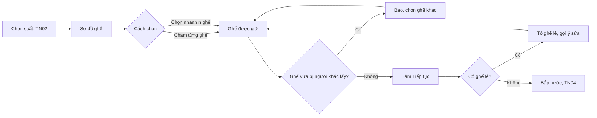

> **Mã:** DE08-TN03-PRD · **Trạng thái:** đã chốt · **Người viết:** Design · **SRS:** [SRS.md](SRS.md)

# PRD Chọn ghế và giữ chỗ (Đặt vé xem phim)

## 1. Bối cảnh và vấn đề

### 1.1 Bối cảnh

Chọn ghế là bước khách quan tâm nhất sau chọn suất (xem [README](../../README.md)). Với phim hot, ngày đầu khởi chiếu, hàng nghìn người cùng mở một sơ đồ ghế; hai người có thể chạm cùng một ghế trong cùng một giây. Rạp cũng cần bán được nhiều ghế nhất có thể, không để những ghế trống lẻ loi khó bán.

### 1.2 Vấn đề

| **Vấn đề** | **Hệ quả** |
| --- | --- |
| Hai người chọn cùng ghế, cả hai thanh toán | Bán trùng, phải hoàn tiền, khách giận |
| Ghế bị giữ mãi bởi người chọn rồi bỏ đi | Người khác không mua được dù ghế thực ra trống |
| Khách chọn chừa một ghế trống lẻ giữa nhóm | Ghế lẻ khó bán, rạp mất doanh thu |
| Sơ đồ nhỏ trên điện thoại, chạm nhầm ghế | Chọn sai ghế, mất thời gian |
| Không biết còn bao lâu để thanh toán | Hết giờ giữ khi đang nhập thẻ |

### 1.3 Mục tiêu

- 0 ghế bán trùng.
- Thời gian chọn ghế trung vị ≤ 40 giây.
- Tỉ lệ ghế trống lẻ (bị kẹp) khi suất bắt đầu giảm 50%.

## 2. Người dùng

| **Nhóm** | **Nhu cầu với tính năng này** |
| --- | --- |
| Nhóm bạn 3–6 người | Ghế liền nhau, chọn nhanh |
| Cặp đôi | Ghế đôi |
| Khách đặt ngày đầu phim hot | Biết ngay ghế nào vừa bị người khác lấy |
| Khách lớn tuổi | Sơ đồ to, dễ chạm, có chọn nhanh |

## 3. Phạm vi

### 3.1 Trong phạm vi (MVP)

- Sơ đồ ghế theo thời gian thực: trống, đang giữ, đã bán, không bán, đang chọn.
- Chọn, bỏ chọn ghế; ghế đôi theo cặp; tối đa 8 ghế.
- Giữ ghế 10 phút cho cả quá trình đặt; đếm ngược luôn hiện.
- Quy tắc không để ghế trống lẻ.
- Chọn nhanh n ghế đẹp liền nhau.
- Phóng to, kéo sơ đồ; chú thích loại ghế và giá.

### 3.2 Ngoài phạm vi

- Ghế dành cho xe lăn, khu vực đặc biệt → phase sau.
- Chọn ghế cùng bạn bè trên nhiều điện thoại.
- Đổi ghế sau khi đã thanh toán (làm tại quầy).

## 4. Nguyên tắc sản phẩm

### 4.1 Chạm là giữ

Ghế được giữ ngay khi khách chạm; người khác thấy ghế chuyển "đang giữ" trong vài giây. Không có bán trùng.

### 4.2 Thời gian luôn hiện

Đồng hồ giữ chỗ đi theo khách qua các bước chọn ghế, bắp nước, thanh toán.

### 4.3 Giúp khách chọn tốt, không chỉ trích

Quy tắc ghế lẻ được giải thích bằng hình (tô ghế bị bỏ lẻ) và gợi ý cách sửa.

## 5. Quy tắc nghiệp vụ

| **Quy tắc** | **Giá trị** |
| --- | --- |
| Số ghế tối đa | 8 mỗi lần đặt (ghế đôi tính là 2) |
| Thời gian giữ | 10 phút từ ghế đầu tiên; + tối đa 5 phút khi đang chờ kết quả thanh toán |
| Phiên giữ chỗ | 1 phiên đang mở mỗi khách |
| Ghế đôi | Chọn, bỏ theo cặp |
| Ghế lẻ | Không được tạo ra một ghế trống lẻ liền kề ghế mình chọn |
| Cập nhật sơ đồ | ≤ 2 giây |

## 6. Luồng trải nghiệm

| **Bước** | **Giai đoạn** | **Trải nghiệm** | **Đầu ra** |
| --- | --- | --- | --- |
| 1 | Xem sơ đồ | Màn hình chiếu ở trên, loại ghế, giá | Hiểu phòng |
| 2 | Chọn | Chạm ghế, ghế đổi màu ngay; đồng hồ 10 phút bắt đầu | Ghế đang giữ |
| 3 | Kiểm tra | Quy tắc ghế lẻ, số ghế, tạm tính | Ghế hợp lệ |
| 4 | Tiếp tục | Sang bắp nước, thanh toán với đồng hồ chạy tiếp | Đơn đặt vé |

## 7. Use Cases, User Stories và Acceptance Criteria

### UC1. Chọn ghế

#### US1.1 Chọn ghế liền nhau cho nhóm

User Story: Là người đặt cho nhóm 4 bạn, tôi muốn chọn 4 ghế liền nhau ở giữa phòng thật nhanh.

AC01: Sơ đồ có màn hình chiếu, chú thích loại ghế và giá.

AC02: Chạm ghế trống → ghế chuyển "đang chọn" ngay; chạm lại để bỏ.

AC03: "Chọn nhanh": nhập số ghế → hệ thống chọn n ghế liền nhau tốt nhất còn trống.

AC04: Ghế đôi chọn theo cặp.

AC05: Quá 8 ghế → báo, không chọn thêm.

#### US1.2 Biết ghế người khác vừa lấy

AC01: Ghế người khác giữ, mua hiện đổi trạng thái trong ≤ 2 giây.

AC02: Chạm đúng ghế vừa bị lấy → báo và giữ nguyên các ghế khác của mình.

### UC2. Giữ chỗ

#### US2.1 Biết còn bao lâu

AC01: Đồng hồ 10 phút bắt đầu khi giữ ghế đầu tiên; hiện ở mọi bước tới thanh toán.

AC02: Còn 2 phút → nhắc.

AC03: Hết giờ → nhả ghế, báo, quay về sơ đồ (ghế có thể đã bị người khác chọn).

AC04: Đang chờ kết quả thanh toán khi hết 10 phút → giữ thêm tối đa 5 phút.

#### US2.2 Một phiên mỗi khách

AC01: Mở suất khác khi đang giữ ghế → hỏi có bỏ ghế đang giữ không.

### UC3. Ghế lẻ

#### US3.1 Không để ghế trống lẻ

User Story: Là rạp, tôi muốn khách không để lại một ghế trống lẻ cạnh nhóm mình để ghế đó còn bán được.

AC01: Bấm Tiếp tục mà tạo ra ghế trống lẻ cạnh ghế mình chọn → không cho tiếp tục, tô ghế lẻ, giải thích.

AC02: Ghế lẻ đã có từ trước (không do khách tạo ra) → không chặn.

AC03: Gợi ý: chọn thêm ghế lẻ đó hoặc dịch nhóm sang một ghế.

## 8. Chỉ số theo dõi

| **Chỉ số** | **Định nghĩa** | **Mục tiêu MVP** |
| --- | --- | --- |
| Bán trùng | Số ghế bán cho 2 đơn | 0 |
| Thời gian chọn ghế | Mở **SCR-K04** → Tiếp tục (trung vị) | ≤ 40 giây |
| Hết giờ giữ | Phiên hết giờ / phiên có giữ ghế | ≤ 15% |
| Va chạm ghế | Lần chạm ghế vừa bị lấy / lần chạm ghế | Theo dõi (phim hot) |
| Ghế lẻ khi bắt đầu chiếu | Ghế trống bị kẹp / ghế trống khi bắt đầu | Giảm 50% |
| Dùng chọn nhanh | Phiên dùng chọn nhanh / phiên chọn ghế | Theo dõi |

## 9. Phụ thuộc và rủi ro

| **Mục** | **Mô tả** | **Hướng xử lý** |
| --- | --- | --- |
| Tải đột biến ngày mở bán | Hàng nghìn phiên cùng một phòng | Giữ ghế nguyên tử trên máy chủ; hàng chờ vào sơ đồ khi quá tải |
| Kết nối thời gian thực | Mất kết nối, sơ đồ cũ | Tự kết nối lại; dự phòng làm mới mỗi 5 giây; máy chủ luôn là nguồn đúng |
| Quy tắc ghế lẻ gây khó chịu | Khách thấy bị ép | Giải thích bằng hình, gợi ý sửa, không áp dụng khi ghế lẻ có sẵn |

## 10. Câu hỏi mở

> Mọi câu hỏi dưới đây đã được PO chốt ngày 20/11/2026; quyết định ghi sau mỗi câu và đã cập nhật vào SRS.

- Giữ ghế khi chạm hay khi bấm Tiếp tục? → **Đã chốt:** Khi chạm, mỗi ghế giữ ngay trên máy chủ (SRS BR-24).
- Đồng hồ có reset khi chọn thêm ghế? → **Đã chốt:** Không; một đồng hồ 10 phút cho cả phiên (SRS BR-25).
- Ghế lẻ ở mép hàng có tính? → **Đã chốt:** Có; mép hàng và lối đi được coi như ghế không trống (SRS BR-27).
- Khách đặt 1 ghế có bị chặn vì ghế lẻ? → **Đã chốt:** Có, cùng quy tắc; trừ khi không còn cách chọn nào khác trong hàng đó (SRS BR-27).
