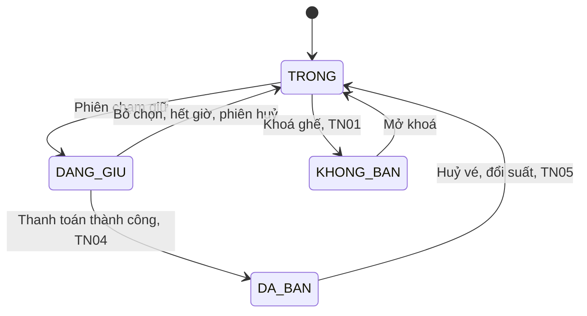
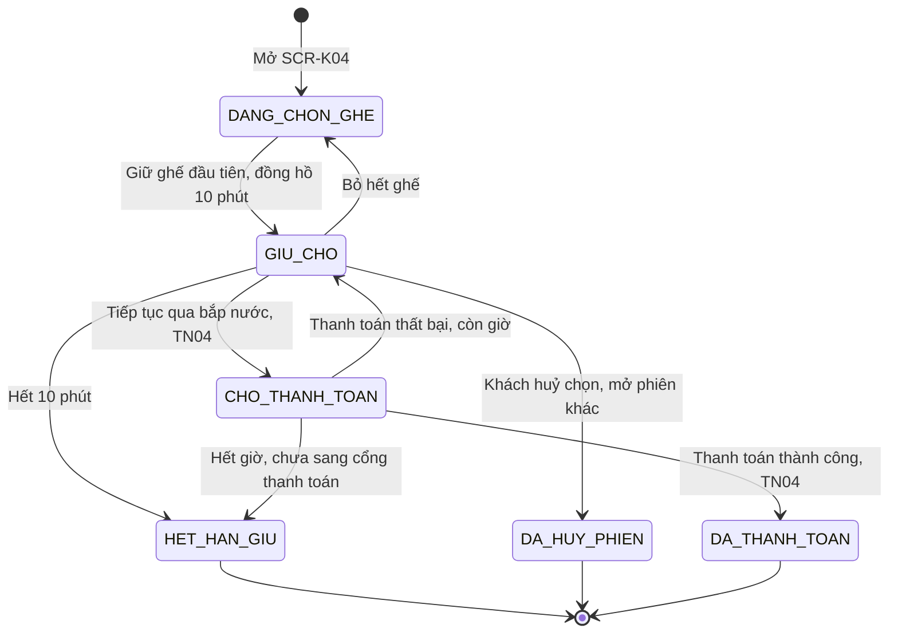
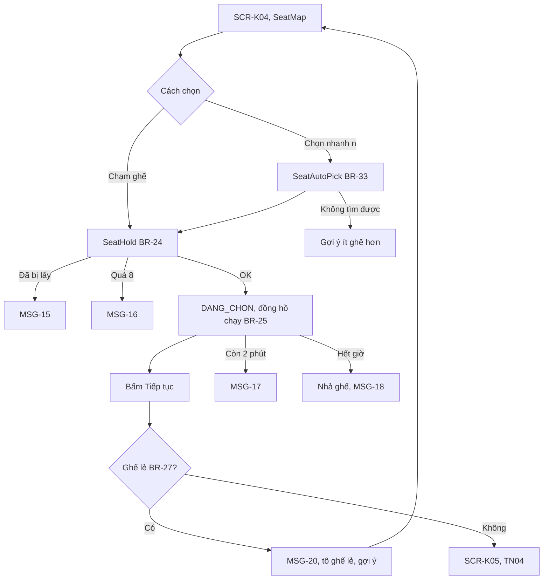
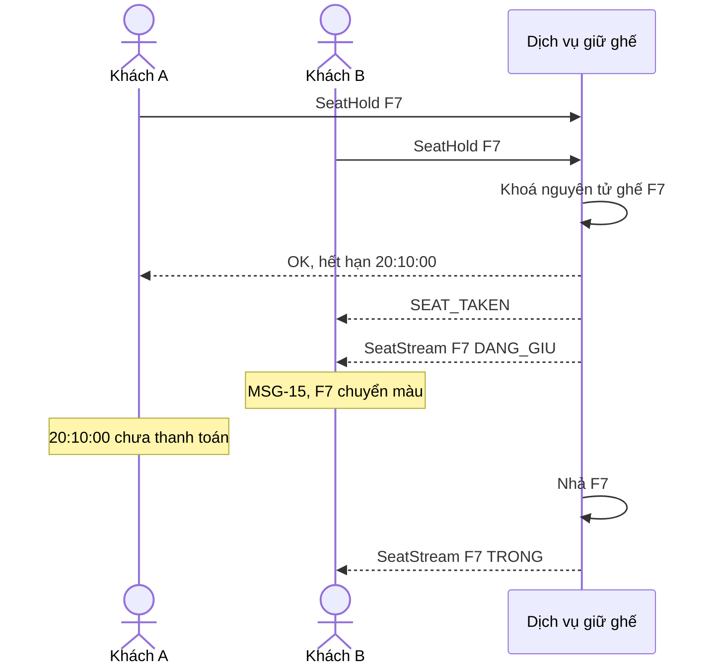

> **Mã:** DE08-TN03-SRS · **Trạng thái:** đã chốt · **Người viết:** Design · **PRD:** [PRD.md](PRD.md)

# UC-DE08-03 - Chọn ghế và giữ chỗ

> SRS này mô tả sơ đồ ghế thời gian thực, giữ ghế và phiên đặt vé từ khi chọn suất ([SRS TN02](../TN02-chon-phim-suat/SRS.md)) tới khi sang bắp nước, thanh toán ([SRS TN04](../TN04-bap-nuoc-thanh-toan/SRS.md)).

## 1. Tổng quan

| **Mục** | **Nội dung** |
| --- | --- |
| Mục tiêu | Khách chọn ghế nhanh, đúng; không bao giờ bán trùng; ghế không bị giữ vô hạn; hạn chế ghế trống lẻ |
| Actor | Khách · App khách · Máy chủ (dịch vụ giữ ghế) |
| Phạm vi | Sơ đồ ghế, trạng thái ghế thời gian thực, chọn, bỏ chọn, ghế đôi, chọn nhanh, giữ ghế, đồng hồ giữ chỗ, phiên đặt vé, quy tắc ghế lẻ |
| Ngoài phạm vi | Ghế xe lăn, chọn ghế cùng bạn bè nhiều máy, đổi ghế sau thanh toán |
| Nền tảng | App khách iOS / Android |

## 2. User Story

| **ID** | **As a** | **I want** | **So that** |
| --- | --- | --- | --- |
| US-11 | Khách | Chọn nhanh n ghế liền nhau | Cả nhóm ngồi cạnh nhau |
| US-12 | Khách | Thấy ngay ghế người khác vừa lấy | Không chọn nhầm |
| US-13 | Khách | Biết còn bao lâu để hoàn tất | Không mất ghế khi đang thanh toán |
| US-14 | Rạp | Không bán trùng ghế | Không phải xử lý sự cố |
| US-15 | Rạp | Hạn chế ghế trống lẻ | Bán được nhiều ghế hơn |

## 3. Business Rules

| **Mã** | **Quy tắc** |
| --- | --- |
| BR-22 | **Trạng thái ghế** (theo suất): `TRONG`, `DANG_GIU` (phiên khác giữ), `DA_BAN`, `KHONG_BAN` (khoá, TN01 BR-04); phía khách thêm `DANG_CHON` (phiên của mình giữ). Màu và biểu tượng khác nhau cho từng trạng thái, kèm chú thích |
| BR-23 | **Số ghế** tối đa 8 mỗi phiên (ghế đôi tính 2). Chạm ghế thứ 9 → MSG-16 |
| BR-24 | **Giữ ghế khi chạm**: \[SeatHold\] nguyên tử trên máy chủ; ghế `TRONG` → `DANG_CHON` cho phiên này; ghế không còn `TRONG` → MSG-15, ghế hiện trạng thái thật. Bỏ chọn → \[SeatRelease\], ghế về `TRONG` ngay |
| BR-25 | **Đồng hồ giữ chỗ**: 10 phút tính từ lần giữ ghế đầu tiên của phiên, không đặt lại khi chọn thêm, áp dụng cho **SCR-K04**, **SCR-K05**, **SCR-K06**. Còn 2 phút → MSG-17. Hết giờ → nhả mọi ghế, phiên `HET_HAN_GIU`, MSG-18. Khi đã chuyển sang cổng thanh toán (TN04) mà hết 10 phút → gia hạn tới khi có kết quả, tối đa thêm 5 phút |
| BR-26 | **Phiên đặt vé**: mỗi khách tối đa 1 phiên đang giữ ghế. Mở suất khác khi đang giữ → MSG-19 \[Bỏ ghế đang giữ\] \[Quay lại\]. Thoát app không nhả ghế ngay; ghế nhả khi hết đồng hồ hoặc khách bấm "Huỷ chọn" |
| BR-27 | **Ghế lẻ**: khi bấm Tiếp tục, với mỗi hàng có ghế `DANG_CHON`: không được tồn tại ghế `TRONG` đứng một mình (hai bên là ghế không trống: `DANG_CHON`, `DANG_GIU`, `DA_BAN`, `KHONG_BAN`, lối đi hoặc mép hàng) **và** liền kề một ghế `DANG_CHON`. Ngoại lệ: ghế lẻ đó đã đứng một mình trước khi khách chọn; hoặc hàng không còn cách chọn cùng số ghế nào mà không tạo ghế lẻ. Vi phạm → MSG-20, tô ghế lẻ, gợi ý (BR-33) |
| BR-28 | **Ghế đôi**: chạm một nửa → giữ cả cặp; bỏ → nhả cả cặp. Giá theo TN01 BR-10 |
| BR-29 | **Thời gian thực**: sơ đồ nhận thay đổi trạng thái ghế qua \[SeatStream\] ≤ 2 giây; mất kết nối → banner MSG-21, làm mới \[SeatMap\] mỗi 5 giây; máy chủ luôn kiểm tra lại khi giữ ghế |
| BR-30 | **Tạm tính**: liệt kê ghế đã chọn theo mã (F7, F8…), loại, giá; tổng tạm tính; phí tiện ích 0 ₫ (cấu hình) |
| BR-31 | **Độ tuổi nhóm**: phim T13, T16, T18 và chọn > 1 ghế → dòng nhắc "Mọi người trong nhóm đều cần đủ {n} tuổi và mang giấy tờ" dưới tạm tính |
| BR-32 | **Suất bắt đầu** trong lúc đang chọn → nhả ghế, MSG-22. Suất bị huỷ (TN05) → nhả ghế, MSG-23 |
| BR-33 | **Chọn nhanh n ghế** (1–8): chọn n ghế `TRONG` liền nhau cùng loại ghế đang lọc (mặc định Thường), trong cùng hàng, không tạo ghế lẻ; ưu tiên hàng ở khoảng 2/3 chiều sâu phòng, gần cột giữa nhất. Không tìm được → MSG-20 dạng gợi ý "Không còn {n} ghế liền nhau, thử ít ghế hơn". Gợi ý sửa ghế lẻ: chọn thêm ghế lẻ, hoặc dịch cả nhóm 1 ghế |

## 4. Trạng thái

### 4.1 Trạng thái một ghế

### 4.2 Trạng thái phiên đặt vé

## 5. Use Case

### UC-06 Chọn và giữ ghế

| **Mục** | **Nội dung** |
| --- | --- |
| Tiền điều kiện | Đã chọn suất `MO_BAN` (TN02); khách đã đăng nhập |
| Hậu điều kiện thành công | Phiên `GIU_CHO` với ghế hợp lệ BR-27; mở **SCR-K05** (TN04) |
| Hậu điều kiện thất bại | Ghế được nhả; khách ở lại **SCR-K04** hoặc về **SCR-K03** |

**Luồng chính**

| **Bước** | **Actor** | **Mô tả** |
| --- | --- | --- |
| 1 | App | Gọi \[SeatMap\], mở \[SeatStream\]; hiện **SCR-K04** |
| 2 | Khách | Chạm F7 |
| 3 | App | Gọi \[SeatHold\]; F7 `DANG_CHON`; đồng hồ 10:00 bắt đầu |
| 4 | Khách | Chạm F8, F9, F10 |
| 5 | App | Giữ từng ghế; tạm tính cập nhật |
| 6 | Khách | Bấm "Tiếp tục" |
| 7 | App | Gọi \[SeatValidate\] (BR-27); hợp lệ → **SCR-K05** |

**Luồng thay thế**

| **Mã** | **Điều kiện** | **Xử lý** |
| --- | --- | --- |
| A1 | Chọn nhanh | Nhập 4 → \[SeatAutoPick\] → 4 ghế được giữ, sơ đồ cuộn tới hàng đó |
| A2 | Ghế đôi | BR-28 |
| A3 | Bỏ chọn | Chạm lại ghế → \[SeatRelease\] |
| A4 | Đang giữ ở phiên khác | MSG-19 trước bước 1 |
| A5 | Phóng to | Kéo hai ngón; ghế tối thiểu 32 pt khi phóng to tối đa |

**Luồng lỗi**

| **Mã** | **Điều kiện** | **Xử lý** |
| --- | --- | --- |
| E1 | Ghế vừa bị lấy | MSG-15 |
| E2 | Quá 8 ghế | MSG-16 |
| E3 | Ghế lẻ | MSG-20 |
| E4 | Hết giờ | MSG-18 |
| E5 | Mất kết nối | MSG-21 (BR-29) |
| E6 | Suất bắt đầu, bị huỷ | MSG-22, MSG-23 |

## 6. Điểm vào

| **Điểm vào** | **Dẫn tới** | **Ghi chú** |
| --- | --- | --- |
| Chọn suất (TN02) | **SCR-K04** | |
| Quay lại từ **SCR-K05**, **SCR-K06** | **SCR-K04** | Giữ nguyên ghế, đồng hồ chạy tiếp |
| Thanh toán thất bại, còn giờ (TN04) | **SCR-K06** | Ghế vẫn giữ |
| "Đổi suất" (TN05) | **SCR-K04** của suất mới | Số ghế = số ghế vé cũ |

## 7. Mô tả màn hình

### SCR-K04 Chọn ghế

| **#** | **Thành phần** | **Loại** | **Hành vi** |
| --- | --- | --- | --- |
| 1 | Header suất | Header | Phim, phòng, ngày giờ, định dạng; nút đổi suất |
| 2 | Đồng hồ giữ chỗ | Timer | "Giữ ghế 09:42"; đổi màu khi < 2 phút; ẩn trước khi giữ ghế đầu |
| 3 | Màn hình chiếu | Hình | Cong, ở trên cùng |
| 4 | Sơ đồ ghế | Canvas | Trạng thái BR-22; phóng to, kéo; mã hàng ở hai bên |
| 5 | Chú thích | Legend | Trống, Đang chọn, Đã bán/Đang giữ, Không bán; Thường, VIP, Đôi kèm giá |
| 6 | Chọn nhanh | Stepper + Button | "Chọn nhanh {n} ghế" (BR-33) |
| 7 | Ghế đã chọn | Chips | Mã ghế, chạm × để bỏ |
| 8 | Tạm tính | Text | BR-30; nhắc độ tuổi BR-31 |
| 9 | "Tiếp tục" | Button dính đáy | Disabled khi chưa có ghế |
| 10 | Banner kết nối | Banner | MSG-21 |
| 11 | Tô ghế lẻ | Overlay | Viền nhấp nháy ghế lẻ khi vi phạm BR-27 |

## 8. API

| **API** | **Request chính** | **Response chính** | **Timeout / retry** |
| --- | --- | --- | --- |
| \[SeatMap\] | showtime_id | Lưới, loại, giá, trạng thái từng ghế, phiên đang mở của khách | 3s / 1 lần |
| \[SeatStream\] | showtime_id | Sự kiện đổi trạng thái ghế | Kết nối lâu dài; dự phòng làm mới 5 giây |
| \[SeatHold\] | session_id, seat_code | OK, hold_expires_at hoặc SEAT_TAKEN, LIMIT | 2s / không retry tự động |
| \[SeatRelease\] | session_id, seat_code | OK | 2s / 2 lần |
| \[SeatAutoPick\] | session_id, count, seat_type | Ghế đã giữ hoặc NOT_FOUND | 3s / 1 lần |
| \[SeatValidate\] | session_id | OK hoặc danh sách ghế lẻ, gợi ý | 2s / 1 lần |
| \[SessionCancel\] | session_id | OK | 3s / 2 lần |

**Map lỗi → thông báo**

| **Nhóm** | **Message** |
| --- | --- |
| Ghế vừa bị lấy | MSG-15 |
| Quá 8 ghế | MSG-16 |
| Còn 2 phút | MSG-17 |
| Hết giờ giữ | MSG-18 |
| Đang có phiên khác | MSG-19 |
| Ghế lẻ, chọn nhanh không được | MSG-20 |
| Mất kết nối | MSG-21 |
| Suất đã bắt đầu | MSG-22 |
| Suất bị huỷ | MSG-23 |

## 9. Danh sách thông báo

| **ID** | **Nơi hiện** | **Nội dung (VI)** |
| --- | --- | --- |
| MSG-15 | Toast | Ghế {mã} vừa có người chọn. Vui lòng chọn ghế khác |
| MSG-16 | Toast | Mỗi lần đặt tối đa 8 ghế |
| MSG-17 | Banner | Còn 2 phút để hoàn tất đặt vé |
| MSG-18 | Popup | Đã hết thời gian giữ ghế. Các ghế bạn chọn đã được nhả cho người khác. \[Chọn lại\] |
| MSG-19 | Popup | Bạn đang giữ {n} ghế suất {phim} {giờ}. Bỏ các ghế đó để chọn suất mới? \[Bỏ ghế đang giữ\] \[Quay lại\] |
| MSG-20 | Inline | Cách chọn này để lại ghế {mã} trống một mình nên khó bán. Hãy chọn thêm ghế {mã} hoặc dịch nhóm sang một ghế. {Hoặc: Không còn {n} ghế liền nhau, thử ít ghế hơn} |
| MSG-21 | Banner | Đang cập nhật sơ đồ ghế… |
| MSG-22 | Popup | Suất chiếu đã bắt đầu nên không thể đặt vé online. Bạn có thể mua tại quầy trong 15 phút đầu |
| MSG-23 | Popup | Suất chiếu này vừa bị huỷ. Vui lòng chọn suất khác |

## 10. Yêu cầu phi chức năng

| **Mục** | **Yêu cầu** |
| --- | --- |
| Tính đúng | Giữ ghế nguyên tử, một ghế một phiên; nhả ghế hết hạn chạy trên máy chủ, không phụ thuộc app |
| Hiệu năng | \[SeatHold\] ≤ 300 ms (p95); sự kiện tới sơ đồ ≤ 2 giây; chịu 5.000 phiên đồng thời trên một suất |
| Tải đột biến | Khi quá tải, khách vào hàng chờ có thứ tự trước khi vào **SCR-K04** |
| Log / audit | Mọi lần giữ, nhả ghế: phiên, thời điểm, lý do (bỏ chọn, hết giờ, thanh toán) |
| Tracking | Thời gian chọn ghế, số va chạm, dùng chọn nhanh, vi phạm ghế lẻ và cách sửa, hết giờ ở bước nào |
| Accessibility | Sơ đồ có chế độ danh sách: chọn hàng → danh sách ghế với trạng thái bằng chữ; ghế đọc "F7, ghế thường, 85.000 đồng, còn trống"; trạng thái không chỉ bằng màu (có biểu tượng) |
