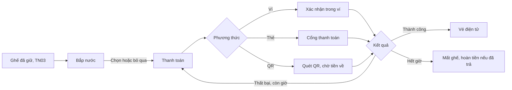

> **Mã:** DE08-TN04-PRD · **Trạng thái:** đã chốt · **Người viết:** Design · **SRS:** [SRS.md](SRS.md)

# PRD Bắp nước, thanh toán và vé điện tử (Đặt vé xem phim)

## 1. Bối cảnh và vấn đề

### 1.1 Bối cảnh

Sau khi giữ ghế (TN03), khách chọn thêm bắp nước, thanh toán trong thời gian giữ chỗ, và nhận vé điện tử để vào phòng chiếu (xem [README](../../README.md)). Bắp nước là nguồn doanh thu lớn của rạp; vé điện tử thay vé giấy và là chìa khoá vào phòng chiếu ở TN05.

### 1.2 Vấn đề

| **Vấn đề** | **Hệ quả** |
| --- | --- |
| Đồng hồ giữ chỗ hết khi đang nhập thẻ | Mất ghế, khách bực |
| Thanh toán xong màn hình treo, không biết thành công chưa | Thanh toán lại, bị trừ 2 lần |
| Đặt bắp nước online nhưng tới quầy vẫn phải xếp hàng mua | Không thấy lợi ích của đặt trước |
| Vé chỉ có trong email, mất mạng ở rạp không mở được | Kẹt ở cửa phòng chiếu |
| Không nhớ giờ chiếu, tới trễ | Lỡ đầu phim |

### 1.3 Mục tiêu

- Tỉ lệ thanh toán thành công / phiên tới màn thanh toán ≥ 85%.
- ≥ 30% đơn có bắp nước đặt trước.
- 100% vé mở được khi không có mạng.

## 2. Người dùng

| **Nhóm** | **Nhu cầu với tính năng này** |
| --- | --- |
| Khách đi xem cuối tuần | Combo bắp nước rẻ hơn mua lẻ, nhận nhanh |
| Khách đặt phút chót | Thanh toán nhanh bằng ví, QR |
| Khách ở rạp mạng yếu | Mở vé không cần mạng |

## 3. Phạm vi

### 3.1 Trong phạm vi (MVP)

- Chọn combo, món lẻ, tuỳ chọn vị; bỏ qua được.
- Tóm tắt đơn: vé, bắp nước, tổng.
- Thanh toán: ví liên kết, thẻ qua cổng thanh toán, QR chuyển khoản.
- Xử lý kết quả, thất bại, tiền về trễ.
- Vé điện tử: QR, thông tin suất, ghế, bắp nước; lưu offline; email; thêm vào lịch.
- Nhận bắp nước tại quầy bằng QR vé.
- Nhắc trước giờ chiếu.

### 3.2 Ngoài phạm vi

- Mã giảm giá, điểm thành viên, thẻ quà tặng.
- Thanh toán tiền mặt (chỉ tại quầy, ngoài phạm vi app).
- Giao bắp nước tới ghế.
- Xuất hoá đơn VAT.

## 4. Nguyên tắc sản phẩm

### 4.1 Đồng hồ là đồng minh

Đồng hồ giữ chỗ hiện rõ ở mọi bước; khi khách đã sang cổng thanh toán, hệ thống chờ kết quả thay vì nhả ghế.

### 4.2 Thanh toán một lần là một lần

Không bao giờ trừ tiền hai lần cho một đơn; tiền về trễ thì tự hoàn.

### 4.3 Vé dùng được ở mọi nơi

Vé lưu trên máy, mở offline, tăng độ sáng khi hiện QR.

## 5. Quy tắc nghiệp vụ

| **Quy tắc** | **Giá trị** |
| --- | --- |
| Bắp nước | Mỗi món 0–10; combo có tuỳ chọn vị bắp và nước |
| Phương thức | Ví liên kết, thẻ nội địa và quốc tế qua cổng thanh toán, QR chuyển khoản |
| Thời gian thanh toán | Trong đồng hồ giữ chỗ; gia hạn tối đa 5 phút khi đang chờ kết quả cổng (TN03) |
| Tiền về sau khi mất ghế | Hoàn tự động ≤ 1 ngày làm việc |
| Nhận bắp nước | Từ 60 phút trước giờ chiếu tới khi suất kết thúc |
| Nhắc trước | 2 giờ và 30 phút trước giờ chiếu |

## 6. Luồng trải nghiệm

| **Bước** | **Giai đoạn** | **Trải nghiệm** | **Đầu ra** |
| --- | --- | --- | --- |
| 1 | Bắp nước | Combo có ảnh, giá, tiết kiệm bao nhiêu | Món đặt trước |
| 2 | Thanh toán | Tóm tắt, phương thức, đồng hồ | Đơn trả tiền |
| 3 | Kết quả | Thành công to rõ | Vé |
| 4 | Ở rạp | Mở vé offline, nhận bắp nước bằng QR | Vào phòng chiếu (TN05) |

## 7. Use Cases, User Stories và Acceptance Criteria

### UC1. Bắp nước

AC01: Danh sách combo, món lẻ; ảnh, mô tả, giá; combo ghi "Tiết kiệm {x} ₫" so với mua lẻ.

AC02: Chọn vị bắp, loại nước trong combo.

AC03: Nút "Bỏ qua"; đồng hồ giữ chỗ vẫn chạy.

### UC2. Thanh toán

#### US2.1 Thanh toán nhanh

User Story: Là khách đặt phút chót, tôi muốn trả bằng ví trong vài chạm.

AC01: Tóm tắt: phim, suất, ghế, bắp nước, tổng.

AC02: Chọn phương thức; nhớ phương thức lần trước.

AC03: Xác nhận đã đọc điều khoản đổi, huỷ vé.

AC04: Bấm "Thanh toán {tổng}" chỉ tạo một giao dịch.

#### US2.2 Khi có sự cố

AC01: Thất bại khi còn giờ → báo lý do, ghế vẫn giữ, thử lại hoặc đổi phương thức.

AC02: Đang chờ kết quả cổng khi hết 10 phút → chờ thêm tối đa 5 phút; khách thấy "Đang xác nhận thanh toán".

AC03: Tiền về sau khi ghế đã nhả → hoàn tự động, báo khách.

### UC3. Vé điện tử

#### US3.1 Có vé ngay và mọi lúc

AC01: Thành công → màn vé: QR, mã đặt vé, phim, phân loại, phòng, ngày giờ, ghế, bắp nước.

AC02: Vé lưu trên máy, mở được khi không có mạng.

AC03: Email vé; nút thêm vào lịch.

AC04: Hiện QR → tăng độ sáng màn hình.

#### US3.2 Nhận bắp nước

AC01: Quầy quét QR vé → thấy món chưa nhận → giao → đánh dấu đã nhận.

AC02: Vé hiện trạng thái từng món: Chưa nhận, Đã nhận lúc {giờ}.

### UC4. Nhắc giờ chiếu

AC01: Push 2 giờ và 30 phút trước giờ chiếu; chạm mở vé.

## 8. Chỉ số theo dõi

| **Chỉ số** | **Định nghĩa** | **Mục tiêu MVP** |
| --- | --- | --- |
| Thanh toán thành công | Đơn thành công / phiên tới **SCR-K06** | ≥ 85% |
| Đơn có bắp nước | Đơn có ≥ 1 món / tổng đơn | ≥ 30% |
| Giá trị bắp nước trung bình | Doanh thu bắp nước / đơn có bắp nước | Theo dõi |
| Trừ tiền hai lần | Số đơn bị trừ 2 lần | 0 |
| Hoàn tiền do mất ghế | Đơn hoàn do tiền về trễ / tổng đơn | ≤ 0,5% |
| Vé mở offline | Lần mở vé không có mạng thành công / lần mở offline | 100% |

## 9. Phụ thuộc và rủi ro

| **Mục** | **Mô tả** | **Hướng xử lý** |
| --- | --- | --- |
| Cổng thanh toán, ví | Chậm, kết quả về trễ | Gia hạn giữ chỗ 5 phút; đối soát máy chủ–máy chủ; hoàn tự động |
| QR chuyển khoản | Khách chuyển sai số tiền, sai nội dung | QR có sẵn số tiền, nội dung; không khớp → hoàn, không xuất vé |
| Quầy bắp nước giờ cao điểm | Xếp hàng dài | Làn riêng cho đơn đặt trước |

## 10. Câu hỏi mở

> Mọi câu hỏi dưới đây đã được PO chốt ngày 20/11/2026; quyết định ghi sau mỗi câu và đã cập nhật vào SRS.

- Một QR cho cả đơn hay mỗi ghế một QR? → **Đã chốt:** Một QR cho cả đơn; soát vé được từng phần (SRS BR-42, TN05).
- Bắp nước có huỷ riêng được? → **Đã chốt:** Không; huỷ theo cả đơn (TN05).
- Vé lưu offline bao lâu? → **Đã chốt:** Tới 24 giờ sau khi suất kết thúc; sau đó vẫn xem được trong lịch sử khi có mạng (SRS BR-42).
- Có thêm vé vào ví điện thoại (Wallet)? → **Đã chốt:** Không ở MVP; có thêm vào lịch (SRS BR-41).
