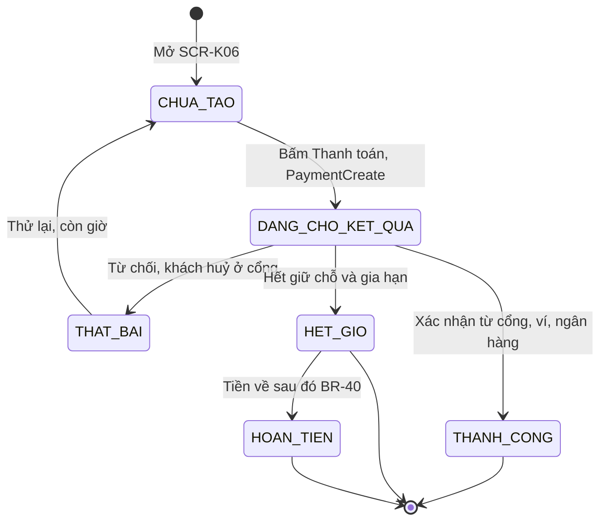
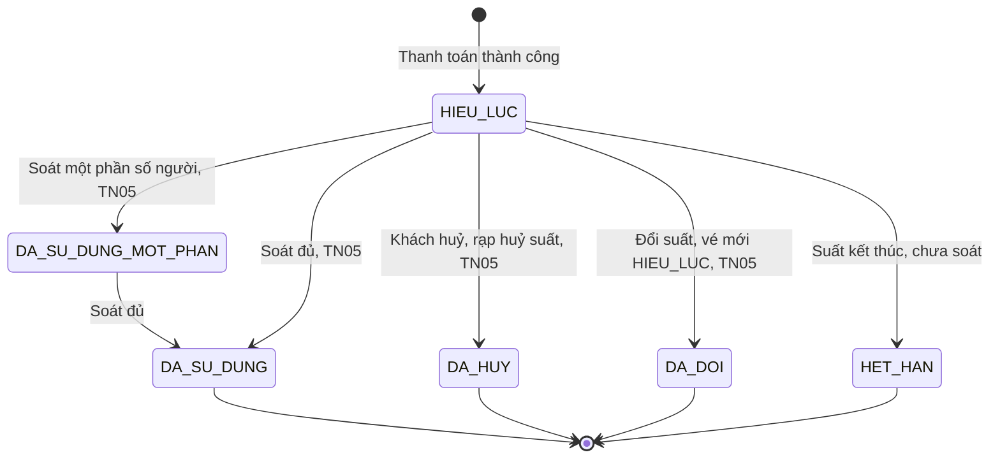
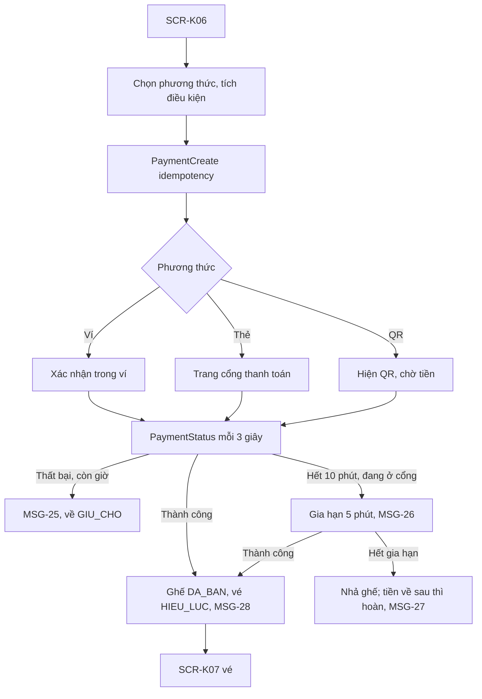
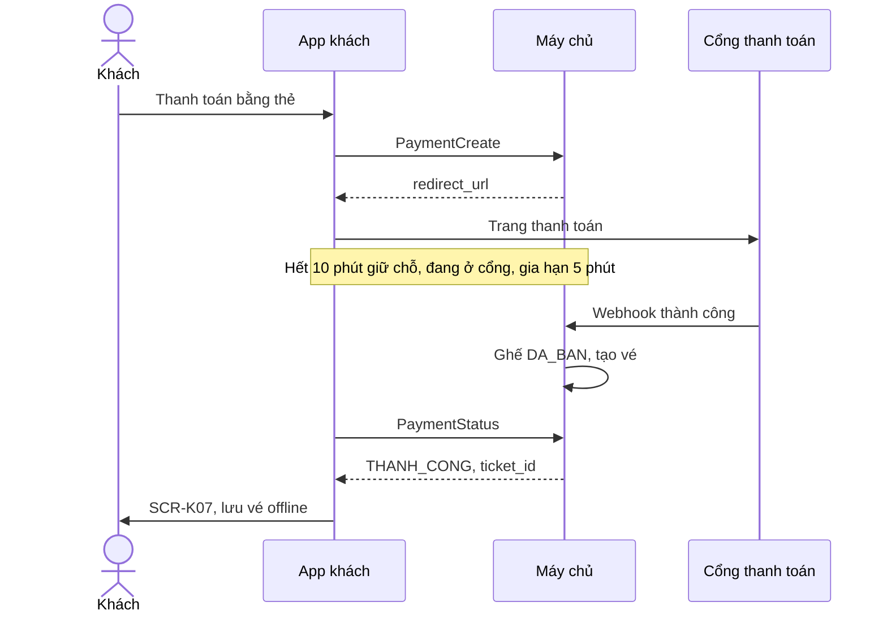

> **Mã:** DE08-TN04-SRS · **Trạng thái:** đã chốt · **Người viết:** Design · **PRD:** [PRD.md](PRD.md)

# UC-DE08-04 - Bắp nước, thanh toán và vé điện tử

> SRS này mô tả phiên đặt vé từ `GIU_CHO` ([SRS TN03](../TN03-chon-ghe-giu-cho/SRS.md)) tới `DA_THANH_TOAN` và vé điện tử; soát vé, đổi, huỷ xem [SRS TN05](../TN05-soat-ve-doi-huy/SRS.md).

## 1. Tổng quan

| **Mục** | **Nội dung** |
| --- | --- |
| Mục tiêu | Khách thêm bắp nước, thanh toán trong thời gian giữ chỗ, nhận vé điện tử dùng được offline |
| Actor | Khách · App khách · Máy chủ · Cổng thanh toán · Ví liên kết · Ngân hàng nhận tiền · Nhân viên quầy bắp nước |
| Phạm vi | Danh mục bắp nước, chọn món, tóm tắt, thanh toán ví / thẻ / QR, kết quả, hoàn tiền tự động, vé điện tử, email, lịch, nhận bắp nước, nhắc giờ chiếu |
| Ngoài phạm vi | Mã giảm giá, điểm, tiền mặt, giao tới ghế, hoá đơn VAT |
| Nền tảng | App khách iOS / Android; màn quầy bắp nước dùng App soát vé (TN05) |

## 2. User Story

| **ID** | **As a** | **I want** | **So that** |
| --- | --- | --- | --- |
| US-16 | Khách | Đặt combo bắp nước trước | Nhận nhanh, rẻ hơn |
| US-17 | Khách | Thanh toán nhanh, biết rõ kết quả | Không trả hai lần |
| US-18 | Khách | Không mất ghế khi đang chờ cổng thanh toán | Không phải chọn lại |
| US-19 | Khách | Mở vé khi không có mạng | Vào phòng chiếu không bị kẹt |
| US-20 | Nhân viên quầy | Quét QR vé để giao bắp nước | Không giao trùng |

## 3. Business Rules

| **Mã** | **Quy tắc** |
| --- | --- |
| BR-34 | **Danh mục bắp nước** do rạp cấu hình: combo và món lẻ; mỗi mục có ảnh, tên, mô tả, giá, trạng thái còn bán; combo có nhóm tuỳ chọn (vị bắp: Ngọt, Phô mai, Caramel; nước: chọn trong danh sách) và nhãn "Tiết kiệm {x} ₫" = tổng giá lẻ − giá combo. Số lượng mỗi mục 0–10 |
| BR-35 | **Bỏ qua** bắp nước được; quay lại sửa trước khi thanh toán |
| BR-36 | **Tổng** = Σ giá ghế (TN01 BR-10, chốt lúc giữ ghế) + Σ bắp nước + phí tiện ích (cấu hình, hiện 0 ₫) |
| BR-37 | **Phương thức**: Ví liên kết; Thẻ (nội địa, quốc tế) qua cổng thanh toán; QR chuyển khoản (VietQR có sẵn số tiền, nội dung = mã đơn). Nhớ phương thức lần trước. Bấm thanh toán cần tích "Tôi đã đọc điều kiện đổi, huỷ vé" (tóm tắt TN05 BR-52) |
| BR-38 | **Tạo thanh toán**: \[PaymentCreate\] với idempotency key; phiên `CHO_THANH_TOAN`. Ví → xác nhận trong ví. Thẻ → chuyển sang trang cổng thanh toán. QR → hiện QR trên **SCR-K06**, đếm theo đồng hồ giữ chỗ |
| BR-39 | **Kết quả** chỉ tin thông báo máy chủ–máy chủ có chữ ký từ cổng, ví, ngân hàng. App gọi \[PaymentStatus\] mỗi 3 giây khi đang chờ. Đã chuyển sang cổng / ví mà hết 10 phút → gia hạn giữ chỗ tối đa 5 phút (TN03 BR-25), **SCR-K06** hiện "Đang xác nhận thanh toán" |
| BR-40 | **Thất bại** khi còn thời gian giữ chỗ → MSG-25, phiên về `GIU_CHO`, ghế giữ nguyên, khách thử lại hoặc đổi phương thức. **Tiền về sau khi ghế đã nhả** (hết giờ và hết gia hạn) → không xuất vé, hoàn tự động về nguồn ≤ 1 ngày làm việc, MSG-27. **QR sai số tiền, sai nội dung** → không xuất vé, hoàn, MSG-27 |
| BR-41 | **Thành công**: ghế `DA_BAN`; tạo đơn vé với mã đặt vé 8 ký tự chữ số; QR chứa mã đặt vé và chữ ký số của máy chủ; trạng thái vé `HIEU_LUC`; gửi push MSG-28 và email vé; nút "Thêm vào lịch" (sự kiện lịch của máy với giờ chiếu, địa chỉ rạp) |
| BR-42 | **Vé điện tử** (**SCR-K07**): QR, mã đặt vé, phim, nhãn phân loại, rạp, phòng, ngày giờ bắt đầu và kết thúc dự kiến, ghế, bắp nước (trạng thái từng món), tổng, phương thức. Lưu trên máy (mã hoá) tới 24 giờ sau khi suất kết thúc; mở được khi không có mạng. Hiện QR → độ sáng tối đa. Một QR cho cả đơn; soát từng phần ở TN05 |
| BR-43 | **Nhận bắp nước**: nhân viên quầy quét QR vé bằng App soát vé (chế độ Quầy bắp nước) → danh sách món, số lượng chưa nhận → chọn món giao → \[ConcessionRedeem\]. Nhận được từ 60 phút trước giờ chiếu tới giờ kết thúc suất; ngoài khoảng → MSG-31. Món đã nhận → MSG-32 kèm thời điểm |
| BR-44 | **Nhắc giờ chiếu**: push MSG-29 lúc 2 giờ và 30 phút trước giờ bắt đầu; tắt được trong cài đặt |
| BR-45 | **Không trừ hai lần**: một phiên đặt vé chỉ có một thanh toán thành công; thanh toán thành công thứ hai (nếu có do khách trả bằng hai phương thức) → hoàn tự động ngay, MSG-27 |

## 4. Trạng thái

### 4.1 Trạng thái thanh toán của phiên

### 4.2 Trạng thái vé (đơn vé)

### 4.3 Hiển thị trên SCR-K06

| **Trạng thái** | **Hiển thị** |
| --- | --- |
| `CHUA_TAO` | Tóm tắt, phương thức, nút "Thanh toán {tổng} ₫", đồng hồ |
| `DANG_CHO_KET_QUA` (QR) | QR, thông tin chuyển khoản sao chép được, đồng hồ |
| `DANG_CHO_KET_QUA` (đã qua cổng, gia hạn) | Vòng chờ, MSG-26 |
| `THAT_BAI` | MSG-25, nút thử lại, đổi phương thức |
| `HET_GIO` | MSG-18 (TN03) kèm MSG-27 nếu đã trả |

## 5. Use Case

### UC-07 Chọn bắp nước

**Luồng chính**

| **Bước** | **Actor** | **Mô tả** |
| --- | --- | --- |
| 1 | App | Gọi \[ConcessionMenu\]; hiện **SCR-K05** với đồng hồ giữ chỗ |
| 2 | Khách | Chọn "Combo đôi": vị Phô mai, 2 nước |
| 3 | App | Cập nhật tổng (BR-36) |
| 4 | Khách | Bấm "Tiếp tục" → **SCR-K06** |

**Luồng thay thế**

| **Mã** | **Điều kiện** | **Xử lý** |
| --- | --- | --- |
| A1 | Bỏ qua | "Bỏ qua" → **SCR-K06** |
| A2 | Món hết | Mờ, "Tạm hết" |

### UC-08 Thanh toán

| **Mục** | **Nội dung** |
| --- | --- |
| Tiền điều kiện | Phiên `GIU_CHO`, còn thời gian giữ chỗ |
| Hậu điều kiện thành công | Phiên `DA_THANH_TOAN`; vé `HIEU_LUC`; mở **SCR-K07** |
| Hậu điều kiện thất bại | Phiên `GIU_CHO` (còn giờ) hoặc `HET_HAN_GIU`; tiền không bị giữ |

**Luồng chính**

| **Bước** | **Actor** | **Mô tả** |
| --- | --- | --- |
| 1 | App | **SCR-K06**: tóm tắt phim, suất, ghế, bắp nước, tổng; phương thức lần trước (Ví) |
| 2 | Khách | Tích điều kiện, bấm "Thanh toán 295.000 ₫" |
| 3 | App | Gọi \[PaymentCreate\]; mở xác nhận của ví |
| 4 | Khách | Xác nhận trong ví |
| 5 | Máy chủ | Nhận xác nhận từ ví; ghế `DA_BAN`; tạo vé; gửi email |
| 6 | App | \[PaymentStatus\] trả `THANH_CONG`; mở **SCR-K07**; lưu vé offline |

**Luồng thay thế**

| **Mã** | **Điều kiện** | **Xử lý** |
| --- | --- | --- |
| A1 | Thẻ | Trang cổng; quay về app → chờ kết quả |
| A2 | QR | QR trên **SCR-K06**; khách chuyển bằng app ngân hàng; tiền về → thành công |
| A3 | Gia hạn khi chờ cổng | MSG-26 (BR-39) |
| A4 | Thêm vào lịch | Nút trên **SCR-K07** → hộp thoại lịch của hệ điều hành |

**Luồng lỗi**

| **Mã** | **Điều kiện** | **Xử lý** |
| --- | --- | --- |
| E1 | Thất bại khi còn giờ | MSG-25 |
| E2 | Tiền về sau khi mất ghế, QR sai số tiền | MSG-27 (BR-40) |
| E3 | Thanh toán thành công hai lần | Hoàn lần thứ hai (BR-45) |
| E4 | Mất mạng trên app sau khi trả | Khi có mạng, \[PaymentStatus\] cập nhật; vé cũng có trong email |

### UC-09 Dùng vé và nhận bắp nước

**Luồng chính**

| **Bước** | **Actor** | **Mô tả** |
| --- | --- | --- |
| 1 | App | 30 phút trước giờ chiếu gửi MSG-29 |
| 2 | Khách | Mở vé (offline) tại quầy bắp nước |
| 3 | Nhân viên quầy | Quét QR bằng App soát vé chế độ Quầy |
| 4 | App soát vé | Gọi \[ConcessionLookup\]; hiện "Combo đôi × 1 – Phô mai, 2 nước – chưa nhận" |
| 5 | Nhân viên quầy | Giao, bấm "Đã giao" → \[ConcessionRedeem\] |
| 6 | App khách | Khi có mạng, vé hiện "Đã nhận lúc {giờ}" |

**Luồng lỗi**

| **Mã** | **Điều kiện** | **Xử lý** |
| --- | --- | --- |
| E1 | Ngoài khung giờ nhận | MSG-31 |
| E2 | Đã nhận | MSG-32 |
| E3 | Vé đã huỷ, đổi | MSG-33 |

## 6. Điểm vào

| **Điểm vào** | **Dẫn tới** | **Ghi chú** |
| --- | --- | --- |
| "Tiếp tục" ở **SCR-K04** | **SCR-K05** | |
| Tab Vé của tôi | Danh sách vé sắp tới, đã xem | |
| Push nhắc giờ chiếu, email | **SCR-K07** | |
| Banner "Vé sắp tới" ở **SCR-K01** | **SCR-K07** | TN02 |

## 7. Mô tả màn hình

### SCR-K05 Bắp nước

| **#** | **Thành phần** | **Loại** | **Hành vi** |
| --- | --- | --- | --- |
| 1 | Đồng hồ giữ chỗ | Timer | TN03 BR-25 |
| 2 | Combo | List | Ảnh, tên, mô tả, giá, "Tiết kiệm {x} ₫", stepper |
| 3 | Tuỳ chọn combo | Bottom sheet | Vị bắp, nước |
| 4 | Món lẻ | List | Ảnh, tên, giá, stepper |
| 5 | Tổng | Text | Vé + bắp nước |
| 6 | "Bỏ qua", "Tiếp tục" | Button | |

### SCR-K06 Thanh toán

| **#** | **Thành phần** | **Loại** | **Bắt buộc** | **Validate / hành vi** |
| --- | --- | --- | --- | --- |
| 1 | Đồng hồ giữ chỗ | Timer | – | |
| 2 | Tóm tắt | Card | – | Poster, phim, phân loại, phòng, ngày giờ, ghế, bắp nước, giá từng phần |
| 3 | Email nhận vé | Email | Có | Điền sẵn từ hồ sơ |
| 4 | Phương thức | Radio list | Có | BR-37 |
| 5 | Điều kiện đổi, huỷ | Checkbox + link | Có | Mở tóm tắt TN05 BR-52 |
| 6 | "Thanh toán {tổng} ₫" | Button | – | Disabled khi chưa tích |
| 7 | Khu QR | Panel | – | QR, ngân hàng, số tài khoản, số tiền, nội dung (sao chép); "Tải ảnh QR" |
| 8 | Trạng thái chờ | Overlay | – | Mục 4.3 |

### SCR-K07 Vé của tôi & vé điện tử

| **#** | **Thành phần** | **Loại** | **Hành vi** |
| --- | --- | --- | --- |
| 1 | Tab | Tabs | Sắp tới, Đã xem |
| 2 | Thẻ vé | Card | Poster, phim, ngày giờ, phòng, ghế, trạng thái vé (mục 4.2) |
| 3 | Vé điện tử | Màn chi tiết | QR lớn, mã đặt vé, thông tin BR-42; độ sáng tối đa |
| 4 | Bắp nước | List | Món, trạng thái nhận |
| 5 | Thêm vào lịch | Button | BR-41 |
| 6 | Đổi suất, Huỷ vé | Button | TN05 |
| 7 | Ghi chú offline | Text | "Vé đã lưu trên máy, dùng được khi không có mạng" |

## 8. API

| **API** | **Request chính** | **Response chính** | **Timeout / retry** |
| --- | --- | --- | --- |
| \[ConcessionMenu\] | showtime_id | Combo, món, tuỳ chọn, trạng thái | 3s / 1 lần |
| \[SessionUpdate\] | session_id, concessions | Tổng mới | 3s / 1 lần |
| \[PaymentCreate\] | session_id, method, email, idempotency_key | payment_id, redirect_url hoặc qr | 10s / gửi lại cùng key |
| \[PaymentStatus\] | payment_id | status, ticket_id | 3s / mỗi 3 giây |
| \[PaymentWebhook\] | Cổng, ví, ngân hàng → máy chủ | – | Có chữ ký; BR-39 |
| \[TicketList\], \[TicketDetail\] | tab; ticket_id | Vé, QR ký số | 5s / 1 lần; lưu offline |
| \[ConcessionLookup\] (App soát vé) | qr_payload | Món, số lượng chưa nhận, khung giờ nhận | 3s / 1 lần |
| \[ConcessionRedeem\] (App soát vé) | ticket_id, items | Trạng thái mới | 3s / 2 lần, idempotent |

**Map lỗi → thông báo**

| **Nhóm** | **Message** |
| --- | --- |
| Món bắp nước tạm hết | MSG-24 |
| Thanh toán thất bại | MSG-25 |
| Đang xác nhận (gia hạn) | MSG-26 |
| Hoàn tiền tự động | MSG-27 |
| Đặt vé thành công | MSG-28 |
| Nhắc giờ chiếu | MSG-29 |
| Mất mạng | MSG-30 |
| Ngoài giờ nhận bắp nước | MSG-31 |
| Bắp nước đã nhận | MSG-32 |
| Vé không còn hiệu lực | MSG-33 |

## 9. Danh sách thông báo

| **ID** | **Nơi hiện** | **Nội dung (VI)** |
| --- | --- | --- |
| MSG-24 | Inline | Món này đang tạm hết |
| MSG-25 | Banner **SCR-K06** | Thanh toán chưa thành công: {lý do}. Ghế của bạn vẫn được giữ tới {giờ}. \[Thử lại\] \[Đổi phương thức\] |
| MSG-26 | Overlay | Đang xác nhận thanh toán với {ngân hàng / ví}. Ghế vẫn được giữ cho bạn, vui lòng không thanh toán lại |
| MSG-27 | Push, email | Đơn {mã} chưa xuất vé {lý do: hết thời gian giữ ghế / số tiền chuyển khoản không khớp / thanh toán trùng}. Số tiền {x} ₫ sẽ được hoàn về {nguồn} trong 1 ngày làm việc |
| MSG-28 | Push | Đặt vé thành công! {Phim} · {ngày giờ} · Ghế {ghế}. Vé đã lưu trong ứng dụng |
| MSG-29 | Push | {Phim} bắt đầu lúc {giờ} tại {phòng}. Mở vé để vào phòng chiếu {và nhận bắp nước tại quầy} |
| MSG-30 | Toast | Kết nối không ổn định, vui lòng thử lại |
| MSG-31 | App soát vé | Chỉ nhận bắp nước từ {giờ} tới {giờ} |
| MSG-32 | App soát vé | Đã nhận lúc {giờ} tại {quầy} |
| MSG-33 | App soát vé | Vé {đã huỷ / đã đổi sang suất khác}. Không giao bắp nước |

## 10. Yêu cầu phi chức năng

| **Mục** | **Yêu cầu** |
| --- | --- |
| Hiệu năng | \[PaymentCreate\] ≤ 1 giây; vé hiện ≤ 3 giây sau khi máy chủ nhận xác nhận; QR vé mở offline ≤ 500 ms |
| Tính đúng | Một phiên tối đa một thanh toán thành công được giữ; ghế chỉ `DA_BAN` khi có xác nhận máy chủ–máy chủ |
| Bảo mật | App không lưu số thẻ; QR vé ký số, không đoán được; vé lưu offline mã hoá |
| Log / audit | Mọi sự kiện thanh toán, gia hạn, hoàn tiền; mọi lần giao bắp nước (thiết bị, nhân viên, thời điểm) |
| Tracking | Tỉ lệ có bắp nước, món phổ biến, phương thức, thời gian thanh toán, thất bại theo lý do, gia hạn, hoàn tiền, mở vé offline, thêm vào lịch |
| Accessibility | Tổng tiền đọc rõ; đồng hồ giữ chỗ thông báo bằng giọng đọc khi còn 2 phút; QR có mã đặt vé dạng chữ để nhân viên nhập tay |
