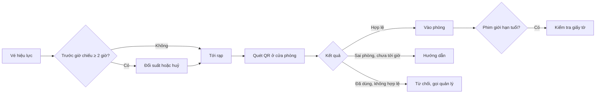

> **Mã:** DE08-TN05-PRD · **Trạng thái:** đã chốt · **Người viết:** Design · **SRS:** [SRS.md](SRS.md)

# PRD Soát vé, đổi và huỷ vé (Đặt vé xem phim)

## 1. Bối cảnh và vấn đề

### 1.1 Bối cảnh

Đây là các điểm kết thúc của vòng đời vé (xem [README](../../README.md)): nhân viên soát vé ở cửa phòng chiếu bằng thiết bị cầm tay; khách bận việc muốn đổi sang suất khác hoặc huỷ; rạp phải huỷ suất vì sự cố. Giờ cao điểm, 200 khách vào một phòng trong 10 phút; mạng trong rạp thường yếu.

### 1.2 Vấn đề

| **Vấn đề** | **Hệ quả** |
| --- | --- |
| Soát vé chậm, khách xếp hàng, vào trễ | Phim bắt đầu khi phòng còn đang vào |
| Mạng yếu, máy soát không kiểm tra được vé | Cho vào bừa hoặc chặn nhầm |
| Một vé chụp màn hình dùng hai lần | Mất doanh thu, tranh chấp ghế |
| Nhóm 4 người, 1 người tới trễ | Không biết cho vào thế nào |
| Không kiểm tra tuổi với phim T16, T18 | Vi phạm quy định phổ biến phim |
| Khách muốn đổi suất phải ra quầy | Mất thời gian, quầy đông |
| Rạp huỷ suất, phải gọi từng khách | Chậm, sót khách |

### 1.3 Mục tiêu

- Thời gian soát trung vị ≤ 3 giây mỗi lượt quét.
- 0 vé dùng hai lần khi thiết bị có mạng.
- ≥ 80% đổi, huỷ vé tự làm trong app.
- 100% khách của suất bị huỷ được báo và hoàn tiền tự động trong 15 phút.

## 2. Người dùng

| **Nhóm** | **Nhu cầu với tính năng này** |
| --- | --- |
| Nhân viên soát vé | Quét nhanh, kết quả rõ bằng màu và âm thanh, chạy cả khi mất mạng |
| Khách | Vào nhanh; nhóm tới lệch giờ vẫn vào được |
| Khách bận việc | Đổi suất, huỷ vé trong app |
| Quản lý rạp | Huỷ suất một lần, hệ thống tự báo và hoàn tiền |

## 3. Phạm vi

### 3.1 Trong phạm vi (MVP)

- App soát vé: chọn phòng, quét QR hoặc nhập mã, kết quả, soát từng phần, kiểm tra độ tuổi, chế độ offline.
- Khách đổi suất (cùng phim), huỷ vé có phí, trong thời hạn.
- Rạp huỷ suất (Web quản lý): hoàn tiền tự động, thông báo.
- Xử lý vé ảnh hưởng do đổi giờ suất, khoá ghế (TN01).

### 3.2 Ngoài phạm vi

- Cổng soát tự động (barrier).
- Đổi sang phim khác, đổi ghế trong app.
- Hoàn tiền bằng điểm, voucher.
- Bán vé tại quầy (dùng hệ thống quầy riêng).

## 4. Nguyên tắc sản phẩm

### 4.1 Một cái nhìn là đủ

Kết quả soát: màn hình đổi màu toàn bộ (xanh, vàng, đỏ), âm thanh khác nhau, chữ lớn; nhân viên không cần đọc kỹ.

### 4.2 Không mạng vẫn soát được

Vé được ký số và tải trước; mất mạng vẫn kiểm tra được, đồng bộ khi có mạng.

### 4.3 Chính sách rõ trước khi khách quyết định

Màn đổi, huỷ hiện phí, số tiền hoàn, thời gian nhận tiền trước khi xác nhận.

### 4.4 Lỗi của rạp, rạp chịu

Rạp huỷ suất hoặc đổi giờ → hoàn 100% hoặc đổi miễn phí, không cần khách yêu cầu.

## 5. Quy tắc nghiệp vụ

| **Quy tắc** | **Giá trị** |
| --- | --- |
| Khung giờ soát | Từ 30 phút trước giờ bắt đầu tới giờ kết thúc suất |
| Soát từng phần | Đơn nhiều ghế cho vào từng nhóm người |
| Đổi suất | Cùng phim, trong 7 ngày, cùng số ghế; ≥ 2 giờ trước giờ chiếu; miễn phí 1 lần mỗi đơn |
| Huỷ vé | ≥ 2 giờ trước giờ chiếu; hoàn 90% tổng (phí huỷ 10%) |
| Rạp huỷ suất | Hoàn 100% tự động |
| Rạp đổi giờ suất | Khách đổi, huỷ miễn phí 100%, không giới hạn thời điểm |
| Không đủ tuổi | Không được vào, không hoàn tiền |

## 6. Luồng trải nghiệm

| **Bước** | **Giai đoạn** | **Khách thấy** | **Nhân viên thấy** |
| --- | --- | --- | --- |
| 1 | Trước giờ chiếu | Đổi suất, huỷ trong app | – |
| 2 | Ở cửa phòng | Mở vé, QR sáng | Camera quét |
| 3 | Kết quả | – | Màu, phim, ghế, số người, cảnh báo tuổi |
| 4 | Sự cố | Push hoàn tiền nếu rạp huỷ | Danh sách vé ảnh hưởng |

## 7. Use Cases, User Stories và Acceptance Criteria

### UC1. Soát vé

#### US1.1 Soát nhanh

User Story: Là nhân viên soát vé giờ cao điểm, tôi muốn quét và biết ngay cho vào hay không.

AC01: Chọn phòng đang soát; camera luôn mở; quét liên tục không cần bấm.

AC02: Kết quả trong ≤ 1 giây: toàn màn đổi màu, âm thanh, rung; hiện phim, phòng, giờ, ghế, số người.

AC03: Vé đã dùng → hiện thời điểm và thiết bị đã soát.

AC04: QR không đọc được → nhập tay mã đặt vé.

#### US1.2 Nhóm tới lệch giờ

AC01: Đơn 4 ghế, 2 người tới → chọn "Cho vào 2 người"; lần quét sau còn 2.

#### US1.3 Kiểm tra tuổi

AC01: Phim T13, T16, T18 → kết quả kèm "Kiểm tra giấy tờ: sinh trước ngày {dd/mm/yyyy}"; nhân viên chọn Đủ tuổi / Không đủ tuổi cho từng người.

AC02: Không đủ tuổi → không cho vào, ghi nhận lý do.

#### US1.4 Không có mạng

AC01: Soát được bằng chữ ký QR và danh sách vé đã tải; biểu tượng "Offline" rõ ràng.

AC02: Có mạng lại → đồng bộ; soát trùng giữa các máy được gắn cờ.

### UC2. Khách đổi, huỷ vé

#### US2.1 Đổi suất

User Story: Là khách bận việc đột xuất, tôi muốn đổi sang suất tối mai của cùng phim.

AC01: Chỉ khi vé chưa soát và còn ≥ 2 giờ trước giờ chiếu.

AC02: Chọn suất mới (cùng phim, trong 7 ngày), chọn đủ số ghế; bắp nước chuyển theo.

AC03: Suất mới đắt hơn → trả thêm chênh lệch; rẻ hơn → không hoàn chênh lệch (ghi rõ).

AC04: Miễn phí 1 lần mỗi đơn; vé cũ chuyển "Đã đổi", vé mới có QR mới.

#### US2.2 Huỷ vé

AC01: Hiện phí huỷ 10%, số tiền hoàn, nơi nhận, thời gian.

AC02: Xác nhận → ghế nhả ngay, hoàn tiền.

### UC3. Rạp huỷ suất

#### US3.1 Huỷ suất một lần

User Story: Là quản lý rạp, khi máy chiếu hỏng tôi muốn huỷ suất và hệ thống tự lo phần khách.

AC01: Chọn suất, lý do; thấy số vé, tổng tiền sẽ hoàn trước khi xác nhận.

AC02: Xác nhận → mọi vé huỷ, hoàn 100% tự động (vé và bắp nước chưa nhận), push, email.

AC03: Suất đang chiếu bị dừng → bắp nước đã nhận không hoàn.

## 8. Chỉ số theo dõi

| **Chỉ số** | **Định nghĩa** | **Mục tiêu MVP** |
| --- | --- | --- |
| Thời gian soát | Quét → kết quả hiện (trung vị) | ≤ 1 giây; ≤ 3 giây mỗi lượt gồm thao tác |
| Vé dùng hai lần | Khi có mạng | 0 |
| Soát trùng offline | Lần gắn cờ / lần soát offline | Theo dõi |
| Tự đổi, huỷ | Đổi, huỷ trong app / tổng đổi, huỷ | ≥ 80% |
| Báo và hoàn khi rạp huỷ | Khách được hoàn ≤ 15 phút / khách của suất huỷ | 100% |
| Từ chối vì tuổi | Lượt không đủ tuổi / lượt kiểm tra | Theo dõi |

## 9. Phụ thuộc và rủi ro

| **Mục** | **Mô tả** | **Hướng xử lý** |
| --- | --- | --- |
| Mạng trong rạp | Yếu, chập chờn | Chế độ offline; tải trước vé 3 giờ tới |
| Nhiều cửa, nhiều máy | Soát trùng khi offline | Gắn cờ khi đồng bộ; quản lý xử lý |
| Cổng thanh toán | Hoàn tiền thẻ chậm | Hiện thời gian dự kiến theo phương thức |
| Quy định độ tuổi | Thay đổi | Mốc tuổi là cấu hình |

## 10. Câu hỏi mở

> Mọi câu hỏi dưới đây đã được PO chốt ngày 20/11/2026; quyết định ghi sau mỗi câu và đã cập nhật vào SRS.

- Cho vào trễ tới khi nào? → **Đã chốt:** Tới giờ kết thúc suất (SRS BR-48).
- Đổi suất có đổi được bắp nước? → **Đã chốt:** Bắp nước chuyển nguyên sang suất mới; không sửa (SRS BR-52).
- Rạp huỷ suất có cho khách chọn đổi suất thay vì hoàn? → **Đã chốt:** Hoàn 100% tự động; khách đặt lại nếu muốn (SRS BR-53).
- Vé chưa soát khi suất kết thúc có hoàn? → **Đã chốt:** Không (SRS BR-57).
