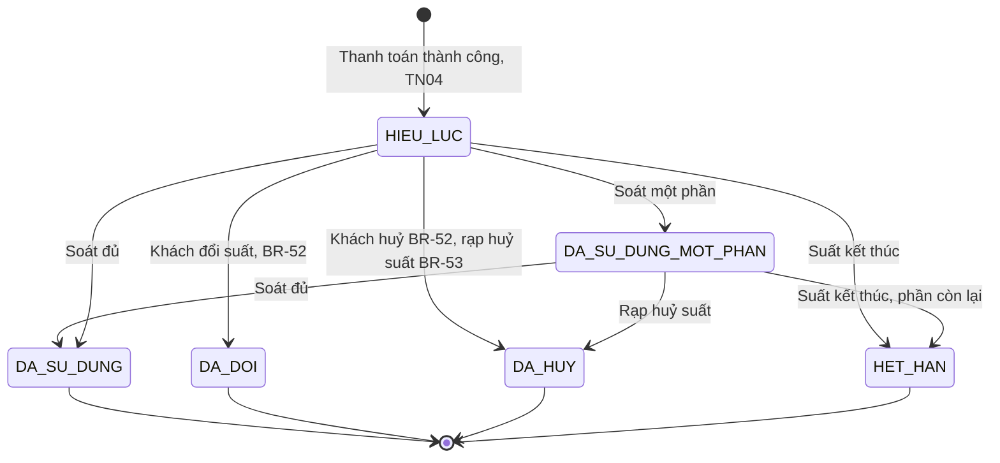
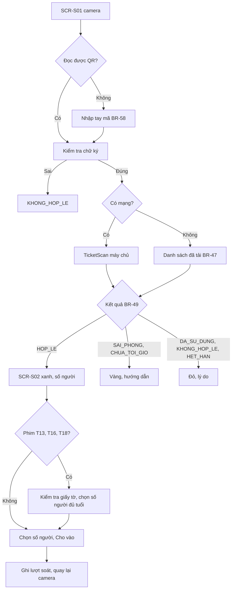
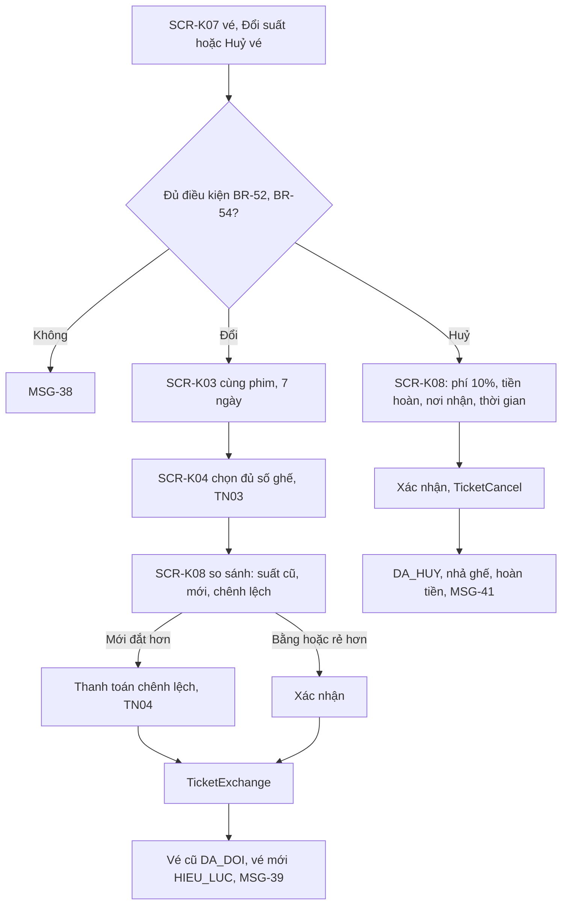
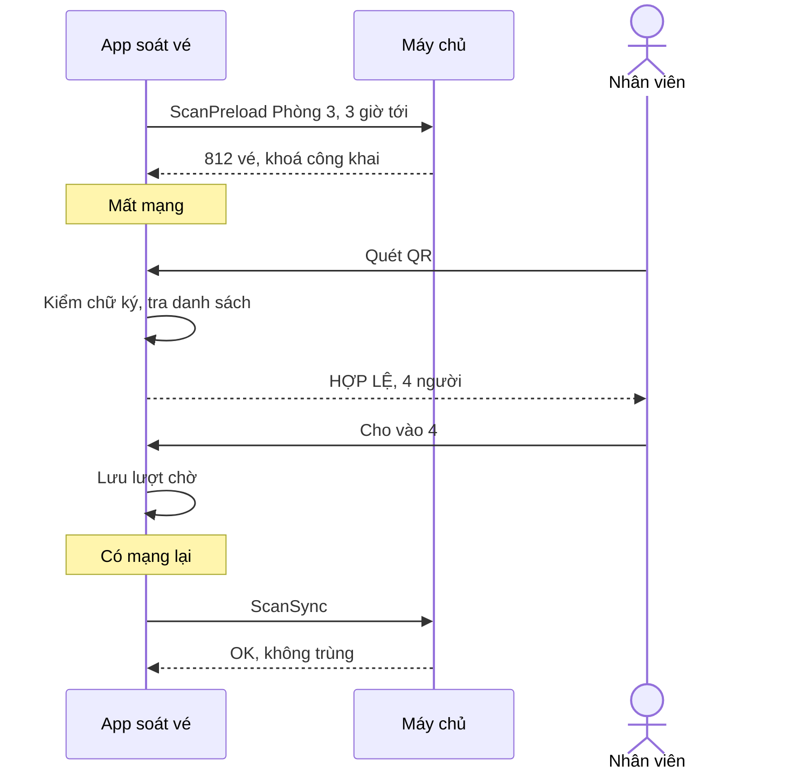

> **Mã:** DE08-TN05-SRS · **Trạng thái:** đã chốt · **Người viết:** Design · **PRD:** [PRD.md](PRD.md)

# UC-DE08-05 - Soát vé, đổi và huỷ vé

> SRS này mô tả vé từ `HIEU_LUC` ([SRS TN04](../TN04-bap-nuoc-thanh-toan/SRS.md)) tới `DA_SU_DUNG`, `DA_DOI`, `DA_HUY` hoặc `HET_HAN`; gồm App soát vé, đổi và huỷ của khách, và rạp huỷ suất trên Web quản lý.

## 1. Tổng quan

| **Mục** | **Nội dung** |
| --- | --- |
| Mục tiêu | Soát vé nhanh, đúng, cả khi mất mạng; khách tự đổi, huỷ; rạp huỷ suất và hoàn tiền tự động |
| Actor | Nhân viên soát vé · Khách · Quản lý rạp · App soát vé · App khách · Web quản lý · Máy chủ · Cổng thanh toán |
| Phạm vi | Chọn phòng, quét QR, nhập mã, kết quả, soát từng phần, kiểm tra tuổi, offline và đồng bộ, đổi suất, huỷ vé, huỷ suất, vé bị ảnh hưởng bởi đổi giờ và khoá ghế, hết hạn |
| Ngoài phạm vi | Cổng soát tự động, đổi phim, đổi ghế trong app, hoàn bằng voucher, bán tại quầy |
| Nền tảng | App soát vé (thiết bị cầm tay Android); App khách iOS / Android; Web quản lý |

## 2. User Story

| **ID** | **As a** | **I want** | **So that** |
| --- | --- | --- | --- |
| US-21 | Nhân viên soát vé | Biết ngay cho vào hay không | Khách vào nhanh |
| US-22 | Nhân viên soát vé | Soát được khi mất mạng | Không kẹt hàng |
| US-23 | Nhân viên soát vé | Biết khi nào phải kiểm tra tuổi | Tuân thủ phân loại phim |
| US-24 | Khách | Đổi suất, huỷ vé trong app | Không phải ra quầy |
| US-25 | Quản lý rạp | Huỷ suất một lần, hệ thống lo hoàn tiền | Xử lý sự cố nhanh |

## 3. Business Rules

| **Mã** | **Quy tắc** |
| --- | --- |
| BR-46 | **App soát vé**: nhân viên đăng nhập bằng tài khoản rạp; chọn chế độ **Soát vé** (chọn 1 phòng hoặc Tất cả phòng) hoặc **Quầy bắp nước** (TN04 BR-43). Camera quét liên tục; nút nhập tay mã đặt vé |
| BR-47 | **Dữ liệu offline**: tải trước danh sách vé (mã, suất, ghế, số người, trạng thái, phân loại phim) của mọi suất bắt đầu trong 3 giờ tới, cập nhật theo sự kiện khi có mạng. Offline: kiểm tra chữ ký QR + danh sách đã tải; lượt soát lưu chờ, đồng bộ khi có mạng |
| BR-48 | **Khung giờ soát**: từ 30 phút trước giờ bắt đầu tới giờ kết thúc suất. Trước khung → `CHUA_TOI_GIO`; sau khung → `HET_HAN` |
| BR-49 | **Kết quả soát** (toàn màn, màu, âm thanh): `HOP_LE` xanh – phim, phòng, giờ, ghế, số người còn được vào; `SAI_PHONG` vàng – "Phòng {x}", cho chuyển hướng; `CHUA_TOI_GIO` vàng – "Mở cửa lúc {giờ}"; `DA_SU_DUNG` đỏ – thời điểm, thiết bị, nhân viên đã soát; `KHONG_HOP_LE` đỏ – vé đã huỷ, đã đổi, không tồn tại, chữ ký sai; `HET_HAN` đỏ |
| BR-50 | **Soát từng phần**: đơn n ghế; mặc định cho vào tất cả số người còn lại; nhân viên giảm số người trước khi bấm "Cho vào". Vé `DA_SU_DUNG_MOT_PHAN` cho tới khi đủ n người → `DA_SU_DUNG` |
| BR-51 | **Kiểm tra tuổi**: phim T13, T16, T18 → kết quả `HOP_LE` có thêm khối vàng "Kiểm tra giấy tờ: sinh trước hoặc đúng ngày {ngày chiếu − n năm}"; nhân viên chọn số người đủ tuổi; người không đủ không được vào, ghi nhận lý do "Không đủ tuổi", không hoàn tiền. Phim K → nhắc "Trẻ dưới 13 tuổi cần đi cùng cha mẹ, người giám hộ" |
| BR-52 | **Khách đổi, huỷ**: chỉ vé `HIEU_LUC` chưa soát, còn ≥ 2 giờ tới giờ bắt đầu. **Đổi suất**: cùng phim, suất `MO_BAN` trong 7 ngày tới, cùng số ghế (chọn ghế theo TN03); miễn phí 1 lần mỗi đơn (vé đổi không đổi tiếp được); suất mới đắt hơn → trả thêm chênh lệch theo TN04; rẻ hơn → không hoàn chênh lệch; bắp nước chuyển nguyên. Vé cũ `DA_DOI`, ghế cũ nhả; vé mới mã, QR mới. **Huỷ**: hoàn 90% tổng (phí huỷ 10%, làm tròn 1.000 ₫) về nguồn: ví ngay, thẻ 5–7 ngày làm việc, QR 1 ngày làm việc (về tài khoản đã chuyển); ghế nhả ngay |
| BR-53 | **Rạp huỷ suất** (**SCR-W05**): quản lý chọn lý do (Sự cố kỹ thuật, Mất điện, Phim bị rút, Khác); xem số vé, tổng hoàn trước khi xác nhận; xác nhận lại bằng mật khẩu. Kết quả: suất `DA_HUY`; mọi vé `HIEU_LUC`, `DA_SU_DUNG_MOT_PHAN` → `DA_HUY`; hoàn 100% giá vé và bắp nước chưa nhận; bắp nước đã nhận không hoàn; push, email MSG-40 trong ≤ 15 phút; phiên đang giữ ghế của suất bị nhả (TN03 MSG-23) |
| BR-54 | **Suất đổi giờ** (TN01 BR-09): vé của suất được đổi suất, huỷ miễn phí 100%, không giới hạn 2 giờ, tới giờ bắt đầu mới; nhãn "Rạp đã đổi giờ" trên vé |
| BR-55 | **Ghế bị khoá** sau khi bán (TN01 BR-04): vé hiện nhãn "Cần đổi ghế tại quầy"; tại quầy quản lý đổi ghế hoặc huỷ vé hoàn 100% |
| BR-56 | **Soát trùng offline**: khi đồng bộ, nếu cùng vé được soát vượt số người trên nhiều thiết bị → lượt sau gắn cờ `SOAT_TRUNG`, thông báo quản lý ca (MSG-43) |
| BR-57 | **Hết hạn**: suất kết thúc mà vé chưa soát đủ → phần chưa soát `HET_HAN`, không hoàn |
| BR-58 | **Nhập tay**: mã đặt vé 8 ký tự; sai 5 lần liên tiếp trên một thiết bị trong 1 phút → khoá nhập tay 1 phút |

## 4. Trạng thái

### 4.1 Trạng thái vé (đầy đủ)

### 4.2 Hành động khách theo trạng thái vé

| **Trạng thái vé** | **Đổi suất** | **Huỷ** | **Ghi chú** |
| --- | --- | --- | --- |
| `HIEU_LUC`, ≥ 2 giờ, chưa đổi | Có (miễn phí 1 lần) | Có (phí 10%) | |
| `HIEU_LUC`, < 2 giờ | Không | Không | Trừ BR-54 |
| `HIEU_LUC`, suất đổi giờ | Có, miễn phí | Có, hoàn 100% | BR-54 |
| Vé đã đổi một lần | Không | Có (phí 10%) | |
| `DA_SU_DUNG_MOT_PHAN`, `DA_SU_DUNG`, `HET_HAN`, `DA_HUY`, `DA_DOI` | Không | Không | |

## 5. Use Case

### UC-10 Soát vé

| **Mục** | **Nội dung** |
| --- | --- |
| Tiền điều kiện | Nhân viên đăng nhập App soát vé, chọn phòng |
| Hậu điều kiện thành công | Lượt soát được ghi; vé cập nhật trạng thái |
| Hậu điều kiện thất bại | Khách không được vào; lượt từ chối được ghi lý do |

**Luồng chính**

| **Bước** | **Actor** | **Mô tả** |
| --- | --- | --- |
| 1 | Nhân viên | Chọn "Phòng 3"; **SCR-S01** mở camera |
| 2 | Khách | Đưa QR vé |
| 3 | App soát vé | Kiểm tra chữ ký; gọi \[TicketScan\] |
| 4 | Máy chủ | Vé `HIEU_LUC`, đúng phòng, trong khung giờ, 4 ghế chưa soát |
| 5 | App soát vé | **SCR-S02** xanh, âm "ting": "{Phim} · Phòng 3 · 19:45 · G5–G8 · 4 người" |
| 6 | Nhân viên | Bấm "Cho vào 4" |
| 7 | App soát vé | Gọi \[TicketAdmit\]; vé `DA_SU_DUNG`; tự quay về camera sau 1 giây |

**Luồng thay thế**

| **Mã** | **Điều kiện** | **Xử lý** |
| --- | --- | --- |
| A1 | Nhóm tới lệch | Giảm số người còn 2 → `DA_SU_DUNG_MOT_PHAN` (BR-50) |
| A2 | Phim T16 | Khối kiểm tra giấy tờ; nhân viên chọn 3/4 đủ tuổi → cho vào 3, ghi 1 "Không đủ tuổi" (BR-51) |
| A3 | Offline | Biểu tượng "Offline"; kết quả từ danh sách đã tải; lượt lưu chờ (BR-47) |
| A4 | Chế độ Tất cả phòng | Không có `SAI_PHONG`; kết quả hiện phòng to rõ |

**Luồng lỗi**

| **Mã** | **Điều kiện** | **Xử lý** |
| --- | --- | --- |
| E1 | Vé đã dùng | MSG-34 |
| E2 | Vé huỷ, đổi, không tồn tại, chữ ký sai | MSG-35 |
| E3 | Sai phòng, chưa tới giờ, hết hạn | MSG-36 |
| E4 | Nhập tay sai nhiều lần | MSG-37 |
| E5 | Soát trùng phát hiện khi đồng bộ | MSG-43 |

### UC-11 Khách đổi suất hoặc huỷ vé

| **Mục** | **Nội dung** |
| --- | --- |
| Tiền điều kiện | Vé thoả mục 4.2 |
| Hậu điều kiện thành công | Vé mới `HIEU_LUC` (đổi) hoặc vé `DA_HUY` và lệnh hoàn tiền (huỷ) |
| Hậu điều kiện thất bại | Vé giữ nguyên |

**Luồng chính (đổi suất)**

| **Bước** | **Actor** | **Mô tả** |
| --- | --- | --- |
| 1 | Khách | Ở vé bấm "Đổi suất" |
| 2 | App | Kiểm tra BR-52; mở **SCR-K03** chế độ đổi suất (chỉ phim này, 7 ngày) |
| 3 | Khách | Chọn suất mới, chọn 2 ghế (TN03, đồng hồ giữ chỗ áp dụng) |
| 4 | App | **SCR-K08**: suất cũ → suất mới, giá cũ, giá mới, chênh lệch +20.000 ₫ |
| 5 | Khách | Thanh toán chênh lệch (TN04) |
| 6 | Máy chủ | \[TicketExchange\]: vé cũ `DA_DOI`, ghế cũ nhả; vé mới `HIEU_LUC`; bắp nước chuyển theo |
| 7 | App | Mở vé mới; MSG-39 |

**Luồng thay thế**

| **Mã** | **Điều kiện** | **Xử lý** |
| --- | --- | --- |
| A1 | Huỷ vé | **SCR-K08** chế độ huỷ → \[TicketCancel\] → MSG-41 |
| A2 | Suất đổi giờ (BR-54) | Đổi, huỷ miễn phí 100%; **SCR-K08** ghi "Miễn phí do rạp đổi giờ" |
| A3 | Suất mới rẻ hơn | Ghi rõ "Không hoàn chênh lệch {x} ₫" trước khi xác nhận |

**Luồng lỗi**

| **Mã** | **Điều kiện** | **Xử lý** |
| --- | --- | --- |
| E1 | Không đủ điều kiện (< 2 giờ, đã đổi, đã soát) | MSG-38 |
| E2 | Hết giờ giữ ghế suất mới | Theo TN03 MSG-18; vé cũ giữ nguyên |
| E3 | Thanh toán chênh lệch thất bại | Theo TN04 MSG-25; vé cũ giữ nguyên |

### UC-12 Rạp huỷ suất

| **Mục** | **Nội dung** |
| --- | --- |
| Tiền điều kiện | Quản lý rạp đăng nhập Web; suất `MO_BAN` hoặc `DANG_CHIEU` |
| Hậu điều kiện thành công | Suất `DA_HUY`; mọi khách được hoàn và báo ≤ 15 phút |
| Hậu điều kiện thất bại | Suất giữ trạng thái |

**Luồng chính**

| **Bước** | **Actor** | **Mô tả** |
| --- | --- | --- |
| 1 | Quản lý rạp | Ở **SCR-W03** (TN01) mở suất → "Huỷ suất" → **SCR-W05** |
| 2 | Web | Hiện số đơn, số vé, bắp nước đã nhận, tổng tiền sẽ hoàn (BR-53) |
| 3 | Quản lý rạp | Chọn lý do "Sự cố kỹ thuật", nhập mật khẩu xác nhận |
| 4 | Web | Gọi \[ShowtimeCancel\] |
| 5 | Máy chủ | Suất `DA_HUY`; vé `DA_HUY`; tạo lệnh hoàn; nhả phiên giữ ghế; gửi MSG-40 |
| 6 | Web | Tiến độ "Đã báo {n}/{N} khách, đã tạo {n} lệnh hoàn"; MSG-44 khi xong |

**Luồng lỗi**

| **Mã** | **Điều kiện** | **Xử lý** |
| --- | --- | --- |
| E1 | Sai mật khẩu | Lỗi inline |
| E2 | Lệnh hoàn thất bại một số đơn | Danh sách đơn lỗi, nút "Thử lại"; hệ thống tự thử lại mỗi 15 phút |

## 6. Điểm vào

| **Điểm vào** | **Dẫn tới** | **Ghi chú** |
| --- | --- | --- |
| Mở App soát vé | Chọn chế độ, phòng → **SCR-S01** | |
| Vé ở **SCR-K07** → Đổi suất / Huỷ vé | UC-11 | |
| Push "Rạp đã đổi giờ" (TN01 MSG-07) | Vé với lựa chọn đổi, huỷ miễn phí | BR-54 |
| Panel suất ở **SCR-W03** → Huỷ suất | **SCR-W05** | |

## 7. Mô tả màn hình

### SCR-S01 Soát vé (App soát vé)

| **#** | **Thành phần** | **Loại** | **Hành vi** |
| --- | --- | --- | --- |
| 1 | Chế độ, phòng | Header | "Soát vé · Phòng 3"; chạm để đổi |
| 2 | Trạng thái mạng | Badge | Online / Offline; số lượt chờ đồng bộ |
| 3 | Camera | Camera view | Quét liên tục |
| 4 | Suất đang soát | List nhỏ | Suất trong khung giờ của phòng: giờ, phim, đã vào / tổng |
| 5 | Nhập mã | Button | Bàn phím 8 ký tự (BR-58) |
| 6 | Đèn | Icon | Bật đèn khi tối |

### SCR-S02 Kết quả soát

| **#** | **Thành phần** | **Loại** | **Hành vi** |
| --- | --- | --- | --- |
| 1 | Nền màu toàn màn | Background | Xanh, vàng, đỏ theo BR-49; âm, rung khác nhau |
| 2 | Tiêu đề | Text cực lớn | "HỢP LỆ", "SAI PHÒNG – Phòng 5", "ĐÃ SỬ DỤNG"… |
| 3 | Thông tin vé | Text | Phim, phòng, giờ, ghế |
| 4 | Số người | Stepper | Còn được vào; mặc định tối đa (BR-50) |
| 5 | Kiểm tra giấy tờ | Khối vàng | BR-51; stepper số người đủ tuổi |
| 6 | Lần soát trước | Text | Với `DA_SU_DUNG`: giờ, thiết bị, nhân viên |
| 7 | "Cho vào {n}" / "Đóng" | Button lớn | Tự quay về camera sau 1 giây với `HOP_LE` |

### SCR-K08 Đổi suất / Huỷ vé (App khách)

| **#** | **Thành phần** | **Loại** | **Hành vi** |
| --- | --- | --- | --- |
| 1 | Vé hiện tại | Card | Phim, suất, ghế, bắp nước, đã trả |
| 2 | Đổi: suất mới | Card | Suất, ghế mới, giá mới; mũi tên từ cũ sang mới |
| 3 | Chênh lệch | Text | "+{x} ₫ cần trả thêm" hoặc "Không hoàn chênh lệch {x} ₫" hoặc "Miễn phí do rạp đổi giờ" |
| 4 | Huỷ: tiền hoàn | Card | Tổng đã trả, phí huỷ 10%, tiền hoàn, nơi nhận, thời gian (BR-52) |
| 5 | Điều kiện | Text | "Mỗi vé được đổi miễn phí 1 lần, trước giờ chiếu ít nhất 2 giờ" |
| 6 | "Xác nhận đổi" / "Xác nhận huỷ" | Button | |

### SCR-W05 Huỷ suất chiếu (Web quản lý)

| **#** | **Thành phần** | **Loại** | **Bắt buộc** | **Validate / hành vi** |
| --- | --- | --- | --- | --- |
| 1 | Suất | Card | – | Phim, phòng, giờ, trạng thái |
| 2 | Ảnh hưởng | Table | – | Số đơn, vé, bắp nước đã nhận, tổng hoàn |
| 3 | Lý do | Select + Text | Có | BR-53 |
| 4 | Mật khẩu xác nhận | Password | Có | |
| 5 | "Huỷ suất" | Button đỏ | – | |
| 6 | Tiến độ | Progress | – | Báo khách, tạo lệnh hoàn; danh sách lỗi |

## 8. API

| **API** | **Request chính** | **Response chính** | **Timeout / retry** |
| --- | --- | --- | --- |
| \[ScanPreload\] | room_id hoặc all, window 3h | Danh sách vé, khoá công khai kiểm chữ ký | 15s / 3 lần; làm mới theo sự kiện |
| \[TicketScan\] | qr_payload hoặc code, room_id, device_id | Kết quả BR-49, vé, số người còn lại, rating | 2s / không retry (dùng offline) |
| \[TicketAdmit\] | ticket_id, count, age_rejected, device_id, offline_at | Trạng thái vé, cờ trùng | 3s / lưu chờ khi offline |
| \[ScanSync\] | lượt soát offline | Kết quả, cờ `SOAT_TRUNG` | 15s / thử lại tới khi thành công |
| \[TicketExchangeOptions\] | ticket_id | Đủ điều kiện, lý do, miễn phí hay không | 3s / 1 lần |
| \[TicketExchange\] | ticket_id, new_session_id, payment_id (nếu có) | Vé mới | 10s / idempotent |
| \[TicketCancelQuote\] | ticket_id | Phí, tiền hoàn, nơi nhận, thời gian | 3s / 1 lần |
| \[TicketCancel\] | ticket_id, idempotency_key | Trạng thái, refund_id | 10s / gửi lại cùng key |
| \[ShowtimeCancel\] (Web) | showtime_id, reason, password | job_id | 10s / 1 lần |
| \[ShowtimeCancelProgress\] (Web) | job_id | Đã báo, đã hoàn, lỗi | 3s / mỗi 3 giây |

**Map lỗi → thông báo**

| **Nhóm** | **Message** |
| --- | --- |
| Vé đã sử dụng | MSG-34 |
| Vé không hợp lệ | MSG-35 |
| Sai phòng, chưa tới giờ, hết hạn | MSG-36 |
| Nhập tay bị khoá | MSG-37 |
| Không đủ điều kiện đổi, huỷ | MSG-38 |
| Đổi suất thành công | MSG-39 |
| Rạp huỷ suất (gửi khách) | MSG-40 |
| Huỷ vé thành công | MSG-41 |
| Không đủ tuổi (ghi nhận) | MSG-42 |
| Soát trùng | MSG-43 |
| Huỷ suất xong (Web) | MSG-44 |

## 9. Danh sách thông báo

| **ID** | **Nơi hiện** | **Nội dung (VI)** |
| --- | --- | --- |
| MSG-34 | **SCR-S02** đỏ | ĐÃ SỬ DỤNG lúc {giờ} tại {thiết bị} bởi {nhân viên}. {Đã vào {k}/{n} người} |
| MSG-35 | **SCR-S02** đỏ | VÉ KHÔNG HỢP LỆ: {đã huỷ / đã đổi sang suất khác / không tồn tại / mã không đúng}. Mời khách tới quầy |
| MSG-36 | **SCR-S02** vàng, đỏ | {SAI PHÒNG – Vé của Phòng {x} / CHƯA TỚI GIỜ – Mở cửa lúc {giờ} / HẾT HẠN – Suất đã kết thúc} |
| MSG-37 | Toast | Nhập sai nhiều lần. Thử lại sau 1 phút |
| MSG-38 | Popup | Vé này không thể {đổi / huỷ}: {còn dưới 2 giờ tới giờ chiếu / đã đổi một lần / đã soát}. Vui lòng liên hệ quầy vé |
| MSG-39 | Toast | Đã đổi sang suất {ngày giờ}, ghế {ghế}. Vé mới đã thay vé cũ |
| MSG-40 | Push, email | Rất tiếc, suất {phim} {ngày giờ} đã bị huỷ ({lý do}). Bạn được hoàn {x} ₫ về {nguồn} trong {thời gian}. \[Đặt suất khác\] |
| MSG-41 | Toast | Đã huỷ vé. {x} ₫ sẽ được hoàn về {nguồn} trong {thời gian} |
| MSG-42 | **SCR-S02** | Đã ghi nhận {k} người không đủ tuổi, không vào phòng |
| MSG-43 | Thông báo quản lý ca | Vé {mã} được soát vượt số người trên {thiết bị A} và {thiết bị B} lúc {giờ}. Kiểm tra phòng {x} |
| MSG-44 | Toast Web | Đã huỷ suất; báo {N} khách, tạo {N} lệnh hoàn tiền {(m lỗi, đang thử lại)} |

## 10. Yêu cầu phi chức năng

| **Mục** | **Yêu cầu** |
| --- | --- |
| Hiệu năng | Kết quả soát ≤ 1 giây (online, p95), ≤ 300 ms (offline); đồng bộ lượt chờ ≤ 30 giây sau khi có mạng; báo và tạo lệnh hoàn cho suất huỷ ≤ 15 phút |
| Độ tin cậy | Soát online khoá theo vé (không vượt số người); offline gắn cờ trùng khi đồng bộ; dữ liệu soát không mất khi tắt máy |
| Bảo mật | QR ký số bằng khoá riêng của máy chủ; App soát vé chỉ có khoá công khai; thiết bị soát đăng ký với rạp; huỷ suất cần mật khẩu |
| Thiết bị | App soát vé chạy trên máy Android cầm tay; pin đủ ca 8 giờ ở chế độ quét liên tục; dùng được bằng một tay |
| Log / audit | Mọi lượt soát (thiết bị, nhân viên, thời điểm, kết quả, số người, từ chối tuổi), mọi đổi, huỷ, huỷ suất, lệnh hoàn |
| Tracking | Thời gian soát, tỉ lệ kết quả theo loại, tỉ lệ offline, soát trùng, đổi, huỷ (lý do), hoàn tiền theo nguồn |
| Accessibility | Kết quả soát phân biệt bằng màu **và** chữ, âm, rung; App khách đọc rõ số tiền hoàn và điều kiện |
